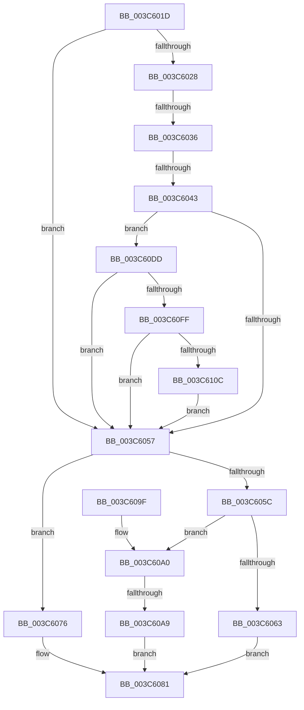

# sub_003C601D

- RVA: `0x003C601D`–`0x003C611D` (길이 `256` bytes)
- VA: `0x00000001403C601D`
- 실행 섹션: `.text`
- PDB 이름 있음: `아니요`; PDB Function 태그: `아니요`
- unwind 정보 RVA: `0x0008E4CC`
- 디코드: `60`개 명령, `256/256` bytes 표시
- 미해석 바이트: `0` (있으면 어셈블리에 `.byte`로 보존)

> 이 문서는 커널 이미지의 기계어와 PDB 기호를 분석해 생성했습니다. 4번과 5번은 함수 원형과 자료형을 바이너리 사용 방식에서 추정한 C 해석이며 원본 소스 복구 결과는 아닙니다.

## 1. Dependencies

- 직접 호출 지점: **2**; 고유 호출 대상: **2**
- 직접 호출자로 확인된 함수: **0**
- RIP 상대 이미지 참조: **1**

### Outgoing calls
- `0x003C60FF` → [KiRcuReportQuiescentState](../20/KiRcuReportQuiescentState_function_0020AB8C.md) (function, `0x0020AB8C`)
- `0x003C6113` → [KiRcuFlushCompleted](../20/KiRcuFlushCompleted_function_0020AD38.md) (function, `0x0020AD38`)

### Direct callers
- 이 함수 시작 RVA로 연결되는 직접 call은 확인되지 않았습니다. 간접 호출은 완전히 역산할 수 없습니다.

### Static image references
- `0x003C60E0` → RVA `0x00F110C0` (`.data`; read)

## 2. Other-region calls and transfers

- 다른 실행 섹션으로 향하는 call: **0**
- call이 아닌 외부 분기/꼬리 이동: **3**
  - `0x003C6030` → [sub_003C6144 + 0x1F](Unknown_function_003C6144.md) (`tail-transfer`)
  - `0x003C603D` → [sub_003C6144 + 0x11C](Unknown_function_003C6144.md) (`tail-transfer`)
  - `0x003C60A3` → [sub_003C6144](Unknown_function_003C6144.md) (`tail-transfer`)

## 3. Assembly (complete function range)

```asm
003C601D  4C 89 6C 24 58                  mov qword ptr [rsp + 0x58], r13
003C6022  80 7F 20 01                     cmp byte ptr [rdi + 0x20], 1
003C6026  77 2F                           ja 0x1403c6057
003C6028  48 83 BF F8 38 00 00 00         cmp qword ptr [rdi + 0x38f8], 0
003C6030  0F 85 2D 01 00 00               jne 0x1403c6163
003C6036  80 BF E5 38 00 00 00            cmp byte ptr [rdi + 0x38e5], 0
003C603D  0F 85 1D 02 00 00               jne 0x1403c6260
003C6043  48 8B 97 E8 38 00 00            mov rdx, qword ptr [rdi + 0x38e8]
003C604A  48 3B 97 F0 38 00 00            cmp rdx, qword ptr [rdi + 0x38f0]
003C6051  0F 85 86 00 00 00               jne 0x1403c60dd
003C6057  4D 85 F6                        test r14, r14
003C605A  74 1A                           je 0x1403c6076
003C605C  41 83 7E 04 00                  cmp dword ptr [r14 + 4], 0
003C6061  7C 3D                           jl 0x1403c60a0
003C6063  49 8B 0E                        mov rcx, qword ptr [r14]
003C6066  49 89 0F                        mov qword ptr [r15], rcx
003C6069  48 8B 4C 24 70                  mov rcx, qword ptr [rsp + 0x70]
003C606E  C7 01 01 00 00 00               mov dword ptr [rcx], 1
003C6074  EB 0B                           jmp 0x1403c6081
003C6076  48 8B 44 24 70                  mov rax, qword ptr [rsp + 0x70]
003C607B  C7 00 00 00 00 00               mov dword ptr [rax], 0
003C6081  4C 8B 6C 24 58                  mov r13, qword ptr [rsp + 0x58]
003C6086  8B C3                           mov eax, ebx
003C6088  48 8B 5C 24 60                  mov rbx, qword ptr [rsp + 0x60]
003C608D  48 8B 6C 24 68                  mov rbp, qword ptr [rsp + 0x68]
003C6092  48 83 C4 20                     add rsp, 0x20
003C6096  41 5F                           pop r15
003C6098  41 5E                           pop r14
003C609A  41 5C                           pop r12
003C609C  5F                              pop rdi
003C609D  5E                              pop rsi
003C609E  C3                              ret
003C609F  CC                              int3
003C60A0  40 84 ED                        test bpl, bpl
003C60A3  0F 85 9B 00 00 00               jne 0x1403c6144
003C60A9  48 B8 B0 03 00 00 80 F7 FF FF   movabs rax, 0xfffff780000003b0
003C60B3  48 B9 08 00 00 00 80 F7 FF FF   movabs rcx, 0xfffff78000000008
003C60BD  48 8B 00                        mov rax, qword ptr [rax]
003C60C0  48 8B 09                        mov rcx, qword ptr [rcx]
003C60C3  48 2B C8                        sub rcx, rax
003C60C6  48 8B 44 24 70                  mov rax, qword ptr [rsp + 0x70]
003C60CB  49 2B 0E                        sub rcx, qword ptr [r14]
003C60CE  48 2B 8E F8 00 00 00            sub rcx, qword ptr [rsi + 0xf8]
003C60D5  49 89 0F                        mov qword ptr [r15], rcx
003C60D8  44 89 20                        mov dword ptr [rax], r12d
003C60DB  EB A4                           jmp 0x1403c6081
003C60DD  8B 4F 24                        mov ecx, dword ptr [rdi + 0x24]
003C60E0  48 8D 05 D9 AF B4 00            lea rax, [rip + 0xb4afd9]
003C60E7  48 C1 E1 05                     shl rcx, 5
003C60EB  48 03 C8                        add rcx, rax
003C60EE  48 8B 41 08                     mov rax, qword ptr [rcx + 8]
003C60F2  4C 8B 40 38                     mov r8, qword ptr [rax + 0x38]
003C60F6  4C 85 01                        test qword ptr [rcx], r8
003C60F9  0F 85 58 FF FF FF               jne 0x1403c6057
003C60FF  E8 88 4A E4 FF                  call 0x14020ab8c
003C6104  85 C0                           test eax, eax
003C6106  0F 84 4B FF FF FF               je 0x1403c6057
003C610C  0F B6 8F E6 38 00 00            movzx ecx, byte ptr [rdi + 0x38e6]
003C6113  E8 20 4C E4 FF                  call 0x14020ad38
003C6118  E9 3A FF FF FF                  jmp 0x1403c6057
```

## 4. C-style interpretation (structured pseudocode)

```c
__int64 __fastcall sub_003C601D(__int64 a1, __int64 a2, __int64 a3, __int64 a4, __int64 a5, __int64 a6, __int64 a7, __int64 a8, __int64 a9, __int64 a10, __int64 a11, __int64 a12, __int64 a13, __int64 a14)
{
    __int64 result;
    __int64 v_rsp;
    unsigned __int64 v_stack_p58;

    v_stack_p58 = v_r13;
    if ((*(unsigned __int8 *)(v_rdi + 32)) > 1) goto loc_003C6057;
    if ((*(unsigned __int64 *)(v_rdi + 14568)) != (*(unsigned __int64 *)(v_rdi + 14576))) goto loc_003C60DD;
loc_003C6057:
    if (v_r14 == 0) goto loc_003C6076;
    if ((*(unsigned int *)(v_r14 + 4)) < 0) goto loc_003C60A0;
    *(unsigned __int64 *)(v_r15) = *(unsigned __int64 *)(v_r14);
    *(unsigned int *)(a14) = 1;
    goto loc_003C6081;
loc_003C6076:
    *(unsigned int *)(a14) = 0;
loc_003C6081:
    v_rsp = (v_rsp) + (32);
    return (unsigned int)((unsigned int)(v_rbx));
loc_003C60A0:
    a1 = (*(unsigned __int64 *)(a14)) - (*(unsigned __int64 *)((unsigned int)((unsigned int)(v_rbx))));
    a1 = (a1) - (*(unsigned __int64 *)(v_r14));
    a1 = (a1) - (*(unsigned __int64 *)(v_rsi + 248));
    *(unsigned __int64 *)(v_r15) = a1;
    *(unsigned int *)(a14) = (unsigned int)(v_r12);
    goto loc_003C6081;
loc_003C60DD:
    a1 = ((unsigned int)(*(unsigned int *)(v_rdi + 36))) << (5);
    a1 = (a1) + (v_rip + 11841497);
    if (((*(unsigned __int64 *)(a1)) & (*(unsigned __int64 *)(*(unsigned __int64 *)(a1 + 8) + 56))) != 0) goto loc_003C6057;
    result = KiRcuReportQuiescentState(a1, *(unsigned __int64 *)(v_rdi + 14568), *(unsigned __int64 *)(*(unsigned __int64 *)(a1 + 8) + 56), a4);
    if ((unsigned int)(result) == 0) goto loc_003C6057;
    result = KiRcuFlushCompleted(*(unsigned __int8 *)(v_rdi + 14566), *(unsigned __int64 *)(v_rdi + 14568), *(unsigned __int64 *)(*(unsigned __int64 *)(a1 + 8) + 56), a4);
    goto loc_003C6057;
}
```

## 5. (Beta) C Style

```c
int64_t sub_003C601D(int64_t Arg1, int64_t Arg2, int64_t Arg3, int64_t Arg4, uint64_t Arg5, uint64_t Arg6, uint64_t Arg7, uint64_t Arg8, uint64_t Arg9, uint64_t Arg10, int64_t Arg11, int64_t Arg12, int64_t Arg13, void *Arg14)
{
    uint8_t *arg14 = (uint8_t *)Arg14;

    int64_t result;
    int64_t local_rsp;
    uint64_t v_stack_p58;

    v_stack_p58 = local_r13;
    if ((*(uint8_t *)(local_rdi + 0x20)) > 1) goto loc_003C6057;
    if ((*(uint64_t *)(local_rdi + 0x38E8)) != (*(uint64_t *)(local_rdi + 0x38F0))) goto loc_003C60DD;
loc_003C6057:
    if (local_r14 == 0) goto loc_003C6076;
    if ((*(uint32_t *)(local_r14 + 0x4)) < 0) goto loc_003C60A0;
    *(uint64_t *)(local_r15) = *(uint64_t *)(local_r14);
    *(uint32_t *)(arg14) = 1;
    goto loc_003C6081;
loc_003C6076:
    *(uint32_t *)(arg14) = 0;
loc_003C6081:
    local_rsp = (local_rsp) + (32);
    return (uint32_t)((uint32_t)(local_rbx));
loc_003C60A0:
    Arg1 = (*(uint64_t *)(arg14)) - (*(uint64_t *)((uint32_t)((uint32_t)(local_rbx))));
    Arg1 = (Arg1) - (*(uint64_t *)(local_r14));
    Arg1 = (Arg1) - (*(uint64_t *)(local_rsi + 0xF8));
    *(uint64_t *)(local_r15) = Arg1;
    *(uint32_t *)(arg14) = (uint32_t)(local_r12);
    goto loc_003C6081;
loc_003C60DD:
    Arg1 = ((uint32_t)(*(uint32_t *)(local_rdi + 0x24))) << (5);
    Arg1 = (Arg1) + (v_rip + 11841497);
    if (((*(uint64_t *)(Arg1)) & (*(uint64_t *)(*(uint64_t *)(Arg1 + 0x8) + 0x38))) != 0) goto loc_003C6057;
    result = KiRcuReportQuiescentState(Arg1, *(uint64_t *)(local_rdi + 0x38E8), *(uint64_t *)(*(uint64_t *)(Arg1 + 0x8) + 0x38), Arg4);
    if ((uint32_t)(result) == 0) goto loc_003C6057;
    result = KiRcuFlushCompleted(*(uint8_t *)(local_rdi + 0x38E6), *(uint64_t *)(local_rdi + 0x38E8), *(uint64_t *)(*(uint64_t *)(Arg1 + 0x8) + 0x38), Arg4);
    goto loc_003C6057;
}
```

### 관측된 메모리 오프셋

구조체 형식이 확인되지 않은 접근은 인자 기준의 오프셋으로만 기록했습니다.

| 기준 인자 | 오프셋 표현 | 폭 (bit) | 접근 |
|---|---:|---:|---|
| `Arg14` | `+ 0x0` | `32` | `W` |

## 6. Execution-region graph

[열기: 2D/3D 그래프와 함수 탐색 컨트롤 패널](../../../control-panel.html?section=text&rva=0x003C601D&view=graph)

- 2D 그래프는 위에서 아래로 흐르고, 3D 그래프는 빈 공간을 드래그해 회전합니다. Shift+드래그는 이동, 휠은 확대·축소, 함수 노드 선택은 대상 보고서 이동입니다.

### Static fallback


