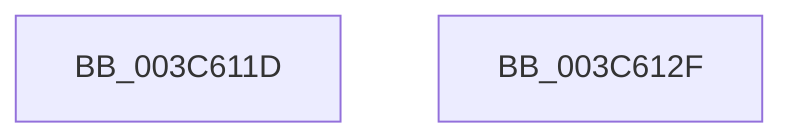

# sub_003C611D

- RVA: `0x003C611D`–`0x003C6144` (길이 `39` bytes)
- VA: `0x00000001403C611D`
- 실행 섹션: `.text`
- PDB 이름 있음: `아니요`; PDB Function 태그: `아니요`
- unwind 정보 RVA: `0x0008E4E4`
- 디코드: `10`개 명령, `39/39` bytes 표시
- 미해석 바이트: `0` (있으면 어셈블리에 `.byte`로 보존)

> 이 문서는 커널 이미지의 기계어와 PDB 기호를 분석해 생성했습니다. 4번과 5번은 함수 원형과 자료형을 바이너리 사용 방식에서 추정한 C 해석이며 원본 소스 복구 결과는 아닙니다.

## 1. Dependencies

- 직접 호출 지점: **1**; 고유 호출 대상: **1**
- 직접 호출자로 확인된 함수: **0**
- RIP 상대 이미지 참조: **0**

### Outgoing calls
- `0x003C6125` → [KiRaiseIrqlProcessIrqlFlags](../4F/KiRaiseIrqlProcessIrqlFlags_function_004F56FC.md) (function, `0x004F56FC`)

### Direct callers
- 이 함수 시작 RVA로 연결되는 직접 call은 확인되지 않았습니다. 간접 호출은 완전히 역산할 수 없습니다.

### Static image references
- 디코드된 RIP-relative 메모리 참조가 없습니다.

## 2. Other-region calls and transfers

- 다른 실행 섹션으로 향하는 call: **0**
- call이 아닌 외부 분기/꼬리 이동: **2**
  - `0x003C612A` → [KiCheckWaitNext + 0x4D](KiCheckWaitNext_function_003C5FC0.md) (`tail-transfer`)
  - `0x003C613F` → [KiCheckWaitNext + 0x54](KiCheckWaitNext_function_003C5FC0.md) (`tail-transfer`)

## 3. Assembly (complete function range)

```asm
003C611D  41 0F B6 D4                     movzx edx, r12b
003C6121  40 0F B6 CF                     movzx ecx, dil
003C6125  E8 D2 F5 12 00                  call 0x1404f56fc
003C612A  E9 DE FE FF FF                  jmp 0x1403c600d
003C612F  0F BA 71 74 10                  btr dword ptr [rcx + 0x74], 0x10
003C6134  0F 92 C3                        setb bl
003C6137  83 E3 01                        and ebx, 1
003C613A  03 DB                           add ebx, ebx
003C613C  83 CB 01                        or ebx, 1
003C613F  E9 D0 FE FF FF                  jmp 0x1403c6014
```

## 4. C-style interpretation (structured pseudocode)

```c
__int64 __fastcall sub_003C611D(void)
{
    __int64 result;

    result = KiRaiseIrqlProcessIrqlFlags((unsigned __int8)(v_rdi), (unsigned __int8)(v_r12), a3, a4);
}
```

## 5. (Beta) C Style

```c
void sub_003C611D(void)
{
    int64_t result;

    result = KiRaiseIrqlProcessIrqlFlags((uint8_t)(local_rdi), (uint8_t)(local_r12), a3, a4);
}
```

## 6. Execution-region graph

[열기: 2D/3D 그래프와 함수 탐색 컨트롤 패널](../../../control-panel.html?section=text&rva=0x003C611D&view=graph)

- 2D 그래프는 위에서 아래로 흐르고, 3D 그래프는 빈 공간을 드래그해 회전합니다. Shift+드래그는 이동, 휠은 확대·축소, 함수 노드 선택은 대상 보고서 이동입니다.

### Static fallback


