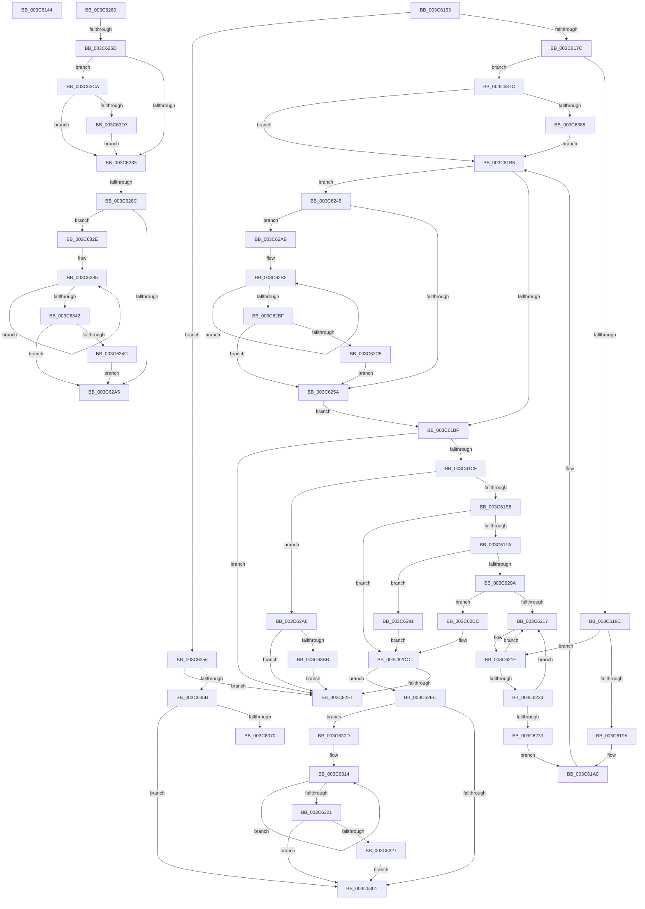

# sub_003C6144

- RVA: `0x003C6144`–`0x003C63F6` (길이 `690` bytes)
- VA: `0x00000001403C6144`
- 실행 섹션: `.text`
- PDB 이름 있음: `아니요`; PDB Function 태그: `아니요`
- unwind 정보 RVA: `0x0008E4F4`
- 디코드: `150`개 명령, `690/690` bytes 표시
- 미해석 바이트: `0` (있으면 어셈블리에 `.byte`로 보존)

> 이 문서는 커널 이미지의 기계어와 PDB 기호를 분석해 생성했습니다. 4번과 5번은 함수 원형과 자료형을 바이너리 사용 방식에서 추정한 C 해석이며 원본 소스 복구 결과는 아닙니다.

## 1. Dependencies

- 직접 호출 지점: **9**; 고유 호출 대상: **5**
- 직접 호출자로 확인된 함수: **0**
- RIP 상대 이미지 참조: **1**

### Outgoing calls
- `0x003C6149` → [RtlGetInterruptTimePrecise](../20/RtlGetInterruptTimePrecise_function_0020A4C0.md) (function, `0x0020A4C0`)
- `0x003C6163` → [KeDisableInterrupts](../21/KeDisableInterrupts_function_00217BE0.md) (function, `0x00217BE0`)
- `0x003C61E6` → [KeDisableInterrupts](../21/KeDisableInterrupts_function_00217BE0.md) (function, `0x00217BE0`)
- `0x003C626D` → [KeDisableInterrupts](../21/KeDisableInterrupts_function_00217BE0.md) (function, `0x00217BE0`)
- `0x003C62C5` → [KiRemoveSystemWorkPriorityKick](../26/KiRemoveSystemWorkPriorityKick_function_002631D0.md) (function, `0x002631D0`)
- `0x003C6327` → [KiRemoveSystemWorkPriorityKick](../26/KiRemoveSystemWorkPriorityKick_function_002631D0.md) (function, `0x002631D0`)
- `0x003C634C` → [KiRemoveSystemWorkPriorityKick](../26/KiRemoveSystemWorkPriorityKick_function_002631D0.md) (function, `0x002631D0`)
- `0x003C63AE` → [KiSrcuReportQuiescent](../5C/KiSrcuReportQuiescent_function_005C2C08.md) (function, `0x005C2C08`)
- `0x003C63C0` → [KiSrcuFlushCompleted](../5C/KiSrcuFlushCompleted_function_005C22B4.md) (function, `0x005C22B4`)

### Direct callers
- 이 함수 시작 RVA로 연결되는 직접 call은 확인되지 않았습니다. 간접 호출은 완전히 역산할 수 없습니다.

### Static image references
- `0x003C63E3` → RVA `0x00F210E8` (`.data`; read)

## 2. Other-region calls and transfers

- 다른 실행 섹션으로 향하는 call: **0**
- call이 아닌 외부 분기/꼬리 이동: **7**
  - `0x003C615E` → [sub_003C601D + 0xA6](Unknown_function_003C601D.md) (`tail-transfer`)
  - `0x003C6267` → [sub_003C601D + 0x26](Unknown_function_003C601D.md) (`tail-transfer`)
  - `0x003C6286` → [sub_003C601D + 0x26](Unknown_function_003C601D.md) (`tail-transfer`)
  - `0x003C62A6` → [sub_003C601D + 0x26](Unknown_function_003C601D.md) (`tail-transfer`)
  - `0x003C62E7` → [sub_003C601D + 0x19](Unknown_function_003C601D.md) (`tail-transfer`)
  - `0x003C6308` → [sub_003C601D + 0x19](Unknown_function_003C601D.md) (`tail-transfer`)
  - `0x003C6377` → [sub_006E81F0](../6E/Unknown_function_006E81F0.md) (`tail-transfer`)

## 3. Assembly (complete function range)

```asm
003C6144  48 8D 4C 24 50                  lea rcx, [rsp + 0x50]
003C6149  E8 72 43 E4 FF                  call 0x14020a4c0
003C614E  48 8B C8                        mov rcx, rax
003C6151  48 B8 B0 03 00 00 80 F7 FF FF   movabs rax, 0xfffff780000003b0
003C615B  48 8B 00                        mov rax, qword ptr [rax]
003C615E  E9 60 FF FF FF                  jmp 0x1403c60c3
003C6163  E8 78 1A E5 FF                  call 0x140217be0
003C6168  4C 8B A7 F8 38 00 00            mov r12, qword ptr [rdi + 0x38f8]
003C616F  44 0F B6 C0                     movzx r8d, al
003C6173  4D 85 E4                        test r12, r12
003C6176  0F 84 DA 01 00 00               je 0x1403c6356
003C617C  49 83 7C 24 F8 00               cmp qword ptr [r12 - 8], 0
003C6182  49 8B 04 24                     mov rax, qword ptr [r12]
003C6186  0F 85 F0 01 00 00               jne 0x1403c637c
003C618C  49 3B C4                        cmp rax, r12
003C618F  0F 85 89 00 00 00               jne 0x1403c621e
003C6195  48 C7 87 F8 38 00 00 00 00 00 00  mov qword ptr [rdi + 0x38f8], 0
003C61A0  49 8B 44 24 30                  mov rax, qword ptr [r12 + 0x30]
003C61A5  49 C7 04 24 00 00 00 00         mov qword ptr [r12], 0
003C61AD  48 8B 40 38                     mov rax, qword ptr [rax + 0x38]
003C61B1  49 89 44 24 10                  mov qword ptr [r12 + 0x10], rax
003C61B6  45 84 C0                        test r8b, r8b
003C61B9  0F 85 86 00 00 00               jne 0x1403c6245
003C61BF  4D 8B 44 24 10                  mov r8, qword ptr [r12 + 0x10]
003C61C4  4D 3B 44 24 18                  cmp r8, qword ptr [r12 + 0x18]
003C61C9  0F 84 12 01 00 00               je 0x1403c62e1
003C61CF  49 8B 44 24 28                  mov rax, qword ptr [r12 + 0x28]
003C61D4  49 8B 54 24 20                  mov rdx, qword ptr [r12 + 0x20]
003C61D9  48 8B 08                        mov rcx, qword ptr [rax]
003C61DC  48 85 4A 28                     test qword ptr [rdx + 0x28], rcx
003C61E0  0F 84 C0 01 00 00               je 0x1403c63a6
003C61E6  E8 F5 19 E5 FF                  call 0x140217be0
003C61EB  49 83 3C 24 00                  cmp qword ptr [r12], 0
003C61F0  44 0F B6 C0                     movzx r8d, al
003C61F4  0F 85 E2 00 00 00               jne 0x1403c62dc
003C61FA  48 8B 87 F8 38 00 00            mov rax, qword ptr [rdi + 0x38f8]
003C6201  48 85 C0                        test rax, rax
003C6204  0F 84 87 01 00 00               je 0x1403c6391
003C620A  48 8B 48 08                     mov rcx, qword ptr [rax + 8]
003C620E  48 39 01                        cmp qword ptr [rcx], rax
003C6211  0F 84 B5 00 00 00               je 0x1403c62cc
003C6217  B9 03 00 00 00                  mov ecx, 3
003C621C  CD 29                           int 0x29
003C621E  48 89 87 F8 38 00 00            mov qword ptr [rdi + 0x38f8], rax
003C6225  49 8B 0C 24                     mov rcx, qword ptr [r12]
003C6229  49 8B 44 24 08                  mov rax, qword ptr [r12 + 8]
003C622E  4C 39 61 08                     cmp qword ptr [rcx + 8], r12
003C6232  75 E3                           jne 0x1403c6217
003C6234  4C 39 20                        cmp qword ptr [rax], r12
003C6237  75 DE                           jne 0x1403c6217
003C6239  48 89 08                        mov qword ptr [rax], rcx
003C623C  48 89 41 08                     mov qword ptr [rcx + 8], rax
003C6240  E9 5B FF FF FF                  jmp 0x1403c61a0
003C6245  65 48 8B 0C 25 20 00 00 00      mov rcx, qword ptr gs:[0x20]
003C624E  4C 8B 81 B8 8E 00 00            mov r8, qword ptr [rcx + 0x8eb8]
003C6255  4D 85 C0                        test r8, r8
003C6258  75 51                           jne 0x1403c62ab
003C625A  FB                              sti
003C625B  E9 5F FF FF FF                  jmp 0x1403c61bf
003C6260  83 BF E0 38 00 00 00            cmp dword ptr [rdi + 0x38e0], 0
003C6267  0F 85 D6 FD FF FF               jne 0x1403c6043
003C626D  E8 6E 19 E5 FF                  call 0x140217be0
003C6272  80 BF E5 38 00 00 00            cmp byte ptr [rdi + 0x38e5], 0
003C6279  44 0F B6 C0                     movzx r8d, al
003C627D  0F 85 47 01 00 00               jne 0x1403c63ca
003C6283  45 84 C0                        test r8b, r8b
003C6286  0F 84 B7 FD FF FF               je 0x1403c6043
003C628C  65 48 8B 0C 25 20 00 00 00      mov rcx, qword ptr gs:[0x20]
003C6295  4C 8B 81 B8 8E 00 00            mov r8, qword ptr [rcx + 0x8eb8]
003C629C  4D 85 C0                        test r8, r8
003C629F  0F 85 89 00 00 00               jne 0x1403c632e
003C62A5  FB                              sti
003C62A6  E9 98 FD FF FF                  jmp 0x1403c6043
003C62AB  41 0F 0D 08                     prefetchw byte ptr [r8]
003C62AF  41 8B 00                        mov eax, dword ptr [r8]
003C62B2  8B D0                           mov edx, eax
003C62B4  0F BA F2 15                     btr edx, 0x15
003C62B8  F0 41 0F B1 10                  lock cmpxchg dword ptr [r8], edx
003C62BD  75 F3                           jne 0x1403c62b2
003C62BF  0F BA E0 15                     bt eax, 0x15
003C62C3  73 95                           jae 0x1403c625a
003C62C5  E8 06 CF E9 FF                  call 0x1402631d0
003C62CA  EB 8E                           jmp 0x1403c625a
003C62CC  49 89 04 24                     mov qword ptr [r12], rax
003C62D0  49 89 4C 24 08                  mov qword ptr [r12 + 8], rcx
003C62D5  4C 89 21                        mov qword ptr [rcx], r12
003C62D8  4C 89 60 08                     mov qword ptr [rax + 8], r12
003C62DC  45 84 C0                        test r8b, r8b
003C62DF  75 0B                           jne 0x1403c62ec
003C62E1  41 BC 02 00 00 00               mov r12d, 2
003C62E7  E9 4A FD FF FF                  jmp 0x1403c6036
003C62EC  65 48 8B 0C 25 20 00 00 00      mov rcx, qword ptr gs:[0x20]
003C62F5  4C 8B 81 B8 8E 00 00            mov r8, qword ptr [rcx + 0x8eb8]
003C62FC  4D 85 C0                        test r8, r8
003C62FF  75 0C                           jne 0x1403c630d
003C6301  FB                              sti
003C6302  41 BC 02 00 00 00               mov r12d, 2
003C6308  E9 29 FD FF FF                  jmp 0x1403c6036
003C630D  41 0F 0D 08                     prefetchw byte ptr [r8]
003C6311  41 8B 00                        mov eax, dword ptr [r8]
003C6314  8B D0                           mov edx, eax
003C6316  0F BA F2 15                     btr edx, 0x15
003C631A  F0 41 0F B1 10                  lock cmpxchg dword ptr [r8], edx
003C631F  75 F3                           jne 0x1403c6314
003C6321  0F BA E0 15                     bt eax, 0x15
003C6325  73 DA                           jae 0x1403c6301
003C6327  E8 A4 CE E9 FF                  call 0x1402631d0
003C632C  EB D3                           jmp 0x1403c6301
003C632E  41 0F 0D 08                     prefetchw byte ptr [r8]
003C6332  41 8B 00                        mov eax, dword ptr [r8]
003C6335  8B D0                           mov edx, eax
003C6337  0F BA F2 15                     btr edx, 0x15
003C633B  F0 41 0F B1 10                  lock cmpxchg dword ptr [r8], edx
003C6340  75 F3                           jne 0x1403c6335
003C6342  0F BA E0 15                     bt eax, 0x15
003C6346  0F 83 59 FF FF FF               jae 0x1403c62a5
003C634C  E8 7F CE E9 FF                  call 0x1402631d0
003C6351  E9 4F FF FF FF                  jmp 0x1403c62a5
003C6356  45 84 C0                        test r8b, r8b
003C6359  74 86                           je 0x1403c62e1
003C635B  65 48 8B 0C 25 20 00 00 00      mov rcx, qword ptr gs:[0x20]
003C6364  4C 8B 81 B8 8E 00 00            mov r8, qword ptr [rcx + 0x8eb8]
003C636B  4D 85 C0                        test r8, r8
003C636E  74 91                           je 0x1403c6301
003C6370  41 0F 0D 08                     prefetchw byte ptr [r8]
003C6374  41 8B 00                        mov eax, dword ptr [r8]
003C6377  E9 74 1E 32 00                  jmp 0x1406e81f0
003C637C  4C 3B E0                        cmp r12, rax
003C637F  0F 84 31 FE FF FF               je 0x1403c61b6
003C6385  48 89 87 F8 38 00 00            mov qword ptr [rdi + 0x38f8], rax
003C638C  E9 25 FE FF FF                  jmp 0x1403c61b6
003C6391  4D 89 64 24 08                  mov qword ptr [r12 + 8], r12
003C6396  4D 89 24 24                     mov qword ptr [r12], r12
003C639A  4C 89 A7 F8 38 00 00            mov qword ptr [rdi + 0x38f8], r12
003C63A1  E9 36 FF FF FF                  jmp 0x1403c62dc
003C63A6  49 8B D0                        mov rdx, r8
003C63A9  49 8D 4C 24 F8                  lea rcx, [r12 - 8]
003C63AE  E8 55 C8 1F 00                  call 0x1405c2c08
003C63B3  85 C0                           test eax, eax
003C63B5  0F 84 26 FF FF FF               je 0x1403c62e1
003C63BB  49 8B 4C 24 30                  mov rcx, qword ptr [r12 + 0x30]
003C63C0  E8 EF BE 1F 00                  call 0x1405c22b4
003C63C5  E9 17 FF FF FF                  jmp 0x1403c62e1
003C63CA  83 BF E0 38 00 00 00            cmp dword ptr [rdi + 0x38e0], 0
003C63D1  0F 85 AC FE FF FF               jne 0x1403c6283
003C63D7  C6 87 E5 38 00 00 00            mov byte ptr [rdi + 0x38e5], 0
003C63DE  F0 83 0C 24 00                  lock or dword ptr [rsp], 0
003C63E3  48 8B 05 FE AC B5 00            mov rax, qword ptr [rip + 0xb5acfe]
003C63EA  48 89 87 E8 38 00 00            mov qword ptr [rdi + 0x38e8], rax
003C63F1  E9 8D FE FF FF                  jmp 0x1403c6283
```

## 4. C-style interpretation (structured pseudocode)

```c
__int64 __fastcall sub_003C6144(__int64 a1, __int64 a2, __int64 a3, __int64 a4, __int64 a5, __int64 a6, __int64 a7, __int64 a8, __int64 a9, __int64 a10)
{
    __int64 result;
    unsigned int v_stack_p0;

    result = RtlGetInterruptTimePrecise(a10, a2, a3, a4);
}
```

## 5. (Beta) C Style

```c
int64_t sub_003C6144(int64_t Arg1, int64_t Arg2, int64_t Arg3, int64_t Arg4, uint64_t Arg5, uint64_t Arg6, uint64_t Arg7, uint64_t Arg8, uint64_t Arg9, int64_t Arg10)
{
    int64_t result;
    uint32_t v_stack_p0;

    result = RtlGetInterruptTimePrecise(Arg10, Arg2, Arg3, Arg4);
}
```

## 6. Execution-region graph

[열기: 2D/3D 그래프와 함수 탐색 컨트롤 패널](../../../control-panel.html?section=text&rva=0x003C6144&view=graph)

- 2D 그래프는 위에서 아래로 흐르고, 3D 그래프는 빈 공간을 드래그해 회전합니다. Shift+드래그는 이동, 휠은 확대·축소, 함수 노드 선택은 대상 보고서 이동입니다.

### Static fallback


