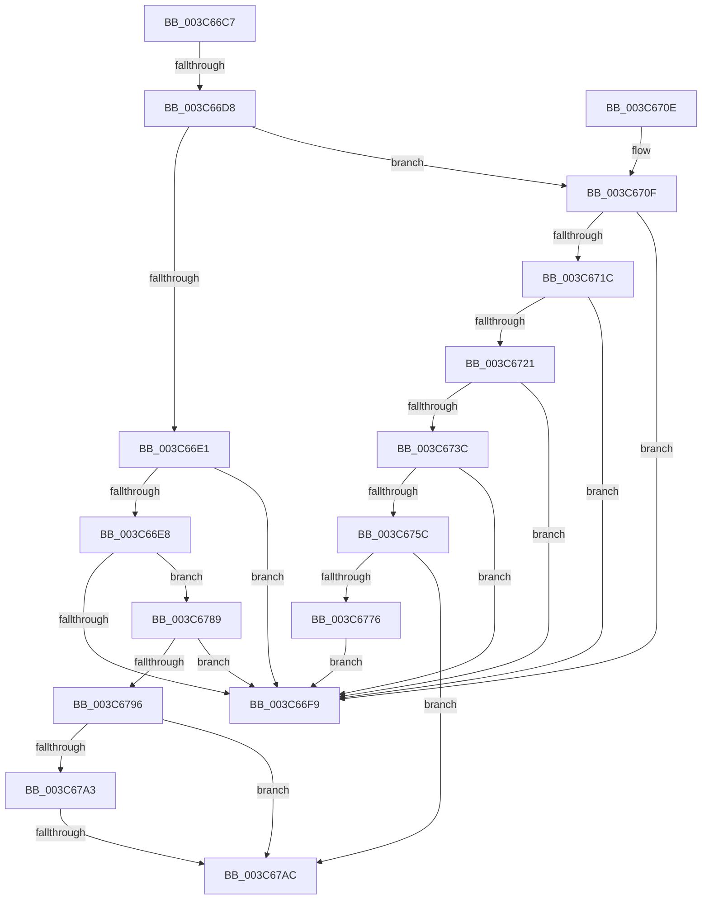

# sub_003C66C7

- RVA: `0x003C66C7`–`0x003C67B3` (길이 `236` bytes)
- VA: `0x00000001403C66C7`
- 실행 섹션: `.text`
- PDB 이름 있음: `아니요`; PDB Function 태그: `아니요`
- unwind 정보 RVA: `0x0008E560`
- 디코드: `69`개 명령, `236/236` bytes 표시
- 미해석 바이트: `0` (있으면 어셈블리에 `.byte`로 보존)

> 이 문서는 커널 이미지의 기계어와 PDB 기호를 분석해 생성했습니다. 4번과 5번은 함수 원형과 자료형을 바이너리 사용 방식에서 추정한 C 해석이며 원본 소스 복구 결과는 아닙니다.

## 1. Dependencies

- 직접 호출 지점: **2**; 고유 호출 대상: **2**
- 직접 호출자로 확인된 함수: **0**
- RIP 상대 이미지 참조: **0**

### Outgoing calls
- `0x003C672F` → [KiAttemptFastRemovePriQueue](KiAttemptFastRemovePriQueue_function_003C6AA0.md) (function, `0x003C6AA0`)
- `0x003C6753` → [KiWakePriQueueWaiter](../21/KiWakePriQueueWaiter_function_0021F720.md) (function, `0x0021F720`)

### Direct callers
- 이 함수 시작 RVA로 연결되는 직접 call은 확인되지 않았습니다. 간접 호출은 완전히 역산할 수 없습니다.

### Static image references
- 디코드된 RIP-relative 메모리 참조가 없습니다.

## 2. Other-region calls and transfers

- 다른 실행 섹션으로 향하는 call: **0**
- call이 아닌 외부 분기/꼬리 이동: **2**
  - `0x003C66D2` → [sub_003C67DC](Unknown_function_003C67DC.md) (`tail-transfer`)
  - `0x003C67A6` → [sub_003C6884](Unknown_function_003C6884.md) (`tail-transfer`)

## 3. Assembly (complete function range)

```asm
003C66C7  48 89 74 24 50                  mov qword ptr [rsp + 0x50], rsi
003C66CC  48 89 6F 40                     mov qword ptr [rdi + 0x40], rbp
003C66D0  84 C0                           test al, al
003C66D2  0F 84 04 01 00 00               je 0x1403c67dc
003C66D8  0F B6 03                        movzx eax, byte ptr [rbx]
003C66DB  24 7F                           and al, 0x7f
003C66DD  3C 15                           cmp al, 0x15
003C66DF  74 2E                           je 0x1403c670f
003C66E1  8B 01                           mov eax, dword ptr [rcx]
003C66E3  3B 43 2C                        cmp eax, dword ptr [rbx + 0x2c]
003C66E6  73 11                           jae 0x1403c66f9
003C66E8  48 8B 73 18                     mov rsi, qword ptr [rbx + 0x18]
003C66EC  48 8D 7B 18                     lea rdi, [rbx + 0x18]
003C66F0  48 3B F7                        cmp rsi, rdi
003C66F3  0F 85 90 00 00 00               jne 0x1403c6789
003C66F9  B8 7F FF FF FF                  mov eax, 0xffffff7f
003C66FE  F0 21 03                        lock and dword ptr [rbx], eax
003C6701  48 8B 74 24 50                  mov rsi, qword ptr [rsp + 0x50]
003C6706  48 83 C4 20                     add rsp, 0x20
003C670A  5F                              pop rdi
003C670B  5D                              pop rbp
003C670C  5B                              pop rbx
003C670D  C3                              ret
003C670E  CC                              int3
003C670F  48 8D 43 08                     lea rax, [rbx + 8]
003C6713  89 6C 24 40                     mov dword ptr [rsp + 0x40], ebp
003C6717  48 39 00                        cmp qword ptr [rax], rax
003C671A  74 DD                           je 0x1403c66f9
003C671C  39 6B 04                        cmp dword ptr [rbx + 4], ebp
003C671F  74 D8                           je 0x1403c66f9
003C6721  41 B8 FF FF FF FF               mov r8d, 0xffffffff
003C6727  48 8D 54 24 40                  lea rdx, [rsp + 0x40]
003C672C  48 8B CB                        mov rcx, rbx
003C672F  E8 6C 03 00 00                  call 0x1403c6aa0
003C6734  48 8B F8                        mov rdi, rax
003C6737  48 85 C0                        test rax, rax
003C673A  74 BD                           je 0x1403c66f9
003C673C  65 48 8B 0C 25 20 00 00 00      mov rcx, qword ptr gs:[0x20]
003C6745  4C 8B C0                        mov r8, rax
003C6748  48 63 74 24 40                  movsxd rsi, dword ptr [rsp + 0x40]
003C674D  48 8B D3                        mov rdx, rbx
003C6750  44 8B CE                        mov r9d, esi
003C6753  E8 C8 8F E5 FF                  call 0x14021f720
003C6758  84 C0                           test al, al
003C675A  75 9D                           jne 0x1403c66f9
003C675C  FF 43 04                        inc dword ptr [rbx + 4]
003C675F  48 8B CE                        mov rcx, rsi
003C6762  48 C1 E1 04                     shl rcx, 4
003C6766  48 83 C1 18                     add rcx, 0x18
003C676A  48 03 CB                        add rcx, rbx
003C676D  48 8B 01                        mov rax, qword ptr [rcx]
003C6770  48 39 48 08                     cmp qword ptr [rax + 8], rcx
003C6774  75 36                           jne 0x1403c67ac
003C6776  48 89 07                        mov qword ptr [rdi], rax
003C6779  48 89 4F 08                     mov qword ptr [rdi + 8], rcx
003C677D  48 89 78 08                     mov qword ptr [rax + 8], rdi
003C6781  48 89 39                        mov qword ptr [rcx], rdi
003C6784  E9 70 FF FF FF                  jmp 0x1403c66f9
003C6789  48 8D 43 08                     lea rax, [rbx + 8]
003C678D  48 39 00                        cmp qword ptr [rax], rax
003C6790  0F 84 63 FF FF FF               je 0x1403c66f9
003C6796  48 8B 0E                        mov rcx, qword ptr [rsi]
003C6799  48 8B 46 08                     mov rax, qword ptr [rsi + 8]
003C679D  48 39 71 08                     cmp qword ptr [rcx + 8], rsi
003C67A1  75 09                           jne 0x1403c67ac
003C67A3  48 39 30                        cmp qword ptr [rax], rsi
003C67A6  0F 84 D8 00 00 00               je 0x1403c6884
003C67AC  B9 03 00 00 00                  mov ecx, 3
003C67B1  CD 29                           int 0x29
```

## 4. C-style interpretation (structured pseudocode)

```c
__int64 __fastcall sub_003C66C7(__int64 a1, __int64 a2, __int64 a3, __int64 a4, __int64 a5, __int64 a6, __int64 a7, unsigned int a8, __int64 a9, __int64 a10)
{
    __int64 result;
    __int64 v_rsp;
    unsigned __int64 v_stack_p50;
    unsigned int v_stack_p78;

    v_stack_p50 = v_rsi;
    *(unsigned __int64 *)(v_rdi + 64) = v_rbp;
    result = (unsigned __int8)((*(unsigned __int8 *)(v_rbx)) & (127));
    if (((unsigned __int8)(result)) == 21) goto loc_003C670F;
    if (((unsigned int)((unsigned int)(*(unsigned int *)(a1)))) >= (*(unsigned int *)(v_rbx + 44))) goto loc_003C66F9;
    if ((*(unsigned __int64 *)(v_rbx + 24)) != (v_rbx + 24)) goto loc_003C6789;
loc_003C66F9:
    v_rsp = (v_rsp) + (32);
    return (unsigned int)(0xFFFFFF7FULL);
loc_003C670F:
    v_stack_p78 = (unsigned int)(v_rbp);
    if ((*(unsigned __int64 *)(v_rbx + 8)) == (v_rbx + 8)) goto loc_003C66F9;
    if ((*(unsigned int *)(v_rbx + 4)) == ((unsigned int)(v_rbp))) goto loc_003C66F9;
    result = KiAttemptFastRemovePriQueue(v_rbx, a8, (unsigned int)(0xFFFFFFFFULL), a4);
    if (result == 0) goto loc_003C66F9;
    result = KiWakePriQueueWaiter(*(unsigned __int64 *)(gs_base + (0 + 32)), v_rbx, result, (unsigned int)((unsigned int)((int)(a8))));
    if ((unsigned __int8)(result) != 0) goto loc_003C66F9;
    a1 = ((int)(a8)) << (4);
    a1 = (a1) + (24);
    a1 = (a1) + (v_rbx);
    if ((*(unsigned __int64 *)(*(unsigned __int64 *)(a1) + 8)) != a1) goto loc_003C67AC;
    *(unsigned __int64 *)(result) = *(unsigned __int64 *)(a1);
    *(unsigned __int64 *)(result + 8) = a1;
    *(unsigned __int64 *)(*(unsigned __int64 *)(a1) + 8) = result;
    *(unsigned __int64 *)(a1) = result;
    goto loc_003C66F9;
loc_003C6789:
    if ((*(unsigned __int64 *)(v_rbx + 8)) == (v_rbx + 8)) goto loc_003C66F9;
    if ((*(unsigned __int64 *)(*(unsigned __int64 *)((int)(a8)) + 8)) != ((int)(a8))) goto loc_003C67AC;
loc_003C67AC:
    return *(unsigned __int64 *)((int)(a8) + 8);
}
```

## 5. (Beta) C Style

```c
int64_t sub_003C66C7(void *Arg1, int64_t Arg2, int64_t Arg3, int64_t Arg4, uint64_t Arg5, uint64_t Arg6, uint64_t Arg7, uint32_t Arg8, uint64_t Arg9, int64_t Arg10)
{
    uint8_t *arg1 = (uint8_t *)Arg1;

    int64_t result;
    int64_t local_rsp;
    uint64_t v_stack_p50;
    uint32_t v_stack_p78;

    v_stack_p50 = local_rsi;
    *(uint64_t *)(local_rdi + 0x40) = local_rbp;
    result = (uint8_t)((*(uint8_t *)(local_rbx)) & (127));
    if (((uint8_t)(result)) == 21) goto loc_003C670F;
    if (((uint32_t)((uint32_t)(*(uint32_t *)(arg1)))) >= (*(uint32_t *)(local_rbx + 0x2C))) goto loc_003C66F9;
    if ((*(uint64_t *)(local_rbx + 0x18)) != (local_rbx + 24)) goto loc_003C6789;
loc_003C66F9:
    local_rsp = (local_rsp) + (32);
    return (uint32_t)(0xFFFFFF7FULL);
loc_003C670F:
    v_stack_p78 = (uint32_t)(local_rbp);
    if ((*(uint64_t *)(local_rbx + 0x8)) == (local_rbx + 8)) goto loc_003C66F9;
    if ((*(uint32_t *)(local_rbx + 0x4)) == ((uint32_t)(local_rbp))) goto loc_003C66F9;
    result = KiAttemptFastRemovePriQueue(local_rbx, Arg8, (uint32_t)(0xFFFFFFFFULL), Arg4);
    if (result == 0) goto loc_003C66F9;
    result = KiWakePriQueueWaiter(*(uint64_t *)(gs_base + (0 + 0x20)), local_rbx, result, (uint32_t)((uint32_t)((int32_t)(Arg8))));
    if ((uint8_t)(result) != 0) goto loc_003C66F9;
    Arg1 = ((int32_t)(Arg8)) << (4);
    Arg1 = (Arg1) + (24);
    Arg1 = (Arg1) + (local_rbx);
    if ((*(uint64_t *)(*(uint64_t *)(arg1) + 0x8)) != Arg1) goto loc_003C67AC;
    *(uint64_t *)(result) = *(uint64_t *)(arg1);
    *(void **)(result + 0x8) = Arg1;
    *(uint64_t *)(*(uint64_t *)(arg1) + 0x8) = result;
    *(uint64_t *)(arg1) = result;
    goto loc_003C66F9;
loc_003C6789:
    if ((*(uint64_t *)(local_rbx + 0x8)) == (local_rbx + 8)) goto loc_003C66F9;
    if ((*(uint64_t *)(*(uint64_t *)((int32_t)(Arg8)) + 0x8)) != ((int32_t)(Arg8))) goto loc_003C67AC;
loc_003C67AC:
    return *(uint64_t *)((int32_t)(Arg8) + 0x8);
}
```

### 관측된 메모리 오프셋

구조체 형식이 확인되지 않은 접근은 인자 기준의 오프셋으로만 기록했습니다.

| 기준 인자 | 오프셋 표현 | 폭 (bit) | 접근 |
|---|---:|---:|---|
| `Arg1` | `+ 0x0` | `32` | `R` |

## 6. Execution-region graph

[열기: 2D/3D 그래프와 함수 탐색 컨트롤 패널](../../../control-panel.html?section=text&rva=0x003C66C7&view=graph)

- 2D 그래프는 위에서 아래로 흐르고, 3D 그래프는 빈 공간을 드래그해 회전합니다. Shift+드래그는 이동, 휠은 확대·축소, 함수 노드 선택은 대상 보고서 이동입니다.

### Static fallback


