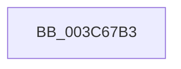

# sub_003C67B3

- RVA: `0x003C67B3`–`0x003C67DC` (길이 `41` bytes)
- VA: `0x00000001403C67B3`
- 실행 섹션: `.text`
- PDB 이름 있음: `아니요`; PDB Function 태그: `아니요`
- unwind 정보 RVA: `0x0008E578`
- 디코드: `9`개 명령, `41/41` bytes 표시
- 미해석 바이트: `0` (있으면 어셈블리에 `.byte`로 보존)

> 이 문서는 커널 이미지의 기계어와 PDB 기호를 분석해 생성했습니다. 4번과 5번은 함수 원형과 자료형을 바이너리 사용 방식에서 추정한 C 해석이며 원본 소스 복구 결과는 아닙니다.

## 1. Dependencies

- 직접 호출 지점: **0**; 고유 호출 대상: **0**
- 직접 호출자로 확인된 함수: **0**
- RIP 상대 이미지 참조: **0**

### Outgoing calls
- 직접 디코드된 call 명령이 없습니다.

### Direct callers
- 이 함수 시작 RVA로 연결되는 직접 call은 확인되지 않았습니다. 간접 호출은 완전히 역산할 수 없습니다.

### Static image references
- 디코드된 RIP-relative 메모리 참조가 없습니다.

## 2. Other-region calls and transfers

- 다른 실행 섹션으로 향하는 call: **0**
- call이 아닌 외부 분기/꼬리 이동: **1**
  - `0x003C67D7` → [KiActivateWaiterQueueWithThreadLock + 0x25](KiActivateWaiterQueueWithThreadLock_function_003C6690.md) (`tail-transfer`)

## 3. Assembly (complete function range)

```asm
003C67B3  8B 81 1C 02 00 00               mov eax, dword ptr [rcx + 0x21c]
003C67B9  0F B6 C0                        movzx eax, al
003C67BC  8B D0                           mov edx, eax
003C67BE  0F BA E8 08                     bts eax, 8
003C67C2  89 81 1C 02 00 00               mov dword ptr [rcx + 0x21c], eax
003C67C8  48 8D 83 18 02 00 00            lea rax, [rbx + 0x218]
003C67CF  48 8D 4B 28                     lea rcx, [rbx + 0x28]
003C67D3  48 8D 04 90                     lea rax, [rax + rdx*4]
003C67D7  E9 D9 FE FF FF                  jmp 0x1403c66b5
```

## 4. C-style interpretation (structured pseudocode)

```c
__int64 __fastcall sub_003C67B3(__int64 a1)
{
    *(unsigned int *)(a1 + 540) = (unsigned int)((unsigned __int8)((unsigned int)(*(unsigned int *)(a1 + 540))));
}
```

## 5. (Beta) C Style

```c
int64_t sub_003C67B3(void *Arg1)
{
    uint8_t *arg1 = (uint8_t *)Arg1;

    *(uint32_t *)(arg1 + 0x21C) = (uint32_t)((uint8_t)((uint32_t)(*(uint32_t *)(arg1 + 0x21C))));
}
```

### 관측된 메모리 오프셋

구조체 형식이 확인되지 않은 접근은 인자 기준의 오프셋으로만 기록했습니다.

| 기준 인자 | 오프셋 표현 | 폭 (bit) | 접근 |
|---|---:|---:|---|
| `Arg1` | `+ 0x21C` | `32` | `R` |
| `Arg1` | `+ 0x21C` | `32` | `W` |

## 6. Execution-region graph

[열기: 2D/3D 그래프와 함수 탐색 컨트롤 패널](../../../control-panel.html?section=text&rva=0x003C67B3&view=graph)

- 2D 그래프는 위에서 아래로 흐르고, 3D 그래프는 빈 공간을 드래그해 회전합니다. Shift+드래그는 이동, 휠은 확대·축소, 함수 노드 선택은 대상 보고서 이동입니다.

### Static fallback


