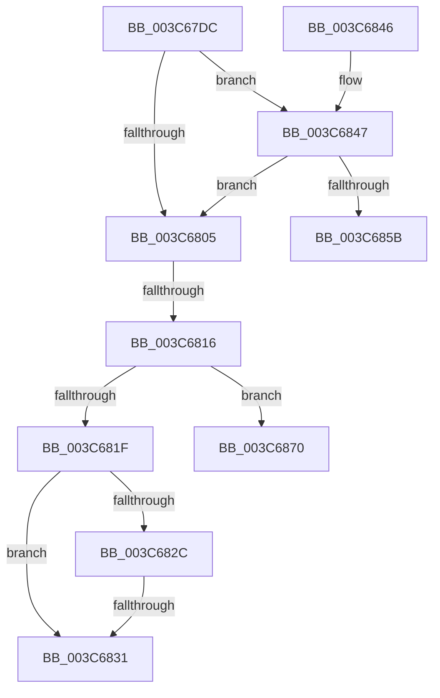

# sub_003C67DC

- RVA: `0x003C67DC`–`0x003C687D` (길이 `161` bytes)
- VA: `0x00000001403C67DC`
- 실행 섹션: `.text`
- PDB 이름 있음: `아니요`; PDB Function 태그: `아니요`
- unwind 정보 RVA: `0x0008E588`
- 디코드: `46`개 명령, `161/161` bytes 표시
- 미해석 바이트: `0` (있으면 어셈블리에 `.byte`로 보존)

> 이 문서는 커널 이미지의 기계어와 PDB 기호를 분석해 생성했습니다. 4번과 5번은 함수 원형과 자료형을 바이너리 사용 방식에서 추정한 C 해석이며 원본 소스 복구 결과는 아닙니다.

## 1. Dependencies

- 직접 호출 지점: **5**; 고유 호출 대상: **4**
- 직접 호출자로 확인된 함수: **0**
- RIP 상대 이미지 참조: **1**

### Outgoing calls
- `0x003C67F4` → [ExAcquireSpinLockSharedAtDpcLevel](../24/ExAcquireSpinLockSharedAtDpcLevel_function_00248E30.md) (function, `0x00248E30`)
- `0x003C6808` → [ExReleaseSpinLockSharedFromDpcLevel](../24/ExReleaseSpinLockSharedFromDpcLevel_function_0024A590.md) (function, `0x0024A590`)
- `0x003C684A` → [KiAcquireKobjectLockSafe](../25/KiAcquireKobjectLockSafe_function_00251C90.md) (function, `0x00251C90`)
- `0x003C6866` → [ExReleaseSpinLockSharedFromDpcLevel](../24/ExReleaseSpinLockSharedFromDpcLevel_function_0024A590.md) (function, `0x0024A590`)
- `0x003C6873` → [KiActivateWaiterKQueue](KiActivateWaiterKQueue_function_003C6950.md) (function, `0x003C6950`)

### Direct callers
- 이 함수 시작 RVA로 연결되는 직접 call은 확인되지 않았습니다. 간접 호출은 완전히 역산할 수 없습니다.

### Static image references
- `0x003C67E0` → RVA `0x00FD2D80` (`CACHEALI`; read)

## 2. Other-region calls and transfers

- 다른 실행 섹션으로 향하는 call: **0**
- call이 아닌 외부 분기/꼬리 이동: **4**
  - `0x003C6810` → [sub_003C66C7 + 0x3A](Unknown_function_003C66C7.md) (`tail-transfer`)
  - `0x003C682F` → [sub_003C6884 + 0x2A](Unknown_function_003C6884.md) (`tail-transfer`)
  - `0x003C686B` → [sub_003C66C7 + 0x3A](Unknown_function_003C66C7.md) (`tail-transfer`)
  - `0x003C6878` → [sub_003C66C7 + 0x3A](Unknown_function_003C66C7.md) (`tail-transfer`)

## 3. Assembly (complete function range)

```asm
003C67DC  48 C1 EB 04                     shr rbx, 4
003C67E0  48 8D 05 99 C5 C0 00            lea rax, [rip + 0xc0c599]
003C67E7  83 E3 3F                        and ebx, 0x3f
003C67EA  48 C1 E3 06                     shl rbx, 6
003C67EE  48 03 D8                        add rbx, rax
003C67F1  48 8B CB                        mov rcx, rbx
003C67F4  E8 37 26 E8 FF                  call 0x140248e30
003C67F9  48 8B B7 E8 00 00 00            mov rsi, qword ptr [rdi + 0xe8]
003C6800  48 85 F6                        test rsi, rsi
003C6803  75 42                           jne 0x1403c6847
003C6805  48 8B CB                        mov rcx, rbx
003C6808  E8 83 3D E8 FF                  call 0x14024a590
003C680D  48 85 F6                        test rsi, rsi
003C6810  0F 84 EB FE FF FF               je 0x1403c6701
003C6816  0F B6 06                        movzx eax, byte ptr [rsi]
003C6819  24 7F                           and al, 0x7f
003C681B  3C 15                           cmp al, 0x15
003C681D  75 51                           jne 0x1403c6870
003C681F  48 8D 46 08                     lea rax, [rsi + 8]
003C6823  89 6C 24 48                     mov dword ptr [rsp + 0x48], ebp
003C6827  48 39 00                        cmp qword ptr [rax], rax
003C682A  74 05                           je 0x1403c6831
003C682C  39 6E 04                        cmp dword ptr [rsi + 4], ebp
003C682F  75 7D                           jne 0x1403c68ae
003C6831  B8 7F FF FF FF                  mov eax, 0xffffff7f
003C6836  F0 21 06                        lock and dword ptr [rsi], eax
003C6839  48 8B 74 24 50                  mov rsi, qword ptr [rsp + 0x50]
003C683E  48 83 C4 20                     add rsp, 0x20
003C6842  5F                              pop rdi
003C6843  5D                              pop rbp
003C6844  5B                              pop rbx
003C6845  C3                              ret
003C6846  CC                              int3
003C6847  48 8B CE                        mov rcx, rsi
003C684A  E8 41 B4 E8 FF                  call 0x140251c90
003C684F  48 8B 87 E8 00 00 00            mov rax, qword ptr [rdi + 0xe8]
003C6856  48 85 C0                        test rax, rax
003C6859  75 AA                           jne 0x1403c6805
003C685B  B8 7F FF FF FF                  mov eax, 0xffffff7f
003C6860  F0 21 06                        lock and dword ptr [rsi], eax
003C6863  48 8B CB                        mov rcx, rbx
003C6866  E8 25 3D E8 FF                  call 0x14024a590
003C686B  E9 91 FE FF FF                  jmp 0x1403c6701
003C6870  48 8B CE                        mov rcx, rsi
003C6873  E8 D8 00 00 00                  call 0x1403c6950
003C6878  E9 84 FE FF FF                  jmp 0x1403c6701
```

## 4. C-style interpretation (structured pseudocode)

```c
__int64 __fastcall sub_003C67DC(__int64 a1, __int64 a2, __int64 a3, __int64 a4, __int64 a5, __int64 a6, __int64 a7, __int64 a8, __int64 a9, __int64 a10)
{
    __int64 result;
    __int64 v_rbx;
    __int64 v_rsp;
    unsigned int v_stack_p48;

    v_rbx = (v_rbx) >> (4);
    v_rbx = (unsigned int)((v_rbx) & (63));
    v_rbx = (v_rbx) << (6);
    v_rbx = (v_rbx) + (v_rip + 12633497);
    result = ExAcquireSpinLockSharedAtDpcLevel(v_rbx, a2, a3, a4);
    if (*(unsigned __int64 *)(v_rdi + 232) != 0) goto loc_003C6847;
loc_003C6805:
    result = ExReleaseSpinLockSharedFromDpcLevel(v_rbx, a2, a3, a4);
    result = (unsigned __int8)((*(unsigned __int8 *)(*(unsigned __int64 *)(v_rdi + 232))) & (127));
    if (((unsigned __int8)(result)) != 21) goto loc_003C6870;
    v_stack_p48 = (unsigned int)(v_rbp);
    if ((*(unsigned __int64 *)(*(unsigned __int64 *)(v_rdi + 232) + 8)) == (*(unsigned __int64 *)(v_rdi + 232) + 8)) goto loc_003C6831;
loc_003C6831:
    v_rsp = (v_rsp) + (32);
    return (unsigned int)(0xFFFFFF7FULL);
loc_003C6847:
    result = KiAcquireKobjectLockSafe(a10, a2, a3, a4);
    if (*(unsigned __int64 *)(v_rdi + 232) != 0) goto loc_003C6805;
    result = ExReleaseSpinLockSharedFromDpcLevel(v_rbx, a2, a3, a4);
loc_003C6870:
    result = KiActivateWaiterKQueue(a10, a2, a3, a4);
}
```

## 5. (Beta) C Style

```c
int64_t sub_003C67DC(int64_t Arg1, int64_t Arg2, int64_t Arg3, int64_t Arg4, uint64_t Arg5, uint64_t Arg6, uint64_t Arg7, uint64_t Arg8, uint64_t Arg9, int64_t Arg10)
{
    int64_t result;
    int64_t local_rbx;
    int64_t local_rsp;
    uint32_t v_stack_p48;

    local_rbx = (local_rbx) >> (4);
    local_rbx = (uint32_t)((local_rbx) & (63));
    local_rbx = (local_rbx) << (6);
    local_rbx = (local_rbx) + (v_rip + 12633497);
    result = ExAcquireSpinLockSharedAtDpcLevel(local_rbx, Arg2, Arg3, Arg4);
    if (*(uint64_t *)(local_rdi + 0xE8) != 0) goto loc_003C6847;
loc_003C6805:
    result = ExReleaseSpinLockSharedFromDpcLevel(local_rbx, Arg2, Arg3, Arg4);
    result = (uint8_t)((*(uint8_t *)(*(uint64_t *)(local_rdi + 0xE8))) & (127));
    if (((uint8_t)(result)) != 21) goto loc_003C6870;
    v_stack_p48 = (uint32_t)(local_rbp);
    if ((*(uint64_t *)(*(uint64_t *)(local_rdi + 0xE8) + 0x8)) == (*(uint64_t *)(local_rdi + 0xE8) + 8)) goto loc_003C6831;
loc_003C6831:
    local_rsp = (local_rsp) + (32);
    return (uint32_t)(0xFFFFFF7FULL);
loc_003C6847:
    result = KiAcquireKobjectLockSafe(Arg10, Arg2, Arg3, Arg4);
    if (*(uint64_t *)(local_rdi + 0xE8) != 0) goto loc_003C6805;
    result = ExReleaseSpinLockSharedFromDpcLevel(local_rbx, Arg2, Arg3, Arg4);
loc_003C6870:
    result = KiActivateWaiterKQueue(Arg10, Arg2, Arg3, Arg4);
}
```

## 6. Execution-region graph

[열기: 2D/3D 그래프와 함수 탐색 컨트롤 패널](../../../control-panel.html?section=text&rva=0x003C67DC&view=graph)

- 2D 그래프는 위에서 아래로 흐르고, 3D 그래프는 빈 공간을 드래그해 회전합니다. Shift+드래그는 이동, 휠은 확대·축소, 함수 노드 선택은 대상 보고서 이동입니다.

### Static fallback


