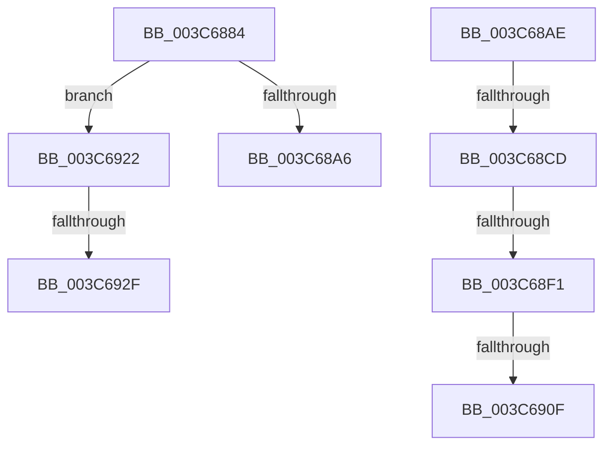

# sub_003C6884

- RVA: `0x003C6884`–`0x003C6942` (길이 `190` bytes)
- VA: `0x00000001403C6884`
- 실행 섹션: `.text`
- PDB 이름 있음: `아니요`; PDB Function 태그: `아니요`
- unwind 정보 RVA: `0x0008E5B0`
- 디코드: `47`개 명령, `190/190` bytes 표시
- 미해석 바이트: `0` (있으면 어셈블리에 `.byte`로 보존)

> 이 문서는 커널 이미지의 기계어와 PDB 기호를 분석해 생성했습니다. 4번과 5번은 함수 원형과 자료형을 바이너리 사용 방식에서 추정한 C 해석이며 원본 소스 복구 결과는 아닙니다.

## 1. Dependencies

- 직접 호출 지점: **3**; 고유 호출 대상: **3**
- 직접 호출자로 확인된 함수: **0**
- RIP 상대 이미지 참조: **0**

### Outgoing calls
- `0x003C689D` → [KiWakeQueueWaiter](../34/KiWakeQueueWaiter_function_00344C10.md) (function, `0x00344C10`)
- `0x003C68BC` → [KiAttemptFastRemovePriQueue](KiAttemptFastRemovePriQueue_function_003C6AA0.md) (function, `0x003C6AA0`)
- `0x003C68E4` → [KiWakePriQueueWaiter](../21/KiWakePriQueueWaiter_function_0021F720.md) (function, `0x0021F720`)

### Direct callers
- 이 함수 시작 RVA로 연결되는 직접 call은 확인되지 않았습니다. 간접 호출은 완전히 역산할 수 없습니다.

### Static image references
- 디코드된 RIP-relative 메모리 참조가 없습니다.

## 2. Other-region calls and transfers

- 다른 실행 섹션으로 향하는 call: **0**
- call이 아닌 외부 분기/꼬리 이동: **7**
  - `0x003C68A9` → [sub_003C66C7 + 0x32](Unknown_function_003C66C7.md) (`tail-transfer`)
  - `0x003C68C7` → [sub_003C67DC + 0x55](Unknown_function_003C67DC.md) (`tail-transfer`)
  - `0x003C68EB` → [sub_003C67DC + 0x55](Unknown_function_003C67DC.md) (`tail-transfer`)
  - `0x003C6909` → [sub_003C66C7 + 0xE5](Unknown_function_003C66C7.md) (`tail-transfer`)
  - `0x003C691D` → [sub_003C67DC + 0x55](Unknown_function_003C67DC.md) (`tail-transfer`)
  - `0x003C6929` → [sub_003C66C7 + 0xE5](Unknown_function_003C66C7.md) (`tail-transfer`)
  - `0x003C693D` → [sub_003C66C7 + 0x32](Unknown_function_003C66C7.md) (`tail-transfer`)

## 3. Assembly (complete function range)

```asm
003C6884  48 89 08                        mov qword ptr [rax], rcx
003C6887  4C 8B C6                        mov r8, rsi
003C688A  48 89 41 08                     mov qword ptr [rcx + 8], rax
003C688E  48 8B D3                        mov rdx, rbx
003C6891  48 89 2E                        mov qword ptr [rsi], rbp
003C6894  65 48 8B 0C 25 20 00 00 00      mov rcx, qword ptr gs:[0x20]
003C689D  E8 6E E3 F7 FF                  call 0x140344c10
003C68A2  84 C0                           test al, al
003C68A4  74 7C                           je 0x1403c6922
003C68A6  FF 4B 04                        dec dword ptr [rbx + 4]
003C68A9  E9 4B FE FF FF                  jmp 0x1403c66f9
003C68AE  41 B8 FF FF FF FF               mov r8d, 0xffffffff
003C68B4  48 8D 54 24 48                  lea rdx, [rsp + 0x48]
003C68B9  48 8B CE                        mov rcx, rsi
003C68BC  E8 DF 01 00 00                  call 0x1403c6aa0
003C68C1  48 8B D8                        mov rbx, rax
003C68C4  48 85 C0                        test rax, rax
003C68C7  0F 84 64 FF FF FF               je 0x1403c6831
003C68CD  65 48 8B 0C 25 20 00 00 00      mov rcx, qword ptr gs:[0x20]
003C68D6  4C 8B C0                        mov r8, rax
003C68D9  48 63 7C 24 48                  movsxd rdi, dword ptr [rsp + 0x48]
003C68DE  48 8B D6                        mov rdx, rsi
003C68E1  44 8B CF                        mov r9d, edi
003C68E4  E8 37 8E E5 FF                  call 0x14021f720
003C68E9  84 C0                           test al, al
003C68EB  0F 85 40 FF FF FF               jne 0x1403c6831
003C68F1  FF 46 04                        inc dword ptr [rsi + 4]
003C68F4  48 8B CF                        mov rcx, rdi
003C68F7  48 C1 E1 04                     shl rcx, 4
003C68FB  48 83 C1 18                     add rcx, 0x18
003C68FF  48 03 CE                        add rcx, rsi
003C6902  48 8B 01                        mov rax, qword ptr [rcx]
003C6905  48 39 48 08                     cmp qword ptr [rax + 8], rcx
003C6909  0F 85 9D FE FF FF               jne 0x1403c67ac
003C690F  48 89 03                        mov qword ptr [rbx], rax
003C6912  48 89 4B 08                     mov qword ptr [rbx + 8], rcx
003C6916  48 89 58 08                     mov qword ptr [rax + 8], rbx
003C691A  48 89 19                        mov qword ptr [rcx], rbx
003C691D  E9 0F FF FF FF                  jmp 0x1403c6831
003C6922  48 8B 07                        mov rax, qword ptr [rdi]
003C6925  48 39 78 08                     cmp qword ptr [rax + 8], rdi
003C6929  0F 85 7D FE FF FF               jne 0x1403c67ac
003C692F  48 89 06                        mov qword ptr [rsi], rax
003C6932  48 89 7E 08                     mov qword ptr [rsi + 8], rdi
003C6936  48 89 70 08                     mov qword ptr [rax + 8], rsi
003C693A  48 89 37                        mov qword ptr [rdi], rsi
003C693D  E9 B7 FD FF FF                  jmp 0x1403c66f9
```

## 4. C-style interpretation (structured pseudocode)

```c
__int64 __fastcall sub_003C6884(__int64 a1)
{
    __int64 result;
    unsigned __int64 v_stack_p48;

    *(unsigned __int64 *)(result) = a1;
    *(unsigned __int64 *)(a1 + 8) = result;
    *(unsigned __int64 *)(v_rsi) = v_rbp;
    result = KiWakeQueueWaiter(*(unsigned __int64 *)(gs_base + (0 + 32)), v_rbx, v_rsi, a4);
    if ((unsigned __int8)(result) == 0) goto loc_003C6922;
loc_003C6922:
    *(unsigned __int64 *)(v_rsi) = *(unsigned __int64 *)(v_rdi);
    *(unsigned __int64 *)(v_rsi + 8) = v_rdi;
    *(unsigned __int64 *)(*(unsigned __int64 *)(v_rdi) + 8) = v_rsi;
    *(unsigned __int64 *)(v_rdi) = v_rsi;
}
```

## 5. (Beta) C Style

```c
int64_t sub_003C6884(void *Arg1)
{
    uint8_t *arg1 = (uint8_t *)Arg1;

    int64_t result;
    uint64_t v_stack_p48;

    *(void **)(result) = Arg1;
    *(uint64_t *)(arg1 + 0x8) = result;
    *(uint64_t *)(local_rsi) = local_rbp;
    result = KiWakeQueueWaiter(*(uint64_t *)(gs_base + (0 + 0x20)), local_rbx, local_rsi, a4);
    if ((uint8_t)(result) == 0) goto loc_003C6922;
loc_003C6922:
    *(uint64_t *)(local_rsi) = *(uint64_t *)(local_rdi);
    *(uint64_t *)(local_rsi + 0x8) = local_rdi;
    *(uint64_t *)(*(uint64_t *)(local_rdi) + 0x8) = local_rsi;
    *(uint64_t *)(local_rdi) = local_rsi;
}
```

### 관측된 메모리 오프셋

구조체 형식이 확인되지 않은 접근은 인자 기준의 오프셋으로만 기록했습니다.

| 기준 인자 | 오프셋 표현 | 폭 (bit) | 접근 |
|---|---:|---:|---|
| `Arg1` | `+ 0x8` | `64` | `W` |

## 6. Execution-region graph

[열기: 2D/3D 그래프와 함수 탐색 컨트롤 패널](../../../control-panel.html?section=text&rva=0x003C6884&view=graph)

- 2D 그래프는 위에서 아래로 흐르고, 3D 그래프는 빈 공간을 드래그해 회전합니다. Shift+드래그는 이동, 휠은 확대·축소, 함수 노드 선택은 대상 보고서 이동입니다.

### Static fallback


