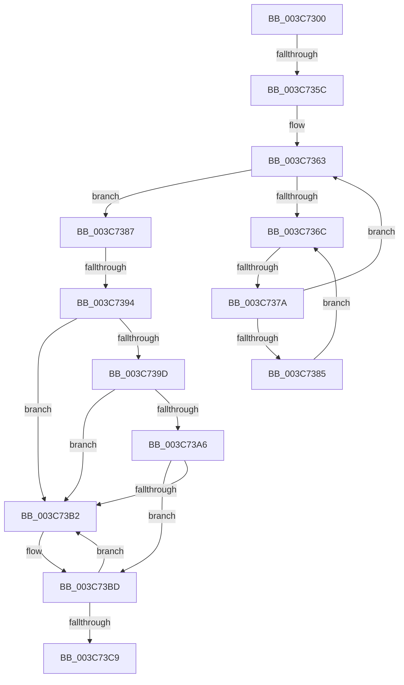

# sub_003C7300

- RVA: `0x003C7300`–`0x003C73D7` (길이 `215` bytes)
- VA: `0x00000001403C7300`
- 실행 섹션: `.text`
- PDB 이름 있음: `아니요`; PDB Function 태그: `아니요`
- unwind 정보 RVA: `0x0008E658`
- 디코드: `48`개 명령, `215/215` bytes 표시
- 미해석 바이트: `0` (있으면 어셈블리에 `.byte`로 보존)

> 이 문서는 커널 이미지의 기계어와 PDB 기호를 분석해 생성했습니다. 4번과 5번은 함수 원형과 자료형을 바이너리 사용 방식에서 추정한 C 해석이며 원본 소스 복구 결과는 아닙니다.

## 1. Dependencies

- 직접 호출 지점: **1**; 고유 호출 대상: **1**
- 직접 호출자로 확인된 함수: **0**
- RIP 상대 이미지 참조: **2**

### Outgoing calls
- `0x003C73B7` → [KeBugCheck](../4F/KeBugCheck_function_004FD640.md) (function, `0x004FD640`)

### Direct callers
- 이 함수 시작 RVA로 연결되는 직접 call은 확인되지 않았습니다. 간접 호출은 완전히 역산할 수 없습니다.

### Static image references
- `0x003C7350` → RVA `0x00FC6D20` (`ALMOSTRO`; read)
- `0x003C736E` → RVA `0x00FC52AC` (`ALMOSTRO`; reference)

## 2. Other-region calls and transfers

- 다른 실행 섹션으로 향하는 call: **0**
- call이 아닌 외부 분기/꼬리 이동: **3**
  - `0x003C7356` → [sub_003C763E](Unknown_function_003C763E.md) (`tail-transfer`)
  - `0x003C7374` → [sub_003C763E + 0x11](Unknown_function_003C763E.md) (`tail-transfer`)
  - `0x003C738E` → [sub_003C76A0](Unknown_function_003C76A0.md) (`tail-transfer`)

## 3. Assembly (complete function range)

```asm
003C7300  49 89 5B 08                     mov qword ptr [r11 + 8], rbx
003C7304  65 48 8B 1C 25 88 01 00 00      mov rbx, qword ptr gs:[0x188]
003C730D  49 89 6B 10                     mov qword ptr [r11 + 0x10], rbp
003C7311  33 ED                           xor ebp, ebp
003C7313  49 89 73 18                     mov qword ptr [r11 + 0x18], rsi
003C7317  48 8D B0 58 02 00 00            lea rsi, [rax + 0x258]
003C731E  49 89 6B A8                     mov qword ptr [r11 - 0x58], rbp
003C7322  F3 0F 7F 44 24 48               movdqu xmmword ptr [rsp + 0x48], xmm0
003C7328  49 89 7B F8                     mov qword ptr [r11 - 8], rdi
003C732C  4D 89 7B E8                     mov qword ptr [r11 - 0x18], r15
003C7330  4C 8B BB B8 00 00 00            mov r15, qword ptr [rbx + 0xb8]
003C7337  49 89 6B C0                     mov qword ptr [r11 - 0x40], rbp
003C733B  49 89 6B D0                     mov qword ptr [r11 - 0x30], rbp
003C733F  49 89 6B C8                     mov qword ptr [r11 - 0x38], rbp
003C7343  44 0F 20 C7                     mov rdi, cr8
003C7347  B8 02 00 00 00                  mov eax, 2
003C734C  44 0F 22 C0                     mov cr8, rax
003C7350  39 2D CA F9 BF 00               cmp dword ptr [rip + 0xbff9ca], ebp
003C7356  0F 85 E2 02 00 00               jne 0x1403c763e
003C735C  40 88 7C 24 20                  mov byte ptr [rsp + 0x20], dil
003C7361  8B FD                           mov edi, ebp
003C7363  F0 48 0F BA 6B 40 00            lock bts qword ptr [rbx + 0x40], 0
003C736A  73 1B                           jae 0x1403c7387
003C736C  FF C7                           inc edi
003C736E  85 3D 38 DF BF 00               test dword ptr [rip + 0xbfdf38], edi
003C7374  0F 84 D5 02 00 00               je 0x1403c764f
003C737A  F3 90                           pause
003C737C  48 8B 43 40                     mov rax, qword ptr [rbx + 0x40]
003C7380  48 85 C0                        test rax, rax
003C7383  74 DE                           je 0x1403c7363
003C7385  EB E5                           jmp 0x1403c736c
003C7387  40 38 AB C1 00 00 00            cmp byte ptr [rbx + 0xc1], bpl
003C738E  0F 85 0C 03 00 00               jne 0x1403c76a0
003C7394  40 38 AB 4A 02 00 00            cmp byte ptr [rbx + 0x24a], bpl
003C739B  74 15                           je 0x1403c73b2
003C739D  F6 83 C0 00 00 00 01            test byte ptr [rbx + 0xc0], 1
003C73A4  75 0C                           jne 0x1403c73b2
003C73A6  48 8D BB 98 00 00 00            lea rdi, [rbx + 0x98]
003C73AD  48 39 3F                        cmp qword ptr [rdi], rdi
003C73B0  74 0B                           je 0x1403c73bd
003C73B2  B9 06 00 00 00                  mov ecx, 6
003C73B7  E8 84 62 13 00                  call 0x1404fd640
003C73BC  CC                              int3
003C73BD  48 8D 83 A8 00 00 00            lea rax, [rbx + 0xa8]
003C73C4  48 39 00                        cmp qword ptr [rax], rax
003C73C7  75 E9                           jne 0x1403c73b2
003C73C9  81 4B 74 00 08 00 00            or dword ptr [rbx + 0x74], 0x800
003C73D0  48 8D 8B 58 02 00 00            lea rcx, [rbx + 0x258]
```

## 4. C-style interpretation (structured pseudocode)

```c
__int64 __fastcall sub_003C7300(void)
{
    __int64 result;
    __int64 v_rbp;
    __int64 v_rdi;
    unsigned __int8 v_stack_p20;
    unsigned __int64 v_stack_p48;

    *(unsigned __int64 *)(v_r11 + 8) = v_rbx;
    *(unsigned __int64 *)(v_r11 + 16) = v_rbp;
    v_rbp = 0;
    *(unsigned __int64 *)(v_r11 + 24) = v_rsi;
    *(unsigned __int64 *)(v_r11 - 88) = 0;
    v_stack_p48 = v_xmm0;
    *(unsigned __int64 *)(v_r11 - 8) = v_rdi;
    *(unsigned __int64 *)(v_r11 - 24) = v_r15;
    *(unsigned __int64 *)(v_r11 - 64) = 0;
    *(unsigned __int64 *)(v_r11 - 48) = 0;
    *(unsigned __int64 *)(v_r11 - 56) = 0;
    v_stack_p20 = (unsigned __int8)(v_cr8);
loc_003C7363:
    if ((*(unsigned int *)(v_rip + 12581322)) >= 0) goto loc_003C7387;
loc_003C736C:
    v_rdi = (unsigned int)((0) + 1);
    if (*(unsigned __int64 *)(*(unsigned __int64 *)(gs_base + (0 + 392)) + 64) == 0) goto loc_003C7363;
    goto loc_003C736C;
loc_003C7387:
    if ((*(unsigned __int8 *)(*(unsigned __int64 *)(gs_base + (0 + 392)) + 586)) == 0) goto loc_003C73B2;
    if (((*(unsigned __int8 *)(*(unsigned __int64 *)(gs_base + (0 + 392)) + 192)) & (1)) != 0) goto loc_003C73B2;
    result = *(unsigned __int64 *)(*(unsigned __int64 *)(gs_base + (0 + 392)) + 64);
    if ((*(unsigned __int64 *)(*(unsigned __int64 *)(gs_base + (0 + 392)) + 152)) != (*(unsigned __int64 *)(gs_base + (0 + 392)) + 152)) {
        a1 = 6;
        result = KeBugCheck(a1, a2, a3, a4);
    }
    if ((*(unsigned __int64 *)(*(unsigned __int64 *)(gs_base + (0 + 392)) + 168)) != (*(unsigned __int64 *)(gs_base + (0 + 392)) + 168)) goto loc_003C73B2;
    return *(unsigned __int64 *)(gs_base + (0 + 392)) + 168;
}
```

## 5. (Beta) C Style

```c
void sub_003C7300(void)
{
    int64_t result;
    int64_t local_rbp;
    int64_t local_rdi;
    uint8_t v_stack_p20;
    uint64_t v_stack_p48;

    *(uint64_t *)(local_r11 + 0x8) = local_rbx;
    *(uint64_t *)(local_r11 + 0x10) = local_rbp;
    local_rbp = 0;
    *(uint64_t *)(local_r11 + 0x18) = local_rsi;
    *(uint64_t *)(local_r11 - 0x58) = 0;
    v_stack_p48 = v_xmm0;
    *(uint64_t *)(local_r11 - 0x8) = local_rdi;
    *(uint64_t *)(local_r11 - 0x18) = local_r15;
    *(uint64_t *)(local_r11 - 0x40) = 0;
    *(uint64_t *)(local_r11 - 0x30) = 0;
    *(uint64_t *)(local_r11 - 0x38) = 0;
    v_stack_p20 = (uint8_t)(v_cr8);
loc_003C7363:
    if ((*(uint32_t *)(v_rip + 0xBFF9CA)) >= 0) goto loc_003C7387;
loc_003C736C:
    local_rdi = (uint32_t)((0) + 1);
    if (*(uint64_t *)(*(uint64_t *)(gs_base + (0 + 0x188)) + 0x40) == 0) goto loc_003C7363;
    goto loc_003C736C;
loc_003C7387:
    if ((*(uint8_t *)(*(uint64_t *)(gs_base + (0 + 0x188)) + 0x24A)) == 0) goto loc_003C73B2;
    if (((*(uint8_t *)(*(uint64_t *)(gs_base + (0 + 0x188)) + 0xC0)) & (1)) != 0) goto loc_003C73B2;
    result = *(uint64_t *)(*(uint64_t *)(gs_base + (0 + 0x188)) + 0x40);
    if ((*(uint64_t *)(*(uint64_t *)(gs_base + (0 + 0x188)) + 0x98)) != (*(uint64_t *)(gs_base + (0 + 0x188)) + 152)) {
        a1 = 6;
        result = KeBugCheck(a1, a2, a3, a4);
    }
    if ((*(uint64_t *)(*(uint64_t *)(gs_base + (0 + 0x188)) + 0xA8)) != (*(uint64_t *)(gs_base + (0 + 0x188)) + 168)) goto loc_003C73B2;
    return *(uint64_t *)(gs_base + (0 + 0x188)) + 168;
}
```

## 6. Execution-region graph

[열기: 2D/3D 그래프와 함수 탐색 컨트롤 패널](../../../control-panel.html?section=text&rva=0x003C7300&view=graph)

- 2D 그래프는 위에서 아래로 흐르고, 3D 그래프는 빈 공간을 드래그해 회전합니다. Shift+드래그는 이동, 휠은 확대·축소, 함수 노드 선택은 대상 보고서 이동입니다.

### Static fallback


