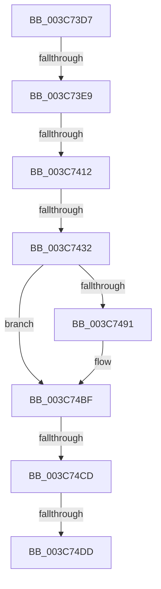

# sub_003C73D7

- RVA: `0x003C73D7`–`0x003C7508` (길이 `305` bytes)
- VA: `0x00000001403C73D7`
- 실행 섹션: `.text`
- PDB 이름 있음: `아니요`; PDB Function 태그: `아니요`
- unwind 정보 RVA: `0x0008E67C`
- 디코드: `60`개 명령, `305/305` bytes 표시
- 미해석 바이트: `0` (있으면 어셈블리에 `.byte`로 보존)

> 이 문서는 커널 이미지의 기계어와 PDB 기호를 분석해 생성했습니다. 4번과 5번은 함수 원형과 자료형을 바이너리 사용 방식에서 추정한 C 해석이며 원본 소스 복구 결과는 아닙니다.

## 1. Dependencies

- 직접 호출 지점: **1**; 고유 호출 대상: **1**
- 직접 호출자로 확인된 함수: **0**
- RIP 상대 이미지 참조: **3**

### Outgoing calls
- `0x003C74BA` → [KiSetAddressPolicy](../21/KiSetAddressPolicy_function_002178A0.md) (function, `0x002178A0`)

### Direct callers
- 이 함수 시작 RVA로 연결되는 직접 call은 확인되지 않았습니다. 간접 호출은 완전히 역산할 수 없습니다.

### Static image references
- `0x003C7484` → RVA `0x01201840` (`CFGRO`; read)
- `0x003C74BF` → RVA `0x00FC6AB8` (`ALMOSTRO`; read)
- `0x003C74F2` → RVA `0x00FC6D20` (`ALMOSTRO`; read)

## 2. Other-region calls and transfers

- 다른 실행 섹션으로 향하는 call: **0**
- call이 아닌 외부 분기/꼬리 이동: **6**
  - `0x003C73E3` → [sub_003C7676](Unknown_function_003C7676.md) (`tail-transfer`)
  - `0x003C740C` → [sub_003C75E4](Unknown_function_003C75E4.md) (`tail-transfer`)
  - `0x003C742C` → [sub_003C75E4 + 0x17](Unknown_function_003C75E4.md) (`tail-transfer`)
  - `0x003C74C7` → [sub_003C7676 + 0x10](Unknown_function_003C7676.md) (`tail-transfer`)
  - `0x003C74D7` → [sub_003C75E4 + 0x2E](Unknown_function_003C75E4.md) (`tail-transfer`)
  - `0x003C7506` → [sub_003C7508 + 0xD](Unknown_function_003C7508.md) (`tail-transfer`)

## 3. Assembly (complete function range)

```asm
003C73D7  4C 89 B4 24 88 00 00 00         mov qword ptr [rsp + 0x88], r14
003C73DF  90                              nop
003C73E0  48 3B F1                        cmp rsi, rcx
003C73E3  0F 85 8D 02 00 00               jne 0x1403c7676
003C73E9  48 8B 41 20                     mov rax, qword ptr [rcx + 0x20]
003C73ED  48 89 47 20                     mov qword ptr [rdi + 0x20], rax
003C73F1  0F B6 41 28                     movzx eax, byte ptr [rcx + 0x28]
003C73F5  88 47 28                        mov byte ptr [rdi + 0x28], al
003C73F8  0F B6 41 29                     movzx eax, byte ptr [rcx + 0x29]
003C73FC  88 47 29                        mov byte ptr [rdi + 0x29], al
003C73FF  0F B6 41 2A                     movzx eax, byte ptr [rcx + 0x2a]
003C7403  88 47 2A                        mov byte ptr [rdi + 0x2a], al
003C7406  48 8B 11                        mov rdx, qword ptr [rcx]
003C7409  48 3B D1                        cmp rdx, rcx
003C740C  0F 85 D2 01 00 00               jne 0x1403c75e4
003C7412  48 89 7F 08                     mov qword ptr [rdi + 8], rdi
003C7416  48 89 3F                        mov qword ptr [rdi], rdi
003C7419  40 88 6F 29                     mov byte ptr [rdi + 0x29], bpl
003C741D  48 8B 51 10                     mov rdx, qword ptr [rcx + 0x10]
003C7421  48 8D 41 10                     lea rax, [rcx + 0x10]
003C7425  48 3B D0                        cmp rdx, rax
003C7428  48 8D 47 10                     lea rax, [rdi + 0x10]
003C742C  0F 85 C9 01 00 00               jne 0x1403c75fb
003C7432  48 89 40 08                     mov qword ptr [rax + 8], rax
003C7436  48 89 00                        mov qword ptr [rax], rax
003C7439  40 88 6F 2A                     mov byte ptr [rdi + 0x2a], bpl
003C743D  48 89 AB 78 02 00 00            mov qword ptr [rbx + 0x278], rbp
003C7444  40 88 AB 4A 02 00 00            mov byte ptr [rbx + 0x24a], bpl
003C744B  48 89 6B 40                     mov qword ptr [rbx + 0x40], rbp
003C744F  65 48 8B 04 25 20 00 00 00      mov rax, qword ptr gs:[0x20]
003C7458  4C 8B 83 B8 00 00 00            mov r8, qword ptr [rbx + 0xb8]
003C745F  44 0F B6 B0 D1 00 00 00         movzx r14d, byte ptr [rax + 0xd1]
003C7467  0F B6 80 D0 00 00 00            movzx eax, byte ptr [rax + 0xd0]
003C746E  48 8D 2C C5 00 00 00 00         lea rbp, [rax*8]
003C7476  49 8B 80 80 00 00 00            mov rax, qword ptr [r8 + 0x80]
003C747D  F0 4C 0F AB 74 28 08            lock bts qword ptr [rax + rbp + 8], r14
003C7484  80 3D B5 A3 E3 00 00            cmp byte ptr [rip + 0xe3a3b5], 0
003C748B  49 8B 70 28                     mov rsi, qword ptr [r8 + 0x28]
003C748F  74 2E                           je 0x1403c74bf
003C7491  48 B9 00 00 00 00 00 00 00 80   movabs rcx, 0x8000000000000000
003C749B  48 8B C6                        mov rax, rsi
003C749E  48 0B C1                        or rax, rcx
003C74A1  40 F6 C6 02                     test sil, 2
003C74A5  48 0F 44 C6                     cmove rax, rsi
003C74A9  65 48 89 04 25 00 B0 00 00      mov qword ptr gs:[0xb000], rax
003C74B2  41 0F B6 88 60 01 00 00         movzx ecx, byte ptr [r8 + 0x160]
003C74BA  E8 E1 03 E5 FF                  call 0x1402178a0
003C74BF  8B 05 F3 F5 BF 00               mov eax, dword ptr [rip + 0xbff5f3]
003C74C5  A8 01                           test al, 1
003C74C7  0F 85 B9 01 00 00               jne 0x1403c7686
003C74CD  0F 22 DE                        mov cr3, rsi
003C74D0  80 3D 69 A3 E3 00 00            cmp byte ptr [rip + 0xe3a369], 0
003C74D7  0F 85 35 01 00 00               jne 0x1403c7612
003C74DD  49 8B 87 80 00 00 00            mov rax, qword ptr [r15 + 0x80]
003C74E4  F0 4C 0F B3 74 28 08            lock btr qword ptr [rax + rbp + 8], r14
003C74EB  81 63 74 FF F7 FF FF            and dword ptr [rbx + 0x74], 0xfffff7ff
003C74F2  83 3D 27 F8 BF 00 00            cmp dword ptr [rip + 0xbff827], 0
003C74F9  0F B6 74 24 20                  movzx esi, byte ptr [rsp + 0x20]
003C74FE  4C 8B B4 24 88 00 00 00         mov r14, qword ptr [rsp + 0x88]
003C7506  74 0D                           je 0x1403c7515
```

## 4. C-style interpretation (structured pseudocode)

```c
__int64 __fastcall sub_003C73D7(__int64 a1, __int64 a2, __int64 a3, __int64 a4, __int64 a5, __int64 a6, __int64 a7, __int64 a8, __int64 a9, __int64 a10, __int64 a11, __int64 a12, __int64 a13, __int64 a14, __int64 a15, __int64 a16, __int64 a17)
{
    __int64 result;
    unsigned __int8 v_stack_p20;
    unsigned __int64 v_stack_p88;

    v_stack_p88 = v_r14;
    *(unsigned __int64 *)(v_rdi + 32) = *(unsigned __int64 *)(a1 + 32);
    *(unsigned __int8 *)(v_rdi + 40) = (unsigned __int8)(*(unsigned __int8 *)(a1 + 40));
    *(unsigned __int8 *)(v_rdi + 41) = (unsigned __int8)(*(unsigned __int8 *)(a1 + 41));
    *(unsigned __int8 *)(v_rdi + 42) = (unsigned __int8)(*(unsigned __int8 *)(a1 + 42));
    *(unsigned __int64 *)(v_rdi + 8) = v_rdi;
    *(unsigned __int64 *)(v_rdi) = v_rdi;
    *(unsigned __int8 *)(v_rdi + 41) = (unsigned __int8)(v_rbp);
    *(unsigned __int64 *)(v_rdi + 16 + 8) = v_rdi + 16;
    *(unsigned __int64 *)(v_rdi + 16) = v_rdi + 16;
    *(unsigned __int8 *)(v_rdi + 42) = (unsigned __int8)(v_rbp);
    *(unsigned __int64 *)(v_rbx + 632) = v_rbp;
    *(unsigned __int8 *)(v_rbx + 586) = (unsigned __int8)(v_rbp);
    *(unsigned __int64 *)(v_rbx + 64) = v_rbp;
    result = *(unsigned __int64 *)(*(unsigned __int64 *)(v_rbx + 184) + 128);
    if ((*(unsigned __int8 *)(v_rip + 14918581)) != 0) {
        result = *(unsigned __int64 *)(*(unsigned __int64 *)(v_rbx + 184) + 40);
        result = (result) | (a1);
        if ((((unsigned __int8)(*(unsigned __int64 *)(*(unsigned __int64 *)(v_rbx + 184) + 40))) & (2)) == 0) { result = *(unsigned __int64 *)(*(unsigned __int64 *)(v_rbx + 184) + 40); }
        *(unsigned __int64 *)(gs_base + (0 + 45056)) = result;
        a1 = *(unsigned __int8 *)(*(unsigned __int64 *)(v_rbx + 184) + 352);
        result = KiSetAddressPolicy(a1, *(unsigned __int64 *)(a1 + 16), *(unsigned __int64 *)(v_rbx + 184), a4);
    }
}
```

## 5. (Beta) C Style

```c
int64_t sub_003C73D7(void *Arg1, int64_t Arg2, int64_t Arg3, int64_t Arg4, uint64_t Arg5, uint64_t Arg6, uint64_t Arg7, uint64_t Arg8, uint64_t Arg9, uint64_t Arg10, uint64_t Arg11, uint64_t Arg12, uint64_t Arg13, uint64_t Arg14, uint64_t Arg15, uint64_t Arg16, int64_t Arg17)
{
    uint8_t *arg1 = (uint8_t *)Arg1;

    int64_t result;
    uint8_t v_stack_p20;
    uint64_t v_stack_p88;

    v_stack_p88 = local_r14;
    *(uint64_t *)(local_rdi + 0x20) = *(uint64_t *)(arg1 + 0x20);
    *(uint8_t *)(local_rdi + 0x28) = (uint8_t)(*(uint8_t *)(arg1 + 0x28));
    *(uint8_t *)(local_rdi + 0x29) = (uint8_t)(*(uint8_t *)(arg1 + 0x29));
    *(uint8_t *)(local_rdi + 0x2A) = (uint8_t)(*(uint8_t *)(arg1 + 0x2A));
    *(uint64_t *)(local_rdi + 0x8) = local_rdi;
    *(uint64_t *)(local_rdi) = local_rdi;
    *(uint8_t *)(local_rdi + 0x29) = (uint8_t)(local_rbp);
    *(uint64_t *)(local_rdi + 0x10 + 0x8) = local_rdi + 16;
    *(uint64_t *)(local_rdi + 0x10) = local_rdi + 16;
    *(uint8_t *)(local_rdi + 0x2A) = (uint8_t)(local_rbp);
    *(uint64_t *)(local_rbx + 0x278) = local_rbp;
    *(uint8_t *)(local_rbx + 0x24A) = (uint8_t)(local_rbp);
    *(uint64_t *)(local_rbx + 0x40) = local_rbp;
    result = *(uint64_t *)(*(uint64_t *)(local_rbx + 0xB8) + 0x80);
    if ((*(uint8_t *)(v_rip + 0xE3A3B5)) != 0) {
        result = *(uint64_t *)(*(uint64_t *)(local_rbx + 0xB8) + 0x28);
        result = (result) | (Arg1);
        if ((((uint8_t)(*(uint64_t *)(*(uint64_t *)(local_rbx + 0xB8) + 0x28))) & (2)) == 0) { result = *(uint64_t *)(*(uint64_t *)(local_rbx + 0xB8) + 0x28); }
        *(uint64_t *)(gs_base + (0 + 0xB000)) = result;
        Arg1 = *(uint8_t *)(*(uint64_t *)(local_rbx + 0xB8) + 0x160);
        result = KiSetAddressPolicy(Arg1, *(uint64_t *)(arg1 + 0x10), *(uint64_t *)(local_rbx + 0xB8), Arg4);
    }
}
```

### 관측된 메모리 오프셋

구조체 형식이 확인되지 않은 접근은 인자 기준의 오프셋으로만 기록했습니다.

| 기준 인자 | 오프셋 표현 | 폭 (bit) | 접근 |
|---|---:|---:|---|
| `Arg1` | `+ 0x0` | `64` | `R` |
| `Arg1` | `+ 0x10` | `64` | `R` |
| `Arg1` | `+ 0x20` | `64` | `R` |
| `Arg1` | `+ 0x28` | `8` | `R` |
| `Arg1` | `+ 0x29` | `8` | `R` |
| `Arg1` | `+ 0x2A` | `8` | `R` |

## 6. Execution-region graph

[열기: 2D/3D 그래프와 함수 탐색 컨트롤 패널](../../../control-panel.html?section=text&rva=0x003C73D7&view=graph)

- 2D 그래프는 위에서 아래로 흐르고, 3D 그래프는 빈 공간을 드래그해 회전합니다. Shift+드래그는 이동, 휠은 확대·축소, 함수 노드 선택은 대상 보고서 이동입니다.

### Static fallback


