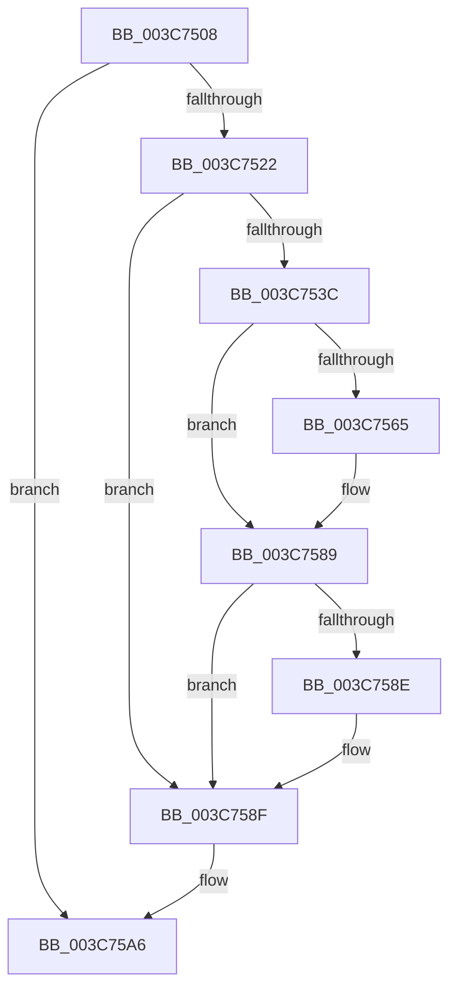

# sub_003C7508

- RVA: `0x003C7508`–`0x003C75CE` (길이 `198` bytes)
- VA: `0x00000001403C7508`
- 실행 섹션: `.text`
- PDB 이름 있음: `아니요`; PDB Function 태그: `아니요`
- unwind 정보 RVA: `0x0008E690`
- 디코드: `42`개 명령, `198/198` bytes 표시
- 미해석 바이트: `0` (있으면 어셈블리에 `.byte`로 보존)

> 이 문서는 커널 이미지의 기계어와 PDB 기호를 분석해 생성했습니다. 4번과 5번은 함수 원형과 자료형을 바이너리 사용 방식에서 추정한 C 해석이며 원본 소스 복구 결과는 아닙니다.

## 1. Dependencies

- 직접 호출 지점: **3**; 고유 호출 대상: **3**
- 직접 호출자로 확인된 함수: **0**
- RIP 상대 이미지 참조: **1**

### Outgoing calls
- `0x003C7510` → [KiLowerIrqlProcessIrqlFlags](../4F/KiLowerIrqlProcessIrqlFlags_function_004F5698.md) (function, `0x004F5698`)
- `0x003C7545` → [HalpDisableInterrupts](../25/HalpDisableInterrupts_function_002521A0.md) (function, `0x002521A0`)
- `0x003C75A1` → [HalpInterruptSendIpi](../25/HalpInterruptSendIpi_function_00252310.md) (function, `0x00252310`)

### Direct callers
- 이 함수 시작 RVA로 연결되는 직접 call은 확인되지 않았습니다. 간접 호출은 완전히 역산할 수 없습니다.

### Static image references
- `0x003C752B` → RVA `0x00FC6BC5` (`ALMOSTRO`; read)

## 2. Other-region calls and transfers

- 다른 실행 섹션으로 향하는 call: **0**
- 별도 외부 분기/꼬리 이동을 확인하지 못했습니다.

## 3. Assembly (complete function range)

```asm
003C7508  44 0F 20 C1                     mov rcx, cr8
003C750C  40 0F B6 D6                     movzx edx, sil
003C7510  E8 83 E1 12 00                  call 0x1404f5698
003C7515  44 0F 22 C6                     mov cr8, rsi
003C7519  48 39 3F                        cmp qword ptr [rdi], rdi
003C751C  0F 84 84 00 00 00               je 0x1403c75a6
003C7522  33 C0                           xor eax, eax
003C7524  C6 83 C1 00 00 00 01            mov byte ptr [rbx + 0xc1], 1
003C752B  38 05 94 F6 BF 00               cmp byte ptr [rip + 0xbff694], al
003C7531  0F 57 C0                        xorps xmm0, xmm0
003C7534  F3 0F 7F 44 24 2C               movdqu xmmword ptr [rsp + 0x2c], xmm0
003C753A  74 53                           je 0x1403c758f
003C753C  65 4C 8B 04 25 20 00 00 00      mov r8, qword ptr gs:[0x20]
003C7545  E8 56 AC E8 FF                  call 0x1402521a0
003C754A  41 8B 90 A8 00 00 00            mov edx, dword ptr [r8 + 0xa8]
003C7551  44 0F B6 C8                     movzx r9d, al
003C7555  8B CA                           mov ecx, edx
003C7557  83 C9 02                        or ecx, 2
003C755A  41 89 88 A8 00 00 00            mov dword ptr [r8 + 0xa8], ecx
003C7561  85 D2                           test edx, edx
003C7563  75 24                           jne 0x1403c7589
003C7565  B9 15 00 01 C0                  mov ecx, 0xc0010015
003C756A  0F 32                           rdmsr
003C756C  48 C1 E2 20                     shl rdx, 0x20
003C7570  48 0B C2                        or rax, rdx
003C7573  48 BA 00 00 00 00 01 00 00 00   movabs rdx, 0x100000000
003C757D  48 0B C2                        or rax, rdx
003C7580  48 8B D0                        mov rdx, rax
003C7583  48 C1 EA 20                     shr rdx, 0x20
003C7587  0F 30                           wrmsr
003C7589  45 84 C9                        test r9b, r9b
003C758C  74 01                           je 0x1403c758f
003C758E  FB                              sti
003C758F  BA 1F 00 00 00                  mov edx, 0x1f
003C7594  C7 44 24 28 05 00 00 00         mov dword ptr [rsp + 0x28], 5
003C759C  48 8D 4C 24 28                  lea rcx, [rsp + 0x28]
003C75A1  E8 6A AD E8 FF                  call 0x140252310
003C75A6  48 8B BC 24 90 00 00 00         mov rdi, qword ptr [rsp + 0x90]
003C75AE  48 8B B4 24 B0 00 00 00         mov rsi, qword ptr [rsp + 0xb0]
003C75B6  48 8B AC 24 A8 00 00 00         mov rbp, qword ptr [rsp + 0xa8]
003C75BE  48 8B 9C 24 A0 00 00 00         mov rbx, qword ptr [rsp + 0xa0]
003C75C6  4C 8B BC 24 80 00 00 00         mov r15, qword ptr [rsp + 0x80]
```

## 4. C-style interpretation (structured pseudocode)

```c
__int64 __fastcall sub_003C7508(__int64 a1, __int64 a2, __int64 a3, __int64 a4, __int64 a5, __int64 a6, __int64 a7, __int64 a8, __int64 a9, __int64 a10, __int64 a11, __int64 a12, __int64 a13, __int64 a14, __int64 a15, __int64 a16, __int64 a17, __int64 a18, __int64 a19, __int64 a20, __int64 a21, __int64 a22)
{
    __int64 result;
    unsigned int v_stack_p28;
    unsigned __int64 v_stack_p2C;

    result = KiLowerIrqlProcessIrqlFlags(v_cr8, (unsigned __int8)(v_rsi), a3, a4);
    if ((*(unsigned __int64 *)(v_rdi)) == v_rdi) goto loc_003C75A6;
    result = 0;
    *(unsigned __int8 *)(v_rbx + 193) = 1;
    v_stack_p2C = v_xmm0;
    if ((*(unsigned __int8 *)(v_rip + 12580500)) == 0) goto loc_003C758F;
    result = HalpDisableInterrupts(v_cr8, (unsigned __int8)(v_rsi), *(unsigned __int64 *)(gs_base + (0 + 32)), a4);
    a1 = (unsigned int)(((unsigned int)((unsigned int)((unsigned int)(*(unsigned int *)(*(unsigned __int64 *)(gs_base + (0 + 32)) + 168))))) | (2));
    *(unsigned int *)(*(unsigned __int64 *)(gs_base + (0 + 32)) + 168) = (unsigned int)(a1);
    if ((unsigned int)((unsigned int)(*(unsigned int *)(*(unsigned __int64 *)(gs_base + (0 + 32)) + 168))) == 0) {
        a1 = 0xC0010015ULL;
        a2 = ((unsigned int)(*(unsigned int *)(*(unsigned __int64 *)(gs_base + (0 + 32)) + 168))) << (32);
        result = (result) | (a2);
        result = (result) | (a2);
        a2 = result;
        a2 = (a2) >> (32);
    }
    if ((unsigned __int8)((unsigned __int8)(result)) != 0) {
    }
    v_stack_p28 = 5;
    result = HalpInterruptSendIpi(a5, 31, *(unsigned __int64 *)(gs_base + (0 + 32)), (unsigned __int8)(result));
loc_003C75A6:
    return result;
}
```

## 5. (Beta) C Style

```c
int64_t sub_003C7508(int64_t Arg1, int64_t Arg2, int64_t Arg3, int64_t Arg4, int64_t Arg5, uint64_t Arg6, uint64_t Arg7, uint64_t Arg8, uint64_t Arg9, uint64_t Arg10, uint64_t Arg11, uint64_t Arg12, uint64_t Arg13, uint64_t Arg14, uint64_t Arg15, int64_t Arg16, uint64_t Arg17, int64_t Arg18, uint64_t Arg19, int64_t Arg20, int64_t Arg21, int64_t Arg22)
{
    int64_t result;
    uint32_t v_stack_p28;
    uint64_t v_stack_p2C;

    result = KiLowerIrqlProcessIrqlFlags(v_cr8, (uint8_t)(local_rsi), Arg3, Arg4);
    if ((*(uint64_t *)(local_rdi)) == local_rdi) goto loc_003C75A6;
    result = 0;
    *(uint8_t *)(local_rbx + 0xC1) = 1;
    v_stack_p2C = v_xmm0;
    if ((*(uint8_t *)(v_rip + 0xBFF694)) == 0) goto loc_003C758F;
    result = HalpDisableInterrupts(v_cr8, (uint8_t)(local_rsi), *(uint64_t *)(gs_base + (0 + 0x20)), Arg4);
    Arg1 = (uint32_t)(((uint32_t)((uint32_t)((uint32_t)(*(uint32_t *)(*(uint64_t *)(gs_base + (0 + 0x20)) + 0xA8))))) | (2));
    *(uint32_t *)(*(uint64_t *)(gs_base + (0 + 0x20)) + 0xA8) = (uint32_t)(Arg1);
    if ((uint32_t)((uint32_t)(*(uint32_t *)(*(uint64_t *)(gs_base + (0 + 0x20)) + 0xA8))) == 0) {
        Arg1 = 0xC0010015ULL;
        Arg2 = ((uint32_t)(*(uint32_t *)(*(uint64_t *)(gs_base + (0 + 0x20)) + 0xA8))) << (32);
        result = (result) | (Arg2);
        result = (result) | (Arg2);
        Arg2 = result;
        Arg2 = (Arg2) >> (32);
    }
    if ((uint8_t)((uint8_t)(result)) != 0) {
    }
    v_stack_p28 = 5;
    result = HalpInterruptSendIpi(Arg5, 31, *(uint64_t *)(gs_base + (0 + 0x20)), (uint8_t)(result));
loc_003C75A6:
    return result;
}
```

## 6. Execution-region graph

[열기: 2D/3D 그래프와 함수 탐색 컨트롤 패널](../../../control-panel.html?section=text&rva=0x003C7508&view=graph)

- 2D 그래프는 위에서 아래로 흐르고, 3D 그래프는 빈 공간을 드래그해 회전합니다. Shift+드래그는 이동, 휠은 확대·축소, 함수 노드 선택은 대상 보고서 이동입니다.

### Static fallback


