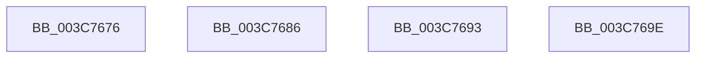

# sub_003C7676

- RVA: `0x003C7676`–`0x003C76A0` (길이 `42` bytes)
- VA: `0x00000001403C7676`
- 실행 섹션: `.text`
- PDB 이름 있음: `아니요`; PDB Function 태그: `아니요`
- unwind 정보 RVA: `0x0008E700`
- 디코드: `11`개 명령, `42/42` bytes 표시
- 미해석 바이트: `0` (있으면 어셈블리에 `.byte`로 보존)

> 이 문서는 커널 이미지의 기계어와 PDB 기호를 분석해 생성했습니다. 4번과 5번은 함수 원형과 자료형을 바이너리 사용 방식에서 추정한 C 해석이며 원본 소스 복구 결과는 아닙니다.

## 1. Dependencies

- 직접 호출 지점: **2**; 고유 호출 대상: **2**
- 직접 호출자로 확인된 함수: **0**
- RIP 상대 이미지 참조: **0**

### Outgoing calls
- `0x003C767C` → [KiMoveApcState](KiMoveApcState_function_003C76F0.md) (function, `0x003C76F0`)
- `0x003C7689` → [HvlSwitchVirtualAddressSpace](HvlSwitchVirtualAddressSpace_function_003C7C60.md) (function, `0x003C7C60`)

### Direct callers
- 이 함수 시작 RVA로 연결되는 직접 call은 확인되지 않았습니다. 간접 호출은 완전히 역산할 수 없습니다.

### Static image references
- 디코드된 RIP-relative 메모리 참조가 없습니다.

## 2. Other-region calls and transfers

- 다른 실행 섹션으로 향하는 call: **0**
- call이 아닌 외부 분기/꼬리 이동: **3**
  - `0x003C7681` → [sub_003C73D7 + 0x74](Unknown_function_003C73D7.md) (`tail-transfer`)
  - `0x003C768E` → [sub_003C73D7 + 0xF9](Unknown_function_003C73D7.md) (`tail-transfer`)
  - `0x003C7699` → [sub_003C73D7 + 0x106](Unknown_function_003C73D7.md) (`tail-transfer`)

## 3. Assembly (complete function range)

```asm
003C7676  48 8B D7                        mov rdx, rdi
003C7679  48 8B CE                        mov rcx, rsi
003C767C  E8 6F 00 00 00                  call 0x1403c76f0
003C7681  E9 C5 FD FF FF                  jmp 0x1403c744b
003C7686  48 8B CE                        mov rcx, rsi
003C7689  E8 D2 05 00 00                  call 0x1403c7c60
003C768E  E9 3D FE FF FF                  jmp 0x1403c74d0
003C7693  0F 20 D8                        mov rax, cr3
003C7696  0F 22 D8                        mov cr3, rax
003C7699  E9 3F FE FF FF                  jmp 0x1403c74dd
003C769E  66 90                           nop
```

## 4. C-style interpretation (structured pseudocode)

```c
__int64 __fastcall sub_003C7676(void)
{
    __int64 result;

    result = KiMoveApcState(v_rsi, v_rdi, a3, a4);
}
```

## 5. (Beta) C Style

```c
void sub_003C7676(void)
{
    int64_t result;

    result = KiMoveApcState(local_rsi, local_rdi, a3, a4);
}
```

## 6. Execution-region graph

[열기: 2D/3D 그래프와 함수 탐색 컨트롤 패널](../../../control-panel.html?section=text&rva=0x003C7676&view=graph)

- 2D 그래프는 위에서 아래로 흐르고, 3D 그래프는 빈 공간을 드래그해 회전합니다. Shift+드래그는 이동, 휠은 확대·축소, 함수 노드 선택은 대상 보고서 이동입니다.

### Static fallback


