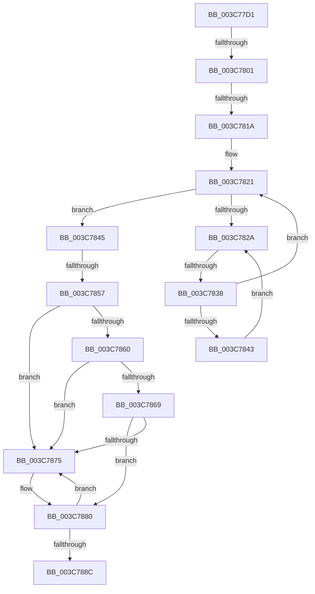

# sub_003C77D1

- RVA: `0x003C77D1`–`0x003C789A` (길이 `201` bytes)
- VA: `0x00000001403C77D1`
- 실행 섹션: `.text`
- PDB 이름 있음: `아니요`; PDB Function 태그: `아니요`
- unwind 정보 RVA: `0x0008E760`
- 디코드: `44`개 명령, `201/201` bytes 표시
- 미해석 바이트: `0` (있으면 어셈블리에 `.byte`로 보존)

> 이 문서는 커널 이미지의 기계어와 PDB 기호를 분석해 생성했습니다. 4번과 5번은 함수 원형과 자료형을 바이너리 사용 방식에서 추정한 C 해석이며 원본 소스 복구 결과는 아닙니다.

## 1. Dependencies

- 직접 호출 지점: **1**; 고유 호출 대상: **1**
- 직접 호출자로 확인된 함수: **0**
- RIP 상대 이미지 참조: **2**

### Outgoing calls
- `0x003C787A` → [KeBugCheck](../4F/KeBugCheck_function_004FD640.md) (function, `0x004FD640`)

### Direct callers
- 이 함수 시작 RVA로 연결되는 직접 call은 확인되지 않았습니다. 간접 호출은 완전히 역산할 수 없습니다.

### Static image references
- `0x003C780E` → RVA `0x00FC6D20` (`ALMOSTRO`; read)
- `0x003C782C` → RVA `0x00FC52AC` (`ALMOSTRO`; reference)

## 2. Other-region calls and transfers

- 다른 실행 섹션으로 향하는 call: **0**
- call이 아닌 외부 분기/꼬리 이동: **4**
  - `0x003C77FB` → [sub_003C7BF1](Unknown_function_003C7BF1.md) (`tail-transfer`)
  - `0x003C7814` → [sub_003C7B1E](Unknown_function_003C7B1E.md) (`tail-transfer`)
  - `0x003C7832` → [sub_003C7B1E + 0x11](Unknown_function_003C7B1E.md) (`tail-transfer`)
  - `0x003C7851` → [sub_003C7C10](Unknown_function_003C7C10.md) (`tail-transfer`)

## 3. Assembly (complete function range)

```asm
003C77D1  49 89 5B 10                     mov qword ptr [r11 + 0x10], rbx
003C77D5  65 48 8B 1C 25 88 01 00 00      mov rbx, qword ptr gs:[0x188]
003C77DE  4D 89 6B E8                     mov qword ptr [r11 - 0x18], r13
003C77E2  4D 89 73 E0                     mov qword ptr [r11 - 0x20], r14
003C77E6  4C 8D B0 58 02 00 00            lea r14, [rax + 0x258]
003C77ED  49 89 7B F0                     mov qword ptr [r11 - 0x10], rdi
003C77F1  4C 8B AB B8 00 00 00            mov r13, qword ptr [rbx + 0xb8]
003C77F8  83 E6 02                        and esi, 2
003C77FB  0F 85 F0 03 00 00               jne 0x1403c7bf1
003C7801  44 0F 20 C7                     mov rdi, cr8
003C7805  B8 02 00 00 00                  mov eax, 2
003C780A  44 0F 22 C0                     mov cr8, rax
003C780E  39 35 0C F5 BF 00               cmp dword ptr [rip + 0xbff50c], esi
003C7814  0F 85 04 03 00 00               jne 0x1403c7b1e
003C781A  40 88 7C 24 20                  mov byte ptr [rsp + 0x20], dil
003C781F  33 FF                           xor edi, edi
003C7821  F0 48 0F BA 6B 40 00            lock bts qword ptr [rbx + 0x40], 0
003C7828  73 1B                           jae 0x1403c7845
003C782A  FF C7                           inc edi
003C782C  85 3D 7A DA BF 00               test dword ptr [rip + 0xbfda7a], edi
003C7832  0F 84 F7 02 00 00               je 0x1403c7b2f
003C7838  F3 90                           pause
003C783A  48 8B 43 40                     mov rax, qword ptr [rbx + 0x40]
003C783E  48 85 C0                        test rax, rax
003C7841  74 DE                           je 0x1403c7821
003C7843  EB E5                           jmp 0x1403c782a
003C7845  0F B6 54 24 20                  movzx edx, byte ptr [rsp + 0x20]
003C784A  80 BB C1 00 00 00 00            cmp byte ptr [rbx + 0xc1], 0
003C7851  0F 85 B9 03 00 00               jne 0x1403c7c10
003C7857  80 BB 4A 02 00 00 00            cmp byte ptr [rbx + 0x24a], 0
003C785E  74 15                           je 0x1403c7875
003C7860  F6 83 C0 00 00 00 01            test byte ptr [rbx + 0xc0], 1
003C7867  75 0C                           jne 0x1403c7875
003C7869  48 8D BB 98 00 00 00            lea rdi, [rbx + 0x98]
003C7870  48 39 3F                        cmp qword ptr [rdi], rdi
003C7873  74 0B                           je 0x1403c7880
003C7875  B9 06 00 00 00                  mov ecx, 6
003C787A  E8 C1 5D 13 00                  call 0x1404fd640
003C787F  CC                              int3
003C7880  48 8D 83 A8 00 00 00            lea rax, [rbx + 0xa8]
003C7887  48 39 00                        cmp qword ptr [rax], rax
003C788A  75 E9                           jne 0x1403c7875
003C788C  81 4B 74 00 08 00 00            or dword ptr [rbx + 0x74], 0x800
003C7893  48 8D 8B 58 02 00 00            lea rcx, [rbx + 0x258]
```

## 4. C-style interpretation (structured pseudocode)

```c
__int64 __fastcall sub_003C77D1(void)
{
    __int64 result;
    __int64 v_rdi;
    __int64 v_rsi;
    unsigned __int8 v_stack_p20;

    *(unsigned __int64 *)(v_r11 + 16) = v_rbx;
    *(unsigned __int64 *)(v_r11 - 24) = v_r13;
    *(unsigned __int64 *)(v_r11 - 32) = v_r14;
    *(unsigned __int64 *)(v_r11 - 16) = v_rdi;
    v_rsi = (unsigned int)((v_rsi) & (2));
    v_stack_p20 = (unsigned __int8)(v_cr8);
    v_rdi = 0;
loc_003C7821:
    if (condition_is_above_or_equal) goto loc_003C7845;
loc_003C782A:
    v_rdi = (unsigned int)((v_rdi) + 1);
    if (*(unsigned __int64 *)(*(unsigned __int64 *)(gs_base + (0 + 392)) + 64) == 0) goto loc_003C7821;
    goto loc_003C782A;
loc_003C7845:
    if ((*(unsigned __int8 *)(*(unsigned __int64 *)(gs_base + (0 + 392)) + 586)) == 0) goto loc_003C7875;
    if (((*(unsigned __int8 *)(*(unsigned __int64 *)(gs_base + (0 + 392)) + 192)) & (1)) != 0) goto loc_003C7875;
    result = *(unsigned __int64 *)(*(unsigned __int64 *)(gs_base + (0 + 392)) + 64);
    if ((*(unsigned __int64 *)(*(unsigned __int64 *)(gs_base + (0 + 392)) + 152)) != (*(unsigned __int64 *)(gs_base + (0 + 392)) + 152)) {
        a1 = 6;
        result = KeBugCheck(a1, v_stack_p20, a3, a4);
    }
    if ((*(unsigned __int64 *)(*(unsigned __int64 *)(gs_base + (0 + 392)) + 168)) != (*(unsigned __int64 *)(gs_base + (0 + 392)) + 168)) goto loc_003C7875;
    return *(unsigned __int64 *)(gs_base + (0 + 392)) + 168;
}
```

## 5. (Beta) C Style

```c
void sub_003C77D1(void)
{
    int64_t result;
    int64_t local_rdi;
    int64_t local_rsi;
    uint8_t v_stack_p20;

    *(uint64_t *)(local_r11 + 0x10) = local_rbx;
    *(uint64_t *)(local_r11 - 0x18) = local_r13;
    *(uint64_t *)(local_r11 - 0x20) = local_r14;
    *(uint64_t *)(local_r11 - 0x10) = local_rdi;
    local_rsi = (uint32_t)((local_rsi) & (2));
    v_stack_p20 = (uint8_t)(v_cr8);
    local_rdi = 0;
loc_003C7821:
    if (condition_is_above_or_equal) goto loc_003C7845;
loc_003C782A:
    local_rdi = (uint32_t)((local_rdi) + 1);
    if (*(uint64_t *)(*(uint64_t *)(gs_base + (0 + 0x188)) + 0x40) == 0) goto loc_003C7821;
    goto loc_003C782A;
loc_003C7845:
    if ((*(uint8_t *)(*(uint64_t *)(gs_base + (0 + 0x188)) + 0x24A)) == 0) goto loc_003C7875;
    if (((*(uint8_t *)(*(uint64_t *)(gs_base + (0 + 0x188)) + 0xC0)) & (1)) != 0) goto loc_003C7875;
    result = *(uint64_t *)(*(uint64_t *)(gs_base + (0 + 0x188)) + 0x40);
    if ((*(uint64_t *)(*(uint64_t *)(gs_base + (0 + 0x188)) + 0x98)) != (*(uint64_t *)(gs_base + (0 + 0x188)) + 152)) {
        a1 = 6;
        result = KeBugCheck(a1, v_stack_p20, a3, a4);
    }
    if ((*(uint64_t *)(*(uint64_t *)(gs_base + (0 + 0x188)) + 0xA8)) != (*(uint64_t *)(gs_base + (0 + 0x188)) + 168)) goto loc_003C7875;
    return *(uint64_t *)(gs_base + (0 + 0x188)) + 168;
}
```

## 6. Execution-region graph

[열기: 2D/3D 그래프와 함수 탐색 컨트롤 패널](../../../control-panel.html?section=text&rva=0x003C77D1&view=graph)

- 2D 그래프는 위에서 아래로 흐르고, 3D 그래프는 빈 공간을 드래그해 회전합니다. Shift+드래그는 이동, 휠은 확대·축소, 함수 노드 선택은 대상 보고서 이동입니다.

### Static fallback


