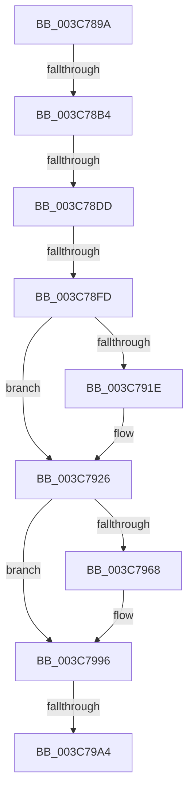

# sub_003C789A

- RVA: `0x003C789A`–`0x003C79BC` (길이 `290` bytes)
- VA: `0x00000001403C789A`
- 실행 섹션: `.text`
- PDB 이름 있음: `아니요`; PDB Function 태그: `아니요`
- unwind 정보 RVA: `0x0008E780`
- 디코드: `57`개 명령, `290/290` bytes 표시
- 미해석 바이트: `0` (있으면 어셈블리에 `.byte`로 보존)

> 이 문서는 커널 이미지의 기계어와 PDB 기호를 분석해 생성했습니다. 4번과 5번은 함수 원형과 자료형을 바이너리 사용 방식에서 추정한 C 해석이며 원본 소스 복구 결과는 아닙니다.

## 1. Dependencies

- 직접 호출 지점: **1**; 고유 호출 대상: **1**
- 직접 호출자로 확인된 함수: **0**
- RIP 상대 이미지 참조: **2**

### Outgoing calls
- `0x003C7991` → [KiSetAddressPolicy](../21/KiSetAddressPolicy_function_002178A0.md) (function, `0x002178A0`)

### Direct callers
- 이 함수 시작 RVA로 연결되는 직접 call은 확인되지 않았습니다. 간접 호출은 완전히 역산할 수 없습니다.

### Static image references
- `0x003C795B` → RVA `0x01201840` (`CFGRO`; read)
- `0x003C7996` → RVA `0x00FC6AB8` (`ALMOSTRO`; read)

## 2. Other-region calls and transfers

- 다른 실행 섹션으로 향하는 call: **0**
- call이 아닌 외부 분기/꼬리 이동: **5**
  - `0x003C78AE` → [sub_003C7B56](Unknown_function_003C7B56.md) (`tail-transfer`)
  - `0x003C78D7` → [sub_003C7AC0](Unknown_function_003C7AC0.md) (`tail-transfer`)
  - `0x003C78F7` → [sub_003C7AC0 + 0x17](Unknown_function_003C7AC0.md) (`tail-transfer`)
  - `0x003C799E` → [sub_003C7B56 + 0x7F](Unknown_function_003C7B56.md) (`tail-transfer`)
  - `0x003C79B6` → [sub_003C7AEE](Unknown_function_003C7AEE.md) (`tail-transfer`)

## 3. Assembly (complete function range)

```asm
003C789A  48 89 AC 24 C0 00 00 00         mov qword ptr [rsp + 0xc0], rbp
003C78A2  90                              nop
003C78A3  4C 89 BC 24 80 00 00 00         mov qword ptr [rsp + 0x80], r15
003C78AB  4C 3B F1                        cmp r14, rcx
003C78AE  0F 85 A2 02 00 00               jne 0x1403c7b56
003C78B4  48 8B 41 20                     mov rax, qword ptr [rcx + 0x20]
003C78B8  48 89 47 20                     mov qword ptr [rdi + 0x20], rax
003C78BC  0F B6 41 28                     movzx eax, byte ptr [rcx + 0x28]
003C78C0  88 47 28                        mov byte ptr [rdi + 0x28], al
003C78C3  0F B6 41 29                     movzx eax, byte ptr [rcx + 0x29]
003C78C7  88 47 29                        mov byte ptr [rdi + 0x29], al
003C78CA  0F B6 41 2A                     movzx eax, byte ptr [rcx + 0x2a]
003C78CE  88 47 2A                        mov byte ptr [rdi + 0x2a], al
003C78D1  48 8B 11                        mov rdx, qword ptr [rcx]
003C78D4  48 3B D1                        cmp rdx, rcx
003C78D7  0F 85 E3 01 00 00               jne 0x1403c7ac0
003C78DD  48 89 7F 08                     mov qword ptr [rdi + 8], rdi
003C78E1  48 89 3F                        mov qword ptr [rdi], rdi
003C78E4  C6 47 29 00                     mov byte ptr [rdi + 0x29], 0
003C78E8  48 8B 51 10                     mov rdx, qword ptr [rcx + 0x10]
003C78EC  48 8D 41 10                     lea rax, [rcx + 0x10]
003C78F0  48 3B D0                        cmp rdx, rax
003C78F3  48 8D 47 10                     lea rax, [rdi + 0x10]
003C78F7  0F 85 DA 01 00 00               jne 0x1403c7ad7
003C78FD  48 89 40 08                     mov qword ptr [rax + 8], rax
003C7901  48 89 00                        mov qword ptr [rax], rax
003C7904  C6 47 2A 00                     mov byte ptr [rdi + 0x2a], 0
003C7908  48 C7 83 78 02 00 00 00 00 00 00  mov qword ptr [rbx + 0x278], 0
003C7913  C6 83 4A 02 00 00 00            mov byte ptr [rbx + 0x24a], 0
003C791A  85 F6                           test esi, esi
003C791C  75 08                           jne 0x1403c7926
003C791E  48 C7 43 40 00 00 00 00         mov qword ptr [rbx + 0x40], 0
003C7926  65 48 8B 04 25 20 00 00 00      mov rax, qword ptr gs:[0x20]
003C792F  4C 8B 83 B8 00 00 00            mov r8, qword ptr [rbx + 0xb8]
003C7936  44 0F B6 B8 D1 00 00 00         movzx r15d, byte ptr [rax + 0xd1]
003C793E  0F B6 80 D0 00 00 00            movzx eax, byte ptr [rax + 0xd0]
003C7945  4C 8D 34 C5 00 00 00 00         lea r14, [rax*8]
003C794D  49 8B 80 80 00 00 00            mov rax, qword ptr [r8 + 0x80]
003C7954  F0 4E 0F AB 7C 30 08            lock bts qword ptr [rax + r14 + 8], r15
003C795B  80 3D DE 9E E3 00 00            cmp byte ptr [rip + 0xe39ede], 0
003C7962  49 8B 68 28                     mov rbp, qword ptr [r8 + 0x28]
003C7966  74 2E                           je 0x1403c7996
003C7968  48 B9 00 00 00 00 00 00 00 80   movabs rcx, 0x8000000000000000
003C7972  48 8B C5                        mov rax, rbp
003C7975  48 0B C1                        or rax, rcx
003C7978  40 F6 C5 02                     test bpl, 2
003C797C  48 0F 44 C5                     cmove rax, rbp
003C7980  65 48 89 04 25 00 B0 00 00      mov qword ptr gs:[0xb000], rax
003C7989  41 0F B6 88 60 01 00 00         movzx ecx, byte ptr [r8 + 0x160]
003C7991  E8 0A FF E4 FF                  call 0x1402178a0
003C7996  8B 05 1C F1 BF 00               mov eax, dword ptr [rip + 0xbff11c]
003C799C  A8 01                           test al, 1
003C799E  0F 85 31 02 00 00               jne 0x1403c7bd5
003C79A4  0F 22 DD                        mov cr3, rbp
003C79A7  80 3D 92 9E E3 00 00            cmp byte ptr [rip + 0xe39e92], 0
003C79AE  48 8B AC 24 C0 00 00 00         mov rbp, qword ptr [rsp + 0xc0]
003C79B6  0F 85 32 01 00 00               jne 0x1403c7aee
```

## 4. C-style interpretation (structured pseudocode)

```c
__int64 __fastcall sub_003C789A(__int64 a1, __int64 a2, __int64 a3, __int64 a4, __int64 a5, __int64 a6, __int64 a7, __int64 a8, __int64 a9, __int64 a10, __int64 a11, __int64 a12, __int64 a13, __int64 a14, __int64 a15, __int64 a16, __int64 a17, __int64 a18, __int64 a19, __int64 a20, __int64 a21, __int64 a22, __int64 a23, __int64 a24)
{
    __int64 result;
    unsigned __int64 v_stack_p80;
    unsigned __int64 v_stack_pC0;

    v_stack_pC0 = v_rbp;
    v_stack_p80 = v_r15;
    *(unsigned __int64 *)(v_rdi + 32) = *(unsigned __int64 *)(a1 + 32);
    *(unsigned __int8 *)(v_rdi + 40) = (unsigned __int8)(*(unsigned __int8 *)(a1 + 40));
    *(unsigned __int8 *)(v_rdi + 41) = (unsigned __int8)(*(unsigned __int8 *)(a1 + 41));
    *(unsigned __int8 *)(v_rdi + 42) = (unsigned __int8)(*(unsigned __int8 *)(a1 + 42));
    *(unsigned __int64 *)(v_rdi + 8) = v_rdi;
    *(unsigned __int64 *)(v_rdi) = v_rdi;
    *(unsigned __int8 *)(v_rdi + 41) = 0;
    *(unsigned __int64 *)(v_rdi + 16 + 8) = v_rdi + 16;
    *(unsigned __int64 *)(v_rdi + 16) = v_rdi + 16;
    *(unsigned __int8 *)(v_rdi + 42) = 0;
    *(unsigned __int64 *)(v_rbx + 632) = 0;
    *(unsigned __int8 *)(v_rbx + 586) = 0;
    if ((unsigned int)(v_rsi) == 0) {
        *(unsigned __int64 *)(v_rbx + 64) = 0;
    }
    result = *(unsigned __int64 *)(*(unsigned __int64 *)(v_rbx + 184) + 128);
    if ((*(unsigned __int8 *)(v_rip + 14917342)) != 0) {
        result = *(unsigned __int64 *)(*(unsigned __int64 *)(v_rbx + 184) + 40);
        result = (result) | (a1);
        if ((((unsigned __int8)(*(unsigned __int64 *)(*(unsigned __int64 *)(v_rbx + 184) + 40))) & (2)) == 0) { result = *(unsigned __int64 *)(*(unsigned __int64 *)(v_rbx + 184) + 40); }
        *(unsigned __int64 *)(gs_base + (0 + 45056)) = result;
        a1 = *(unsigned __int8 *)(*(unsigned __int64 *)(v_rbx + 184) + 352);
        result = KiSetAddressPolicy(a1, *(unsigned __int64 *)(a1 + 16), *(unsigned __int64 *)(v_rbx + 184), a4);
    }
}
```

## 5. (Beta) C Style

```c
int64_t sub_003C789A(void *Arg1, int64_t Arg2, int64_t Arg3, int64_t Arg4, uint64_t Arg5, uint64_t Arg6, uint64_t Arg7, uint64_t Arg8, uint64_t Arg9, uint64_t Arg10, uint64_t Arg11, uint64_t Arg12, uint64_t Arg13, uint64_t Arg14, uint64_t Arg15, uint64_t Arg16, uint64_t Arg17, uint64_t Arg18, uint64_t Arg19, uint64_t Arg20, uint64_t Arg21, uint64_t Arg22, uint64_t Arg23, int64_t Arg24)
{
    uint8_t *arg1 = (uint8_t *)Arg1;

    int64_t result;
    uint64_t v_stack_p80;
    uint64_t v_stack_pC0;

    v_stack_pC0 = local_rbp;
    v_stack_p80 = local_r15;
    *(uint64_t *)(local_rdi + 0x20) = *(uint64_t *)(arg1 + 0x20);
    *(uint8_t *)(local_rdi + 0x28) = (uint8_t)(*(uint8_t *)(arg1 + 0x28));
    *(uint8_t *)(local_rdi + 0x29) = (uint8_t)(*(uint8_t *)(arg1 + 0x29));
    *(uint8_t *)(local_rdi + 0x2A) = (uint8_t)(*(uint8_t *)(arg1 + 0x2A));
    *(uint64_t *)(local_rdi + 0x8) = local_rdi;
    *(uint64_t *)(local_rdi) = local_rdi;
    *(uint8_t *)(local_rdi + 0x29) = 0;
    *(uint64_t *)(local_rdi + 0x10 + 0x8) = local_rdi + 16;
    *(uint64_t *)(local_rdi + 0x10) = local_rdi + 16;
    *(uint8_t *)(local_rdi + 0x2A) = 0;
    *(uint64_t *)(local_rbx + 0x278) = 0;
    *(uint8_t *)(local_rbx + 0x24A) = 0;
    if ((uint32_t)(local_rsi) == 0) {
        *(uint64_t *)(local_rbx + 0x40) = 0;
    }
    result = *(uint64_t *)(*(uint64_t *)(local_rbx + 0xB8) + 0x80);
    if ((*(uint8_t *)(v_rip + 0xE39EDE)) != 0) {
        result = *(uint64_t *)(*(uint64_t *)(local_rbx + 0xB8) + 0x28);
        result = (result) | (Arg1);
        if ((((uint8_t)(*(uint64_t *)(*(uint64_t *)(local_rbx + 0xB8) + 0x28))) & (2)) == 0) { result = *(uint64_t *)(*(uint64_t *)(local_rbx + 0xB8) + 0x28); }
        *(uint64_t *)(gs_base + (0 + 0xB000)) = result;
        Arg1 = *(uint8_t *)(*(uint64_t *)(local_rbx + 0xB8) + 0x160);
        result = KiSetAddressPolicy(Arg1, *(uint64_t *)(arg1 + 0x10), *(uint64_t *)(local_rbx + 0xB8), Arg4);
    }
}
```

### 관측된 메모리 오프셋

구조체 형식이 확인되지 않은 접근은 인자 기준의 오프셋으로만 기록했습니다.

| 기준 인자 | 오프셋 표현 | 폭 (bit) | 접근 |
|---|---:|---:|---|
| `Arg1` | `+ 0x0` | `64` | `R` |
| `Arg1` | `+ 0x10` | `64` | `R` |
| `Arg1` | `+ 0x20` | `64` | `R` |
| `Arg1` | `+ 0x28` | `8` | `R` |
| `Arg1` | `+ 0x29` | `8` | `R` |
| `Arg1` | `+ 0x2A` | `8` | `R` |

## 6. Execution-region graph

[열기: 2D/3D 그래프와 함수 탐색 컨트롤 패널](../../../control-panel.html?section=text&rva=0x003C789A&view=graph)

- 2D 그래프는 위에서 아래로 흐르고, 3D 그래프는 빈 공간을 드래그해 회전합니다. Shift+드래그는 이동, 휠은 확대·축소, 함수 노드 선택은 대상 보고서 이동입니다.

### Static fallback


