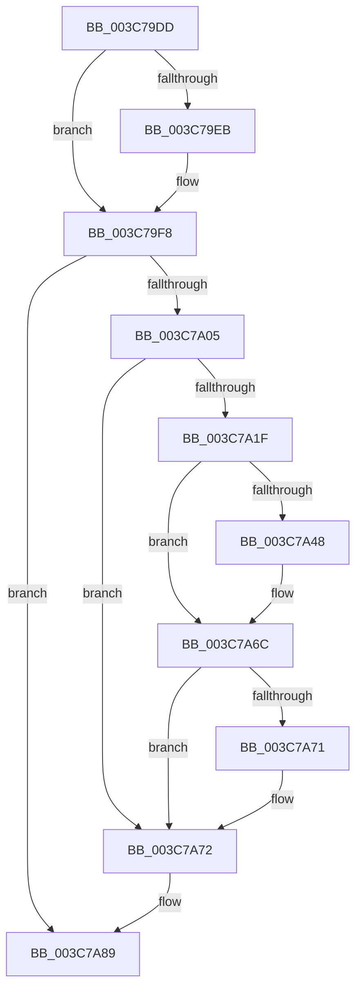

# sub_003C79DD

- RVA: `0x003C79DD`–`0x003C7AA9` (길이 `204` bytes)
- VA: `0x00000001403C79DD`
- 실행 섹션: `.text`
- PDB 이름 있음: `아니요`; PDB Function 태그: `아니요`
- unwind 정보 RVA: `0x0008E7AC`
- 디코드: `44`개 명령, `204/204` bytes 표시
- 미해석 바이트: `0` (있으면 어셈블리에 `.byte`로 보존)

> 이 문서는 커널 이미지의 기계어와 PDB 기호를 분석해 생성했습니다. 4번과 5번은 함수 원형과 자료형을 바이너리 사용 방식에서 추정한 C 해석이며 원본 소스 복구 결과는 아닙니다.

## 1. Dependencies

- 직접 호출 지점: **3**; 고유 호출 대상: **3**
- 직접 호출자로 확인된 함수: **0**
- RIP 상대 이미지 참조: **2**

### Outgoing calls
- `0x003C79F3` → [KiLowerIrqlProcessIrqlFlags](../4F/KiLowerIrqlProcessIrqlFlags_function_004F5698.md) (function, `0x004F5698`)
- `0x003C7A28` → [HalpDisableInterrupts](../25/HalpDisableInterrupts_function_002521A0.md) (function, `0x002521A0`)
- `0x003C7A84` → [HalpInterruptSendIpi](../25/HalpInterruptSendIpi_function_00252310.md) (function, `0x00252310`)

### Direct callers
- 이 함수 시작 RVA로 연결되는 직접 call은 확인되지 않았습니다. 간접 호출은 완전히 역산할 수 없습니다.

### Static image references
- `0x003C79DD` → RVA `0x00FC6D20` (`ALMOSTRO`; read)
- `0x003C7A0E` → RVA `0x00FC6BC5` (`ALMOSTRO`; read)

## 2. Other-region calls and transfers

- 다른 실행 섹션으로 향하는 call: **0**
- 별도 외부 분기/꼬리 이동을 확인하지 못했습니다.

## 3. Assembly (complete function range)

```asm
003C79DD  83 3D 3C F3 BF 00 00            cmp dword ptr [rip + 0xbff33c], 0
003C79E4  0F B6 74 24 20                  movzx esi, byte ptr [rsp + 0x20]
003C79E9  74 0D                           je 0x1403c79f8
003C79EB  44 0F 20 C1                     mov rcx, cr8
003C79EF  40 0F B6 D6                     movzx edx, sil
003C79F3  E8 A0 DC 12 00                  call 0x1404f5698
003C79F8  44 0F 22 C6                     mov cr8, rsi
003C79FC  48 39 3F                        cmp qword ptr [rdi], rdi
003C79FF  0F 84 84 00 00 00               je 0x1403c7a89
003C7A05  33 C0                           xor eax, eax
003C7A07  C6 83 C1 00 00 00 01            mov byte ptr [rbx + 0xc1], 1
003C7A0E  38 05 B1 F1 BF 00               cmp byte ptr [rip + 0xbff1b1], al
003C7A14  0F 57 C0                        xorps xmm0, xmm0
003C7A17  F3 0F 7F 44 24 2C               movdqu xmmword ptr [rsp + 0x2c], xmm0
003C7A1D  74 53                           je 0x1403c7a72
003C7A1F  65 4C 8B 04 25 20 00 00 00      mov r8, qword ptr gs:[0x20]
003C7A28  E8 73 A7 E8 FF                  call 0x1402521a0
003C7A2D  41 8B 90 A8 00 00 00            mov edx, dword ptr [r8 + 0xa8]
003C7A34  44 0F B6 C8                     movzx r9d, al
003C7A38  8B CA                           mov ecx, edx
003C7A3A  83 C9 02                        or ecx, 2
003C7A3D  41 89 88 A8 00 00 00            mov dword ptr [r8 + 0xa8], ecx
003C7A44  85 D2                           test edx, edx
003C7A46  75 24                           jne 0x1403c7a6c
003C7A48  B9 15 00 01 C0                  mov ecx, 0xc0010015
003C7A4D  0F 32                           rdmsr
003C7A4F  48 C1 E2 20                     shl rdx, 0x20
003C7A53  48 0B C2                        or rax, rdx
003C7A56  48 BA 00 00 00 00 01 00 00 00   movabs rdx, 0x100000000
003C7A60  48 0B C2                        or rax, rdx
003C7A63  48 8B D0                        mov rdx, rax
003C7A66  48 C1 EA 20                     shr rdx, 0x20
003C7A6A  0F 30                           wrmsr
003C7A6C  45 84 C9                        test r9b, r9b
003C7A6F  74 01                           je 0x1403c7a72
003C7A71  FB                              sti
003C7A72  BA 1F 00 00 00                  mov edx, 0x1f
003C7A77  C7 44 24 28 05 00 00 00         mov dword ptr [rsp + 0x28], 5
003C7A7F  48 8D 4C 24 28                  lea rcx, [rsp + 0x28]
003C7A84  E8 87 A8 E8 FF                  call 0x140252310
003C7A89  48 8B BC 24 98 00 00 00         mov rdi, qword ptr [rsp + 0x98]
003C7A91  4C 8B AC 24 90 00 00 00         mov r13, qword ptr [rsp + 0x90]
003C7A99  48 8B 9C 24 B8 00 00 00         mov rbx, qword ptr [rsp + 0xb8]
003C7AA1  4C 8B B4 24 88 00 00 00         mov r14, qword ptr [rsp + 0x88]
```

## 4. C-style interpretation (structured pseudocode)

```c
__int64 __fastcall sub_003C79DD(__int64 a1, __int64 a2, __int64 a3, __int64 a4, __int64 a5, __int64 a6, __int64 a7, __int64 a8, __int64 a9, __int64 a10, __int64 a11, __int64 a12, __int64 a13, __int64 a14, __int64 a15, __int64 a16, __int64 a17, __int64 a18, __int64 a19, __int64 a20, __int64 a21, __int64 a22, __int64 a23)
{
    __int64 result;
    unsigned __int8 v_stack_p20;
    unsigned int v_stack_p28;
    unsigned __int64 v_stack_p2C;

    if ((*(unsigned int *)(v_rip + 12579644)) != 0) {
        a1 = v_cr8;
        a2 = (unsigned __int8)(v_stack_p20);
        result = KiLowerIrqlProcessIrqlFlags(a1, a2, a3, a4);
    }
    if ((*(unsigned __int64 *)(v_rdi)) == v_rdi) goto loc_003C7A89;
    result = 0;
    *(unsigned __int8 *)(v_rbx + 193) = 1;
    v_stack_p2C = v_xmm0;
    if ((*(unsigned __int8 *)(v_rip + 12579249)) == 0) goto loc_003C7A72;
    result = HalpDisableInterrupts(a1, a2, *(unsigned __int64 *)(gs_base + (0 + 32)), a4);
    a1 = (unsigned int)(((unsigned int)((unsigned int)((unsigned int)(*(unsigned int *)(*(unsigned __int64 *)(gs_base + (0 + 32)) + 168))))) | (2));
    *(unsigned int *)(*(unsigned __int64 *)(gs_base + (0 + 32)) + 168) = (unsigned int)(a1);
    if ((unsigned int)((unsigned int)(*(unsigned int *)(*(unsigned __int64 *)(gs_base + (0 + 32)) + 168))) == 0) {
        a1 = 0xC0010015ULL;
        a2 = ((unsigned int)(*(unsigned int *)(*(unsigned __int64 *)(gs_base + (0 + 32)) + 168))) << (32);
        result = (result) | (a2);
        result = (result) | (a2);
        a2 = result;
        a2 = (a2) >> (32);
    }
    if ((unsigned __int8)((unsigned __int8)(result)) != 0) {
    }
    v_stack_p28 = 5;
    result = HalpInterruptSendIpi(a5, 31, *(unsigned __int64 *)(gs_base + (0 + 32)), (unsigned __int8)(result));
loc_003C7A89:
    return result;
}
```

## 5. (Beta) C Style

```c
int64_t sub_003C79DD(int64_t Arg1, int64_t Arg2, int64_t Arg3, int64_t Arg4, int64_t Arg5, uint64_t Arg6, uint64_t Arg7, uint64_t Arg8, uint64_t Arg9, uint64_t Arg10, uint64_t Arg11, uint64_t Arg12, uint64_t Arg13, uint64_t Arg14, uint64_t Arg15, uint64_t Arg16, int64_t Arg17, int64_t Arg18, int64_t Arg19, uint64_t Arg20, uint64_t Arg21, uint64_t Arg22, int64_t Arg23)
{
    int64_t result;
    uint8_t v_stack_p20;
    uint32_t v_stack_p28;
    uint64_t v_stack_p2C;

    if ((*(uint32_t *)(v_rip + 0xBFF33C)) != 0) {
        Arg1 = v_cr8;
        Arg2 = (uint8_t)(v_stack_p20);
        result = KiLowerIrqlProcessIrqlFlags(Arg1, Arg2, Arg3, Arg4);
    }
    if ((*(uint64_t *)(local_rdi)) == local_rdi) goto loc_003C7A89;
    result = 0;
    *(uint8_t *)(local_rbx + 0xC1) = 1;
    v_stack_p2C = v_xmm0;
    if ((*(uint8_t *)(v_rip + 0xBFF1B1)) == 0) goto loc_003C7A72;
    result = HalpDisableInterrupts(Arg1, Arg2, *(uint64_t *)(gs_base + (0 + 0x20)), Arg4);
    Arg1 = (uint32_t)(((uint32_t)((uint32_t)((uint32_t)(*(uint32_t *)(*(uint64_t *)(gs_base + (0 + 0x20)) + 0xA8))))) | (2));
    *(uint32_t *)(*(uint64_t *)(gs_base + (0 + 0x20)) + 0xA8) = (uint32_t)(Arg1);
    if ((uint32_t)((uint32_t)(*(uint32_t *)(*(uint64_t *)(gs_base + (0 + 0x20)) + 0xA8))) == 0) {
        Arg1 = 0xC0010015ULL;
        Arg2 = ((uint32_t)(*(uint32_t *)(*(uint64_t *)(gs_base + (0 + 0x20)) + 0xA8))) << (32);
        result = (result) | (Arg2);
        result = (result) | (Arg2);
        Arg2 = result;
        Arg2 = (Arg2) >> (32);
    }
    if ((uint8_t)((uint8_t)(result)) != 0) {
    }
    v_stack_p28 = 5;
    result = HalpInterruptSendIpi(Arg5, 31, *(uint64_t *)(gs_base + (0 + 0x20)), (uint8_t)(result));
loc_003C7A89:
    return result;
}
```

## 6. Execution-region graph

[열기: 2D/3D 그래프와 함수 탐색 컨트롤 패널](../../../control-panel.html?section=text&rva=0x003C79DD&view=graph)

- 2D 그래프는 위에서 아래로 흐르고, 3D 그래프는 빈 공간을 드래그해 회전합니다. Shift+드래그는 이동, 휠은 확대·축소, 함수 노드 선택은 대상 보고서 이동입니다.

### Static fallback


