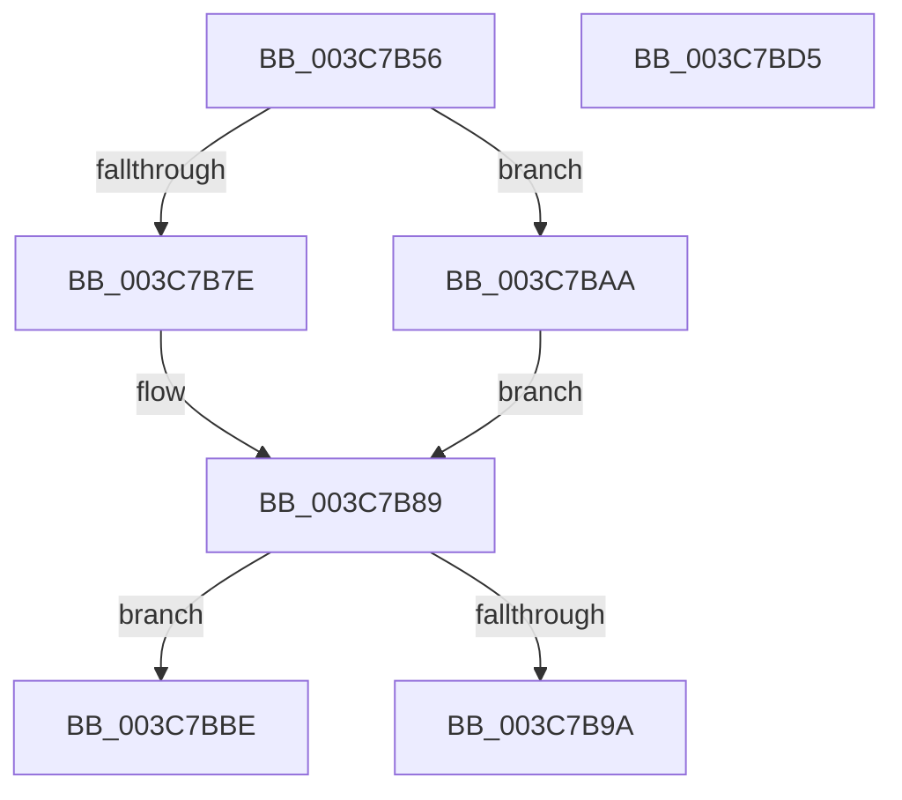

# sub_003C7B56

- RVA: `0x003C7B56`–`0x003C7BE2` (길이 `140` bytes)
- VA: `0x00000001403C7B56`
- 실행 섹션: `.text`
- PDB 이름 있음: `아니요`; PDB Function 태그: `아니요`
- unwind 정보 RVA: `0x0008E83C`
- 디코드: `38`개 명령, `140/140` bytes 표시
- 미해석 바이트: `0` (있으면 어셈블리에 `.byte`로 보존)

> 이 문서는 커널 이미지의 기계어와 PDB 기호를 분석해 생성했습니다. 4번과 5번은 함수 원형과 자료형을 바이너리 사용 방식에서 추정한 C 해석이며 원본 소스 복구 결과는 아닙니다.

## 1. Dependencies

- 직접 호출 지점: **1**; 고유 호출 대상: **1**
- 직접 호출자로 확인된 함수: **0**
- RIP 상대 이미지 참조: **0**

### Outgoing calls
- `0x003C7BD8` → [HvlSwitchVirtualAddressSpace](HvlSwitchVirtualAddressSpace_function_003C7C60.md) (function, `0x003C7C60`)

### Direct callers
- 이 함수 시작 RVA로 연결되는 직접 call은 확인되지 않았습니다. 간접 호출은 완전히 역산할 수 없습니다.

### Static image references
- 디코드된 RIP-relative 메모리 참조가 없습니다.

## 2. Other-region calls and transfers

- 다른 실행 섹션으로 향하는 call: **0**
- call이 아닌 외부 분기/꼬리 이동: **3**
  - `0x003C7BA5` → [sub_003C789A + 0x80](Unknown_function_003C789A.md) (`tail-transfer`)
  - `0x003C7BD0` → [sub_003C789A + 0x80](Unknown_function_003C789A.md) (`tail-transfer`)
  - `0x003C7BDD` → [sub_003C789A + 0x10D](Unknown_function_003C789A.md) (`tail-transfer`)

## 3. Assembly (complete function range)

```asm
003C7B56  49 8B 46 20                     mov rax, qword ptr [r14 + 0x20]
003C7B5A  48 89 47 20                     mov qword ptr [rdi + 0x20], rax
003C7B5E  41 0F B6 46 28                  movzx eax, byte ptr [r14 + 0x28]
003C7B63  88 47 28                        mov byte ptr [rdi + 0x28], al
003C7B66  41 0F B6 46 29                  movzx eax, byte ptr [r14 + 0x29]
003C7B6B  88 47 29                        mov byte ptr [rdi + 0x29], al
003C7B6E  41 0F B6 46 2A                  movzx eax, byte ptr [r14 + 0x2a]
003C7B73  88 47 2A                        mov byte ptr [rdi + 0x2a], al
003C7B76  49 8B 0E                        mov rcx, qword ptr [r14]
003C7B79  49 3B CE                        cmp rcx, r14
003C7B7C  75 2C                           jne 0x1403c7baa
003C7B7E  48 89 7F 08                     mov qword ptr [rdi + 8], rdi
003C7B82  48 89 3F                        mov qword ptr [rdi], rdi
003C7B85  C6 47 29 00                     mov byte ptr [rdi + 0x29], 0
003C7B89  49 8B 56 10                     mov rdx, qword ptr [r14 + 0x10]
003C7B8D  49 8D 46 10                     lea rax, [r14 + 0x10]
003C7B91  48 3B D0                        cmp rdx, rax
003C7B94  48 8D 47 10                     lea rax, [rdi + 0x10]
003C7B98  75 24                           jne 0x1403c7bbe
003C7B9A  48 89 40 08                     mov qword ptr [rax + 8], rax
003C7B9E  48 89 00                        mov qword ptr [rax], rax
003C7BA1  C6 47 2A 00                     mov byte ptr [rdi + 0x2a], 0
003C7BA5  E9 70 FD FF FF                  jmp 0x1403c791a
003C7BAA  49 8B 46 08                     mov rax, qword ptr [r14 + 8]
003C7BAE  48 89 0F                        mov qword ptr [rdi], rcx
003C7BB1  48 89 47 08                     mov qword ptr [rdi + 8], rax
003C7BB5  48 89 79 08                     mov qword ptr [rcx + 8], rdi
003C7BB9  48 89 38                        mov qword ptr [rax], rdi
003C7BBC  EB CB                           jmp 0x1403c7b89
003C7BBE  49 8B 4E 18                     mov rcx, qword ptr [r14 + 0x18]
003C7BC2  48 89 10                        mov qword ptr [rax], rdx
003C7BC5  48 89 4F 18                     mov qword ptr [rdi + 0x18], rcx
003C7BC9  48 89 42 08                     mov qword ptr [rdx + 8], rax
003C7BCD  48 89 01                        mov qword ptr [rcx], rax
003C7BD0  E9 45 FD FF FF                  jmp 0x1403c791a
003C7BD5  48 8B CD                        mov rcx, rbp
003C7BD8  E8 83 00 00 00                  call 0x1403c7c60
003C7BDD  E9 C5 FD FF FF                  jmp 0x1403c79a7
```

## 4. C-style interpretation (structured pseudocode)

```c
__int64 __fastcall sub_003C7B56(void)
{
    *(unsigned __int64 *)(v_rdi + 32) = *(unsigned __int64 *)(v_r14 + 32);
    *(unsigned __int8 *)(v_rdi + 40) = (unsigned __int8)(*(unsigned __int8 *)(v_r14 + 40));
    *(unsigned __int8 *)(v_rdi + 41) = (unsigned __int8)(*(unsigned __int8 *)(v_r14 + 41));
    *(unsigned __int8 *)(v_rdi + 42) = (unsigned __int8)(*(unsigned __int8 *)(v_r14 + 42));
    if ((*(unsigned __int64 *)(v_r14)) != v_r14) goto loc_003C7BAA;
    *(unsigned __int64 *)(v_rdi + 8) = v_rdi;
    *(unsigned __int64 *)(v_rdi) = v_rdi;
    *(unsigned __int8 *)(v_rdi + 41) = 0;
loc_003C7B89:
    if ((*(unsigned __int64 *)(v_r14 + 16)) != (v_r14 + 16)) goto loc_003C7BBE;
    *(unsigned __int64 *)(v_rdi + 16 + 8) = v_rdi + 16;
    *(unsigned __int64 *)(v_rdi + 16) = v_rdi + 16;
    *(unsigned __int8 *)(v_rdi + 42) = 0;
loc_003C7BAA:
    *(unsigned __int64 *)(v_rdi) = *(unsigned __int64 *)(v_r14);
    *(unsigned __int64 *)(v_rdi + 8) = *(unsigned __int64 *)(v_r14 + 8);
    *(unsigned __int64 *)(*(unsigned __int64 *)(v_r14) + 8) = v_rdi;
    *(unsigned __int64 *)(*(unsigned __int64 *)(v_r14 + 8)) = v_rdi;
    goto loc_003C7B89;
loc_003C7BBE:
    *(unsigned __int64 *)(*(unsigned __int64 *)(v_r14 + 8)) = *(unsigned __int64 *)(v_r14 + 16);
    *(unsigned __int64 *)(v_rdi + 24) = *(unsigned __int64 *)(v_r14 + 24);
    *(unsigned __int64 *)(*(unsigned __int64 *)(v_r14 + 16) + 8) = *(unsigned __int64 *)(v_r14 + 8);
    *(unsigned __int64 *)(*(unsigned __int64 *)(v_r14 + 24)) = *(unsigned __int64 *)(v_r14 + 8);
}
```

## 5. (Beta) C Style

```c
void sub_003C7B56(void)
{
    *(uint64_t *)(local_rdi + 0x20) = *(uint64_t *)(local_r14 + 0x20);
    *(uint8_t *)(local_rdi + 0x28) = (uint8_t)(*(uint8_t *)(local_r14 + 0x28));
    *(uint8_t *)(local_rdi + 0x29) = (uint8_t)(*(uint8_t *)(local_r14 + 0x29));
    *(uint8_t *)(local_rdi + 0x2A) = (uint8_t)(*(uint8_t *)(local_r14 + 0x2A));
    if ((*(uint64_t *)(local_r14)) != local_r14) goto loc_003C7BAA;
    *(uint64_t *)(local_rdi + 0x8) = local_rdi;
    *(uint64_t *)(local_rdi) = local_rdi;
    *(uint8_t *)(local_rdi + 0x29) = 0;
loc_003C7B89:
    if ((*(uint64_t *)(local_r14 + 0x10)) != (local_r14 + 16)) goto loc_003C7BBE;
    *(uint64_t *)(local_rdi + 0x10 + 0x8) = local_rdi + 16;
    *(uint64_t *)(local_rdi + 0x10) = local_rdi + 16;
    *(uint8_t *)(local_rdi + 0x2A) = 0;
loc_003C7BAA:
    *(uint64_t *)(local_rdi) = *(uint64_t *)(local_r14);
    *(uint64_t *)(local_rdi + 0x8) = *(uint64_t *)(local_r14 + 0x8);
    *(uint64_t *)(*(uint64_t *)(local_r14) + 0x8) = local_rdi;
    *(uint64_t *)(*(uint64_t *)(local_r14 + 0x8)) = local_rdi;
    goto loc_003C7B89;
loc_003C7BBE:
    *(uint64_t *)(*(uint64_t *)(local_r14 + 0x8)) = *(uint64_t *)(local_r14 + 0x10);
    *(uint64_t *)(local_rdi + 0x18) = *(uint64_t *)(local_r14 + 0x18);
    *(uint64_t *)(*(uint64_t *)(local_r14 + 0x10) + 0x8) = *(uint64_t *)(local_r14 + 0x8);
    *(uint64_t *)(*(uint64_t *)(local_r14 + 0x18)) = *(uint64_t *)(local_r14 + 0x8);
}
```

## 6. Execution-region graph

[열기: 2D/3D 그래프와 함수 탐색 컨트롤 패널](../../../control-panel.html?section=text&rva=0x003C7B56&view=graph)

- 2D 그래프는 위에서 아래로 흐르고, 3D 그래프는 빈 공간을 드래그해 회전합니다. Shift+드래그는 이동, 휠은 확대·축소, 함수 노드 선택은 대상 보고서 이동입니다.

### Static fallback


