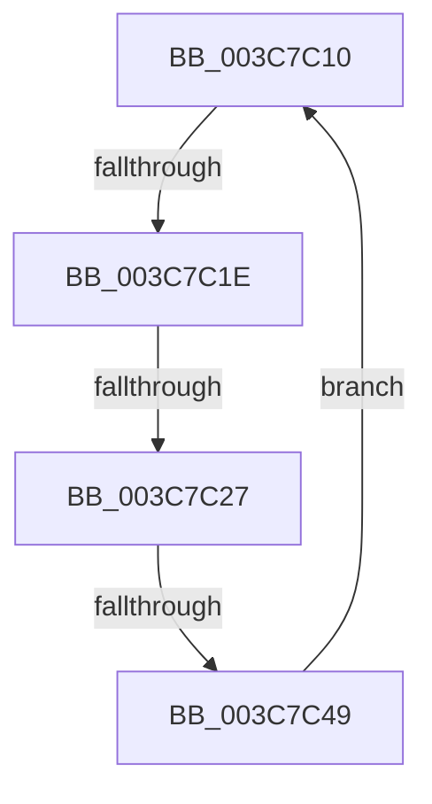

# sub_003C7C10

- RVA: `0x003C7C10`–`0x003C7C50` (길이 `64` bytes)
- VA: `0x00000001403C7C10`
- 실행 섹션: `.text`
- PDB 이름 있음: `아니요`; PDB Function 태그: `아니요`
- unwind 정보 RVA: `0x0008E8B8`
- 디코드: `13`개 명령, `64/64` bytes 표시
- 미해석 바이트: `0` (있으면 어셈블리에 `.byte`로 보존)

> 이 문서는 커널 이미지의 기계어와 PDB 기호를 분석해 생성했습니다. 4번과 5번은 함수 원형과 자료형을 바이너리 사용 방식에서 추정한 C 해석이며 원본 소스 복구 결과는 아닙니다.

## 1. Dependencies

- 직접 호출 지점: **2**; 고유 호출 대상: **2**
- 직접 호출자로 확인된 함수: **0**
- RIP 상대 이미지 참조: **0**

### Outgoing calls
- `0x003C7C2A` → [KiReleaseThreadLockLowerIrql](KiReleaseThreadLockLowerIrql_function_003C65D0.md) (function, `0x003C65D0`)
- `0x003C7C37` → [KiAcquireThreadLockRaiseToDpc](../39/KiAcquireThreadLockRaiseToDpc_function_00396280.md) (function, `0x00396280`)

### Direct callers
- 이 함수 시작 RVA로 연결되는 직접 call은 확인되지 않았습니다. 간접 호출은 완전히 역산할 수 없습니다.

### Static image references
- 디코드된 RIP-relative 메모리 참조가 없습니다.

## 2. Other-region calls and transfers

- 다른 실행 섹션으로 향하는 call: **0**
- call이 아닌 외부 분기/꼬리 이동: **3**
  - `0x003C7C18` → [sub_003C77D1 + 0x86](Unknown_function_003C77D1.md) (`tail-transfer`)
  - `0x003C7C21` → [sub_003C77D1 + 0x86](Unknown_function_003C77D1.md) (`tail-transfer`)
  - `0x003C7C43` → [sub_003C77D1 + 0x86](Unknown_function_003C77D1.md) (`tail-transfer`)

## 3. Assembly (complete function range)

```asm
003C7C10  66 83 BB E6 01 00 00 00         cmp word ptr [rbx + 0x1e6], 0
003C7C18  0F 85 39 FC FF FF               jne 0x1403c7857
003C7C1E  80 FA 01                        cmp dl, 1
003C7C21  0F 83 30 FC FF FF               jae 0x1403c7857
003C7C27  48 8B CB                        mov rcx, rbx
003C7C2A  E8 A1 E9 FF FF                  call 0x1403c65d0
003C7C2F  48 8D 54 24 20                  lea rdx, [rsp + 0x20]
003C7C34  48 8B CB                        mov rcx, rbx
003C7C37  E8 44 E6 FC FF                  call 0x140396280
003C7C3C  80 BB C1 00 00 00 00            cmp byte ptr [rbx + 0xc1], 0
003C7C43  0F 84 0E FC FF FF               je 0x1403c7857
003C7C49  0F B6 54 24 20                  movzx edx, byte ptr [rsp + 0x20]
003C7C4E  EB C0                           jmp 0x1403c7c10
```

## 4. C-style interpretation (structured pseudocode)

```c
__int64 __fastcall sub_003C7C10(__int64 a1, unsigned __int8 a2)
{
    __int64 result;
    unsigned __int64 v_stack_p20;

    result = KiReleaseThreadLockLowerIrql(v_rbx, a2, a3, a4);
    result = KiAcquireThreadLockRaiseToDpc(v_rbx, v_stack_p20, a3, a4);
    goto loc_003C7C10;
}
```

## 5. (Beta) C Style

```c
int64_t sub_003C7C10(int64_t Arg1, uint8_t Arg2)
{
    int64_t result;
    uint64_t v_stack_p20;

    result = KiReleaseThreadLockLowerIrql(local_rbx, Arg2, a3, a4);
    result = KiAcquireThreadLockRaiseToDpc(local_rbx, v_stack_p20, a3, a4);
    goto loc_003C7C10;
}
```

## 6. Execution-region graph

[열기: 2D/3D 그래프와 함수 탐색 컨트롤 패널](../../../control-panel.html?section=text&rva=0x003C7C10&view=graph)

- 2D 그래프는 위에서 아래로 흐르고, 3D 그래프는 빈 공간을 드래그해 회전합니다. Shift+드래그는 이동, 휠은 확대·축소, 함수 노드 선택은 대상 보고서 이동입니다.

### Static fallback


