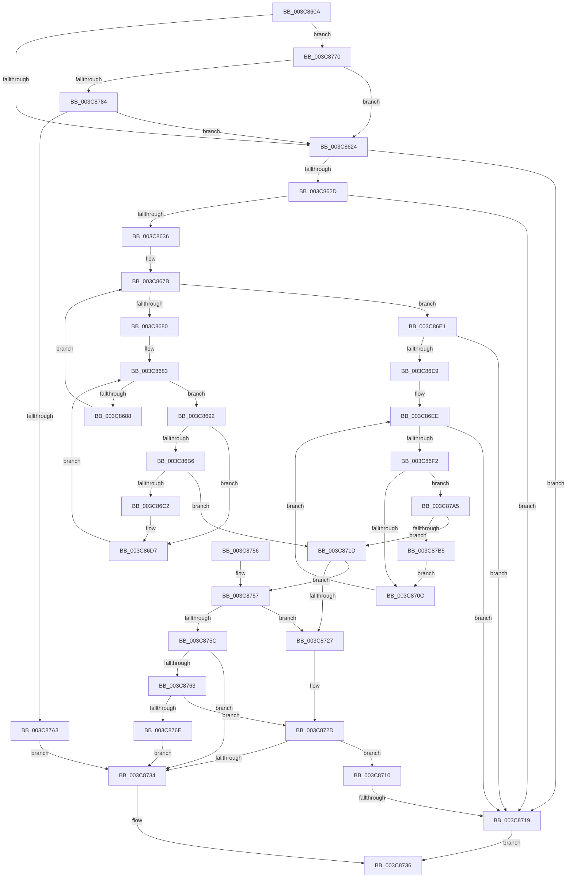

# sub_003C860A

- RVA: `0x003C860A`–`0x003C87C8` (길이 `446` bytes)
- VA: `0x00000001403C860A`
- 실행 섹션: `.text`
- PDB 이름 있음: `아니요`; PDB Function 태그: `아니요`
- unwind 정보 RVA: `0x0008E994`
- 디코드: `115`개 명령, `446/446` bytes 표시
- 미해석 바이트: `0` (있으면 어셈블리에 `.byte`로 보존)

> 이 문서는 커널 이미지의 기계어와 PDB 기호를 분석해 생성했습니다. 4번과 5번은 함수 원형과 자료형을 바이너리 사용 방식에서 추정한 C 해석이며 원본 소스 복구 결과는 아닙니다.

## 1. Dependencies

- 직접 호출 지점: **3**; 고유 호출 대상: **1**
- 직접 호출자로 확인된 함수: **0**
- RIP 상대 이미지 참조: **2**

### Outgoing calls
- `0x003C86B9` → [memcmp](../6C/memcmp_function_006C6B10.md) (function, `0x006C6B10`)
- `0x003C8796` → [memcmp](../6C/memcmp_function_006C6B10.md) (function, `0x006C6B10`)
- `0x003C87A8` → [memcmp](../6C/memcmp_function_006C6B10.md) (function, `0x006C6B10`)

### Direct callers
- 이 함수 시작 RVA로 연결되는 직접 call은 확인되지 않았습니다. 간접 호출은 완전히 역산할 수 없습니다.

### Static image references
- `0x003C8671` → RVA `0x00011DE0` (`.rdata`; read)
- `0x003C8770` → RVA `0x00E67CF0` (`.data`; read)

## 2. Other-region calls and transfers

- 다른 실행 섹션으로 향하는 call: **0**
- call이 아닌 외부 분기/꼬리 이동: **1**
  - `0x003C8713` → [sub_003C87FE](Unknown_function_003C87FE.md) (`tail-transfer`)

## 3. Assembly (complete function range)

```asm
003C860A  48 89 6C 24 60                  mov qword ptr [rsp + 0x60], rbp
003C860F  48 89 74 24 30                  mov qword ptr [rsp + 0x30], rsi
003C8614  48 89 7C 24 28                  mov qword ptr [rsp + 0x28], rdi
003C8619  4C 89 6C 24 20                  mov qword ptr [rsp + 0x20], r13
003C861E  0F 85 4C 01 00 00               jne 0x1403c8770
003C8624  4D 85 F6                        test r14, r14
003C8627  0F 84 EC 00 00 00               je 0x1403c8719
003C862D  4D 85 FF                        test r15, r15
003C8630  0F 84 E3 00 00 00               je 0x1403c8719
003C8636  41 0F B6 47 01                  movzx eax, byte ptr [r15 + 1]
003C863B  45 0F B7 0F                     movzx r9d, word ptr [r15]
003C863F  66 44 89 8C 24 88 00 00 00      mov word ptr [rsp + 0x88], r9w
003C8648  41 0F B6 4C 87 04               movzx ecx, byte ptr [r15 + rax*4 + 4]
003C864E  44 8D 04 85 08 00 00 00         lea r8d, [rax*4 + 8]
003C8656  8B D9                           mov ebx, ecx
003C8658  44 89 44 24 68                  mov dword ptr [rsp + 0x68], r8d
003C865D  48 C1 EB 04                     shr rbx, 4
003C8661  83 E1 0F                        and ecx, 0xf
003C8664  49 8B 9C DE 90 00 00 00         mov rbx, qword ptr [r14 + rbx*8 + 0x90]
003C866C  49 23 5C CE 10                  and rbx, qword ptr [r14 + rcx*8 + 0x10]
003C8671  48 8D 0D 68 97 C4 FF            lea rcx, [rip - 0x3b6898]
003C8678  40 32 ED                        xor bpl, bpl
003C867B  48 85 DB                        test rbx, rbx
003C867E  74 61                           je 0x1403c86e1
003C8680  0F B6 FB                        movzx edi, bl
003C8683  40 84 FF                        test dil, dil
003C8686  75 0A                           jne 0x1403c8692
003C8688  40 80 C5 08                     add bpl, 8
003C868C  48 C1 EB 08                     shr rbx, 8
003C8690  EB E9                           jmp 0x1403c867b
003C8692  4D 8B 6E 08                     mov r13, qword ptr [r14 + 8]
003C8696  40 0F B6 F5                     movzx esi, bpl
003C869A  40 0F B6 C7                     movzx eax, dil
003C869E  44 0F B6 24 08                  movzx r12d, byte ptr [rax + rcx]
003C86A3  41 03 F4                        add esi, r12d
003C86A6  48 C1 E6 04                     shl rsi, 4
003C86AA  49 03 F5                        add rsi, r13
003C86AD  48 8B 16                        mov rdx, qword ptr [rsi]
003C86B0  66 44 39 0A                     cmp word ptr [rdx], r9w
003C86B4  75 21                           jne 0x1403c86d7
003C86B6  49 8B CF                        mov rcx, r15
003C86B9  E8 52 E4 2F 00                  call 0x1406c6b10
003C86BE  85 C0                           test eax, eax
003C86C0  74 5B                           je 0x1403c871d
003C86C2  44 8B 44 24 68                  mov r8d, dword ptr [rsp + 0x68]
003C86C7  48 8D 0D 12 97 C4 FF            lea rcx, [rip - 0x3b68ee]
003C86CE  44 0F B7 8C 24 88 00 00 00      movzx r9d, word ptr [rsp + 0x88]
003C86D7  40 0F B6 FF                     movzx edi, dil
003C86DB  44 0F BB E7                     btc edi, r12d
003C86DF  EB A2                           jmp 0x1403c8683
003C86E1  41 8B 1E                        mov ebx, dword ptr [r14]
003C86E4  83 FB 40                        cmp ebx, 0x40
003C86E7  76 30                           jbe 0x1403c8719
003C86E9  BF 40 00 00 00                  mov edi, 0x40
003C86EE  3B FB                           cmp edi, ebx
003C86F0  73 27                           jae 0x1403c8719
003C86F2  4D 8B 6E 08                     mov r13, qword ptr [r14 + 8]
003C86F6  8B F7                           mov esi, edi
003C86F8  48 C1 E6 04                     shl rsi, 4
003C86FC  49 03 F5                        add rsi, r13
003C86FF  48 8B 16                        mov rdx, qword ptr [rsi]
003C8702  66 44 39 0A                     cmp word ptr [rdx], r9w
003C8706  0F 84 99 00 00 00               je 0x1403c87a5
003C870C  FF C7                           inc edi
003C870E  EB DE                           jmp 0x1403c86ee
003C8710  45 84 E4                        test r12b, r12b
003C8713  0F 85 E5 00 00 00               jne 0x1403c87fe
003C8719  32 C0                           xor al, al
003C871B  EB 19                           jmp 0x1403c8736
003C871D  80 BC 24 80 00 00 00 00         cmp byte ptr [rsp + 0x80], 0
003C8725  74 30                           je 0x1403c8757
003C8727  44 0F B6 64 24 78               movzx r12d, byte ptr [rsp + 0x78]
003C872D  8B 46 08                        mov eax, dword ptr [rsi + 8]
003C8730  A8 04                           test al, 4
003C8732  74 DC                           je 0x1403c8710
003C8734  B0 01                           mov al, 1
003C8736  4C 8B 6C 24 20                  mov r13, qword ptr [rsp + 0x20]
003C873B  48 8B 7C 24 28                  mov rdi, qword ptr [rsp + 0x28]
003C8740  48 8B 74 24 30                  mov rsi, qword ptr [rsp + 0x30]
003C8745  48 8B 6C 24 60                  mov rbp, qword ptr [rsp + 0x60]
003C874A  48 83 C4 38                     add rsp, 0x38
003C874E  41 5F                           pop r15
003C8750  41 5E                           pop r14
003C8752  41 5C                           pop r12
003C8754  5B                              pop rbx
003C8755  C3                              ret
003C8756  CC                              int3
003C8757  49 3B F5                        cmp rsi, r13
003C875A  75 CB                           jne 0x1403c8727
003C875C  8B 46 08                        mov eax, dword ptr [rsi + 8]
003C875F  A8 10                           test al, 0x10
003C8761  74 D1                           je 0x1403c8734
003C8763  44 0F B6 64 24 78               movzx r12d, byte ptr [rsp + 0x78]
003C8769  45 84 E4                        test r12b, r12b
003C876C  74 BF                           je 0x1403c872d
003C876E  EB C4                           jmp 0x1403c8734
003C8770  48 8B 0D 79 F5 A9 00            mov rcx, qword ptr [rip + 0xa9f579]
003C8777  0F B7 01                        movzx eax, word ptr [rcx]
003C877A  66 41 3B 07                     cmp ax, word ptr [r15]
003C877E  0F 85 A0 FE FF FF               jne 0x1403c8624
003C8784  44 8B C0                        mov r8d, eax
003C8787  49 8B D7                        mov rdx, r15
003C878A  49 C1 E8 08                     shr r8, 8
003C878E  4E 8D 04 85 08 00 00 00         lea r8, [r8*4 + 8]
003C8796  E8 75 E3 2F 00                  call 0x1406c6b10
003C879B  85 C0                           test eax, eax
003C879D  0F 85 81 FE FF FF               jne 0x1403c8624
003C87A3  EB 8F                           jmp 0x1403c8734
003C87A5  49 8B CF                        mov rcx, r15
003C87A8  E8 63 E3 2F 00                  call 0x1406c6b10
003C87AD  85 C0                           test eax, eax
003C87AF  0F 84 68 FF FF FF               je 0x1403c871d
003C87B5  44 8B 44 24 68                  mov r8d, dword ptr [rsp + 0x68]
003C87BA  44 0F B7 8C 24 88 00 00 00      movzx r9d, word ptr [rsp + 0x88]
003C87C3  E9 44 FF FF FF                  jmp 0x1403c870c
```

## 4. C-style interpretation (structured pseudocode)

```c
__int64 __fastcall sub_003C860A(__int64 a1, __int64 a2, __int64 a3, __int64 a4, __int64 a5, __int64 a6, __int64 a7, __int64 a8, __int64 a9, __int64 a10, __int64 a11, __int64 a12, unsigned int a13, __int64 a14, unsigned __int8 a15, unsigned __int8 a16, unsigned __int16 a17)
{
    __int64 result;
    __int64 v_rbp;
    __int64 v_rbx;
    __int64 v_rdi;
    __int64 v_rsi;
    __int64 v_rsp;
    unsigned __int64 v_stack_p20;
    unsigned __int64 v_stack_p28;
    unsigned __int64 v_stack_p30;
    unsigned __int64 v_stack_p60;
    unsigned int v_stack_p68;
    unsigned __int16 v_stack_p88;

    v_stack_p60 = v_rbp;
    v_stack_p30 = v_rsi;
    v_stack_p28 = v_rdi;
    v_stack_p20 = v_r13;
    if (condition_is_not_equal) goto loc_003C8770;
loc_003C8624:
    if (v_r14 == 0) goto loc_003C8719;
    if (v_r15 == 0) goto loc_003C8719;
    v_stack_p88 = (unsigned __int16)(*(unsigned __int16 *)(v_r15));
    v_stack_p68 = (unsigned int)(*(unsigned __int8 *)(v_r15 + 1) * 4 + 8);
    v_rbx = ((unsigned int)((unsigned int)(*(unsigned __int8 *)(v_r15 + *(unsigned __int8 *)(v_r15 + 1) * 4 + 4)))) >> (4);
    a1 = (unsigned int)((*(unsigned __int8 *)(v_r15 + *(unsigned __int8 *)(v_r15 + 1) * 4 + 4)) & (15));
    v_rbx = (*(unsigned __int64 *)(v_r14 + v_rbx * 8 + 144)) & (*(unsigned __int64 *)(v_r14 + a1 * 8 + 16));
    v_rbp = 0;
loc_003C867B:
    if (v_rbx == 0) goto loc_003C86E1;
loc_003C8683:
    if ((unsigned __int8)((unsigned __int8)(v_rbx)) != 0) goto loc_003C8692;
    v_rbp = (unsigned __int8)((v_rbp) + (8));
    v_rbx = (v_rbx) >> (8);
    goto loc_003C867B;
loc_003C8692:
    v_rsi = (unsigned int)(((unsigned __int8)(v_rbp)) + ((unsigned int)(*(unsigned __int8 *)((unsigned __int8)((unsigned __int8)(v_rbx)) + v_rip - 3893400 * 1))));
    v_rsi = (v_rsi) << (4);
    v_rsi = (v_rsi) + (*(unsigned __int64 *)(v_r14 + 8));
    if ((*(unsigned __int16 *)(*(unsigned __int64 *)(v_rsi))) != ((unsigned __int16)(*(unsigned __int16 *)(v_r15)))) goto loc_003C86D7;
    result = memcmp(v_r15, *(unsigned __int64 *)(v_rsi), *(unsigned __int8 *)(v_r15 + 1) * 4 + 8, *(unsigned __int16 *)(v_r15));
    if ((unsigned int)(result) == 0) goto loc_003C871D;
loc_003C86D7:
    goto loc_003C8683;
loc_003C86E1:
    if (((unsigned int)((unsigned int)(*(unsigned int *)(v_r14)))) <= 64) goto loc_003C8719;
loc_003C86EE:
    if (64 >= ((unsigned int)((unsigned int)(*(unsigned int *)(v_r14))))) goto loc_003C8719;
    v_rsi = (64) << (4);
    v_rsi = (v_rsi) + (*(unsigned __int64 *)(v_r14 + 8));
    if ((*(unsigned __int16 *)(*(unsigned __int64 *)(v_rsi))) == a17) goto loc_003C87A5;
loc_003C870C:
    v_rdi = (unsigned int)((64) + 1);
    goto loc_003C86EE;
loc_003C8710:
loc_003C8719:
    result = 0;
    goto loc_003C8736;
loc_003C871D:
    if (a16 == 0) goto loc_003C8757;
loc_003C8727:
loc_003C872D:
    if ((((unsigned __int8)((unsigned int)(*(unsigned int *)(v_rsi + 8)))) & (4)) == 0) goto loc_003C8710;
loc_003C8734:
loc_003C8736:
    v_rsp = (v_rsp) + (56);
    return 1;
loc_003C8757:
    if (a6 != v_stack_p20) goto loc_003C8727;
    if ((((unsigned __int8)((unsigned int)(*(unsigned int *)(a6 + 8)))) & (16)) == 0) goto loc_003C8734;
    if (a15 == 0) goto loc_003C872D;
    goto loc_003C8734;
loc_003C8770:
    if (((unsigned __int16)(*(unsigned __int16 *)(*(unsigned __int64 *)(v_rip + 11138425)))) != (*(unsigned __int16 *)(v_r15))) goto loc_003C8624;
    a3 = ((unsigned int)((unsigned int)(*(unsigned __int16 *)(*(unsigned __int64 *)(v_rip + 11138425))))) >> (8);
    result = memcmp(*(unsigned __int64 *)(v_rip + 11138425), v_r15, a3 * 4 + 8, a17);
    if ((unsigned int)(result) != 0) goto loc_003C8624;
    goto loc_003C8734;
loc_003C87A5:
    result = memcmp(v_r15, v_r15, a3 * 4 + 8, a17);
    if ((unsigned int)(result) == 0) goto loc_003C871D;
    goto loc_003C870C;
}
```

## 5. (Beta) C Style

```c
int64_t sub_003C860A(int64_t Arg1, int64_t Arg2, int64_t Arg3, int64_t Arg4, int64_t Arg5, int64_t Arg6, uint64_t Arg7, uint64_t Arg8, uint64_t Arg9, uint64_t Arg10, uint64_t Arg11, int64_t Arg12, uint32_t Arg13, uint64_t Arg14, uint8_t Arg15, uint8_t Arg16, uint16_t Arg17)
{
    int64_t result;
    int64_t local_rbp;
    int64_t local_rbx;
    int64_t local_rdi;
    int64_t local_rsi;
    int64_t local_rsp;
    uint64_t v_stack_p20;
    uint64_t v_stack_p28;
    uint64_t v_stack_p30;
    uint64_t v_stack_p60;
    uint32_t v_stack_p68;
    uint16_t v_stack_p88;

    v_stack_p60 = local_rbp;
    v_stack_p30 = local_rsi;
    v_stack_p28 = local_rdi;
    v_stack_p20 = local_r13;
    if (condition_is_not_equal) goto loc_003C8770;
loc_003C8624:
    if (local_r14 == 0) goto loc_003C8719;
    if (local_r15 == 0) goto loc_003C8719;
    v_stack_p88 = (uint16_t)(*(uint16_t *)(local_r15));
    v_stack_p68 = (uint32_t)(*(uint8_t *)(local_r15 + 0x1) * 4 + 8);
    local_rbx = ((uint32_t)((uint32_t)(*(uint8_t *)(local_r15 + *(uint8_t *)(local_r15 + 0x1) * 4 + 0x4)))) >> (4);
    Arg1 = (uint32_t)((*(uint8_t *)(local_r15 + *(uint8_t *)(local_r15 + 0x1) * 4 + 0x4)) & (15));
    local_rbx = (*(uint64_t *)(local_r14 + local_rbx * 8 + 0x90)) & (*(uint64_t *)(local_r14 + Arg1 * 8 + 0x10));
    local_rbp = 0;
loc_003C867B:
    if (local_rbx == 0) goto loc_003C86E1;
loc_003C8683:
    if ((uint8_t)((uint8_t)(local_rbx)) != 0) goto loc_003C8692;
    local_rbp = (uint8_t)((local_rbp) + (8));
    local_rbx = (local_rbx) >> (8);
    goto loc_003C867B;
loc_003C8692:
    local_rsi = (uint32_t)(((uint8_t)(local_rbp)) + ((uint32_t)(*(uint8_t *)((uint8_t)((uint8_t)(local_rbx)) + v_rip - 0x3B6898 * 1))));
    local_rsi = (local_rsi) << (4);
    local_rsi = (local_rsi) + (*(uint64_t *)(local_r14 + 0x8));
    if ((*(uint16_t *)(*(uint64_t *)(local_rsi))) != ((uint16_t)(*(uint16_t *)(local_r15)))) goto loc_003C86D7;
    result = memcmp(local_r15, *(uint64_t *)(local_rsi), *(uint8_t *)(local_r15 + 0x1) * 4 + 8, *(uint16_t *)(local_r15));
    if ((uint32_t)(result) == 0) goto loc_003C871D;
loc_003C86D7:
    goto loc_003C8683;
loc_003C86E1:
    if (((uint32_t)((uint32_t)(*(uint32_t *)(local_r14)))) <= 64) goto loc_003C8719;
loc_003C86EE:
    if (64 >= ((uint32_t)((uint32_t)(*(uint32_t *)(local_r14))))) goto loc_003C8719;
    local_rsi = (64) << (4);
    local_rsi = (local_rsi) + (*(uint64_t *)(local_r14 + 0x8));
    if ((*(uint16_t *)(*(uint64_t *)(local_rsi))) == Arg17) goto loc_003C87A5;
loc_003C870C:
    local_rdi = (uint32_t)((64) + 1);
    goto loc_003C86EE;
loc_003C8710:
loc_003C8719:
    result = 0;
    goto loc_003C8736;
loc_003C871D:
    if (Arg16 == 0) goto loc_003C8757;
loc_003C8727:
loc_003C872D:
    if ((((uint8_t)((uint32_t)(*(uint32_t *)(local_rsi + 0x8)))) & (4)) == 0) goto loc_003C8710;
loc_003C8734:
loc_003C8736:
    local_rsp = (local_rsp) + (56);
    return 1;
loc_003C8757:
    if (Arg6 != v_stack_p20) goto loc_003C8727;
    if ((((uint8_t)((uint32_t)(*(uint32_t *)(Arg6 + 0x8)))) & (16)) == 0) goto loc_003C8734;
    if (Arg15 == 0) goto loc_003C872D;
    goto loc_003C8734;
loc_003C8770:
    if (((uint16_t)(*(uint16_t *)(*(uint64_t *)(v_rip + 0xA9F579)))) != (*(uint16_t *)(local_r15))) goto loc_003C8624;
    Arg3 = ((uint32_t)((uint32_t)(*(uint16_t *)(*(uint64_t *)(v_rip + 0xA9F579))))) >> (8);
    result = memcmp(*(uint64_t *)(v_rip + 0xA9F579), local_r15, Arg3 * 4 + 8, Arg17);
    if ((uint32_t)(result) != 0) goto loc_003C8624;
    goto loc_003C8734;
loc_003C87A5:
    result = memcmp(local_r15, local_r15, Arg3 * 4 + 8, Arg17);
    if ((uint32_t)(result) == 0) goto loc_003C871D;
    goto loc_003C870C;
}
```

## 6. Execution-region graph

[열기: 2D/3D 그래프와 함수 탐색 컨트롤 패널](../../../control-panel.html?section=text&rva=0x003C860A&view=graph)

- 2D 그래프는 위에서 아래로 흐르고, 3D 그래프는 빈 공간을 드래그해 회전합니다. Shift+드래그는 이동, 휠은 확대·축소, 함수 노드 선택은 대상 보고서 이동입니다.

### Static fallback


