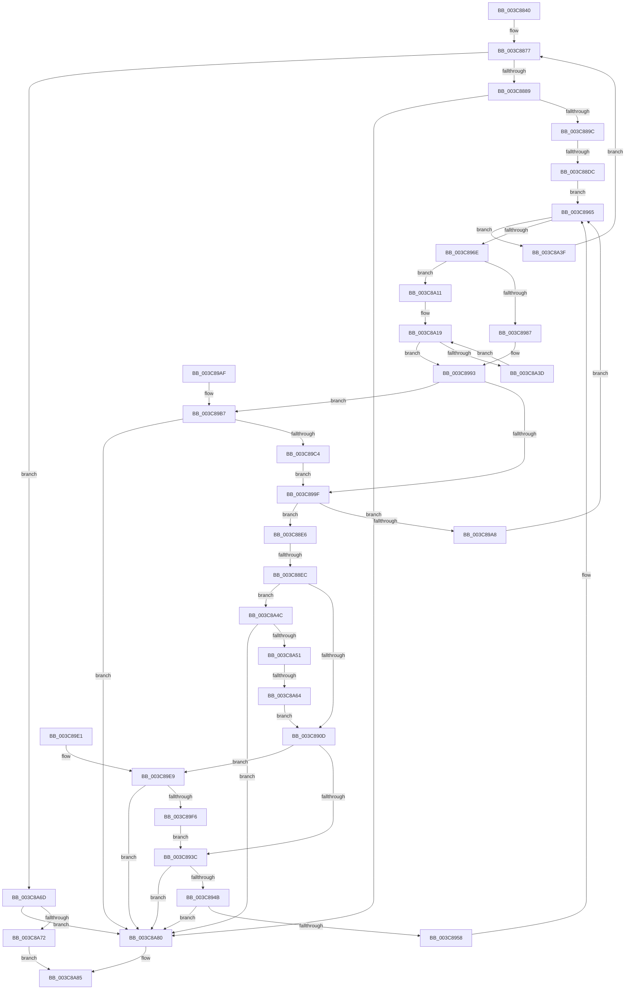

# sub_003C8840

- RVA: `0x003C8840`–`0x003C8AA7` (길이 `615` bytes)
- VA: `0x00000001403C8840`
- 실행 섹션: `.text`
- PDB 이름 있음: `아니요`; PDB Function 태그: `아니요`
- unwind 정보 RVA: `0x0008F4A0`
- 디코드: `161`개 명령, `615/615` bytes 표시
- 미해석 바이트: `0` (있으면 어셈블리에 `.byte`로 보존)

> 이 문서는 커널 이미지의 기계어와 PDB 기호를 분석해 생성했습니다. 4번과 5번은 함수 원형과 자료형을 바이너리 사용 방식에서 추정한 C 해석이며 원본 소스 복구 결과는 아닙니다.

## 1. Dependencies

- 직접 호출 지점: **1**; 고유 호출 대상: **1**
- 직접 호출자로 확인된 함수: **0**
- RIP 상대 이미지 참조: **0**

### Outgoing calls
- `0x003C888F` → [XpressBuildHuffmanDecodingTable](XpressBuildHuffmanDecodingTable_function_003C8DA0.md) (function, `0x003C8DA0`)

### Direct callers
- 이 함수 시작 RVA로 연결되는 직접 call은 확인되지 않았습니다. 간접 호출은 완전히 역산할 수 없습니다.

### Static image references
- 디코드된 RIP-relative 메모리 참조가 없습니다.

## 2. Other-region calls and transfers

- 다른 실행 섹션으로 향하는 call: **0**
- call이 아닌 외부 분기/꼬리 이동: **3**
  - `0x003C88D6` → [sub_003C8AA8 + 0x8](Unknown_function_003C8AA8.md) (`tail-transfer`)
  - `0x003C88E6` → [sub_003C8AA8 + 0x261](Unknown_function_003C8AA8.md) (`tail-transfer`)
  - `0x003C8A5E` → [sub_003C8D2F](Unknown_function_003C8D2F.md) (`tail-transfer`)

## 3. Assembly (complete function range)

```asm
003C8840  48 89 74 24 50                  mov qword ptr [rsp + 0x50], rsi
003C8845  48 83 C5 07                     add rbp, 7
003C8849  48 89 7C 24 58                  mov qword ptr [rsp + 0x58], rdi
003C884E  48 83 E5 F8                     and rbp, 0xfffffffffffffff8
003C8852  4C 89 6C 24 60                  mov qword ptr [rsp + 0x60], r13
003C8857  48 8B F9                        mov rdi, rcx
003C885A  4C 89 74 24 28                  mov qword ptr [rsp + 0x28], r14
003C885F  4C 89 7C 24 20                  mov qword ptr [rsp + 0x20], r15
003C8864  45 8B F9                        mov r15d, r9d
003C8867  4C 03 FB                        add r15, rbx
003C886A  8B F2                           mov esi, edx
003C886C  48 03 F1                        add rsi, rcx
003C886F  48 89 B4 24 80 00 00 00         mov qword ptr [rsp + 0x80], rsi
003C8877  49 8B C7                        mov rax, r15
003C887A  48 2B C3                        sub rax, rbx
003C887D  48 3D 04 01 00 00               cmp rax, 0x104
003C8883  0F 8C E4 01 00 00               jl 0x1403c8a6d
003C8889  48 8B D3                        mov rdx, rbx
003C888C  48 8B CD                        mov rcx, rbp
003C888F  E8 0C 05 00 00                  call 0x1403c8da0
003C8894  85 C0                           test eax, eax
003C8896  0F 85 E4 01 00 00               jne 0x1403c8a80
003C889C  44 8D 48 10                     lea r9d, [rax + 0x10]
003C88A0  BA 00 01 00 00                  mov edx, 0x100
003C88A5  48 03 DA                        add rbx, rdx
003C88A8  4C 8B EE                        mov r13, rsi
003C88AB  0F B7 43 02                     movzx eax, word ptr [rbx + 2]
003C88AF  44 0F B7 03                     movzx r8d, word ptr [rbx]
003C88B3  48 83 C3 04                     add rbx, 4
003C88B7  41 C1 E0 10                     shl r8d, 0x10
003C88BB  44 03 C0                        add r8d, eax
003C88BE  48 8D 87 00 00 01 00            lea rax, [rdi + 0x10000]
003C88C5  48 3B C6                        cmp rax, rsi
003C88C8  4C 0F 46 E8                     cmovbe r13, rax
003C88CC  4D 8D B5 44 FF FF FF            lea r14, [r13 - 0xbc]
003C88D3  49 3B FE                        cmp rdi, r14
003C88D6  0F 82 D4 01 00 00               jb 0x1403c8ab0
003C88DC  4C 8B 9C 24 80 00 00 00         mov r11, qword ptr [rsp + 0x80]
003C88E4  EB 7F                           jmp 0x1403c8965
003C88E6  0F 84 1D 04 00 00               je 0x1403c8d09
003C88EC  98                              cwde
003C88ED  99                              cdq
003C88EE  83 E2 0F                        and edx, 0xf
003C88F1  03 C2                           add eax, edx
003C88F3  8B C8                           mov ecx, eax
003C88F5  83 E0 0F                        and eax, 0xf
003C88F8  2B C2                           sub eax, edx
003C88FA  C1 F9 04                        sar ecx, 4
003C88FD  48 63 D0                        movsxd rdx, eax
003C8900  48 63 F1                        movsxd rsi, ecx
003C8903  48 83 FA 0F                     cmp rdx, 0xf
003C8907  0F 84 3F 01 00 00               je 0x1403c8a4c
003C890D  B9 1F 00 00 00                  mov ecx, 0x1f
003C8912  45 8B D0                        mov r10d, r8d
003C8915  40 2A CE                        sub cl, sil
003C8918  B8 01 00 00 00                  mov eax, 1
003C891D  49 D3 EA                        shr r10, cl
003C8920  48 83 C2 03                     add rdx, 3
003C8924  48 8B CE                        mov rcx, rsi
003C8927  49 D1 EA                        shr r10, 1
003C892A  48 D3 E0                        shl rax, cl
003C892D  4C 03 D0                        add r10, rax
003C8930  41 D3 E0                        shl r8d, cl
003C8933  4C 2B CE                        sub r9, rsi
003C8936  0F 88 AD 00 00 00               js 0x1403c89e9
003C893C  48 8B F7                        mov rsi, rdi
003C893F  49 2B F2                        sub rsi, r10
003C8942  49 3B F4                        cmp rsi, r12
003C8945  0F 82 35 01 00 00               jb 0x1403c8a80
003C894B  48 8D 04 3A                     lea rax, [rdx + rdi]
003C894F  49 3B C3                        cmp rax, r11
003C8952  0F 87 28 01 00 00               ja 0x1403c8a80
003C8958  48 8B CA                        mov rcx, rdx
003C895B  BA 00 01 00 00                  mov edx, 0x100
003C8960  F3 A4                           rep movsb byte ptr [rdi], byte ptr [rsi]
003C8962  48 8B F8                        mov rdi, rax
003C8965  49 3B FD                        cmp rdi, r13
003C8968  0F 83 D1 00 00 00               jae 0x1403c8a3f
003C896E  41 8B C0                        mov eax, r8d
003C8971  48 C1 E8 16                     shr rax, 0x16
003C8975  48 0F BF 84 45 20 04 00 00      movsx rax, word ptr [rbp + rax*2 + 0x420]
003C897E  66 85 C0                        test ax, ax
003C8981  0F 8E 8A 00 00 00               jle 0x1403c8a11
003C8987  48 8B C8                        mov rcx, rax
003C898A  83 E1 0F                        and ecx, 0xf
003C898D  41 D3 E0                        shl r8d, cl
003C8990  4C 2B C9                        sub r9, rcx
003C8993  66 C1 E8 04                     shr ax, 4
003C8997  66 2B C2                        sub ax, dx
003C899A  4D 85 C9                        test r9, r9
003C899D  78 18                           js 0x1403c89b7
003C899F  66 85 C0                        test ax, ax
003C89A2  0F 89 3E FF FF FF               jns 0x1403c88e6
003C89A8  88 07                           mov byte ptr [rdi], al
003C89AA  48 FF C7                        inc rdi
003C89AD  EB B6                           jmp 0x1403c8965
003C89AF  4C 8B 9C 24 80 00 00 00         mov r11, qword ptr [rsp + 0x80]
003C89B7  48 8D 4B 01                     lea rcx, [rbx + 1]
003C89BB  49 3B CF                        cmp rcx, r15
003C89BE  0F 83 BC 00 00 00               jae 0x1403c8a80
003C89C4  0F B7 13                        movzx edx, word ptr [rbx]
003C89C7  41 0F B6 C9                     movzx ecx, r9b
003C89CB  F6 D9                           neg cl
003C89CD  48 83 C3 02                     add rbx, 2
003C89D1  D3 E2                           shl edx, cl
003C89D3  44 03 C2                        add r8d, edx
003C89D6  BA 00 01 00 00                  mov edx, 0x100
003C89DB  49 83 C1 10                     add r9, 0x10
003C89DF  EB BE                           jmp 0x1403c899f
003C89E1  4C 8B 9C 24 80 00 00 00         mov r11, qword ptr [rsp + 0x80]
003C89E9  48 8D 43 01                     lea rax, [rbx + 1]
003C89ED  49 3B C7                        cmp rax, r15
003C89F0  0F 83 8A 00 00 00               jae 0x1403c8a80
003C89F6  0F B7 03                        movzx eax, word ptr [rbx]
003C89F9  41 0F B6 C9                     movzx ecx, r9b
003C89FD  F6 D9                           neg cl
003C89FF  48 83 C3 02                     add rbx, 2
003C8A03  D3 E0                           shl eax, cl
003C8A05  44 03 C0                        add r8d, eax
003C8A08  49 83 C1 10                     add r9, 0x10
003C8A0C  E9 2B FF FF FF                  jmp 0x1403c893c
003C8A11  41 C1 E0 0A                     shl r8d, 0xa
003C8A15  49 83 E9 0A                     sub r9, 0xa
003C8A19  41 8B C8                        mov ecx, r8d
003C8A1C  49 FF C9                        dec r9
003C8A1F  C1 E9 1F                        shr ecx, 0x1f
003C8A22  45 03 C0                        add r8d, r8d
003C8A25  66 2B C8                        sub cx, ax
003C8A28  48 0F BF C1                     movsx rax, cx
003C8A2C  0F B7 84 45 20 0C 00 00         movzx eax, word ptr [rbp + rax*2 + 0xc20]
003C8A34  66 85 C0                        test ax, ax
003C8A37  0F 8F 56 FF FF FF               jg 0x1403c8993
003C8A3D  EB DA                           jmp 0x1403c8a19
003C8A3F  48 8B B4 24 80 00 00 00         mov rsi, qword ptr [rsp + 0x80]
003C8A47  E9 2B FE FF FF                  jmp 0x1403c8877
003C8A4C  49 3B DF                        cmp rbx, r15
003C8A4F  73 2F                           jae 0x1403c8a80
003C8A51  0F B6 13                        movzx edx, byte ptr [rbx]
003C8A54  48 FF C3                        inc rbx
003C8A57  48 81 FA FF 00 00 00            cmp rdx, 0xff
003C8A5E  0F 84 CB 02 00 00               je 0x1403c8d2f
003C8A64  48 83 C2 0F                     add rdx, 0xf
003C8A68  E9 A0 FE FF FF                  jmp 0x1403c890d
003C8A6D  48 3B FE                        cmp rdi, rsi
003C8A70  75 0E                           jne 0x1403c8a80
003C8A72  48 8B 44 24 78                  mov rax, qword ptr [rsp + 0x78]
003C8A77  41 2B FC                        sub edi, r12d
003C8A7A  89 38                           mov dword ptr [rax], edi
003C8A7C  33 C0                           xor eax, eax
003C8A7E  EB 05                           jmp 0x1403c8a85
003C8A80  B8 42 02 00 C0                  mov eax, 0xc0000242
003C8A85  4C 8B 74 24 28                  mov r14, qword ptr [rsp + 0x28]
003C8A8A  4C 8B 6C 24 60                  mov r13, qword ptr [rsp + 0x60]
003C8A8F  48 8B 7C 24 58                  mov rdi, qword ptr [rsp + 0x58]
003C8A94  48 8B 74 24 50                  mov rsi, qword ptr [rsp + 0x50]
003C8A99  4C 8B 7C 24 20                  mov r15, qword ptr [rsp + 0x20]
003C8A9E  48 83 C4 30                     add rsp, 0x30
003C8AA2  41 5C                           pop r12
003C8AA4  5D                              pop rbp
003C8AA5  5B                              pop rbx
003C8AA6  C3                              ret
```

## 4. C-style interpretation (structured pseudocode)

```c
__int64 __fastcall sub_003C8840(__int64 a1, int a2, __int64 a3, int a4, __int64 a5, __int64 a6, __int64 a7, __int64 a8, __int64 a9, __int64 a10, __int64 a11, __int64 a12, __int64 a13, __int64 a14, __int64 a15, __int64 a16)
{
    __int64 result;
    __int64 v_r10;
    __int64 v_r13;
    __int64 v_r15;
    __int64 v_rbp;
    __int64 v_rbx;
    __int64 v_rdi;
    __int64 v_rsi;
    __int64 v_rsp;
    unsigned __int64 v_stack_p20;
    unsigned __int64 v_stack_p28;
    unsigned __int64 v_stack_p50;
    unsigned __int64 v_stack_p58;
    unsigned __int64 v_stack_p60;
    unsigned __int64 v_stack_p80;

    v_stack_p50 = v_rsi;
    v_rbp = (v_rbp) + (7);
    v_stack_p58 = v_rdi;
    v_rbp = (v_rbp) & (-8);
    v_stack_p60 = v_r13;
    v_stack_p28 = v_r14;
    v_stack_p20 = v_r15;
    v_r15 = ((unsigned int)(a4)) + (v_rbx);
    v_rsi = ((unsigned int)(a2)) + (a1);
    v_stack_p80 = v_rsi;
loc_003C8877:
    result = (v_r15) - (v_rbx);
    if (result < 260) goto loc_003C8A6D;
    result = XpressBuildHuffmanDecodingTable(v_rbp, v_rbx, a3, a4);
    if ((unsigned int)(result) != 0) goto loc_003C8A80;
    v_rbx = (v_rbx) + (256);
    v_rbx = (v_rbx) + (4);
    a3 = (unsigned int)((*(unsigned __int16 *)(v_rbx)) << (16));
    a3 = (unsigned int)((a3) + ((unsigned int)(*(unsigned __int16 *)(v_rbx + 2))));
    v_r13 = v_rsi;
    if ((a1 + 65536) <= v_rsi) { v_r13 = a1 + 65536; }
    goto loc_003C8965;
loc_003C88E6:
    a2 = (unsigned int)((256) & (15));
    result = (unsigned int)((a1 + 65536) + (a2));
    result = (unsigned int)((result) & (15));
    result = (unsigned int)((result) - (a2));
    a1 = (unsigned int)(((unsigned int)((unsigned int)(result))) >> (4));
    if (((int)((unsigned int)(result))) == 15) goto loc_003C8A4C;
loc_003C890D:
    a1 = (unsigned __int8)((31) - ((unsigned __int8)((int)((unsigned int)(a1)))));
    v_r10 = ((unsigned int)((unsigned int)(a3))) >> ((unsigned __int8)(a1));
    a2 = ((int)((unsigned int)(result))) + (3);
    v_r10 = (v_r10) >> (1);
    result = (1) << ((unsigned __int8)((int)((unsigned int)(a1))));
    v_r10 = (v_r10) + (result);
    a3 = (unsigned int)((a3) << ((unsigned __int8)((int)((unsigned int)(a1)))));
    a4 = (result + 16) - ((int)((unsigned int)(a1)));
    if (sign_flag) goto loc_003C89E9;
loc_003C893C:
    v_rsi = (a1) - (v_r10);
    if (v_rsi < v_r12) goto loc_003C8A80;
    if ((a2 + a1 * 1) > a16) goto loc_003C8A80;
loc_003C8965:
    if ((a2 + a1 * 1) >= v_r13) goto loc_003C8A3F;
    result = ((unsigned int)((unsigned int)(a3))) >> (22);
    if (condition_is_less_or_equal) goto loc_003C8A11;
    a1 = (unsigned int)(((__int16)(*(unsigned __int16 *)(v_rbp + result * 2 + 1056))) & (15));
    a3 = (unsigned int)((a3) << ((unsigned __int8)(a1)));
    a4 = (a4) - (a1);
loc_003C8993:
    result = (unsigned __int16)(((__int16)(*(unsigned __int16 *)(v_rbp + result * 2 + 1056))) >> (4));
    result = (unsigned __int16)((result) - (256));
    if (sign_flag) goto loc_003C89B7;
loc_003C899F:
    if (!sign_flag) goto loc_003C88E6;
    *(unsigned __int8 *)(a2 + a1 * 1) = (unsigned __int8)(result);
    v_rdi = (a2 + a1 * 1) + 1;
    goto loc_003C8965;
loc_003C89B7:
    if ((v_rbx + 1) >= v_r15) goto loc_003C8A80;
    a1 = (unsigned __int8)(-((unsigned __int8)(a4)));
    v_rbx = (v_rbx) + (2);
    a2 = (unsigned int)((*(unsigned __int16 *)(v_rbx)) << ((unsigned __int8)(a1)));
    a3 = (unsigned int)((a3) + (a2));
    a4 = (a4) + (16);
    goto loc_003C899F;
loc_003C89E9:
    if ((v_rbx + 1) >= v_r15) goto loc_003C8A80;
    a1 = (unsigned __int8)(-((unsigned __int8)(a4)));
    v_rbx = (v_rbx) + (2);
    result = (unsigned int)((*(unsigned __int16 *)(v_rbx)) << ((unsigned __int8)(a1)));
    a3 = (unsigned int)((a3) + ((unsigned int)(result)));
    a4 = (a4) + (16);
    goto loc_003C893C;
loc_003C8A11:
    a3 = (unsigned int)((a3) << (10));
    a4 = (a4) - (10);
loc_003C8A19:
    a4 = (a4) - 1;
    a1 = (unsigned int)(((unsigned int)((unsigned int)(a3))) >> (31));
    a3 = (unsigned int)((a3) + ((unsigned int)(a3)));
    a1 = (unsigned __int16)((a1) - ((unsigned __int16)(result)));
    if (condition_is_greater) goto loc_003C8993;
    goto loc_003C8A19;
loc_003C8A3F:
    goto loc_003C8877;
loc_003C8A4C:
    if (v_rbx >= v_r15) goto loc_003C8A80;
    v_rbx = (v_rbx) + 1;
    a2 = (*(unsigned __int8 *)(v_rbx)) + (15);
    goto loc_003C890D;
loc_003C8A6D:
    if (v_rdi != a16) goto loc_003C8A80;
    v_rdi = (unsigned int)((v_rdi) - ((unsigned int)(v_r12)));
    *(unsigned int *)(a15) = (unsigned int)(v_rdi);
    result = 0;
    goto loc_003C8A85;
loc_003C8A80:
loc_003C8A85:
    v_rsp = (v_rsp) + (48);
    return (unsigned int)(0xC0000242ULL);
}
```

## 5. (Beta) C Style

```c
int64_t sub_003C8840(int64_t Arg1, int32_t Arg2, int64_t Arg3, int32_t Arg4, int64_t Arg5, uint64_t Arg6, uint64_t Arg7, uint64_t Arg8, uint64_t Arg9, int64_t Arg10, int64_t Arg11, int64_t Arg12, uint64_t Arg13, uint64_t Arg14, void *Arg15, int64_t Arg16)
{
    uint8_t *arg15 = (uint8_t *)Arg15;

    int64_t result;
    int64_t local_r10;
    int64_t local_r13;
    int64_t local_r15;
    int64_t local_rbp;
    int64_t local_rbx;
    int64_t local_rdi;
    int64_t local_rsi;
    int64_t local_rsp;
    uint64_t v_stack_p20;
    uint64_t v_stack_p28;
    uint64_t v_stack_p50;
    uint64_t v_stack_p58;
    uint64_t v_stack_p60;
    uint64_t v_stack_p80;

    v_stack_p50 = local_rsi;
    local_rbp = (local_rbp) + (7);
    v_stack_p58 = local_rdi;
    local_rbp = (local_rbp) & (-8);
    v_stack_p60 = local_r13;
    v_stack_p28 = local_r14;
    v_stack_p20 = local_r15;
    local_r15 = ((uint32_t)(Arg4)) + (local_rbx);
    local_rsi = ((uint32_t)(Arg2)) + (Arg1);
    v_stack_p80 = local_rsi;
loc_003C8877:
    result = (local_r15) - (local_rbx);
    if (result < 260) goto loc_003C8A6D;
    result = XpressBuildHuffmanDecodingTable(local_rbp, local_rbx, Arg3, Arg4);
    if ((uint32_t)(result) != 0) goto loc_003C8A80;
    local_rbx = (local_rbx) + (256);
    local_rbx = (local_rbx) + (4);
    Arg3 = (uint32_t)((*(uint16_t *)(local_rbx)) << (16));
    Arg3 = (uint32_t)((Arg3) + ((uint32_t)(*(uint16_t *)(local_rbx + 0x2))));
    local_r13 = local_rsi;
    if ((Arg1 + 65536) <= local_rsi) { local_r13 = Arg1 + 65536; }
    goto loc_003C8965;
loc_003C88E6:
    Arg2 = (uint32_t)((256) & (15));
    result = (uint32_t)((Arg1 + 65536) + (Arg2));
    result = (uint32_t)((result) & (15));
    result = (uint32_t)((result) - (Arg2));
    Arg1 = (uint32_t)(((uint32_t)((uint32_t)(result))) >> (4));
    if (((int32_t)((uint32_t)(result))) == 15) goto loc_003C8A4C;
loc_003C890D:
    Arg1 = (uint8_t)((31) - ((uint8_t)((int32_t)((uint32_t)(Arg1)))));
    local_r10 = ((uint32_t)((uint32_t)(Arg3))) >> ((uint8_t)(Arg1));
    Arg2 = ((int32_t)((uint32_t)(result))) + (3);
    local_r10 = (local_r10) >> (1);
    result = (1) << ((uint8_t)((int32_t)((uint32_t)(Arg1))));
    local_r10 = (local_r10) + (result);
    Arg3 = (uint32_t)((Arg3) << ((uint8_t)((int32_t)((uint32_t)(Arg1)))));
    Arg4 = (result + 16) - ((int32_t)((uint32_t)(Arg1)));
    if (sign_flag) goto loc_003C89E9;
loc_003C893C:
    local_rsi = (Arg1) - (local_r10);
    if (local_rsi < local_r12) goto loc_003C8A80;
    if ((Arg2 + Arg1 * 1) > Arg16) goto loc_003C8A80;
loc_003C8965:
    if ((Arg2 + Arg1 * 1) >= local_r13) goto loc_003C8A3F;
    result = ((uint32_t)((uint32_t)(Arg3))) >> (22);
    if (condition_is_less_or_equal) goto loc_003C8A11;
    Arg1 = (uint32_t)(((int16_t)(*(uint16_t *)(local_rbp + result * 2 + 0x420))) & (15));
    Arg3 = (uint32_t)((Arg3) << ((uint8_t)(Arg1)));
    Arg4 = (Arg4) - (Arg1);
loc_003C8993:
    result = (uint16_t)(((int16_t)(*(uint16_t *)(local_rbp + result * 2 + 0x420))) >> (4));
    result = (uint16_t)((result) - (256));
    if (sign_flag) goto loc_003C89B7;
loc_003C899F:
    if (!sign_flag) goto loc_003C88E6;
    *(uint8_t *)(Arg2 + Arg1 * 1) = (uint8_t)(result);
    local_rdi = (Arg2 + Arg1 * 1) + 1;
    goto loc_003C8965;
loc_003C89B7:
    if ((local_rbx + 1) >= local_r15) goto loc_003C8A80;
    Arg1 = (uint8_t)(-((uint8_t)(Arg4)));
    local_rbx = (local_rbx) + (2);
    Arg2 = (uint32_t)((*(uint16_t *)(local_rbx)) << ((uint8_t)(Arg1)));
    Arg3 = (uint32_t)((Arg3) + (Arg2));
    Arg4 = (Arg4) + (16);
    goto loc_003C899F;
loc_003C89E9:
    if ((local_rbx + 1) >= local_r15) goto loc_003C8A80;
    Arg1 = (uint8_t)(-((uint8_t)(Arg4)));
    local_rbx = (local_rbx) + (2);
    result = (uint32_t)((*(uint16_t *)(local_rbx)) << ((uint8_t)(Arg1)));
    Arg3 = (uint32_t)((Arg3) + ((uint32_t)(result)));
    Arg4 = (Arg4) + (16);
    goto loc_003C893C;
loc_003C8A11:
    Arg3 = (uint32_t)((Arg3) << (10));
    Arg4 = (Arg4) - (10);
loc_003C8A19:
    Arg4 = (Arg4) - 1;
    Arg1 = (uint32_t)(((uint32_t)((uint32_t)(Arg3))) >> (31));
    Arg3 = (uint32_t)((Arg3) + ((uint32_t)(Arg3)));
    Arg1 = (uint16_t)((Arg1) - ((uint16_t)(result)));
    if (condition_is_greater) goto loc_003C8993;
    goto loc_003C8A19;
loc_003C8A3F:
    goto loc_003C8877;
loc_003C8A4C:
    if (local_rbx >= local_r15) goto loc_003C8A80;
    local_rbx = (local_rbx) + 1;
    Arg2 = (*(uint8_t *)(local_rbx)) + (15);
    goto loc_003C890D;
loc_003C8A6D:
    if (local_rdi != Arg16) goto loc_003C8A80;
    local_rdi = (uint32_t)((local_rdi) - ((uint32_t)(local_r12)));
    *(uint32_t *)(arg15) = (uint32_t)(local_rdi);
    result = 0;
    goto loc_003C8A85;
loc_003C8A80:
loc_003C8A85:
    local_rsp = (local_rsp) + (48);
    return (uint32_t)(0xC0000242ULL);
}
```

### 관측된 메모리 오프셋

구조체 형식이 확인되지 않은 접근은 인자 기준의 오프셋으로만 기록했습니다.

| 기준 인자 | 오프셋 표현 | 폭 (bit) | 접근 |
|---|---:|---:|---|
| `Arg15` | `+ 0x0` | `32` | `W` |

## 6. Execution-region graph

[열기: 2D/3D 그래프와 함수 탐색 컨트롤 패널](../../../control-panel.html?section=text&rva=0x003C8840&view=graph)

- 2D 그래프는 위에서 아래로 흐르고, 3D 그래프는 빈 공간을 드래그해 회전합니다. Shift+드래그는 이동, 휠은 확대·축소, 함수 노드 선택은 대상 보고서 이동입니다.

### Static fallback


