# sub_003C8AA8

- RVA: `0x003C8AA8`–`0x003C8D20` (길이 `632` bytes)
- VA: `0x00000001403C8AA8`
- 실행 섹션: `.text`
- PDB 이름 있음: `아니요`; PDB Function 태그: `아니요`
- unwind 정보 RVA: `0x0008F4D8`
- 디코드: `176`개 명령, `632/632` bytes 표시
- 미해석 바이트: `0` (있으면 어셈블리에 `.byte`로 보존)

> 이 문서는 커널 이미지의 기계어와 PDB 기호를 분석해 생성했습니다. 4번과 5번은 함수 원형과 자료형을 바이너리 사용 방식에서 추정한 C 해석이며 원본 소스 복구 결과는 아닙니다.

## 1. Dependencies

- 직접 호출 지점: **0**; 고유 호출 대상: **0**
- 직접 호출자로 확인된 함수: **0**
- RIP 상대 이미지 참조: **0**

### Outgoing calls
- 직접 디코드된 call 명령이 없습니다.

### Direct callers
- 이 함수 시작 RVA로 연결되는 직접 call은 확인되지 않았습니다. 간접 호출은 완전히 역산할 수 없습니다.

### Static image references
- 디코드된 RIP-relative 메모리 참조가 없습니다.

## 2. Other-region calls and transfers

- 다른 실행 섹션으로 향하는 call: **0**
- call이 아닌 외부 분기/꼬리 이동: **15**
  - `0x003C8AE3` → [sub_003C8840 + 0x16F](Unknown_function_003C8840.md) (`tail-transfer`)
  - `0x003C8AF0` → [sub_003C8840 + 0x240](Unknown_function_003C8840.md) (`tail-transfer`)
  - `0x003C8B77` → [sub_003C8840 + 0x240](Unknown_function_003C8840.md) (`tail-transfer`)
  - `0x003C8BC5` → [sub_003C8840 + 0x1A1](Unknown_function_003C8840.md) (`tail-transfer`)
  - `0x003C8BD2` → [sub_003C8840 + 0x240](Unknown_function_003C8840.md) (`tail-transfer`)
  - `0x003C8BF7` → [sub_003C8840 + 0x240](Unknown_function_003C8840.md) (`tail-transfer`)
  - `0x003C8CA7` → [sub_003C8840 + 0x240](Unknown_function_003C8840.md) (`tail-transfer`)
  - `0x003C8CB7` → [sub_003C8D2F + 0x4F](Unknown_function_003C8D2F.md) (`tail-transfer`)
  - `0x003C8CC1` → [sub_003C8840 + 0x240](Unknown_function_003C8840.md) (`tail-transfer`)
  - `0x003C8CD1` → [sub_003C8840 + 0x240](Unknown_function_003C8840.md) (`tail-transfer`)
  - `0x003C8CF1` → [sub_003C8840 + 0x232](Unknown_function_003C8840.md) (`tail-transfer`)
  - `0x003C8D04` → [sub_003C8840 + 0x10B](Unknown_function_003C8840.md) (`tail-transfer`)
  - `0x003C8D0C` → [sub_003C8840 + 0xAC](Unknown_function_003C8840.md) (`tail-transfer`)
  - `0x003C8D15` → [sub_003C8840 + 0x232](Unknown_function_003C8840.md) (`tail-transfer`)
  - `0x003C8D1B` → [sub_003C8840 + 0xAC](Unknown_function_003C8840.md) (`tail-transfer`)

## 3. Assembly (complete function range)

```asm
003C8AA8  48 03 FA                        add rdi, rdx
003C8AAB  BA 00 01 00 00                  mov edx, 0x100
003C8AB0  41 8B C0                        mov eax, r8d
003C8AB3  48 C1 E8 16                     shr rax, 0x16
003C8AB7  48 0F BF B4 45 20 04 00 00      movsx rsi, word ptr [rbp + rax*2 + 0x420]
003C8AC0  66 85 F6                        test si, si
003C8AC3  7E 54                           jle 0x1403c8b19
003C8AC5  48 8B CE                        mov rcx, rsi
003C8AC8  83 E1 0F                        and ecx, 0xf
003C8ACB  41 D3 E0                        shl r8d, cl
003C8ACE  4C 2B C9                        sub r9, rcx
003C8AD1  66 C1 EE 04                     shr si, 4
003C8AD5  0F B7 C6                        movzx eax, si
003C8AD8  66 2B C2                        sub ax, dx
003C8ADB  4D 85 C9                        test r9, r9
003C8ADE  79 2D                           jns 0x1403c8b0d
003C8AE0  49 3B FE                        cmp rdi, r14
003C8AE3  0F 83 C6 FE FF FF               jae 0x1403c89af
003C8AE9  48 8D 4B 01                     lea rcx, [rbx + 1]
003C8AED  49 3B CF                        cmp rcx, r15
003C8AF0  73 8E                           jae 0x1403c8a80
003C8AF2  0F B7 13                        movzx edx, word ptr [rbx]
003C8AF5  41 0F B6 C9                     movzx ecx, r9b
003C8AF9  F6 D9                           neg cl
003C8AFB  48 83 C3 02                     add rbx, 2
003C8AFF  D3 E2                           shl edx, cl
003C8B01  44 03 C2                        add r8d, edx
003C8B04  BA 00 01 00 00                  mov edx, 0x100
003C8B09  49 83 C1 10                     add r9, 0x10
003C8B0D  66 85 C0                        test ax, ax
003C8B10  79 31                           jns 0x1403c8b43
003C8B12  88 07                           mov byte ptr [rdi], al
003C8B14  48 FF C7                        inc rdi
003C8B17  EB 97                           jmp 0x1403c8ab0
003C8B19  41 C1 E0 0A                     shl r8d, 0xa
003C8B1D  49 83 E9 0A                     sub r9, 0xa
003C8B21  41 8B C0                        mov eax, r8d
003C8B24  49 FF C9                        dec r9
003C8B27  C1 E8 1F                        shr eax, 0x1f
003C8B2A  45 03 C0                        add r8d, r8d
003C8B2D  66 2B C6                        sub ax, si
003C8B30  48 0F BF C0                     movsx rax, ax
003C8B34  0F B7 B4 45 20 0C 00 00         movzx esi, word ptr [rbp + rax*2 + 0xc20]
003C8B3C  66 85 F6                        test si, si
003C8B3F  7F 90                           jg 0x1403c8ad1
003C8B41  EB DE                           jmp 0x1403c8b21
003C8B43  0F 84 97 01 00 00               je 0x1403c8ce0
003C8B49  0F B7 CE                        movzx ecx, si
003C8B4C  2B CA                           sub ecx, edx
003C8B4E  8B C1                           mov eax, ecx
003C8B50  99                              cdq
003C8B51  83 E2 0F                        and edx, 0xf
003C8B54  03 C2                           add eax, edx
003C8B56  C1 F8 04                        sar eax, 4
003C8B59  48 63 F0                        movsxd rsi, eax
003C8B5C  81 E1 0F 00 00 80               and ecx, 0x8000000f
003C8B62  7D 07                           jge 0x1403c8b6b
003C8B64  FF C9                           dec ecx
003C8B66  83 C9 F0                        or ecx, 0xfffffff0
003C8B69  FF C1                           inc ecx
003C8B6B  48 63 D1                        movsxd rdx, ecx
003C8B6E  48 83 FA 0F                     cmp rdx, 0xf
003C8B72  75 20                           jne 0x1403c8b94
003C8B74  49 3B DF                        cmp rbx, r15
003C8B77  0F 83 03 FF FF FF               jae 0x1403c8a80
003C8B7D  0F B6 13                        movzx edx, byte ptr [rbx]
003C8B80  48 FF C3                        inc rbx
003C8B83  48 81 FA FF 00 00 00            cmp rdx, 0xff
003C8B8A  0F 84 10 01 00 00               je 0x1403c8ca0
003C8B90  48 83 C2 0F                     add rdx, 0xf
003C8B94  B9 1F 00 00 00                  mov ecx, 0x1f
003C8B99  45 8B D0                        mov r10d, r8d
003C8B9C  40 2A CE                        sub cl, sil
003C8B9F  B8 01 00 00 00                  mov eax, 1
003C8BA4  49 D3 EA                        shr r10, cl
003C8BA7  4C 8B DA                        mov r11, rdx
003C8BAA  48 8B CE                        mov rcx, rsi
003C8BAD  49 D1 EA                        shr r10, 1
003C8BB0  48 D3 E0                        shl rax, cl
003C8BB3  48 83 C2 03                     add rdx, 3
003C8BB7  4C 03 D0                        add r10, rax
003C8BBA  41 D3 E0                        shl r8d, cl
003C8BBD  4C 2B CE                        sub r9, rsi
003C8BC0  79 2C                           jns 0x1403c8bee
003C8BC2  49 3B FE                        cmp rdi, r14
003C8BC5  0F 83 16 FE FF FF               jae 0x1403c89e1
003C8BCB  48 8D 43 01                     lea rax, [rbx + 1]
003C8BCF  49 3B C7                        cmp rax, r15
003C8BD2  0F 83 A8 FE FF FF               jae 0x1403c8a80
003C8BD8  0F B7 03                        movzx eax, word ptr [rbx]
003C8BDB  41 0F B6 C9                     movzx ecx, r9b
003C8BDF  F6 D9                           neg cl
003C8BE1  48 83 C3 02                     add rbx, 2
003C8BE5  D3 E0                           shl eax, cl
003C8BE7  44 03 C0                        add r8d, eax
003C8BEA  49 83 C1 10                     add r9, 0x10
003C8BEE  48 8B F7                        mov rsi, rdi
003C8BF1  49 2B F2                        sub rsi, r10
003C8BF4  49 3B F4                        cmp rsi, r12
003C8BF7  0F 82 83 FE FF FF               jb 0x1403c8a80
003C8BFD  49 83 FA 04                     cmp r10, 4
003C8C01  72 57                           jb 0x1403c8c5a
003C8C03  8B 06                           mov eax, dword ptr [rsi]
003C8C05  89 07                           mov dword ptr [rdi], eax
003C8C07  8B 46 04                        mov eax, dword ptr [rsi + 4]
003C8C0A  89 47 04                        mov dword ptr [rdi + 4], eax
003C8C0D  48 83 FA 09                     cmp rdx, 9
003C8C11  0F 82 91 FE FF FF               jb 0x1403c8aa8
003C8C17  48 83 C7 08                     add rdi, 8
003C8C1B  48 83 C6 08                     add rsi, 8
003C8C1F  48 83 EA 08                     sub rdx, 8
003C8C23  49 3B FE                        cmp rdi, r14
003C8C26  0F 83 D0 00 00 00               jae 0x1403c8cfc
003C8C2C  8B 06                           mov eax, dword ptr [rsi]
003C8C2E  89 07                           mov dword ptr [rdi], eax
003C8C30  8B 46 04                        mov eax, dword ptr [rsi + 4]
003C8C33  89 47 04                        mov dword ptr [rdi + 4], eax
003C8C36  8B 46 08                        mov eax, dword ptr [rsi + 8]
003C8C39  89 47 08                        mov dword ptr [rdi + 8], eax
003C8C3C  8B 46 0C                        mov eax, dword ptr [rsi + 0xc]
003C8C3F  89 47 0C                        mov dword ptr [rdi + 0xc], eax
003C8C42  48 83 FA 11                     cmp rdx, 0x11
003C8C46  0F 82 5C FE FF FF               jb 0x1403c8aa8
003C8C4C  48 83 C7 10                     add rdi, 0x10
003C8C50  48 83 C6 10                     add rsi, 0x10
003C8C54  48 83 EA 10                     sub rdx, 0x10
003C8C58  EB C9                           jmp 0x1403c8c23
003C8C5A  0F B6 06                        movzx eax, byte ptr [rsi]
003C8C5D  88 07                           mov byte ptr [rdi], al
003C8C5F  49 83 FA 01                     cmp r10, 1
003C8C63  75 1E                           jne 0x1403c8c83
003C8C65  0F B6 06                        movzx eax, byte ptr [rsi]
003C8C68  88 47 01                        mov byte ptr [rdi + 1], al
003C8C6B  0F B6 06                        movzx eax, byte ptr [rsi]
003C8C6E  88 47 02                        mov byte ptr [rdi + 2], al
003C8C71  49 8B D3                        mov rdx, r11
003C8C74  48 83 C7 03                     add rdi, 3
003C8C78  48 85 D2                        test rdx, rdx
003C8C7B  0F 84 2A FE FF FF               je 0x1403c8aab
003C8C81  EB 80                           jmp 0x1403c8c03
003C8C83  0F B6 46 01                     movzx eax, byte ptr [rsi + 1]
003C8C87  88 47 01                        mov byte ptr [rdi + 1], al
003C8C8A  49 83 FA 02                     cmp r10, 2
003C8C8E  74 06                           je 0x1403c8c96
003C8C90  0F B6 46 02                     movzx eax, byte ptr [rsi + 2]
003C8C94  EB D8                           jmp 0x1403c8c6e
003C8C96  48 83 EA 02                     sub rdx, 2
003C8C9A  48 83 C7 02                     add rdi, 2
003C8C9E  EB D8                           jmp 0x1403c8c78
003C8CA0  48 8D 43 01                     lea rax, [rbx + 1]
003C8CA4  49 3B C7                        cmp rax, r15
003C8CA7  0F 83 D3 FD FF FF               jae 0x1403c8a80
003C8CAD  0F B7 13                        movzx edx, word ptr [rbx]
003C8CB0  48 83 C3 02                     add rbx, 2
003C8CB4  48 85 D2                        test rdx, rdx
003C8CB7  0F 84 C1 00 00 00               je 0x1403c8d7e
003C8CBD  48 83 FA 0F                     cmp rdx, 0xf
003C8CC1  0F 82 B9 FD FF FF               jb 0x1403c8a80
003C8CC7  48 8D 47 03                     lea rax, [rdi + 3]
003C8CCB  48 03 C2                        add rax, rdx
003C8CCE  48 3B C7                        cmp rax, rdi
003C8CD1  0F 82 A9 FD FF FF               jb 0x1403c8a80
003C8CD7  48 83 EA 0F                     sub rdx, 0xf
003C8CDB  E9 B0 FE FF FF                  jmp 0x1403c8b90
003C8CE0  48 3B BC 24 80 00 00 00         cmp rdi, qword ptr [rsp + 0x80]
003C8CE8  0F 85 5B FE FF FF               jne 0x1403c8b49
003C8CEE  49 3B DF                        cmp rbx, r15
003C8CF1  0F 83 7B FD FF FF               jae 0x1403c8a72
003C8CF7  E9 4D FE FF FF                  jmp 0x1403c8b49
003C8CFC  4C 8B 9C 24 80 00 00 00         mov r11, qword ptr [rsp + 0x80]
003C8D04  E9 42 FC FF FF                  jmp 0x1403c894b
003C8D09  49 3B FB                        cmp rdi, r11
003C8D0C  0F 85 DA FB FF FF               jne 0x1403c88ec
003C8D12  49 3B DF                        cmp rbx, r15
003C8D15  0F 83 57 FD FF FF               jae 0x1403c8a72
003C8D1B  E9 CC FB FF FF                  jmp 0x1403c88ec
```

## 4. C-style interpretation (structured pseudocode)

```c
__int64 __fastcall sub_003C8AA8(__int64 a1, __int64 a2, int a3, __int64 a4, __int64 a5, __int64 a6, __int64 a7, __int64 a8, __int64 a9, __int64 a10, __int64 a11, __int64 a12, __int64 a13, __int64 a14, __int64 a15, __int64 a16)
{
    __int64 result;
    __int64 v_r10;
    __int64 v_rbx;
    __int64 v_rdi;
    __int64 v_rsi;

    v_rdi = (v_rdi) + (a2);
loc_003C8AAB:
loc_003C8AB0:
    result = ((unsigned int)(a3)) >> (22);
    if (condition_is_less_or_equal) goto loc_003C8B19;
    a1 = (unsigned int)(((__int16)(*(unsigned __int16 *)(v_rbp + result * 2 + 1056))) & (15));
    a3 = (unsigned int)((a3) << ((unsigned __int8)(a1)));
    a4 = (a4) - (a1);
loc_003C8AD1:
    v_rsi = (unsigned __int16)(((__int16)(*(unsigned __int16 *)(v_rbp + result * 2 + 1056))) >> (4));
    result = (unsigned __int16)(((unsigned __int16)(v_rsi)) - (256));
    if (!sign_flag) goto loc_003C8B0D;
    a1 = (unsigned __int8)(-((unsigned __int8)(a4)));
    v_rbx = (v_rbx) + (2);
    a2 = (unsigned int)((*(unsigned __int16 *)(v_rbx)) << ((unsigned __int8)(a1)));
    a3 = (unsigned int)((a3) + ((unsigned int)(a2)));
    a4 = (a4) + (16);
loc_003C8B0D:
    if (!sign_flag) goto loc_003C8B43;
    *(unsigned __int8 *)(v_rdi) = (unsigned __int8)(result);
    v_rdi = (v_rdi) + 1;
    goto loc_003C8AB0;
loc_003C8B19:
    a3 = (unsigned int)((a3) << (10));
    a4 = (a4) - (10);
loc_003C8B21:
    a4 = (a4) - 1;
    result = (unsigned int)(((unsigned int)(a3)) >> (31));
    a3 = (unsigned int)((a3) + (a3));
    result = (unsigned __int16)((result) - ((unsigned __int16)(v_rsi)));
    if (condition_is_greater) goto loc_003C8AD1;
    goto loc_003C8B21;
loc_003C8B43:
    if ((unsigned __int16)(*(unsigned __int16 *)(v_rbp + (__int16)((unsigned __int16)(result)) * 2 + 3104)) == 0) goto loc_003C8CE0;
loc_003C8B49:
    a1 = (unsigned int)(((unsigned __int16)(*(unsigned __int16 *)(v_rbp + (__int16)((unsigned __int16)(result)) * 2 + 3104))) - (256));
    a2 = (unsigned int)((256) & (15));
    result = (unsigned int)(((unsigned int)((unsigned int)(a1))) + ((unsigned int)(a2)));
    result = (unsigned int)((result) >> (4));
    a1 = (unsigned int)((a1) & (0x8000000FULL));
    if (!(condition_is_greater_or_equal)) {
        a1 = (unsigned int)((a1) - 1);
        a1 = (unsigned int)((a1) | (0xFFFFFFF0ULL));
        a1 = (unsigned int)((a1) + 1);
    }
    if (((int)((unsigned int)(a1))) != 15) goto loc_003C8B94;
    v_rbx = (v_rbx) + 1;
    if ((*(unsigned __int8 *)(v_rbx)) == 255) goto loc_003C8CA0;
loc_003C8B90:
    a2 = (*(unsigned __int8 *)(v_rbx)) + (15);
loc_003C8B94:
    a1 = (unsigned __int8)((31) - ((unsigned __int8)((int)((unsigned int)(result)))));
    v_r10 = ((unsigned int)(a3)) >> ((unsigned __int8)(a1));
    v_r10 = (v_r10) >> (1);
    result = (1) << ((unsigned __int8)((int)((unsigned int)(result))));
    a2 = (a2) + (3);
    v_r10 = (v_r10) + (result);
    a3 = (unsigned int)((a3) << ((unsigned __int8)((int)((unsigned int)(result)))));
    a4 = (a4) - ((int)((unsigned int)(result)));
    if (!sign_flag) goto loc_003C8BEE;
    a1 = (unsigned __int8)(-((unsigned __int8)(a4)));
    v_rbx = (v_rbx) + (2);
    result = (unsigned int)((*(unsigned __int16 *)(v_rbx)) << ((unsigned __int8)(a1)));
    a3 = (unsigned int)((a3) + ((unsigned int)(result)));
    a4 = (a4) + (16);
loc_003C8BEE:
    v_rsi = (v_rdi) - (v_r10);
    if (v_r10 < 4) goto loc_003C8C5A;
loc_003C8C03:
    *(unsigned int *)(v_rdi) = (unsigned int)((unsigned int)(*(unsigned int *)(v_rsi)));
    *(unsigned int *)(v_rdi + 4) = (unsigned int)((unsigned int)(*(unsigned int *)(v_rsi + 4)));
    if (a2 < 9) goto loc_003C8AA8;
    v_rdi = (v_rdi) + (8);
    v_rsi = (v_rsi) + (8);
    a2 = (a2) - (8);
loc_003C8C23:
    if (v_rdi >= v_r14) goto loc_003C8CFC;
    *(unsigned int *)(v_rdi) = (unsigned int)((unsigned int)(*(unsigned int *)(v_rsi)));
    *(unsigned int *)(v_rdi + 4) = (unsigned int)((unsigned int)(*(unsigned int *)(v_rsi + 4)));
    *(unsigned int *)(v_rdi + 8) = (unsigned int)((unsigned int)(*(unsigned int *)(v_rsi + 8)));
    *(unsigned int *)(v_rdi + 12) = (unsigned int)((unsigned int)(*(unsigned int *)(v_rsi + 12)));
    if (a2 < 17) goto loc_003C8AA8;
    v_rdi = (v_rdi) + (16);
    v_rsi = (v_rsi) + (16);
    a2 = (a2) - (16);
    goto loc_003C8C23;
loc_003C8C5A:
    *(unsigned __int8 *)(v_rdi) = (unsigned __int8)(*(unsigned __int8 *)(v_rsi));
    if (v_r10 != 1) goto loc_003C8C83;
    *(unsigned __int8 *)(v_rdi + 1) = (unsigned __int8)(*(unsigned __int8 *)(v_rsi));
loc_003C8C6E:
    *(unsigned __int8 *)(v_rdi + 2) = (unsigned __int8)(*(unsigned __int8 *)(v_rsi));
    v_rdi = (v_rdi) + (3);
loc_003C8C78:
    if (a2 == 0) goto loc_003C8AAB;
    goto loc_003C8C03;
loc_003C8C83:
    *(unsigned __int8 *)(v_rdi + 1) = (unsigned __int8)(*(unsigned __int8 *)(v_rsi + 1));
    if (v_r10 == 2) goto loc_003C8C96;
    goto loc_003C8C6E;
loc_003C8C96:
    a2 = (a2) - (2);
    v_rdi = (v_rdi) + (2);
    goto loc_003C8C78;
loc_003C8CA0:
    v_rbx = (v_rbx) + (2);
    result = (v_rdi + 3) + (*(unsigned __int16 *)(v_rbx));
    a2 = (*(unsigned __int16 *)(v_rbx)) - (15);
    goto loc_003C8B90;
loc_003C8CE0:
    if (v_rdi != a16) goto loc_003C8B49;
    goto loc_003C8B49;
loc_003C8CFC:
}
```

## 5. (Beta) C Style

```c
int64_t sub_003C8AA8(int64_t Arg1, int64_t Arg2, int32_t Arg3, int64_t Arg4, uint64_t Arg5, uint64_t Arg6, uint64_t Arg7, uint64_t Arg8, uint64_t Arg9, uint64_t Arg10, uint64_t Arg11, uint64_t Arg12, uint64_t Arg13, uint64_t Arg14, uint64_t Arg15, int64_t Arg16)
{
    int64_t result;
    int64_t local_r10;
    int64_t local_rbx;
    int64_t local_rdi;
    int64_t local_rsi;

    local_rdi = (local_rdi) + (Arg2);
loc_003C8AAB:
loc_003C8AB0:
    result = ((uint32_t)(Arg3)) >> (22);
    if (condition_is_less_or_equal) goto loc_003C8B19;
    Arg1 = (uint32_t)(((int16_t)(*(uint16_t *)(local_rbp + result * 2 + 0x420))) & (15));
    Arg3 = (uint32_t)((Arg3) << ((uint8_t)(Arg1)));
    Arg4 = (Arg4) - (Arg1);
loc_003C8AD1:
    local_rsi = (uint16_t)(((int16_t)(*(uint16_t *)(local_rbp + result * 2 + 0x420))) >> (4));
    result = (uint16_t)(((uint16_t)(local_rsi)) - (256));
    if (!sign_flag) goto loc_003C8B0D;
    Arg1 = (uint8_t)(-((uint8_t)(Arg4)));
    local_rbx = (local_rbx) + (2);
    Arg2 = (uint32_t)((*(uint16_t *)(local_rbx)) << ((uint8_t)(Arg1)));
    Arg3 = (uint32_t)((Arg3) + ((uint32_t)(Arg2)));
    Arg4 = (Arg4) + (16);
loc_003C8B0D:
    if (!sign_flag) goto loc_003C8B43;
    *(uint8_t *)(local_rdi) = (uint8_t)(result);
    local_rdi = (local_rdi) + 1;
    goto loc_003C8AB0;
loc_003C8B19:
    Arg3 = (uint32_t)((Arg3) << (10));
    Arg4 = (Arg4) - (10);
loc_003C8B21:
    Arg4 = (Arg4) - 1;
    result = (uint32_t)(((uint32_t)(Arg3)) >> (31));
    Arg3 = (uint32_t)((Arg3) + (Arg3));
    result = (uint16_t)((result) - ((uint16_t)(local_rsi)));
    if (condition_is_greater) goto loc_003C8AD1;
    goto loc_003C8B21;
loc_003C8B43:
    if ((uint16_t)(*(uint16_t *)(local_rbp + (int16_t)((uint16_t)(result)) * 2 + 0xC20)) == 0) goto loc_003C8CE0;
loc_003C8B49:
    Arg1 = (uint32_t)(((uint16_t)(*(uint16_t *)(local_rbp + (int16_t)((uint16_t)(result)) * 2 + 0xC20))) - (256));
    Arg2 = (uint32_t)((256) & (15));
    result = (uint32_t)(((uint32_t)((uint32_t)(Arg1))) + ((uint32_t)(Arg2)));
    result = (uint32_t)((result) >> (4));
    Arg1 = (uint32_t)((Arg1) & (0x8000000FULL));
    if (!(condition_is_greater_or_equal)) {
        Arg1 = (uint32_t)((Arg1) - 1);
        Arg1 = (uint32_t)((Arg1) | (0xFFFFFFF0ULL));
        Arg1 = (uint32_t)((Arg1) + 1);
    }
    if (((int32_t)((uint32_t)(Arg1))) != 15) goto loc_003C8B94;
    local_rbx = (local_rbx) + 1;
    if ((*(uint8_t *)(local_rbx)) == 255) goto loc_003C8CA0;
loc_003C8B90:
    Arg2 = (*(uint8_t *)(local_rbx)) + (15);
loc_003C8B94:
    Arg1 = (uint8_t)((31) - ((uint8_t)((int32_t)((uint32_t)(result)))));
    local_r10 = ((uint32_t)(Arg3)) >> ((uint8_t)(Arg1));
    local_r10 = (local_r10) >> (1);
    result = (1) << ((uint8_t)((int32_t)((uint32_t)(result))));
    Arg2 = (Arg2) + (3);
    local_r10 = (local_r10) + (result);
    Arg3 = (uint32_t)((Arg3) << ((uint8_t)((int32_t)((uint32_t)(result)))));
    Arg4 = (Arg4) - ((int32_t)((uint32_t)(result)));
    if (!sign_flag) goto loc_003C8BEE;
    Arg1 = (uint8_t)(-((uint8_t)(Arg4)));
    local_rbx = (local_rbx) + (2);
    result = (uint32_t)((*(uint16_t *)(local_rbx)) << ((uint8_t)(Arg1)));
    Arg3 = (uint32_t)((Arg3) + ((uint32_t)(result)));
    Arg4 = (Arg4) + (16);
loc_003C8BEE:
    local_rsi = (local_rdi) - (local_r10);
    if (local_r10 < 4) goto loc_003C8C5A;
loc_003C8C03:
    *(uint32_t *)(local_rdi) = (uint32_t)((uint32_t)(*(uint32_t *)(local_rsi)));
    *(uint32_t *)(local_rdi + 0x4) = (uint32_t)((uint32_t)(*(uint32_t *)(local_rsi + 0x4)));
    if (Arg2 < 9) goto loc_003C8AA8;
    local_rdi = (local_rdi) + (8);
    local_rsi = (local_rsi) + (8);
    Arg2 = (Arg2) - (8);
loc_003C8C23:
    if (local_rdi >= local_r14) goto loc_003C8CFC;
    *(uint32_t *)(local_rdi) = (uint32_t)((uint32_t)(*(uint32_t *)(local_rsi)));
    *(uint32_t *)(local_rdi + 0x4) = (uint32_t)((uint32_t)(*(uint32_t *)(local_rsi + 0x4)));
    *(uint32_t *)(local_rdi + 0x8) = (uint32_t)((uint32_t)(*(uint32_t *)(local_rsi + 0x8)));
    *(uint32_t *)(local_rdi + 0xC) = (uint32_t)((uint32_t)(*(uint32_t *)(local_rsi + 0xC)));
    if (Arg2 < 17) goto loc_003C8AA8;
    local_rdi = (local_rdi) + (16);
    local_rsi = (local_rsi) + (16);
    Arg2 = (Arg2) - (16);
    goto loc_003C8C23;
loc_003C8C5A:
    *(uint8_t *)(local_rdi) = (uint8_t)(*(uint8_t *)(local_rsi));
    if (local_r10 != 1) goto loc_003C8C83;
    *(uint8_t *)(local_rdi + 0x1) = (uint8_t)(*(uint8_t *)(local_rsi));
loc_003C8C6E:
    *(uint8_t *)(local_rdi + 0x2) = (uint8_t)(*(uint8_t *)(local_rsi));
    local_rdi = (local_rdi) + (3);
loc_003C8C78:
    if (Arg2 == 0) goto loc_003C8AAB;
    goto loc_003C8C03;
loc_003C8C83:
    *(uint8_t *)(local_rdi + 0x1) = (uint8_t)(*(uint8_t *)(local_rsi + 0x1));
    if (local_r10 == 2) goto loc_003C8C96;
    goto loc_003C8C6E;
loc_003C8C96:
    Arg2 = (Arg2) - (2);
    local_rdi = (local_rdi) + (2);
    goto loc_003C8C78;
loc_003C8CA0:
    local_rbx = (local_rbx) + (2);
    result = (local_rdi + 3) + (*(uint16_t *)(local_rbx));
    Arg2 = (*(uint16_t *)(local_rbx)) - (15);
    goto loc_003C8B90;
loc_003C8CE0:
    if (local_rdi != Arg16) goto loc_003C8B49;
    goto loc_003C8B49;
loc_003C8CFC:
}
```

## 6. Execution-region graph

[열기: 2D/3D 그래프와 함수 탐색 컨트롤 패널](../../../control-panel.html?section=text&rva=0x003C8AA8&view=graph)

- 2D 그래프는 위에서 아래로 흐르고, 3D 그래프는 빈 공간을 드래그해 회전합니다. Shift+드래그는 이동, 휠은 확대·축소, 함수 노드 선택은 대상 보고서 이동입니다.

### Static fallback

```mermaid
flowchart TD
  bb_003C8AA8[BB_003C8AA8]
  bb_003C8AAB[BB_003C8AAB]
  bb_003C8AB0[BB_003C8AB0]
  bb_003C8AC5[BB_003C8AC5]
  bb_003C8AD1[BB_003C8AD1]
  bb_003C8AE0[BB_003C8AE0]
  bb_003C8AE9[BB_003C8AE9]
  bb_003C8AF2[BB_003C8AF2]
  bb_003C8B0D[BB_003C8B0D]
  bb_003C8B12[BB_003C8B12]
  bb_003C8B19[BB_003C8B19]
  bb_003C8B21[BB_003C8B21]
  bb_003C8B41[BB_003C8B41]
  bb_003C8B43[BB_003C8B43]
  bb_003C8B49[BB_003C8B49]
  bb_003C8B64[BB_003C8B64]
  bb_003C8B6B[BB_003C8B6B]
  bb_003C8B74[BB_003C8B74]
  bb_003C8B7D[BB_003C8B7D]
  bb_003C8B90[BB_003C8B90]
  bb_003C8B94[BB_003C8B94]
  bb_003C8BC2[BB_003C8BC2]
  bb_003C8BCB[BB_003C8BCB]
  bb_003C8BD8[BB_003C8BD8]
  bb_003C8BEE[BB_003C8BEE]
  bb_003C8BFD[BB_003C8BFD]
  bb_003C8C03[BB_003C8C03]
  bb_003C8C17[BB_003C8C17]
  bb_003C8C23[BB_003C8C23]
  bb_003C8C2C[BB_003C8C2C]
  bb_003C8C4C[BB_003C8C4C]
  bb_003C8C5A[BB_003C8C5A]
  bb_003C8C65[BB_003C8C65]
  bb_003C8C6E[BB_003C8C6E]
  bb_003C8C78[BB_003C8C78]
  bb_003C8C81[BB_003C8C81]
  bb_003C8C83[BB_003C8C83]
  bb_003C8C90[BB_003C8C90]
  bb_003C8C96[BB_003C8C96]
  bb_003C8CA0[BB_003C8CA0]
  bb_003C8CAD[BB_003C8CAD]
  bb_003C8CBD[BB_003C8CBD]
  bb_003C8CC7[BB_003C8CC7]
  bb_003C8CD7[BB_003C8CD7]
  bb_003C8CE0[BB_003C8CE0]
  bb_003C8CEE[BB_003C8CEE]
  bb_003C8CF7[BB_003C8CF7]
  bb_003C8CFC[BB_003C8CFC]
  bb_003C8D09[BB_003C8D09]
  bb_003C8D12[BB_003C8D12]
  bb_003C8D1B[BB_003C8D1B]
  bb_003C8AA8 -->|flow| bb_003C8AAB
  bb_003C8AAB -->|flow| bb_003C8AB0
  bb_003C8AB0 -->|branch| bb_003C8B19
  bb_003C8AB0 -->|fallthrough| bb_003C8AC5
  bb_003C8AC5 -->|flow| bb_003C8AD1
  bb_003C8AD1 -->|branch| bb_003C8B0D
  bb_003C8AD1 -->|fallthrough| bb_003C8AE0
  bb_003C8AE0 -->|fallthrough| bb_003C8AE9
  bb_003C8AE9 -->|fallthrough| bb_003C8AF2
  bb_003C8AF2 -->|flow| bb_003C8B0D
  bb_003C8B0D -->|branch| bb_003C8B43
  bb_003C8B0D -->|fallthrough| bb_003C8B12
  bb_003C8B12 -->|branch| bb_003C8AB0
  bb_003C8B19 -->|flow| bb_003C8B21
  bb_003C8B21 -->|branch| bb_003C8AD1
  bb_003C8B21 -->|fallthrough| bb_003C8B41
  bb_003C8B41 -->|branch| bb_003C8B21
  bb_003C8B43 -->|branch| bb_003C8CE0
  bb_003C8B43 -->|fallthrough| bb_003C8B49
  bb_003C8B49 -->|branch| bb_003C8B6B
  bb_003C8B49 -->|fallthrough| bb_003C8B64
  bb_003C8B64 -->|flow| bb_003C8B6B
  bb_003C8B6B -->|branch| bb_003C8B94
  bb_003C8B6B -->|fallthrough| bb_003C8B74
  bb_003C8B74 -->|fallthrough| bb_003C8B7D
  bb_003C8B7D -->|branch| bb_003C8CA0
  bb_003C8B7D -->|fallthrough| bb_003C8B90
  bb_003C8B90 -->|flow| bb_003C8B94
  bb_003C8B94 -->|branch| bb_003C8BEE
  bb_003C8B94 -->|fallthrough| bb_003C8BC2
  bb_003C8BC2 -->|fallthrough| bb_003C8BCB
  bb_003C8BCB -->|fallthrough| bb_003C8BD8
  bb_003C8BD8 -->|flow| bb_003C8BEE
  bb_003C8BEE -->|fallthrough| bb_003C8BFD
  bb_003C8BFD -->|branch| bb_003C8C5A
  bb_003C8BFD -->|fallthrough| bb_003C8C03
  bb_003C8C03 -->|branch| bb_003C8AA8
  bb_003C8C03 -->|fallthrough| bb_003C8C17
  bb_003C8C17 -->|flow| bb_003C8C23
  bb_003C8C23 -->|branch| bb_003C8CFC
  bb_003C8C23 -->|fallthrough| bb_003C8C2C
  bb_003C8C2C -->|branch| bb_003C8AA8
  bb_003C8C2C -->|fallthrough| bb_003C8C4C
  bb_003C8C4C -->|branch| bb_003C8C23
  bb_003C8C5A -->|branch| bb_003C8C83
  bb_003C8C5A -->|fallthrough| bb_003C8C65
  bb_003C8C65 -->|flow| bb_003C8C6E
  bb_003C8C6E -->|flow| bb_003C8C78
  bb_003C8C78 -->|branch| bb_003C8AAB
  bb_003C8C78 -->|fallthrough| bb_003C8C81
  bb_003C8C81 -->|branch| bb_003C8C03
  bb_003C8C83 -->|branch| bb_003C8C96
  bb_003C8C83 -->|fallthrough| bb_003C8C90
  bb_003C8C90 -->|branch| bb_003C8C6E
  bb_003C8C96 -->|branch| bb_003C8C78
  bb_003C8CA0 -->|fallthrough| bb_003C8CAD
  bb_003C8CAD -->|fallthrough| bb_003C8CBD
  bb_003C8CBD -->|fallthrough| bb_003C8CC7
  bb_003C8CC7 -->|fallthrough| bb_003C8CD7
  bb_003C8CD7 -->|branch| bb_003C8B90
  bb_003C8CE0 -->|branch| bb_003C8B49
  bb_003C8CE0 -->|fallthrough| bb_003C8CEE
  bb_003C8CEE -->|fallthrough| bb_003C8CF7
  bb_003C8CF7 -->|branch| bb_003C8B49
  bb_003C8D09 -->|fallthrough| bb_003C8D12
  bb_003C8D12 -->|fallthrough| bb_003C8D1B
```


