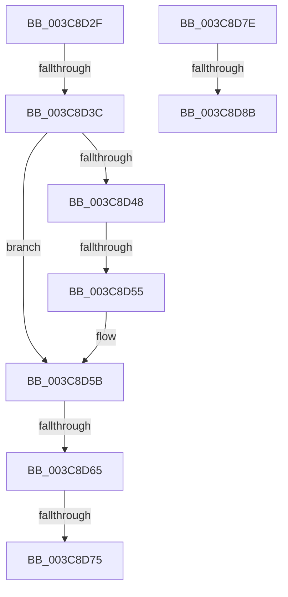

# sub_003C8D2F

- RVA: `0x003C8D2F`–`0x003C8D96` (길이 `103` bytes)
- VA: `0x00000001403C8D2F`
- 실행 섹션: `.text`
- PDB 이름 있음: `아니요`; PDB Function 태그: `아니요`
- unwind 정보 RVA: `0x0008F510`
- 디코드: `26`개 명령, `103/103` bytes 표시
- 미해석 바이트: `0` (있으면 어셈블리에 `.byte`로 보존)

> 이 문서는 커널 이미지의 기계어와 PDB 기호를 분석해 생성했습니다. 4번과 5번은 함수 원형과 자료형을 바이너리 사용 방식에서 추정한 C 해석이며 원본 소스 복구 결과는 아닙니다.

## 1. Dependencies

- 직접 호출 지점: **0**; 고유 호출 대상: **0**
- 직접 호출자로 확인된 함수: **0**
- RIP 상대 이미지 참조: **0**

### Outgoing calls
- 직접 디코드된 call 명령이 없습니다.

### Direct callers
- 이 함수 시작 RVA로 연결되는 직접 call은 확인되지 않았습니다. 간접 호출은 완전히 역산할 수 없습니다.

### Static image references
- 디코드된 RIP-relative 메모리 참조가 없습니다.

## 2. Other-region calls and transfers

- 다른 실행 섹션으로 향하는 call: **0**
- call이 아닌 외부 분기/꼬리 이동: **7**
  - `0x003C8D36` → [sub_003C8840 + 0x240](Unknown_function_003C8840.md) (`tail-transfer`)
  - `0x003C8D4F` → [sub_003C8840 + 0x240](Unknown_function_003C8840.md) (`tail-transfer`)
  - `0x003C8D5F` → [sub_003C8840 + 0x240](Unknown_function_003C8840.md) (`tail-transfer`)
  - `0x003C8D6F` → [sub_003C8840 + 0x240](Unknown_function_003C8840.md) (`tail-transfer`)
  - `0x003C8D79` → [sub_003C8840 + 0x224](Unknown_function_003C8840.md) (`tail-transfer`)
  - `0x003C8D85` → [sub_003C8840 + 0x240](Unknown_function_003C8840.md) (`tail-transfer`)
  - `0x003C8D91` → [sub_003C8AA8 + 0x215](Unknown_function_003C8AA8.md) (`tail-transfer`)

## 3. Assembly (complete function range)

```asm
003C8D2F  48 8D 43 01                     lea rax, [rbx + 1]
003C8D33  49 3B C7                        cmp rax, r15
003C8D36  0F 83 44 FD FF FF               jae 0x1403c8a80
003C8D3C  0F B7 13                        movzx edx, word ptr [rbx]
003C8D3F  48 83 C3 02                     add rbx, 2
003C8D43  48 85 D2                        test rdx, rdx
003C8D46  75 13                           jne 0x1403c8d5b
003C8D48  48 8D 43 03                     lea rax, [rbx + 3]
003C8D4C  49 3B C7                        cmp rax, r15
003C8D4F  0F 83 2B FD FF FF               jae 0x1403c8a80
003C8D55  8B 13                           mov edx, dword ptr [rbx]
003C8D57  48 83 C3 04                     add rbx, 4
003C8D5B  48 83 FA 0F                     cmp rdx, 0xf
003C8D5F  0F 82 1B FD FF FF               jb 0x1403c8a80
003C8D65  48 8D 47 03                     lea rax, [rdi + 3]
003C8D69  48 03 C2                        add rax, rdx
003C8D6C  48 3B C7                        cmp rax, rdi
003C8D6F  0F 82 0B FD FF FF               jb 0x1403c8a80
003C8D75  48 83 EA 0F                     sub rdx, 0xf
003C8D79  E9 E6 FC FF FF                  jmp 0x1403c8a64
003C8D7E  48 8D 43 03                     lea rax, [rbx + 3]
003C8D82  49 3B C7                        cmp rax, r15
003C8D85  0F 83 F5 FC FF FF               jae 0x1403c8a80
003C8D8B  8B 13                           mov edx, dword ptr [rbx]
003C8D8D  48 83 C3 04                     add rbx, 4
003C8D91  E9 27 FF FF FF                  jmp 0x1403c8cbd
```

## 4. C-style interpretation (structured pseudocode)

```c
__int64 __fastcall sub_003C8D2F(void)
{
    __int64 result;
    __int64 v_rbx;

    v_rbx = (v_rbx) + (2);
    if (*(unsigned __int16 *)(v_rbx) != 0) goto loc_003C8D5B;
    v_rbx = (v_rbx) + (4);
loc_003C8D5B:
    result = (v_rdi + 3) + ((unsigned int)(*(unsigned int *)(v_rbx)));
    a2 = ((unsigned int)(*(unsigned int *)(v_rbx))) - (15);
}
```

## 5. (Beta) C Style

```c
void sub_003C8D2F(void)
{
    int64_t result;
    int64_t local_rbx;

    local_rbx = (local_rbx) + (2);
    if (*(uint16_t *)(local_rbx) != 0) goto loc_003C8D5B;
    local_rbx = (local_rbx) + (4);
loc_003C8D5B:
    result = (local_rdi + 3) + ((uint32_t)(*(uint32_t *)(local_rbx)));
    a2 = ((uint32_t)(*(uint32_t *)(local_rbx))) - (15);
}
```

## 6. Execution-region graph

[열기: 2D/3D 그래프와 함수 탐색 컨트롤 패널](../../../control-panel.html?section=text&rva=0x003C8D2F&view=graph)

- 2D 그래프는 위에서 아래로 흐르고, 3D 그래프는 빈 공간을 드래그해 회전합니다. Shift+드래그는 이동, 휠은 확대·축소, 함수 노드 선택은 대상 보고서 이동입니다.

### Static fallback


