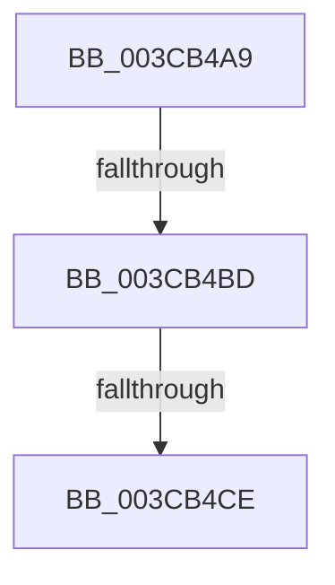

# sub_003CB4A9

- RVA: `0x003CB4A9`–`0x003CB4E1` (길이 `56` bytes)
- VA: `0x00000001403CB4A9`
- 실행 섹션: `.text`
- PDB 이름 있음: `아니요`; PDB Function 태그: `아니요`
- unwind 정보 RVA: `0x0008F774`
- 디코드: `14`개 명령, `56/56` bytes 표시
- 미해석 바이트: `0` (있으면 어셈블리에 `.byte`로 보존)

> 이 문서는 커널 이미지의 기계어와 PDB 기호를 분석해 생성했습니다. 4번과 5번은 함수 원형과 자료형을 바이너리 사용 방식에서 추정한 C 해석이며 원본 소스 복구 결과는 아닙니다.

## 1. Dependencies

- 직접 호출 지점: **0**; 고유 호출 대상: **0**
- 직접 호출자로 확인된 함수: **0**
- RIP 상대 이미지 참조: **0**

### Outgoing calls
- 직접 디코드된 call 명령이 없습니다.

### Direct callers
- 이 함수 시작 RVA로 연결되는 직접 call은 확인되지 않았습니다. 간접 호출은 완전히 역산할 수 없습니다.

### Static image references
- 디코드된 RIP-relative 메모리 참조가 없습니다.

## 2. Other-region calls and transfers

- 다른 실행 섹션으로 향하는 call: **0**
- call이 아닌 외부 분기/꼬리 이동: **3**
  - `0x003CB4BB` → [sub_003CB529](Unknown_function_003CB529.md) (`tail-transfer`)
  - `0x003CB4CC` → [sub_003CB529 + 0x1B](Unknown_function_003CB529.md) (`tail-transfer`)
  - `0x003CB4DF` → [sub_003CB4E1 + 0x35](Unknown_function_003CB4E1.md) (`tail-transfer`)

## 3. Assembly (complete function range)

```asm
003CB4A9  48 89 6C 24 40                  mov qword ptr [rsp + 0x40], rbp
003CB4AE  48 8B F9                        mov rdi, rcx
003CB4B1  33 ED                           xor ebp, ebp
003CB4B3  4C 89 74 24 48                  mov qword ptr [rsp + 0x48], r14
003CB4B8  48 85 DB                        test rbx, rbx
003CB4BB  75 6C                           jne 0x1403cb529
003CB4BD  48 8B BF 20 02 00 00            mov rdi, qword ptr [rdi + 0x220]
003CB4C4  48 83 BF D8 06 00 00 00         cmp qword ptr [rdi + 0x6d8], 0
003CB4CC  75 76                           jne 0x1403cb544
003CB4CE  BE 25 02 00 C0                  mov esi, 0xc0000225
003CB4D3  4C 8B 74 24 48                  mov r14, qword ptr [rsp + 0x48]
003CB4D8  85 ED                           test ebp, ebp
003CB4DA  48 8B 6C 24 40                  mov rbp, qword ptr [rsp + 0x40]
003CB4DF  74 35                           je 0x1403cb516
```

## 4. C-style interpretation (structured pseudocode)

```c
void __fastcall sub_003CB4A9(__int64 a1, __int64 a2, __int64 a3, __int64 a4, __int64 a5, __int64 a6, __int64 a7, __int64 a8, __int64 a9)
{
    __int64 v_rbp;
    unsigned __int64 v_stack_p40;
    unsigned __int64 v_stack_p48;

    v_stack_p40 = v_rbp;
    v_rbp = 0;
    v_stack_p48 = v_r14;
}
```

## 5. (Beta) C Style

```c
void sub_003CB4A9(void *Arg1, int64_t Arg2, int64_t Arg3, int64_t Arg4, uint64_t Arg5, uint64_t Arg6, uint64_t Arg7, int64_t Arg8, int64_t Arg9)
{
    uint8_t *arg1 = (uint8_t *)Arg1;

    int64_t local_rbp;
    uint64_t v_stack_p40;
    uint64_t v_stack_p48;

    v_stack_p40 = local_rbp;
    local_rbp = 0;
    v_stack_p48 = local_r14;
}
```

### 관측된 메모리 오프셋

구조체 형식이 확인되지 않은 접근은 인자 기준의 오프셋으로만 기록했습니다.

| 기준 인자 | 오프셋 표현 | 폭 (bit) | 접근 |
|---|---:|---:|---|
| `Arg1` | `+ 0x220` | `64` | `R` |

## 6. Execution-region graph

[열기: 2D/3D 그래프와 함수 탐색 컨트롤 패널](../../../control-panel.html?section=text&rva=0x003CB4A9&view=graph)

- 2D 그래프는 위에서 아래로 흐르고, 3D 그래프는 빈 공간을 드래그해 회전합니다. Shift+드래그는 이동, 휠은 확대·축소, 함수 노드 선택은 대상 보고서 이동입니다.

### Static fallback


