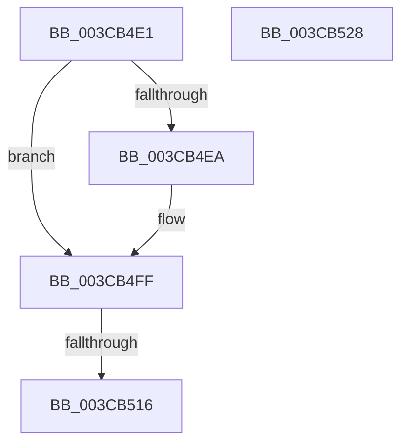

# sub_003CB4E1

- RVA: `0x003CB4E1`–`0x003CB529` (길이 `72` bytes)
- VA: `0x00000001403CB4E1`
- 실행 섹션: `.text`
- PDB 이름 있음: `아니요`; PDB Function 태그: `아니요`
- unwind 정보 RVA: `0x0008F78C`
- 디코드: `18`개 명령, `72/72` bytes 표시
- 미해석 바이트: `0` (있으면 어셈블리에 `.byte`로 보존)

> 이 문서는 커널 이미지의 기계어와 PDB 기호를 분석해 생성했습니다. 4번과 5번은 함수 원형과 자료형을 바이너리 사용 방식에서 추정한 C 해석이며 원본 소스 복구 결과는 아닙니다.

## 1. Dependencies

- 직접 호출 지점: **1**; 고유 호출 대상: **1**
- 직접 호출자로 확인된 함수: **0**
- RIP 상대 이미지 참조: **1**

### Outgoing calls
- `0x003CB4FA` → [ObpPushStackInfo](../21/ObpPushStackInfo_function_002109E4.md) (function, `0x002109E4`)

### Direct callers
- 이 함수 시작 RVA로 연결되는 직접 call은 확인되지 않았습니다. 간접 호출은 완전히 역산할 수 없습니다.

### Static image references
- `0x003CB4E1` → RVA `0x00FC5010` (`ALMOSTRO`; read)

## 2. Other-region calls and transfers

- 다른 실행 섹션으로 향하는 call: **0**
- call이 아닌 외부 분기/꼬리 이동: **1**
  - `0x003CB510` → [sub_003CB5B3](Unknown_function_003CB5B3.md) (`tail-transfer`)

## 3. Assembly (complete function range)

```asm
003CB4E1  83 3D 28 9B BF 00 00            cmp dword ptr [rip + 0xbf9b28], 0
003CB4E8  74 15                           je 0x1403cb4ff
003CB4EA  33 D2                           xor edx, edx
003CB4EC  48 8D 4B D0                     lea rcx, [rbx - 0x30]
003CB4F0  41 B9 44 66 6C 74               mov r9d, 0x746c6644
003CB4F6  44 8D 42 01                     lea r8d, [rdx + 1]
003CB4FA  E8 E5 54 E4 FF                  call 0x1402109e4
003CB4FF  48 C7 C0 FF FF FF FF            mov rax, 0xffffffffffffffff
003CB506  F0 48 0F C1 43 D0               lock xadd qword ptr [rbx - 0x30], rax
003CB50C  48 83 E8 01                     sub rax, 1
003CB510  0F 8E 9D 00 00 00               jle 0x1403cb5b3
003CB516  48 8B 5C 24 50                  mov rbx, qword ptr [rsp + 0x50]
003CB51B  8B C6                           mov eax, esi
003CB51D  48 8B 74 24 58                  mov rsi, qword ptr [rsp + 0x58]
003CB522  48 83 C4 30                     add rsp, 0x30
003CB526  5F                              pop rdi
003CB527  C3                              ret
003CB528  CC                              int3
```

## 4. C-style interpretation (structured pseudocode)

```c
__int64 __fastcall sub_003CB4E1(__int64 a1, int a2, __int64 a3, __int64 a4, __int64 a5, __int64 a6, __int64 a7, __int64 a8, __int64 a9, __int64 a10, __int64 a11)
{
    __int64 result;
    __int64 v_rsp;

    if ((*(unsigned int *)(v_rip + 12557096)) != 0) {
        a2 = 0;
        a1 = v_rbx - 48;
        a4 = 0x746C6644ULL;
        a3 = a2 + 1;
        result = ObpPushStackInfo(a1, a2, a3, a4);
    }
    result = (-1) - (1);
    v_rsp = (v_rsp) + (48);
    return (unsigned int)((unsigned int)(v_rsi));
}
```

## 5. (Beta) C Style

```c
int64_t sub_003CB4E1(int64_t Arg1, int32_t Arg2, int64_t Arg3, int64_t Arg4, uint64_t Arg5, uint64_t Arg6, uint64_t Arg7, uint64_t Arg8, uint64_t Arg9, int64_t Arg10, int64_t Arg11)
{
    int64_t result;
    int64_t local_rsp;

    if ((*(uint32_t *)(v_rip + 0xBF9B28)) != 0) {
        Arg2 = 0;
        Arg1 = local_rbx - 48;
        Arg4 = 0x746C6644ULL;
        Arg3 = Arg2 + 1;
        result = ObpPushStackInfo(Arg1, Arg2, Arg3, Arg4);
    }
    result = (-1) - (1);
    local_rsp = (local_rsp) + (48);
    return (uint32_t)((uint32_t)(local_rsi));
}
```

## 6. Execution-region graph

[열기: 2D/3D 그래프와 함수 탐색 컨트롤 패널](../../../control-panel.html?section=text&rva=0x003CB4E1&view=graph)

- 2D 그래프는 위에서 아래로 흐르고, 3D 그래프는 빈 공간을 드래그해 회전합니다. Shift+드래그는 이동, 휠은 확대·축소, 함수 노드 선택은 대상 보고서 이동입니다.

### Static fallback


