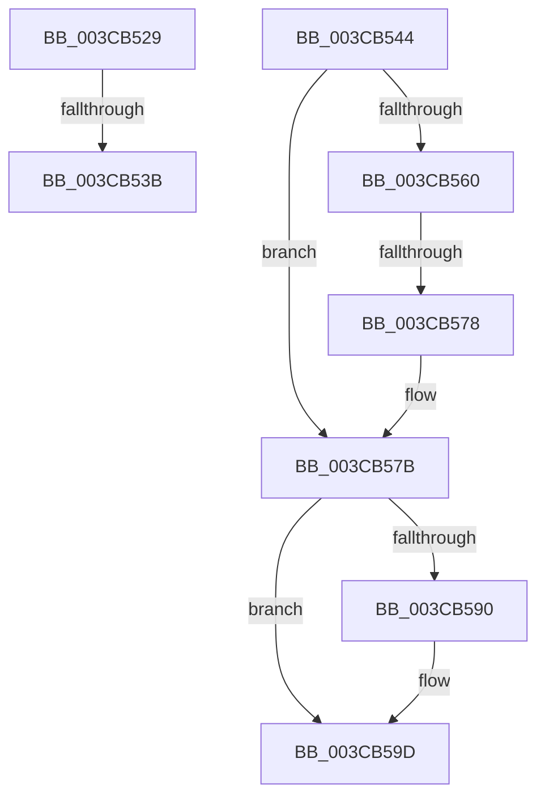

# sub_003CB529

- RVA: `0x003CB529`–`0x003CB5B3` (길이 `138` bytes)
- VA: `0x00000001403CB529`
- 실행 섹션: `.text`
- PDB 이름 있음: `아니요`; PDB Function 태그: `아니요`
- unwind 정보 RVA: `0x0008F7A0`
- 디코드: `30`개 명령, `138/138` bytes 표시
- 미해석 바이트: `0` (있으면 어셈블리에 `.byte`로 보존)

> 이 문서는 커널 이미지의 기계어와 PDB 기호를 분석해 생성했습니다. 4번과 5번은 함수 원형과 자료형을 바이너리 사용 방식에서 추정한 C 해석이며 원본 소스 복구 결과는 아닙니다.

## 1. Dependencies

- 직접 호출 지점: **3**; 고유 호출 대상: **3**
- 직접 호출자로 확인된 함수: **0**
- RIP 상대 이미지 참조: **2**

### Outgoing calls
- `0x003CB54B` → [ExAcquireSpinLockShared](../24/ExAcquireSpinLockShared_function_0024DCE0.md) (function, `0x0024DCE0`)
- `0x003CB582` → [ExReleaseSpinLockSharedFromDpcLevel](../24/ExReleaseSpinLockSharedFromDpcLevel_function_0024A590.md) (function, `0x0024A590`)
- `0x003CB598` → [KiLowerIrqlProcessIrqlFlags](../4F/KiLowerIrqlProcessIrqlFlags_function_004F5698.md) (function, `0x004F5698`)

### Direct callers
- 이 함수 시작 RVA로 연결되는 직접 call은 확인되지 않았습니다. 간접 호출은 완전히 역산할 수 없습니다.

### Static image references
- `0x003CB544` → RVA `0x00F8D1E0` (`.data`; read)
- `0x003CB587` → RVA `0x00FC6D20` (`ALMOSTRO`; read)

## 2. Other-region calls and transfers

- 다른 실행 섹션으로 향하는 call: **0**
- call이 아닌 외부 분기/꼬리 이동: **4**
  - `0x003CB535` → [sub_003CB5DC](Unknown_function_003CB5DC.md) (`tail-transfer`)
  - `0x003CB542` → [sub_003CB4A9 + 0x1B](Unknown_function_003CB4A9.md) (`tail-transfer`)
  - `0x003CB572` → [sub_003CB667](Unknown_function_003CB667.md) (`tail-transfer`)
  - `0x003CB5AE` → [sub_003CB4A9 + 0x2A](Unknown_function_003CB4A9.md) (`tail-transfer`)

## 3. Assembly (complete function range)

```asm
003CB529  65 48 8B 04 25 88 01 00 00      mov rax, qword ptr gs:[0x188]
003CB532  48 3B F8                        cmp rdi, rax
003CB535  0F 85 A1 00 00 00               jne 0x1403cb5dc
003CB53B  48 8B BB 20 02 00 00            mov rdi, qword ptr [rbx + 0x220]
003CB542  EB 80                           jmp 0x1403cb4c4
003CB544  48 8D 0D 95 1C BC 00            lea rcx, [rip + 0xbc1c95]
003CB54B  E8 90 27 E8 FF                  call 0x14024dce0
003CB550  48 8B BF D8 06 00 00            mov rdi, qword ptr [rdi + 0x6d8]
003CB557  44 0F B6 F0                     movzx r14d, al
003CB55B  48 85 FF                        test rdi, rdi
003CB55E  74 1B                           je 0x1403cb57b
003CB560  BA 01 00 00 00                  mov edx, 1
003CB565  F0 48 0F C1 57 20               lock xadd qword ptr [rdi + 0x20], rdx
003CB56B  48 FF C2                        inc rdx
003CB56E  48 83 FA 01                     cmp rdx, 1
003CB572  0F 8E EF 00 00 00               jle 0x1403cb667
003CB578  48 89 3E                        mov qword ptr [rsi], rdi
003CB57B  48 8D 0D 5E 1C BC 00            lea rcx, [rip + 0xbc1c5e]
003CB582  E8 09 F0 E7 FF                  call 0x14024a590
003CB587  83 3D 92 B7 BF 00 00            cmp dword ptr [rip + 0xbfb792], 0
003CB58E  74 0D                           je 0x1403cb59d
003CB590  44 0F 20 C1                     mov rcx, cr8
003CB594  41 0F B6 D6                     movzx edx, r14b
003CB598  E8 FB A0 12 00                  call 0x1404f5698
003CB59D  45 0F 22 C6                     mov cr8, r14
003CB5A1  33 F6                           xor esi, esi
003CB5A3  B8 25 02 00 C0                  mov eax, 0xc0000225
003CB5A8  48 85 FF                        test rdi, rdi
003CB5AB  0F 44 F0                        cmove esi, eax
003CB5AE  E9 20 FF FF FF                  jmp 0x1403cb4d3
```

## 4. C-style interpretation (structured pseudocode)

```c
__int64 __fastcall sub_003CB529(void)
{
}
```

## 5. (Beta) C Style

```c
void sub_003CB529(void)
{
}
```

## 6. Execution-region graph

[열기: 2D/3D 그래프와 함수 탐색 컨트롤 패널](../../../control-panel.html?section=text&rva=0x003CB529&view=graph)

- 2D 그래프는 위에서 아래로 흐르고, 3D 그래프는 빈 공간을 드래그해 회전합니다. Shift+드래그는 이동, 휠은 확대·축소, 함수 노드 선택은 대상 보고서 이동입니다.

### Static fallback


