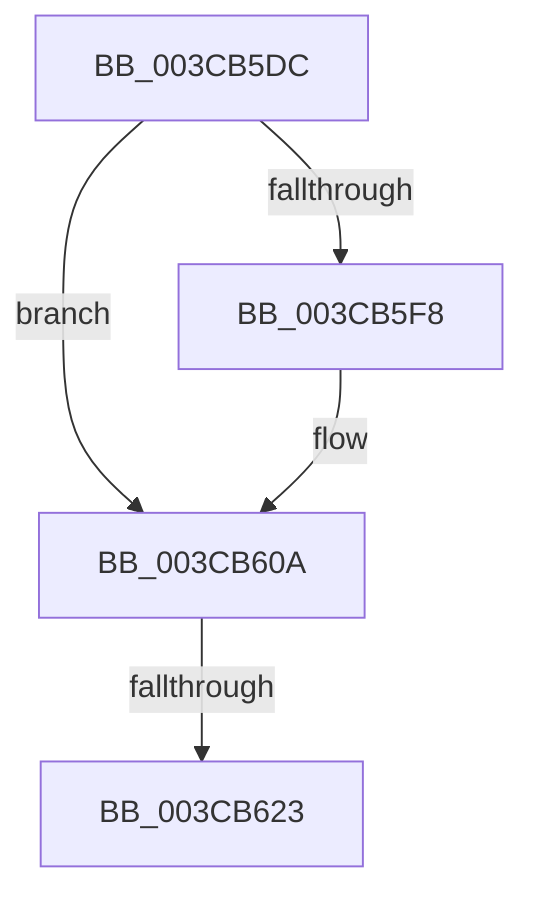

# sub_003CB5DC

- RVA: `0x003CB5DC`–`0x003CB628` (길이 `76` bytes)
- VA: `0x00000001403CB5DC`
- 실행 섹션: `.text`
- PDB 이름 있음: `아니요`; PDB Function 태그: `아니요`
- unwind 정보 RVA: `0x0008F7C8`
- 디코드: `16`개 명령, `76/76` bytes 표시
- 미해석 바이트: `0` (있으면 어셈블리에 `.byte`로 보존)

> 이 문서는 커널 이미지의 기계어와 PDB 기호를 분석해 생성했습니다. 4번과 5번은 함수 원형과 자료형을 바이너리 사용 방식에서 추정한 C 해석이며 원본 소스 복구 결과는 아닙니다.

## 1. Dependencies

- 직접 호출 지점: **3**; 고유 호출 대상: **3**
- 직접 호출자로 확인된 함수: **0**
- RIP 상대 이미지 참조: **1**

### Outgoing calls
- `0x003CB5E3` → [ExAcquireSpinLockShared](../24/ExAcquireSpinLockShared_function_0024DCE0.md) (function, `0x0024DCE0`)
- `0x003CB600` → [ObfReferenceObjectWithTag](../21/ObfReferenceObjectWithTag_function_00210710.md) (function, `0x00210710`)
- `0x003CB615` → [ExReleaseSpinLockShared](../2F/ExReleaseSpinLockShared_function_002F0EF0.md) (function, `0x002F0EF0`)

### Direct callers
- 이 함수 시작 RVA로 연결되는 직접 call은 확인되지 않았습니다. 간접 호출은 완전히 역산할 수 없습니다.

### Static image references
- `0x003CB5DC` → RVA `0x00F06590` (`.data`; read)

## 2. Other-region calls and transfers

- 다른 실행 섹션으로 향하는 call: **0**
- call이 아닌 외부 분기/꼬리 이동: **2**
  - `0x003CB61D` → [sub_003CB4A9 + 0x14](Unknown_function_003CB4A9.md) (`tail-transfer`)
  - `0x003CB623` → [sub_003CB529 + 0x12](Unknown_function_003CB529.md) (`tail-transfer`)

## 3. Assembly (complete function range)

```asm
003CB5DC  48 8D 0D AD AF B3 00            lea rcx, [rip + 0xb3afad]
003CB5E3  E8 F8 26 E8 FF                  call 0x14024dce0
003CB5E8  48 8B 9F 50 06 00 00            mov rbx, qword ptr [rdi + 0x650]
003CB5EF  44 0F B6 F0                     movzx r14d, al
003CB5F3  48 85 DB                        test rbx, rbx
003CB5F6  74 12                           je 0x1403cb60a
003CB5F8  BA 44 66 6C 74                  mov edx, 0x746c6644
003CB5FD  48 8B CB                        mov rcx, rbx
003CB600  E8 0B 51 E4 FF                  call 0x140210710
003CB605  BD 01 00 00 00                  mov ebp, 1
003CB60A  41 0F B6 D6                     movzx edx, r14b
003CB60E  48 8D 0D 7B AF B3 00            lea rcx, [rip + 0xb3af7b]
003CB615  E8 D6 58 F2 FF                  call 0x1402f0ef0
003CB61A  48 85 DB                        test rbx, rbx
003CB61D  0F 84 9A FE FF FF               je 0x1403cb4bd
003CB623  E9 13 FF FF FF                  jmp 0x1403cb53b
```

## 4. C-style interpretation (structured pseudocode)

```c
__int64 __fastcall sub_003CB5DC(void)
{
    __int64 result;
    __int64 v_rbp;

    result = ExAcquireSpinLockShared(v_rip + 11775917, a2, a3, a4);
    if (*(unsigned __int64 *)(v_rdi + 1616) != 0) {
        a2 = 0x746C6644ULL;
        a1 = *(unsigned __int64 *)(v_rdi + 1616);
        result = ObfReferenceObjectWithTag(a1, a2, a3, a4);
        v_rbp = 1;
    }
    result = ExReleaseSpinLockShared(v_rip + 11775867, (unsigned __int8)((unsigned __int8)(result)), a3, a4);
}
```

## 5. (Beta) C Style

```c
void sub_003CB5DC(void)
{
    int64_t result;
    int64_t local_rbp;

    result = ExAcquireSpinLockShared(v_rip + 11775917, a2, a3, a4);
    if (*(uint64_t *)(local_rdi + 0x650) != 0) {
        a2 = 0x746C6644ULL;
        a1 = *(uint64_t *)(local_rdi + 0x650);
        result = ObfReferenceObjectWithTag(a1, a2, a3, a4);
        local_rbp = 1;
    }
    result = ExReleaseSpinLockShared(v_rip + 11775867, (uint8_t)((uint8_t)(result)), a3, a4);
}
```

## 6. Execution-region graph

[열기: 2D/3D 그래프와 함수 탐색 컨트롤 패널](../../../control-panel.html?section=text&rva=0x003CB5DC&view=graph)

- 2D 그래프는 위에서 아래로 흐르고, 3D 그래프는 빈 공간을 드래그해 회전합니다. Shift+드래그는 이동, 휠은 확대·축소, 함수 노드 선택은 대상 보고서 이동입니다.

### Static fallback


