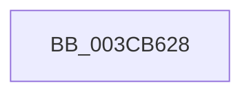

# sub_003CB628

- RVA: `0x003CB628`–`0x003CB667` (길이 `63` bytes)
- VA: `0x00000001403CB628`
- 실행 섹션: `.text`
- PDB 이름 있음: `아니요`; PDB Function 태그: `아니요`
- unwind 정보 RVA: `0x0008F7E0`
- 디코드: `15`개 명령, `63/63` bytes 표시
- 미해석 바이트: `0` (있으면 어셈블리에 `.byte`로 보존)

> 이 문서는 커널 이미지의 기계어와 PDB 기호를 분석해 생성했습니다. 4번과 5번은 함수 원형과 자료형을 바이너리 사용 방식에서 추정한 C 해석이며 원본 소스 복구 결과는 아닙니다.

## 1. Dependencies

- 직접 호출 지점: **1**; 고유 호출 대상: **1**
- 직접 호출자로 확인된 함수: **0**
- RIP 상대 이미지 참조: **2**

### Outgoing calls
- `0x003CB661` → [KeBugCheckEx](../4F/KeBugCheckEx_function_004FD660.md) (function, `0x004FD660`)

### Direct callers
- 이 함수 시작 RVA로 연결되는 직접 call은 확인되지 않았습니다. 간접 호출은 완전히 역산할 수 없습니다.

### Static image references
- `0x003CB64C` → RVA `0x00FC6E4C` (`ALMOSTRO`; read)
- `0x003CB656` → RVA `0x00FC7800` (`ALMOSTRO`; read)

## 2. Other-region calls and transfers

- 다른 실행 섹션으로 향하는 call: **0**
- 별도 외부 분기/꼬리 이동을 확인하지 못했습니다.

## 3. Assembly (complete function range)

```asm
003CB628  41 B9 03 00 00 00               mov r9d, 3
003CB62E  48 89 4C 24 20                  mov qword ptr [rsp + 0x20], rcx
003CB633  48 8D 43 D0                     lea rax, [rbx - 0x30]
003CB637  4C 8B C3                        mov r8, rbx
003CB63A  48 C1 E8 08                     shr rax, 8
003CB63E  0F B6 D0                        movzx edx, al
003CB641  0F B6 43 E8                     movzx eax, byte ptr [rbx - 0x18]
003CB645  41 8D 49 15                     lea ecx, [r9 + 0x15]
003CB649  48 33 D0                        xor rdx, rax
003CB64C  0F B6 05 F9 B7 BF 00            movzx eax, byte ptr [rip + 0xbfb7f9]
003CB653  48 33 D0                        xor rdx, rax
003CB656  48 8D 05 A3 C1 BF 00            lea rax, [rip + 0xbfc1a3]
003CB65D  48 8B 14 D0                     mov rdx, qword ptr [rax + rdx*8]
003CB661  E8 FA 1F 13 00                  call 0x1404fd660
003CB666  CC                              int3
```

## 4. C-style interpretation (structured pseudocode)

```c
__int64 __fastcall sub_003CB628(__int64 a1)
{
    __int64 result;
    unsigned __int64 v_stack_p20;

    v_stack_p20 = a1;
    result = (v_rbx - 48) >> (8);
    a2 = ((unsigned __int8)(result)) ^ (*(unsigned __int8 *)(v_rbx - 24));
    a2 = (a2) ^ (*(unsigned __int8 *)(v_rip + 12564473));
    result = KeBugCheckEx(3 + 21, *(unsigned __int64 *)(v_rip + 12566947 + a2 * 8), v_rbx, 3);
    return result;
}
```

## 5. (Beta) C Style

```c
int64_t sub_003CB628(int64_t Arg1)
{
    int64_t result;
    uint64_t v_stack_p20;

    v_stack_p20 = Arg1;
    result = (local_rbx - 48) >> (8);
    a2 = ((uint8_t)(result)) ^ (*(uint8_t *)(local_rbx - 0x18));
    a2 = (a2) ^ (*(uint8_t *)(v_rip + 0xBFB7F9));
    result = KeBugCheckEx(3 + 21, *(uint64_t *)(v_rip + 0xBFC1A3 + a2 * 8), local_rbx, 3);
    return result;
}
```

## 6. Execution-region graph

[열기: 2D/3D 그래프와 함수 탐색 컨트롤 패널](../../../control-panel.html?section=text&rva=0x003CB628&view=graph)

- 2D 그래프는 위에서 아래로 흐르고, 3D 그래프는 빈 공간을 드래그해 회전합니다. Shift+드래그는 이동, 휠은 확대·축소, 함수 노드 선택은 대상 보고서 이동입니다.

### Static fallback


