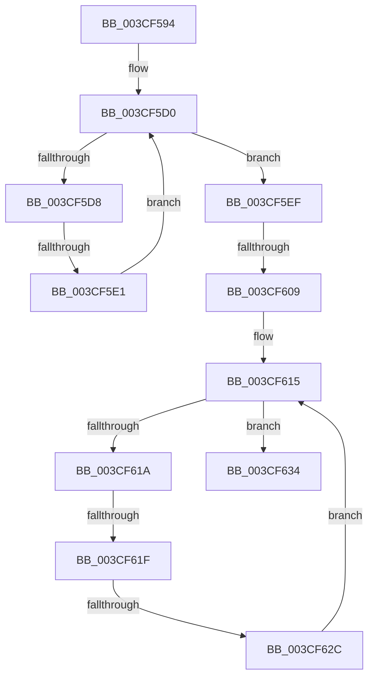

# sub_003CF594

- RVA: `0x003CF594`–`0x003CF673` (길이 `223` bytes)
- VA: `0x00000001403CF594`
- 실행 섹션: `.text`
- PDB 이름 있음: `아니요`; PDB Function 태그: `아니요`
- unwind 정보 RVA: `0x00090640`
- 디코드: `70`개 명령, `223/223` bytes 표시
- 미해석 바이트: `0` (있으면 어셈블리에 `.byte`로 보존)

> 이 문서는 커널 이미지의 기계어와 PDB 기호를 분석해 생성했습니다. 4번과 5번은 함수 원형과 자료형을 바이너리 사용 방식에서 추정한 C 해석이며 원본 소스 복구 결과는 아닙니다.

## 1. Dependencies

- 직접 호출 지점: **0**; 고유 호출 대상: **0**
- 직접 호출자로 확인된 함수: **0**
- RIP 상대 이미지 참조: **0**

### Outgoing calls
- 직접 디코드된 call 명령이 없습니다.

### Direct callers
- 이 함수 시작 RVA로 연결되는 직접 call은 확인되지 않았습니다. 간접 호출은 완전히 역산할 수 없습니다.

### Static image references
- 디코드된 RIP-relative 메모리 참조가 없습니다.

## 2. Other-region calls and transfers

- 다른 실행 섹션으로 향하는 call: **0**
- call이 아닌 외부 분기/꼬리 이동: **4**
  - `0x003CF5DB` → [sub_003CF674](Unknown_function_003CF674.md) (`tail-transfer`)
  - `0x003CF607` → [sub_003CF674](Unknown_function_003CF674.md) (`tail-transfer`)
  - `0x003CF61D` → [sub_003CF68D](Unknown_function_003CF68D.md) (`tail-transfer`)
  - `0x003CF62A` → [sub_003CF68D](Unknown_function_003CF68D.md) (`tail-transfer`)

## 3. Assembly (complete function range)

```asm
003CF594  4C 89 7C 24 18                  mov qword ptr [rsp + 0x18], r15
003CF599  4C 8B 79 08                     mov r15, qword ptr [rcx + 8]
003CF59D  83 E7 1F                        and edi, 0x1f
003CF5A0  48 C1 E8 05                     shr rax, 5
003CF5A4  8D 4E FF                        lea ecx, [rsi - 1]
003CF5A7  45 8B 1C 87                     mov r11d, dword ptr [r15 + rax*4]
003CF5AB  49 8D 04 87                     lea rax, [r15 + rax*4]
003CF5AF  48 C1 E9 05                     shr rcx, 5
003CF5B3  41 B8 01 00 00 00               mov r8d, 1
003CF5B9  41 8B D0                        mov edx, r8d
003CF5BC  4D 8D 0C 8F                     lea r9, [r15 + rcx*4]
003CF5C0  40 0F B6 CF                     movzx ecx, dil
003CF5C4  D3 E2                           shl edx, cl
003CF5C6  48 8D 48 04                     lea rcx, [rax + 4]
003CF5CA  FF CA                           dec edx
003CF5CC  44 0B DA                        or r11d, edx
003CF5CF  90                              nop
003CF5D0  41 F7 D3                        not r11d
003CF5D3  45 85 DB                        test r11d, r11d
003CF5D6  75 17                           jne 0x1403cf5ef
003CF5D8  49 3B C9                        cmp rcx, r9
003CF5DB  0F 87 93 00 00 00               ja 0x1403cf674
003CF5E1  44 8B 58 04                     mov r11d, dword ptr [rax + 4]
003CF5E5  48 83 C0 04                     add rax, 4
003CF5E9  48 83 C1 04                     add rcx, 4
003CF5ED  EB E1                           jmp 0x1403cf5d0
003CF5EF  41 8B CB                        mov ecx, r11d
003CF5F2  48 8B D0                        mov rdx, rax
003CF5F5  49 2B D7                        sub rdx, r15
003CF5F8  48 C1 FA 02                     sar rdx, 2
003CF5FC  48 0F BC C9                     bsf rcx, rcx
003CF600  C1 E2 05                        shl edx, 5
003CF603  03 D1                           add edx, ecx
003CF605  3B D6                           cmp edx, esi
003CF607  77 6B                           ja 0x1403cf674
003CF609  41 D3 E0                        shl r8d, cl
003CF60C  41 FF C8                        dec r8d
003CF60F  45 0B C3                        or r8d, r11d
003CF612  41 F7 D0                        not r8d
003CF615  45 85 C0                        test r8d, r8d
003CF618  75 1A                           jne 0x1403cf634
003CF61A  44 3B D3                        cmp r10d, ebx
003CF61D  77 6E                           ja 0x1403cf68d
003CF61F  41 83 C2 20                     add r10d, 0x20
003CF623  48 8D 48 04                     lea rcx, [rax + 4]
003CF627  49 3B C9                        cmp rcx, r9
003CF62A  77 61                           ja 0x1403cf68d
003CF62C  44 8B 01                        mov r8d, dword ptr [rcx]
003CF62F  48 8B C1                        mov rax, rcx
003CF632  EB E1                           jmp 0x1403cf615
003CF634  41 8B C8                        mov ecx, r8d
003CF637  48 0F BC C9                     bsf rcx, rcx
003CF63B  49 2B C7                        sub rax, r15
003CF63E  44 8B D6                        mov r10d, esi
003CF641  48 C1 F8 02                     sar rax, 2
003CF645  C1 E0 05                        shl eax, 5
003CF648  03 C8                           add ecx, eax
003CF64A  3B CE                           cmp ecx, esi
003CF64C  44 0F 46 D1                     cmovbe r10d, ecx
003CF650  44 2B D2                        sub r10d, edx
003CF653  44 3B D3                        cmp r10d, ebx
003CF656  44 0F 47 D3                     cmova r10d, ebx
003CF65A  41 89 16                        mov dword ptr [r14], edx
003CF65D  41 8B C2                        mov eax, r10d
003CF660  4C 8B 7C 24 18                  mov r15, qword ptr [rsp + 0x18]
003CF665  48 8B 5C 24 28                  mov rbx, qword ptr [rsp + 0x28]
003CF66A  48 8B 74 24 30                  mov rsi, qword ptr [rsp + 0x30]
003CF66F  41 5E                           pop r14
003CF671  5F                              pop rdi
003CF672  C3                              ret
```

## 4. C-style interpretation (structured pseudocode)

```c
__int64 __fastcall sub_003CF594(__int64 a1, __int64 a2, __int64 a3, __int64 a4, __int64 a5, __int64 a6)
{
    __int64 result;
    __int64 v_r10;
    __int64 v_r11;
    __int64 v_rdi;
    unsigned __int64 v_stack_p18;

    v_stack_p18 = v_r15;
    v_rdi = (unsigned int)((v_rdi) & (31));
    result = (result) >> (5);
    a1 = (v_rsi - 1) >> (5);
    a2 = (unsigned int)((1) << ((unsigned __int8)((unsigned __int8)(v_rdi))));
    a2 = (unsigned int)((a2) - 1);
    v_r11 = (unsigned int)(((unsigned int)(*(unsigned int *)(*(unsigned __int64 *)(a1 + 8) + result * 4))) | ((unsigned int)(a2)));
loc_003CF5D0:
    v_r11 = (unsigned int)(~(v_r11));
    if ((unsigned int)(v_r11) != 0) goto loc_003CF5EF;
    result = (*(unsigned __int64 *)(a1 + 8) + result * 4) + (4);
    a1 = (*(unsigned __int64 *)(a1 + 8) + result * 4 + 4) + (4);
    goto loc_003CF5D0;
loc_003CF5EF:
    a2 = (result) - (*(unsigned __int64 *)(a1 + 8));
    a2 = (a2) >> (2);
    a2 = (unsigned int)((a2) << (5));
    a2 = (unsigned int)((a2) + ((unsigned int)((unsigned int)((unsigned int)((unsigned int)(*(unsigned int *)(*(unsigned __int64 *)(a1 + 8) + result * 4 + 4)))))));
    a3 = (unsigned int)((1) << ((unsigned __int8)((unsigned int)((unsigned int)((unsigned int)(*(unsigned int *)(*(unsigned __int64 *)(a1 + 8) + result * 4 + 4)))))));
    a3 = (unsigned int)((a3) - 1);
    a3 = (unsigned int)((a3) | ((unsigned int)((unsigned int)(*(unsigned int *)(*(unsigned __int64 *)(a1 + 8) + result * 4 + 4)))));
    a3 = (unsigned int)(~(a3));
loc_003CF615:
    if ((unsigned int)(a3) != 0) goto loc_003CF634;
    v_r10 = (unsigned int)((v_r10) + (32));
    goto loc_003CF615;
loc_003CF634:
    result = (result + 4) - (*(unsigned __int64 *)(a1 + 8));
    result = (result) >> (2);
    result = (unsigned int)((result) << (5));
    a1 = (unsigned int)(((unsigned int)((unsigned int)((unsigned int)(*(unsigned int *)(result + 4))))) + ((unsigned int)(result)));
    v_r10 = (unsigned int)((unsigned int)(v_rsi));
    if (((unsigned int)(a1)) <= ((unsigned int)(v_rsi))) { v_r10 = (unsigned int)(a1); }
    v_r10 = (unsigned int)((v_r10) - ((unsigned int)(a2)));
    if (((unsigned int)(v_r10)) > ((unsigned int)(v_rbx))) { v_r10 = (unsigned int)(v_rbx); }
    *(unsigned int *)(v_r14) = (unsigned int)(a2);
    return (unsigned int)((unsigned int)(v_r10));
}
```

## 5. (Beta) C Style

```c
int64_t sub_003CF594(void *Arg1, int64_t Arg2, int64_t Arg3, int64_t Arg4, int64_t Arg5, int64_t Arg6)
{
    uint8_t *arg1 = (uint8_t *)Arg1;

    int64_t result;
    int64_t local_r10;
    int64_t local_r11;
    int64_t local_rdi;
    uint64_t v_stack_p18;

    v_stack_p18 = local_r15;
    local_rdi = (uint32_t)((local_rdi) & (31));
    result = (result) >> (5);
    Arg1 = (local_rsi - 1) >> (5);
    Arg2 = (uint32_t)((1) << ((uint8_t)((uint8_t)(local_rdi))));
    Arg2 = (uint32_t)((Arg2) - 1);
    local_r11 = (uint32_t)(((uint32_t)(*(uint32_t *)(*(uint64_t *)(arg1 + 0x8) + result * 4))) | ((uint32_t)(Arg2)));
loc_003CF5D0:
    local_r11 = (uint32_t)(~(local_r11));
    if ((uint32_t)(local_r11) != 0) goto loc_003CF5EF;
    result = (*(uint64_t *)(arg1 + 0x8) + result * 4) + (4);
    Arg1 = (*(uint64_t *)(arg1 + 0x8) + result * 4 + 4) + (4);
    goto loc_003CF5D0;
loc_003CF5EF:
    Arg2 = (result) - (*(uint64_t *)(arg1 + 0x8));
    Arg2 = (Arg2) >> (2);
    Arg2 = (uint32_t)((Arg2) << (5));
    Arg2 = (uint32_t)((Arg2) + ((uint32_t)((uint32_t)((uint32_t)((uint32_t)(*(uint32_t *)(*(uint64_t *)(arg1 + 0x8) + result * 4 + 0x4)))))));
    Arg3 = (uint32_t)((1) << ((uint8_t)((uint32_t)((uint32_t)((uint32_t)(*(uint32_t *)(*(uint64_t *)(arg1 + 0x8) + result * 4 + 0x4)))))));
    Arg3 = (uint32_t)((Arg3) - 1);
    Arg3 = (uint32_t)((Arg3) | ((uint32_t)((uint32_t)(*(uint32_t *)(*(uint64_t *)(arg1 + 0x8) + result * 4 + 0x4)))));
    Arg3 = (uint32_t)(~(Arg3));
loc_003CF615:
    if ((uint32_t)(Arg3) != 0) goto loc_003CF634;
    local_r10 = (uint32_t)((local_r10) + (32));
    goto loc_003CF615;
loc_003CF634:
    result = (result + 4) - (*(uint64_t *)(arg1 + 0x8));
    result = (result) >> (2);
    result = (uint32_t)((result) << (5));
    Arg1 = (uint32_t)(((uint32_t)((uint32_t)((uint32_t)(*(uint32_t *)(result + 0x4))))) + ((uint32_t)(result)));
    local_r10 = (uint32_t)((uint32_t)(local_rsi));
    if (((uint32_t)(Arg1)) <= ((uint32_t)(local_rsi))) { local_r10 = (uint32_t)(Arg1); }
    local_r10 = (uint32_t)((local_r10) - ((uint32_t)(Arg2)));
    if (((uint32_t)(local_r10)) > ((uint32_t)(local_rbx))) { local_r10 = (uint32_t)(local_rbx); }
    *(uint32_t *)(local_r14) = (uint32_t)(Arg2);
    return (uint32_t)((uint32_t)(local_r10));
}
```

### 관측된 메모리 오프셋

구조체 형식이 확인되지 않은 접근은 인자 기준의 오프셋으로만 기록했습니다.

| 기준 인자 | 오프셋 표현 | 폭 (bit) | 접근 |
|---|---:|---:|---|
| `Arg1` | `+ 0x8` | `64` | `R` |

## 6. Execution-region graph

[열기: 2D/3D 그래프와 함수 탐색 컨트롤 패널](../../../control-panel.html?section=text&rva=0x003CF594&view=graph)

- 2D 그래프는 위에서 아래로 흐르고, 3D 그래프는 빈 공간을 드래그해 회전합니다. Shift+드래그는 이동, 휠은 확대·축소, 함수 노드 선택은 대상 보고서 이동입니다.

### Static fallback


