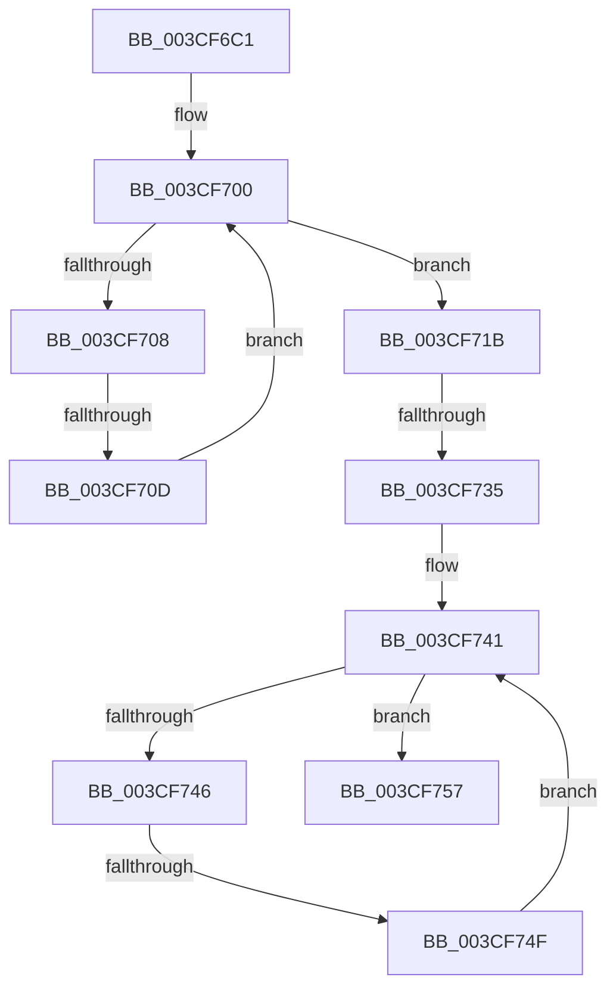

# sub_003CF6C1

- RVA: `0x003CF6C1`–`0x003CF78A` (길이 `201` bytes)
- VA: `0x00000001403CF6C1`
- 실행 섹션: `.text`
- PDB 이름 있음: `아니요`; PDB Function 태그: `아니요`
- unwind 정보 RVA: `0x000906B4`
- 디코드: `64`개 명령, `201/201` bytes 표시
- 미해석 바이트: `0` (있으면 어셈블리에 `.byte`로 보존)

> 이 문서는 커널 이미지의 기계어와 PDB 기호를 분석해 생성했습니다. 4번과 5번은 함수 원형과 자료형을 바이너리 사용 방식에서 추정한 C 해석이며 원본 소스 복구 결과는 아닙니다.

## 1. Dependencies

- 직접 호출 지점: **0**; 고유 호출 대상: **0**
- 직접 호출자로 확인된 함수: **0**
- RIP 상대 이미지 참조: **0**

### Outgoing calls
- 직접 디코드된 call 명령이 없습니다.

### Direct callers
- 이 함수 시작 RVA로 연결되는 직접 call은 확인되지 않았습니다. 간접 호출은 완전히 역산할 수 없습니다.

### Static image references
- 디코드된 RIP-relative 메모리 참조가 없습니다.

## 2. Other-region calls and transfers

- 다른 실행 섹션으로 향하는 call: **0**
- call이 아닌 외부 분기/꼬리 이동: **3**
  - `0x003CF70B` → [sub_003CF78B](Unknown_function_003CF78B.md) (`tail-transfer`)
  - `0x003CF733` → [sub_003CF78B](Unknown_function_003CF78B.md) (`tail-transfer`)
  - `0x003CF74D` → [sub_003CF7A2](Unknown_function_003CF7A2.md) (`tail-transfer`)

## 3. Assembly (complete function range)

```asm
003CF6C1  48 89 74 24 10                  mov qword ptr [rsp + 0x10], rsi
003CF6C6  48 8B 71 08                     mov rsi, qword ptr [rcx + 8]
003CF6CA  41 83 E3 1F                     and r11d, 0x1f
003CF6CE  48 C1 E8 05                     shr rax, 5
003CF6D2  8D 4F FF                        lea ecx, [rdi - 1]
003CF6D5  44 8B 14 86                     mov r10d, dword ptr [rsi + rax*4]
003CF6D9  48 8D 04 86                     lea rax, [rsi + rax*4]
003CF6DD  48 C1 E9 05                     shr rcx, 5
003CF6E1  41 B8 01 00 00 00               mov r8d, 1
003CF6E7  41 8B D0                        mov edx, r8d
003CF6EA  4C 8D 0C 8E                     lea r9, [rsi + rcx*4]
003CF6EE  41 0F B6 CB                     movzx ecx, r11b
003CF6F2  D3 E2                           shl edx, cl
003CF6F4  48 8D 48 04                     lea rcx, [rax + 4]
003CF6F8  FF CA                           dec edx
003CF6FA  44 0B D2                        or r10d, edx
003CF6FD  0F 1F 00                        nop dword ptr [rax]
003CF700  41 F7 D2                        not r10d
003CF703  45 85 D2                        test r10d, r10d
003CF706  75 13                           jne 0x1403cf71b
003CF708  49 3B C9                        cmp rcx, r9
003CF70B  77 7E                           ja 0x1403cf78b
003CF70D  44 8B 50 04                     mov r10d, dword ptr [rax + 4]
003CF711  48 83 C0 04                     add rax, 4
003CF715  48 83 C1 04                     add rcx, 4
003CF719  EB E5                           jmp 0x1403cf700
003CF71B  41 8B CA                        mov ecx, r10d
003CF71E  48 8B D0                        mov rdx, rax
003CF721  48 2B D6                        sub rdx, rsi
003CF724  48 C1 FA 02                     sar rdx, 2
003CF728  48 0F BC C9                     bsf rcx, rcx
003CF72C  C1 E2 05                        shl edx, 5
003CF72F  03 D1                           add edx, ecx
003CF731  3B D7                           cmp edx, edi
003CF733  77 56                           ja 0x1403cf78b
003CF735  41 D3 E0                        shl r8d, cl
003CF738  41 FF C8                        dec r8d
003CF73B  45 0B C2                        or r8d, r10d
003CF73E  41 F7 D0                        not r8d
003CF741  45 85 C0                        test r8d, r8d
003CF744  75 11                           jne 0x1403cf757
003CF746  48 8D 48 04                     lea rcx, [rax + 4]
003CF74A  49 3B C9                        cmp rcx, r9
003CF74D  77 53                           ja 0x1403cf7a2
003CF74F  44 8B 01                        mov r8d, dword ptr [rcx]
003CF752  48 8B C1                        mov rax, rcx
003CF755  EB EA                           jmp 0x1403cf741
003CF757  41 8B C8                        mov ecx, r8d
003CF75A  48 0F BC C9                     bsf rcx, rcx
003CF75E  48 2B C6                        sub rax, rsi
003CF761  8B DF                           mov ebx, edi
003CF763  48 C1 F8 02                     sar rax, 2
003CF767  C1 E0 05                        shl eax, 5
003CF76A  03 C8                           add ecx, eax
003CF76C  3B CF                           cmp ecx, edi
003CF76E  0F 46 D9                        cmovbe ebx, ecx
003CF771  2B DA                           sub ebx, edx
003CF773  41 89 16                        mov dword ptr [r14], edx
003CF776  8B C3                           mov eax, ebx
003CF778  48 8B 74 24 10                  mov rsi, qword ptr [rsp + 0x10]
003CF77D  48 8B 5C 24 20                  mov rbx, qword ptr [rsp + 0x20]
003CF782  48 8B 7C 24 28                  mov rdi, qword ptr [rsp + 0x28]
003CF787  41 5E                           pop r14
003CF789  C3                              ret
```

## 4. C-style interpretation (structured pseudocode)

```c
__int64 __fastcall sub_003CF6C1(__int64 a1, __int64 a2, __int64 a3, __int64 a4, __int64 a5)
{
    __int64 result;
    __int64 v_r10;
    __int64 v_r11;
    __int64 v_rbx;
    unsigned __int64 v_stack_p10;
    unsigned __int64 v_stack_p20;

    v_stack_p10 = v_rsi;
    v_r11 = (unsigned int)((v_r11) & (31));
    result = (result) >> (5);
    a1 = (v_rdi - 1) >> (5);
    a2 = (unsigned int)((1) << ((unsigned __int8)((unsigned __int8)(v_r11))));
    a2 = (unsigned int)((a2) - 1);
    v_r10 = (unsigned int)(((unsigned int)(*(unsigned int *)(*(unsigned __int64 *)(a1 + 8) + result * 4))) | ((unsigned int)(a2)));
loc_003CF700:
    v_r10 = (unsigned int)(~(v_r10));
    if ((unsigned int)(v_r10) != 0) goto loc_003CF71B;
    result = (*(unsigned __int64 *)(a1 + 8) + result * 4) + (4);
    a1 = (*(unsigned __int64 *)(a1 + 8) + result * 4 + 4) + (4);
    goto loc_003CF700;
loc_003CF71B:
    a2 = (result) - (*(unsigned __int64 *)(a1 + 8));
    a2 = (a2) >> (2);
    a2 = (unsigned int)((a2) << (5));
    a2 = (unsigned int)((a2) + ((unsigned int)((unsigned int)((unsigned int)((unsigned int)(*(unsigned int *)(*(unsigned __int64 *)(a1 + 8) + result * 4 + 4)))))));
    a3 = (unsigned int)((1) << ((unsigned __int8)((unsigned int)((unsigned int)((unsigned int)(*(unsigned int *)(*(unsigned __int64 *)(a1 + 8) + result * 4 + 4)))))));
    a3 = (unsigned int)((a3) - 1);
    a3 = (unsigned int)((a3) | ((unsigned int)((unsigned int)(*(unsigned int *)(*(unsigned __int64 *)(a1 + 8) + result * 4 + 4)))));
    a3 = (unsigned int)(~(a3));
loc_003CF741:
    if ((unsigned int)(a3) != 0) goto loc_003CF757;
    goto loc_003CF741;
loc_003CF757:
    result = (result + 4) - (*(unsigned __int64 *)(a1 + 8));
    result = (result) >> (2);
    result = (unsigned int)((result) << (5));
    a1 = (unsigned int)(((unsigned int)((unsigned int)((unsigned int)(*(unsigned int *)(result + 4))))) + ((unsigned int)(result)));
    v_rbx = (unsigned int)((unsigned int)(v_rdi));
    if (((unsigned int)(a1)) <= ((unsigned int)(v_rdi))) { v_rbx = (unsigned int)(a1); }
    v_rbx = (unsigned int)((v_rbx) - ((unsigned int)(a2)));
    *(unsigned int *)(v_r14) = (unsigned int)(a2);
    return (unsigned int)((unsigned int)(v_rbx));
}
```

## 5. (Beta) C Style

```c
int64_t sub_003CF6C1(void *Arg1, int64_t Arg2, int64_t Arg3, int64_t Arg4, int64_t Arg5)
{
    uint8_t *arg1 = (uint8_t *)Arg1;

    int64_t result;
    int64_t local_r10;
    int64_t local_r11;
    int64_t local_rbx;
    uint64_t v_stack_p10;
    uint64_t v_stack_p20;

    v_stack_p10 = local_rsi;
    local_r11 = (uint32_t)((local_r11) & (31));
    result = (result) >> (5);
    Arg1 = (local_rdi - 1) >> (5);
    Arg2 = (uint32_t)((1) << ((uint8_t)((uint8_t)(local_r11))));
    Arg2 = (uint32_t)((Arg2) - 1);
    local_r10 = (uint32_t)(((uint32_t)(*(uint32_t *)(*(uint64_t *)(arg1 + 0x8) + result * 4))) | ((uint32_t)(Arg2)));
loc_003CF700:
    local_r10 = (uint32_t)(~(local_r10));
    if ((uint32_t)(local_r10) != 0) goto loc_003CF71B;
    result = (*(uint64_t *)(arg1 + 0x8) + result * 4) + (4);
    Arg1 = (*(uint64_t *)(arg1 + 0x8) + result * 4 + 4) + (4);
    goto loc_003CF700;
loc_003CF71B:
    Arg2 = (result) - (*(uint64_t *)(arg1 + 0x8));
    Arg2 = (Arg2) >> (2);
    Arg2 = (uint32_t)((Arg2) << (5));
    Arg2 = (uint32_t)((Arg2) + ((uint32_t)((uint32_t)((uint32_t)((uint32_t)(*(uint32_t *)(*(uint64_t *)(arg1 + 0x8) + result * 4 + 0x4)))))));
    Arg3 = (uint32_t)((1) << ((uint8_t)((uint32_t)((uint32_t)((uint32_t)(*(uint32_t *)(*(uint64_t *)(arg1 + 0x8) + result * 4 + 0x4)))))));
    Arg3 = (uint32_t)((Arg3) - 1);
    Arg3 = (uint32_t)((Arg3) | ((uint32_t)((uint32_t)(*(uint32_t *)(*(uint64_t *)(arg1 + 0x8) + result * 4 + 0x4)))));
    Arg3 = (uint32_t)(~(Arg3));
loc_003CF741:
    if ((uint32_t)(Arg3) != 0) goto loc_003CF757;
    goto loc_003CF741;
loc_003CF757:
    result = (result + 4) - (*(uint64_t *)(arg1 + 0x8));
    result = (result) >> (2);
    result = (uint32_t)((result) << (5));
    Arg1 = (uint32_t)(((uint32_t)((uint32_t)((uint32_t)(*(uint32_t *)(result + 0x4))))) + ((uint32_t)(result)));
    local_rbx = (uint32_t)((uint32_t)(local_rdi));
    if (((uint32_t)(Arg1)) <= ((uint32_t)(local_rdi))) { local_rbx = (uint32_t)(Arg1); }
    local_rbx = (uint32_t)((local_rbx) - ((uint32_t)(Arg2)));
    *(uint32_t *)(local_r14) = (uint32_t)(Arg2);
    return (uint32_t)((uint32_t)(local_rbx));
}
```

### 관측된 메모리 오프셋

구조체 형식이 확인되지 않은 접근은 인자 기준의 오프셋으로만 기록했습니다.

| 기준 인자 | 오프셋 표현 | 폭 (bit) | 접근 |
|---|---:|---:|---|
| `Arg1` | `+ 0x8` | `64` | `R` |

## 6. Execution-region graph

[열기: 2D/3D 그래프와 함수 탐색 컨트롤 패널](../../../control-panel.html?section=text&rva=0x003CF6C1&view=graph)

- 2D 그래프는 위에서 아래로 흐르고, 3D 그래프는 빈 공간을 드래그해 회전합니다. Shift+드래그는 이동, 휠은 확대·축소, 함수 노드 선택은 대상 보고서 이동입니다.

### Static fallback


