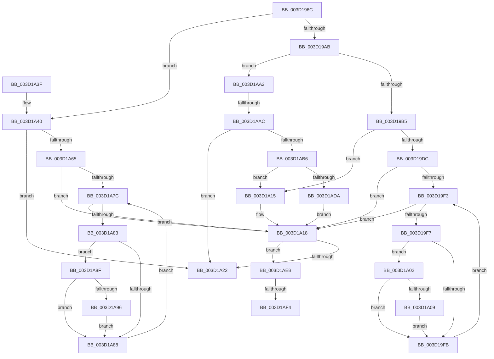

# AuthzBasepAddAccessTypeList

- RVA: `0x003D196C`–`0x003D1B10` (길이 `420` bytes)
- VA: `0x00000001403D196C`
- 실행 섹션: `.text`
- PDB 이름 있음: `예`; PDB Function 태그: `예`
- unwind 정보 RVA: `0x000911BC`
- 디코드: `128`개 명령, `420/420` bytes 표시
- 미해석 바이트: `0` (있으면 어셈블리에 `.byte`로 보존)

> 이 문서는 커널 이미지의 기계어와 PDB 기호를 분석해 생성했습니다. 4번과 5번은 함수 원형과 자료형을 바이너리 사용 방식에서 추정한 C 해석이며 원본 소스 복구 결과는 아닙니다.

## 1. Dependencies

- 직접 호출 지점: **2**; 고유 호출 대상: **2**
- 직접 호출자로 확인된 함수: **5**
- RIP 상대 이미지 참조: **0**

### Outgoing calls
- `0x003D1AE1` → [AuthzBasepSetAppContainerAccessReasons](../69/AuthzBasepSetAppContainerAccessReasons_function_0069D6CC.md) (function, `0x0069D6CC`)
- `0x003D1B05` → [AuthzBasepUpdateParentTypeList](../4B/AuthzBasepUpdateParentTypeList_function_004BD6E4.md) (function, `0x004BD6E4`)

### Direct callers
- [SepMaximumAccessCheck](../30/SepMaximumAccessCheck_function_00300BF0.md) at `0x003010C6`
- [SepNormalAccessCheck](SepNormalAccessCheck_function_003D0688.md) at `0x003D0B4D`
- [SepMaximumAccessCheckEx](../60/SepMaximumAccessCheckEx_function_00606D78.md) at `0x00607320`
- [SepMaximumAccessCheckEx](../60/SepMaximumAccessCheckEx_function_00606D78.md) at `0x0060748F`
- [sub_006E0188](../6E/Unknown_function_006E0188.md) at `0x006E0297`
- [sub_006E8E06](../6E/Unknown_function_006E8E06.md) at `0x006E8EAE`

### Static image references
- 디코드된 RIP-relative 메모리 참조가 없습니다.

## 2. Other-region calls and transfers

- 다른 실행 섹션으로 향하는 call: **0**
- call이 아닌 외부 분기/꼬리 이동: **3**
  - `0x003D1AA6` → [sub_006E9392](../6E/Unknown_function_006E9392.md) (`tail-transfer`)
  - `0x003D1AEE` → [sub_006E9392 + 0x4D](../6E/Unknown_function_006E9392.md) (`tail-transfer`)
  - `0x003D1B0B` → [sub_006E9392 + 0x4D](../6E/Unknown_function_006E9392.md) (`tail-transfer`)

## 3. Assembly (complete function range)

```asm
003D196C  48 89 5C 24 08                  mov qword ptr [rsp + 8], rbx
003D1971  48 89 6C 24 10                  mov qword ptr [rsp + 0x10], rbp
003D1976  48 89 74 24 18                  mov qword ptr [rsp + 0x18], rsi
003D197B  57                              push rdi
003D197C  41 54                           push r12
003D197E  41 55                           push r13
003D1980  41 56                           push r14
003D1982  41 57                           push r15
003D1984  48 83 EC 30                     sub rsp, 0x30
003D1988  44 8B A4 24 88 00 00 00         mov r12d, dword ptr [rsp + 0x88]
003D1990  45 32 F6                        xor r14b, r14b
003D1993  45 8B F8                        mov r15d, r8d
003D1996  41 8B E9                        mov ebp, r9d
003D1999  44 8B EA                        mov r13d, edx
003D199C  48 8B D9                        mov rbx, rcx
003D199F  45 8B D4                        mov r10d, r12d
003D19A2  45 85 E4                        test r12d, r12d
003D19A5  0F 84 95 00 00 00               je 0x1403d1a40
003D19AB  41 83 EA 01                     sub r10d, 1
003D19AF  0F 85 ED 00 00 00               jne 0x1403d1aa2
003D19B5  8B BC 24 80 00 00 00            mov edi, dword ptr [rsp + 0x80]
003D19BC  4B 8D 34 7F                     lea rsi, [r15 + r15*2]
003D19C0  48 C1 E6 04                     shl rsi, 4
003D19C4  48 03 F1                        add rsi, rcx
003D19C7  8B 4E 1C                        mov ecx, dword ptr [rsi + 0x1c]
003D19CA  8B 56 20                        mov edx, dword ptr [rsi + 0x20]
003D19CD  F7 D2                           not edx
003D19CF  8B C2                           mov eax, edx
003D19D1  23 C7                           and eax, edi
003D19D3  0B C1                           or eax, ecx
003D19D5  89 46 1C                        mov dword ptr [rsi + 0x1c], eax
003D19D8  3B C8                           cmp ecx, eax
003D19DA  74 39                           je 0x1403d1a15
003D19DC  4C 8B 56 28                     mov r10, qword ptr [rsi + 0x28]
003D19E0  F7 D1                           not ecx
003D19E2  23 CA                           and ecx, edx
003D19E4  45 33 C0                        xor r8d, r8d
003D19E7  23 CF                           and ecx, edi
003D19E9  BA 01 00 00 00                  mov edx, 1
003D19EE  4D 85 D2                        test r10, r10
003D19F1  74 25                           je 0x1403d1a18
003D19F3  85 D2                           test edx, edx
003D19F5  74 21                           je 0x1403d1a18
003D19F7  85 D1                           test ecx, edx
003D19F9  75 07                           jne 0x1403d1a02
003D19FB  41 FF C0                        inc r8d
003D19FE  03 D2                           add edx, edx
003D1A00  EB F1                           jmp 0x1403d19f3
003D1A02  43 83 3C 82 00                  cmp dword ptr [r10 + r8*4], 0
003D1A07  75 F2                           jne 0x1403d19fb
003D1A09  8B C5                           mov eax, ebp
003D1A0B  0F BA E8 10                     bts eax, 0x10
003D1A0F  43 89 04 82                     mov dword ptr [r10 + r8*4], eax
003D1A13  EB E6                           jmp 0x1403d19fb
003D1A15  41 B6 01                        mov r14b, 1
003D1A18  41 83 FD 01                     cmp r13d, 1
003D1A1C  0F 85 C9 00 00 00               jne 0x1403d1aeb
003D1A22  48 8B 5C 24 60                  mov rbx, qword ptr [rsp + 0x60]
003D1A27  48 8B 6C 24 68                  mov rbp, qword ptr [rsp + 0x68]
003D1A2C  48 8B 74 24 70                  mov rsi, qword ptr [rsp + 0x70]
003D1A31  48 83 C4 30                     add rsp, 0x30
003D1A35  41 5F                           pop r15
003D1A37  41 5E                           pop r14
003D1A39  41 5D                           pop r13
003D1A3B  41 5C                           pop r12
003D1A3D  5F                              pop rdi
003D1A3E  C3                              ret
003D1A3F  CC                              int3
003D1A40  8B BC 24 80 00 00 00            mov edi, dword ptr [rsp + 0x80]
003D1A47  4B 8D 14 7F                     lea rdx, [r15 + r15*2]
003D1A4B  48 C1 E2 04                     shl rdx, 4
003D1A4F  8B C7                           mov eax, edi
003D1A51  48 03 D3                        add rdx, rbx
003D1A54  F7 D0                           not eax
003D1A56  44 8B 42 18                     mov r8d, dword ptr [rdx + 0x18]
003D1A5A  41 23 C0                        and eax, r8d
003D1A5D  89 42 18                        mov dword ptr [rdx + 0x18], eax
003D1A60  44 3B C0                        cmp r8d, eax
003D1A63  74 BD                           je 0x1403d1a22
003D1A65  4C 8B 52 28                     mov r10, qword ptr [rdx + 0x28]
003D1A69  44 23 C7                        and r8d, edi
003D1A6C  45 33 C9                        xor r9d, r9d
003D1A6F  B9 01 00 00 00                  mov ecx, 1
003D1A74  48 8B F2                        mov rsi, rdx
003D1A77  4D 85 D2                        test r10, r10
003D1A7A  74 9C                           je 0x1403d1a18
003D1A7C  48 8B F2                        mov rsi, rdx
003D1A7F  85 C9                           test ecx, ecx
003D1A81  74 95                           je 0x1403d1a18
003D1A83  41 85 C8                        test r8d, ecx
003D1A86  75 07                           jne 0x1403d1a8f
003D1A88  41 FF C1                        inc r9d
003D1A8B  03 C9                           add ecx, ecx
003D1A8D  EB ED                           jmp 0x1403d1a7c
003D1A8F  43 83 3C 8A 00                  cmp dword ptr [r10 + r9*4], 0
003D1A94  75 F2                           jne 0x1403d1a88
003D1A96  8B C5                           mov eax, ebp
003D1A98  0F BA E8 10                     bts eax, 0x10
003D1A9C  43 89 04 8A                     mov dword ptr [r10 + r9*4], eax
003D1AA0  EB E6                           jmp 0x1403d1a88
003D1AA2  41 83 EA 01                     sub r10d, 1
003D1AA6  0F 84 E6 78 31 00               je 0x1406e9392
003D1AAC  41 83 FA 01                     cmp r10d, 1
003D1AB0  0F 85 6C FF FF FF               jne 0x1403d1a22
003D1AB6  8B BC 24 80 00 00 00            mov edi, dword ptr [rsp + 0x80]
003D1ABD  4B 8D 34 7F                     lea rsi, [r15 + r15*2]
003D1AC1  48 C1 E6 04                     shl rsi, 4
003D1AC5  48 03 F3                        add rsi, rbx
003D1AC8  8B 46 1C                        mov eax, dword ptr [rsi + 0x1c]
003D1ACB  8B C8                           mov ecx, eax
003D1ACD  23 CF                           and ecx, edi
003D1ACF  89 4E 1C                        mov dword ptr [rsi + 0x1c], ecx
003D1AD2  3B C1                           cmp eax, ecx
003D1AD4  0F 84 3B FF FF FF               je 0x1403d1a15
003D1ADA  4C 8B 4E 28                     mov r9, qword ptr [rsi + 0x28]
003D1ADE  44 8B C5                        mov r8d, ebp
003D1AE1  E8 E6 BB 2C 00                  call 0x14069d6cc
003D1AE6  E9 2D FF FF FF                  jmp 0x1403d1a18
003D1AEB  45 84 F6                        test r14b, r14b
003D1AEE  0F 85 EB 78 31 00               jne 0x1406e93df
003D1AF4  44 8B CD                        mov r9d, ebp
003D1AF7  44 89 64 24 20                  mov dword ptr [rsp + 0x20], r12d
003D1AFC  45 8B C7                        mov r8d, r15d
003D1AFF  41 8B D5                        mov edx, r13d
003D1B02  48 8B CB                        mov rcx, rbx
003D1B05  E8 DA BB 0E 00                  call 0x1404bd6e4
003D1B0A  90                              nop
003D1B0B  E9 CF 78 31 00                  jmp 0x1406e93df
```

## 4. C-style interpretation (structured pseudocode)

```c
__int64 __fastcall AuthzBasepAddAccessTypeList(__int64 a1, int a2, int a3, int a4, unsigned int a5, unsigned int a6)
{
    __int64 result;
    __int64 v_r10;
    __int64 v_r14;
    __int64 v_rsi;
    __int64 v_rsp;
    unsigned __int64 v_stack_p10;
    unsigned __int64 v_stack_p18;
    unsigned int v_stack_p20;
    unsigned __int64 v_stack_p8;

    v_stack_p8 = v_rbx;
    v_stack_p10 = v_rbp;
    v_stack_p18 = v_rsi;
    v_rsp = (v_rsp) - (48);
    v_r14 = 0;
    if ((unsigned int)((unsigned int)(a6)) == 0) goto loc_003D1A40;
    v_r10 = (unsigned int)(((unsigned int)((unsigned int)((unsigned int)(a6)))) - (1));
    if (condition_is_not_equal) goto loc_003D1AA2;
    v_rsi = ((unsigned int)(a3) + (unsigned int)(a3) * 2) << (4);
    v_rsi = (v_rsi) + (a1);
    a2 = (unsigned int)(~((unsigned int)(*(unsigned int *)(v_rsi + 32))));
    result = (unsigned int)(((unsigned int)(a2)) & ((unsigned int)((unsigned int)(a5))));
    result = (unsigned int)((result) | ((unsigned int)((unsigned int)(*(unsigned int *)(v_rsi + 28)))));
    *(unsigned int *)(v_rsi + 28) = (unsigned int)(result);
    if (((unsigned int)((unsigned int)(*(unsigned int *)(v_rsi + 28)))) == ((unsigned int)(result))) goto loc_003D1A15;
    a1 = (unsigned int)(~((unsigned int)(*(unsigned int *)(v_rsi + 28))));
    a1 = (unsigned int)((a1) & (a2));
    a3 = 0;
    a1 = (unsigned int)((a1) & ((unsigned int)((unsigned int)(a5))));
    if (*(unsigned __int64 *)(v_rsi + 40) == 0) goto loc_003D1A18;
loc_003D19F3:
    if (1 == 0) goto loc_003D1A18;
    if ((((unsigned int)(a1)) & (1)) != 0) goto loc_003D1A02;
loc_003D19FB:
    a3 = (unsigned int)((a3) + 1);
    a2 = (unsigned int)((1) + (1));
    goto loc_003D19F3;
loc_003D1A02:
    if ((*(unsigned int *)(*(unsigned __int64 *)(v_rsi + 40) + a3 * 4)) != 0) goto loc_003D19FB;
    *(unsigned int *)(*(unsigned __int64 *)(v_rsi + 40) + a3 * 4) = (unsigned int)((unsigned int)((unsigned int)((unsigned int)(a4))));
    goto loc_003D19FB;
loc_003D1A15:
loc_003D1A18:
    if (((unsigned int)((unsigned int)(a2))) != 1) goto loc_003D1AEB;
loc_003D1A22:
    v_rsp = (v_rsp) + (48);
    return (unsigned int)((unsigned int)((unsigned int)(a4)));
loc_003D1A40:
    a2 = ((unsigned int)(a3) + (unsigned int)(a3) * 2) << (4);
    a2 = (a2) + (v_stack_p8);
    result = (unsigned int)(~((unsigned int)((unsigned int)((unsigned int)(a5)))));
    result = (unsigned int)((result) & ((unsigned int)((unsigned int)(*(unsigned int *)(a2 + 24)))));
    *(unsigned int *)(a2 + 24) = (unsigned int)(result);
    if (((unsigned int)((unsigned int)(*(unsigned int *)(a2 + 24)))) == ((unsigned int)(result))) goto loc_003D1A22;
    a3 = (unsigned int)(((unsigned int)(*(unsigned int *)(a2 + 24))) & ((unsigned int)((unsigned int)(a5))));
    a4 = 0;
    if (*(unsigned __int64 *)(a2 + 40) == 0) goto loc_003D1A18;
loc_003D1A7C:
    if (1 == 0) goto loc_003D1A18;
    if (((a3) & (1)) != 0) goto loc_003D1A8F;
loc_003D1A88:
    a4 = (unsigned int)((a4) + 1);
    a1 = (unsigned int)((1) + (1));
    goto loc_003D1A7C;
loc_003D1A8F:
    if ((*(unsigned int *)(*(unsigned __int64 *)(a2 + 40) + a4 * 4)) != 0) goto loc_003D1A88;
    *(unsigned int *)(*(unsigned __int64 *)(a2 + 40) + a4 * 4) = (unsigned int)((unsigned int)((unsigned int)(v_stack_p10)));
    goto loc_003D1A88;
loc_003D1AA2:
    v_r10 = (unsigned int)((*(unsigned __int64 *)(a2 + 40)) - (1));
    if (((unsigned int)(v_r10)) != 1) goto loc_003D1A22;
    v_rsi = ((unsigned int)(a3) + (unsigned int)(a3) * 2) << (4);
    v_rsi = (v_rsi) + (v_stack_p8);
    a1 = (unsigned int)(((unsigned int)((unsigned int)((unsigned int)(*(unsigned int *)(v_rsi + 28))))) & ((unsigned int)((unsigned int)(a5))));
    *(unsigned int *)(v_rsi + 28) = (unsigned int)(a1);
    if (((unsigned int)((unsigned int)(*(unsigned int *)(v_rsi + 28)))) == ((unsigned int)(a1))) goto loc_003D1A15;
    result = AuthzBasepSetAppContainerAccessReasons(a1, a2, (unsigned int)((unsigned int)(v_stack_p10)), *(unsigned __int64 *)(v_rsi + 40));
    goto loc_003D1A18;
loc_003D1AEB:
    v_stack_p20 = (unsigned int)((unsigned int)(a6));
    result = AuthzBasepUpdateParentTypeList(v_stack_p8, (unsigned int)((unsigned int)((unsigned int)(a2))), (unsigned int)((unsigned int)((unsigned int)(a3))), (unsigned int)((unsigned int)(v_stack_p10)));
}
```

## 5. (Beta) C Style

```c
int64_t AuthzBasepAddAccessTypeList(int64_t Arg1, int32_t Arg2, void *Arg3, int32_t Arg4, uint32_t Arg5, uint32_t Arg6)
{
    uint8_t *arg3 = (uint8_t *)Arg3;

    int64_t result;
    int64_t local_r10;
    int64_t local_r14;
    int64_t local_rsi;
    int64_t local_rsp;
    uint64_t v_stack_p10;
    uint64_t v_stack_p18;
    uint32_t v_stack_p20;
    uint64_t v_stack_p8;

    v_stack_p8 = local_rbx;
    v_stack_p10 = local_rbp;
    v_stack_p18 = local_rsi;
    local_rsp = (local_rsp) - (48);
    local_r14 = 0;
    if ((uint32_t)((uint32_t)(Arg6)) == 0) goto loc_003D1A40;
    local_r10 = (uint32_t)(((uint32_t)((uint32_t)((uint32_t)(Arg6)))) - (1));
    if (condition_is_not_equal) goto loc_003D1AA2;
    local_rsi = ((uint32_t)(Arg3) + (uint32_t)(Arg3) * 2) << (4);
    local_rsi = (local_rsi) + (Arg1);
    Arg2 = (uint32_t)(~((uint32_t)(*(uint32_t *)(local_rsi + 0x20))));
    result = (uint32_t)(((uint32_t)(Arg2)) & ((uint32_t)((uint32_t)(Arg5))));
    result = (uint32_t)((result) | ((uint32_t)((uint32_t)(*(uint32_t *)(local_rsi + 0x1C)))));
    *(uint32_t *)(local_rsi + 0x1C) = (uint32_t)(result);
    if (((uint32_t)((uint32_t)(*(uint32_t *)(local_rsi + 0x1C)))) == ((uint32_t)(result))) goto loc_003D1A15;
    Arg1 = (uint32_t)(~((uint32_t)(*(uint32_t *)(local_rsi + 0x1C))));
    Arg1 = (uint32_t)((Arg1) & (Arg2));
    Arg3 = 0;
    Arg1 = (uint32_t)((Arg1) & ((uint32_t)((uint32_t)(Arg5))));
    if (*(uint64_t *)(local_rsi + 0x28) == 0) goto loc_003D1A18;
loc_003D19F3:
    if (1 == 0) goto loc_003D1A18;
    if ((((uint32_t)(Arg1)) & (1)) != 0) goto loc_003D1A02;
loc_003D19FB:
    Arg3 = (uint32_t)((Arg3) + 1);
    Arg2 = (uint32_t)((1) + (1));
    goto loc_003D19F3;
loc_003D1A02:
    if ((*(uint32_t *)(*(uint64_t *)(local_rsi + 0x28) + arg3 * 4)) != 0) goto loc_003D19FB;
    *(uint32_t *)(*(uint64_t *)(local_rsi + 0x28) + arg3 * 4) = (uint32_t)((uint32_t)((uint32_t)((uint32_t)(Arg4))));
    goto loc_003D19FB;
loc_003D1A15:
loc_003D1A18:
    if (((uint32_t)((uint32_t)(Arg2))) != 1) goto loc_003D1AEB;
loc_003D1A22:
    local_rsp = (local_rsp) + (48);
    return (uint32_t)((uint32_t)((uint32_t)(Arg4)));
loc_003D1A40:
    Arg2 = ((uint32_t)(Arg3) + (uint32_t)(Arg3) * 2) << (4);
    Arg2 = (Arg2) + (v_stack_p8);
    result = (uint32_t)(~((uint32_t)((uint32_t)((uint32_t)(Arg5)))));
    result = (uint32_t)((result) & ((uint32_t)((uint32_t)(*(uint32_t *)(Arg2 + 0x18)))));
    *(uint32_t *)(Arg2 + 0x18) = (uint32_t)(result);
    if (((uint32_t)((uint32_t)(*(uint32_t *)(Arg2 + 0x18)))) == ((uint32_t)(result))) goto loc_003D1A22;
    Arg3 = (uint32_t)(((uint32_t)(*(uint32_t *)(Arg2 + 0x18))) & ((uint32_t)((uint32_t)(Arg5))));
    Arg4 = 0;
    if (*(uint64_t *)(Arg2 + 0x28) == 0) goto loc_003D1A18;
loc_003D1A7C:
    if (1 == 0) goto loc_003D1A18;
    if (((Arg3) & (1)) != 0) goto loc_003D1A8F;
loc_003D1A88:
    Arg4 = (uint32_t)((Arg4) + 1);
    Arg1 = (uint32_t)((1) + (1));
    goto loc_003D1A7C;
loc_003D1A8F:
    if ((*(uint32_t *)(*(uint64_t *)(Arg2 + 0x28) + Arg4 * 4)) != 0) goto loc_003D1A88;
    *(uint32_t *)(*(uint64_t *)(Arg2 + 0x28) + Arg4 * 4) = (uint32_t)((uint32_t)((uint32_t)(v_stack_p10)));
    goto loc_003D1A88;
loc_003D1AA2:
    local_r10 = (uint32_t)((*(uint64_t *)(Arg2 + 0x28)) - (1));
    if (((uint32_t)(local_r10)) != 1) goto loc_003D1A22;
    local_rsi = ((uint32_t)(Arg3) + (uint32_t)(Arg3) * 2) << (4);
    local_rsi = (local_rsi) + (v_stack_p8);
    Arg1 = (uint32_t)(((uint32_t)((uint32_t)((uint32_t)(*(uint32_t *)(local_rsi + 0x1C))))) & ((uint32_t)((uint32_t)(Arg5))));
    *(uint32_t *)(local_rsi + 0x1C) = (uint32_t)(Arg1);
    if (((uint32_t)((uint32_t)(*(uint32_t *)(local_rsi + 0x1C)))) == ((uint32_t)(Arg1))) goto loc_003D1A15;
    result = AuthzBasepSetAppContainerAccessReasons(Arg1, Arg2, (uint32_t)((uint32_t)(v_stack_p10)), *(uint64_t *)(local_rsi + 0x28));
    goto loc_003D1A18;
loc_003D1AEB:
    v_stack_p20 = (uint32_t)((uint32_t)(Arg6));
    result = AuthzBasepUpdateParentTypeList(v_stack_p8, (uint32_t)((uint32_t)((uint32_t)(Arg2))), (uint32_t)((uint32_t)((uint32_t)(Arg3))), (uint32_t)((uint32_t)(v_stack_p10)));
}
```

### 관측된 메모리 오프셋

구조체 형식이 확인되지 않은 접근은 인자 기준의 오프셋으로만 기록했습니다.

| 기준 인자 | 오프셋 표현 | 폭 (bit) | 접근 |
|---|---:|---:|---|
| `Arg3` | `+ 0x0 + r15*2` | `64` | `R` |

## 6. Execution-region graph

[열기: 2D/3D 그래프와 함수 탐색 컨트롤 패널](../../../control-panel.html?section=text&rva=0x003D196C&view=graph)

- 2D 그래프는 위에서 아래로 흐르고, 3D 그래프는 빈 공간을 드래그해 회전합니다. Shift+드래그는 이동, 휠은 확대·축소, 함수 노드 선택은 대상 보고서 이동입니다.

### Static fallback


