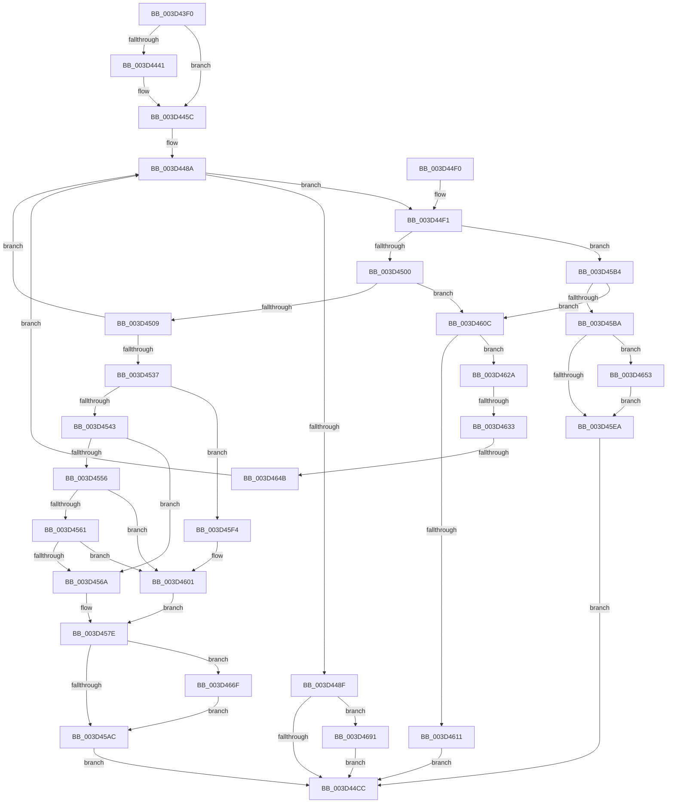

# ExAcquireSharedWaitForExclusive

- RVA: `0x003D43F0`–`0x003D46AD` (길이 `701` bytes)
- VA: `0x00000001403D43F0`
- 실행 섹션: `.text`
- PDB 이름 있음: `예`; PDB Function 태그: `예`
- unwind 정보 RVA: `0x000924C0`
- 디코드: `182`개 명령, `701/701` bytes 표시
- 미해석 바이트: `0` (있으면 어셈블리에 `.byte`로 보존)

> 이 문서는 커널 이미지의 기계어와 PDB 기호를 분석해 생성했습니다. 4번과 5번은 함수 원형과 자료형을 바이너리 사용 방식에서 추정한 C 해석이며 원본 소스 복구 결과는 아닙니다.

## 1. Dependencies

- 직접 호출 지점: **13**; 고유 호출 대상: **8**
- 직접 호출자로 확인된 함수: **3**
- RIP 상대 이미지 참조: **1**

### Outgoing calls
- `0x003D4456` → [KeBugCheckEx](../4F/KeBugCheckEx_function_004FD660.md) (function, `0x004FD660`)
- `0x003D4483` → [KeAcquireInStackQueuedSpinLock](../27/KeAcquireInStackQueuedSpinLock_function_002757A0.md) (function, `0x002757A0`)
- `0x003D4492` → [ExpTryAcquireResourceShared](ExpTryAcquireResourceShared_function_003D46C0.md) (function, `0x003D46C0`)
- `0x003D44AE` → [KeReleaseInStackQueuedSpinLock](../34/KeReleaseInStackQueuedSpinLock_function_00342CE0.md) (function, `0x00342CE0`)
- `0x003D450C` → [ExpGetThreadResourceHint](../21/ExpGetThreadResourceHint_function_002134C0.md) (function, `0x002134C0`)
- `0x003D4526` → [ExpFindCurrentThread](ExpFindCurrentThread_function_003D46F0.md) (function, `0x003D46F0`)
- `0x003D4585` → [KeReleaseInStackQueuedSpinLock](../34/KeReleaseInStackQueuedSpinLock_function_00342CE0.md) (function, `0x00342CE0`)
- `0x003D45D0` → [KeReleaseInStackQueuedSpinLock](../34/KeReleaseInStackQueuedSpinLock_function_00342CE0.md) (function, `0x00342CE0`)
- `0x003D4615` → [KeReleaseInStackQueuedSpinLock](../34/KeReleaseInStackQueuedSpinLock_function_00342CE0.md) (function, `0x00342CE0`)
- `0x003D463A` → [ExpFindEmptyEntry](ExpFindEmptyEntry_function_003D4840.md) (function, `0x003D4840`)
- `0x003D4665` → [PerfLogExecutiveResourceAcquire](../47/PerfLogExecutiveResourceAcquire_function_004795E8.md) (function, `0x004795E8`)
- `0x003D4687` → [PerfLogExecutiveResourceAcquire](../47/PerfLogExecutiveResourceAcquire_function_004795E8.md) (function, `0x004795E8`)
- `0x003D46A3` → [PerfLogExecutiveResourceAcquire](../47/PerfLogExecutiveResourceAcquire_function_004795E8.md) (function, `0x004795E8`)

### Direct callers
- [FsRtlAcquireFileForModWriteEx](../29/FsRtlAcquireFileForModWriteEx_function_00299E5C.md) at `0x0029A18A`
- [FsRtlAcquireFileForModWriteEx](../29/FsRtlAcquireFileForModWriteEx_function_00299E5C.md) at `0x0029A27B`
- [ExEnterCriticalRegionAndAcquireSharedWaitForExclusive](ExEnterCriticalRegionAndAcquireSharedWaitForExclusive_function_003D43B0.md) at `0x003D43C7`
- [DifExAcquireSharedWaitForExclusiveWrapper](../61/DifExAcquireSharedWaitForExclusiveWrapper_function_0061E030.md) at `0x0061E104`

### Static image references
- `0x003D4469` → RVA `0x00FC6B04` (`ALMOSTRO`; read)

## 2. Other-region calls and transfers

- 다른 실행 섹션으로 향하는 call: **0**
- call이 아닌 외부 분기/꼬리 이동: **2**
  - `0x003D462D` → [sub_006E96C4 + 0x11](../6E/Unknown_function_006E96C4.md) (`tail-transfer`)
  - `0x003D4645` → [sub_006E96C4](../6E/Unknown_function_006E96C4.md) (`tail-transfer`)

## 3. Assembly (complete function range)

```asm
003D43F0  48 89 5C 24 08                  mov qword ptr [rsp + 8], rbx
003D43F5  48 89 74 24 10                  mov qword ptr [rsp + 0x10], rsi
003D43FA  48 89 7C 24 18                  mov qword ptr [rsp + 0x18], rdi
003D43FF  55                              push rbp
003D4400  41 54                           push r12
003D4402  41 55                           push r13
003D4404  41 56                           push r14
003D4406  41 57                           push r15
003D4408  48 8B EC                        mov rbp, rsp
003D440B  48 81 EC 80 00 00 00            sub rsp, 0x80
003D4412  33 C0                           xor eax, eax
003D4414  0F 57 C9                        xorps xmm1, xmm1
003D4417  0F 57 C0                        xorps xmm0, xmm0
003D441A  48 89 45 C0                     mov qword ptr [rbp - 0x40], rax
003D441E  44 8A EA                        mov r13b, dl
003D4421  48 89 45 F8                     mov qword ptr [rbp - 8], rax
003D4425  48 8B D9                        mov rbx, rcx
003D4428  8D 70 01                        lea esi, [rax + 1]
003D442B  0F 11 45 B0                     movups xmmword ptr [rbp - 0x50], xmm0
003D442F  0F 11 4D C8                     movups xmmword ptr [rbp - 0x38], xmm1
003D4433  0F 11 4D D8                     movups xmmword ptr [rbp - 0x28], xmm1
003D4437  0F 11 4D E8                     movups xmmword ptr [rbp - 0x18], xmm1
003D443B  40 84 71 1A                     test byte ptr [rcx + 0x1a], sil
003D443F  74 1B                           je 0x1403d445c
003D4441  33 FF                           xor edi, edi
003D4443  8D 50 0E                        lea edx, [rax + 0xe]
003D4446  4C 8B C1                        mov r8, rcx
003D4449  48 89 7C 24 20                  mov qword ptr [rsp + 0x20], rdi
003D444E  B9 C6 01 00 00                  mov ecx, 0x1c6
003D4453  45 33 C9                        xor r9d, r9d
003D4456  E8 05 92 12 00                  call 0x1404fd660
003D445B  CC                              int3
003D445C  65 4C 8B 34 25 88 01 00 00      mov r14, qword ptr gs:[0x188]
003D4465  48 8D 55 B0                     lea rdx, [rbp - 0x50]
003D4469  44 8B 3D 94 26 BF 00            mov r15d, dword ptr [rip + 0xbf2694]
003D4470  48 83 C1 60                     add rcx, 0x60
003D4474  41 81 E7 00 00 02 00            and r15d, 0x20000
003D447B  65 FF 04 25 BC 90 00 00         inc dword ptr gs:[0x90bc]
003D4483  E8 18 13 EA FF                  call 0x1402757a0
003D4488  33 FF                           xor edi, edi
003D448A  39 7B 40                        cmp dword ptr [rbx + 0x40], edi
003D448D  75 62                           jne 0x1403d44f1
003D448F  48 8B CB                        mov rcx, rbx
003D4492  E8 29 02 00 00                  call 0x1403d46c0
003D4497  8B 4B 38                        mov ecx, dword ptr [rbx + 0x38]
003D449A  40 8A F0                        mov sil, al
003D449D  83 E1 07                        and ecx, 7
003D44A0  4C 89 73 30                     mov qword ptr [rbx + 0x30], r14
003D44A4  83 C9 08                        or ecx, 8
003D44A7  89 4B 38                        mov dword ptr [rbx + 0x38], ecx
003D44AA  48 8D 4D B0                     lea rcx, [rbp - 0x50]
003D44AE  E8 2D E8 F6 FF                  call 0x140342ce0
003D44B3  65 FF 04 25 C4 90 00 00         inc dword ptr gs:[0x90c4]
003D44BB  65 FF 04 25 64 90 00 00         inc dword ptr gs:[0x9064]
003D44C3  45 85 FF                        test r15d, r15d
003D44C6  0F 85 C5 01 00 00               jne 0x1403d4691
003D44CC  4C 8D 9C 24 80 00 00 00         lea r11, [rsp + 0x80]
003D44D4  40 8A C6                        mov al, sil
003D44D7  49 8B 5B 30                     mov rbx, qword ptr [r11 + 0x30]
003D44DB  49 8B 73 38                     mov rsi, qword ptr [r11 + 0x38]
003D44DF  49 8B 7B 40                     mov rdi, qword ptr [r11 + 0x40]
003D44E3  49 8B E3                        mov rsp, r11
003D44E6  41 5F                           pop r15
003D44E8  41 5E                           pop r14
003D44EA  41 5D                           pop r13
003D44EC  41 5C                           pop r12
003D44EE  5D                              pop rbp
003D44EF  C3                              ret
003D44F0  CC                              int3
003D44F1  B8 80 00 00 00                  mov eax, 0x80
003D44F6  66 23 43 1A                     and ax, word ptr [rbx + 0x1a]
003D44FA  0F 85 B4 00 00 00               jne 0x1403d45b4
003D4500  39 7B 4C                        cmp dword ptr [rbx + 0x4c], edi
003D4503  0F 85 03 01 00 00               jne 0x1403d460c
003D4509  49 8B CE                        mov rcx, r14
003D450C  E8 AF EF E3 FF                  call 0x1402134c0
003D4511  89 44 24 28                     mov dword ptr [rsp + 0x28], eax
003D4515  4C 8D 45 B0                     lea r8, [rbp - 0x50]
003D4519  44 8B CE                        mov r9d, esi
003D451C  89 74 24 20                     mov dword ptr [rsp + 0x20], esi
003D4520  49 8B D6                        mov rdx, r14
003D4523  48 8B CB                        mov rcx, rbx
003D4526  E8 C5 01 00 00                  call 0x1403d46f0
003D452B  48 8B C8                        mov rcx, rax
003D452E  48 85 C0                        test rax, rax
003D4531  0F 84 53 FF FF FF               je 0x1403d448a
003D4537  8B 70 08                        mov esi, dword ptr [rax + 8]
003D453A  48 39 38                        cmp qword ptr [rax], rdi
003D453D  0F 85 B1 00 00 00               jne 0x1403d45f4
003D4543  83 E6 07                        and esi, 7
003D4546  4C 89 30                        mov qword ptr [rax], r14
003D4549  83 CE 08                        or esi, 8
003D454C  89 70 08                        mov dword ptr [rax + 8], esi
003D454F  8B 53 40                        mov edx, dword ptr [rbx + 0x40]
003D4552  85 D2                           test edx, edx
003D4554  74 14                           je 0x1403d456a
003D4556  8A 43 1A                        mov al, byte ptr [rbx + 0x1a]
003D4559  84 C0                           test al, al
003D455B  0F 88 A0 00 00 00               js 0x1403d4601
003D4561  39 7B 4C                        cmp dword ptr [rbx + 0x4c], edi
003D4564  0F 85 97 00 00 00               jne 0x1403d4601
003D456A  41 BE 01 00 00 00               mov r14d, 1
003D4570  8D 42 01                        lea eax, [rdx + 1]
003D4573  66 44 89 73 18                  mov word ptr [rbx + 0x18], r14w
003D4578  89 43 40                        mov dword ptr [rbx + 0x40], eax
003D457B  8B 71 08                        mov esi, dword ptr [rcx + 8]
003D457E  48 8D 4D B0                     lea rcx, [rbp - 0x50]
003D4582  C1 EE 03                        shr esi, 3
003D4585  E8 56 E7 F6 FF                  call 0x140342ce0
003D458A  41 3B F6                        cmp esi, r14d
003D458D  B8 C8 90 00 00                  mov eax, 0x90c8
003D4592  8D 48 FC                        lea ecx, [rax - 4]
003D4595  0F 44 C1                        cmove eax, ecx
003D4598  65 FF 00                        inc dword ptr gs:[rax]
003D459B  65 FF 04 25 C8 90 00 00         inc dword ptr gs:[0x90c8]
003D45A3  45 85 FF                        test r15d, r15d
003D45A6  0F 85 C3 00 00 00               jne 0x1403d466f
003D45AC  41 8A F6                        mov sil, r14b
003D45AF  E9 18 FF FF FF                  jmp 0x1403d44cc
003D45B4  4C 39 73 30                     cmp qword ptr [rbx + 0x30], r14
003D45B8  75 52                           jne 0x1403d460c
003D45BA  8B 43 38                        mov eax, dword ptr [rbx + 0x38]
003D45BD  8D 48 08                        lea ecx, [rax + 8]
003D45C0  8B F1                           mov esi, ecx
003D45C2  33 F0                           xor esi, eax
003D45C4  83 E6 07                        and esi, 7
003D45C7  33 F1                           xor esi, ecx
003D45C9  48 8D 4D B0                     lea rcx, [rbp - 0x50]
003D45CD  89 73 38                        mov dword ptr [rbx + 0x38], esi
003D45D0  E8 0B E7 F6 FF                  call 0x140342ce0
003D45D5  65 FF 04 25 C0 90 00 00         inc dword ptr gs:[0x90c0]
003D45DD  65 FF 04 25 64 90 00 00         inc dword ptr gs:[0x9064]
003D45E5  45 85 FF                        test r15d, r15d
003D45E8  75 69                           jne 0x1403d4653
003D45EA  BE 01 00 00 00                  mov esi, 1
003D45EF  E9 D8 FE FF FF                  jmp 0x1403d44cc
003D45F4  8D 46 08                        lea eax, [rsi + 8]
003D45F7  33 F0                           xor esi, eax
003D45F9  83 E6 07                        and esi, 7
003D45FC  33 F0                           xor esi, eax
003D45FE  89 71 08                        mov dword ptr [rcx + 8], esi
003D4601  41 BE 01 00 00 00               mov r14d, 1
003D4607  E9 72 FF FF FF                  jmp 0x1403d457e
003D460C  45 84 ED                        test r13b, r13b
003D460F  75 19                           jne 0x1403d462a
003D4611  48 8D 4D B0                     lea rcx, [rbp - 0x50]
003D4615  E8 C6 E6 F6 FF                  call 0x140342ce0
003D461A  65 FF 04 25 D0 90 00 00         inc dword ptr gs:[0x90d0]
003D4622  40 8A F7                        mov sil, dil
003D4625  E9 A2 FE FF FF                  jmp 0x1403d44cc
003D462A  66 85 C0                        test ax, ax
003D462D  0F 84 A2 50 31 00               je 0x1406e96d5
003D4633  48 8D 55 B0                     lea rdx, [rbp - 0x50]
003D4637  48 8B CB                        mov rcx, rbx
003D463A  E8 01 02 00 00                  call 0x1403d4840
003D463F  48 8B F0                        mov rsi, rax
003D4642  48 85 C0                        test rax, rax
003D4645  0F 85 79 50 31 00               jne 0x1406e96c4
003D464B  8D 70 01                        lea esi, [rax + 1]
003D464E  E9 37 FE FF FF                  jmp 0x1403d448a
003D4653  44 8B 4B 44                     mov r9d, dword ptr [rbx + 0x44]
003D4657  48 8B D3                        mov rdx, rbx
003D465A  C1 EE 03                        shr esi, 3
003D465D  B9 31 00 01 00                  mov ecx, 0x10031
003D4662  44 8B C6                        mov r8d, esi
003D4665  E8 7E 4F 0A 00                  call 0x1404795e8
003D466A  E9 7B FF FF FF                  jmp 0x1403d45ea
003D466F  44 8B 4B 44                     mov r9d, dword ptr [rbx + 0x44]
003D4673  B9 51 00 01 00                  mov ecx, 0x10051
003D4678  41 3B F6                        cmp esi, r14d
003D467B  45 8B C6                        mov r8d, r14d
003D467E  48 8B D3                        mov rdx, rbx
003D4681  8D 41 F0                        lea eax, [rcx - 0x10]
003D4684  0F 44 C8                        cmove ecx, eax
003D4687  E8 5C 4F 0A 00                  call 0x1404795e8
003D468C  E9 1B FF FF FF                  jmp 0x1403d45ac
003D4691  44 8B 4B 44                     mov r9d, dword ptr [rbx + 0x44]
003D4695  41 B8 01 00 00 00               mov r8d, 1
003D469B  48 8B D3                        mov rdx, rbx
003D469E  B9 41 00 01 00                  mov ecx, 0x10041
003D46A3  E8 40 4F 0A 00                  call 0x1404795e8
003D46A8  E9 1F FE FF FF                  jmp 0x1403d44cc
```

## 4. C-style interpretation (structured pseudocode)

```c
__int64 __fastcall ExAcquireSharedWaitForExclusive(__int64 a1, unsigned __int8 a2, __int64 a3, int a4)
{
    __int64 result;
    __int64 v_r15;
    __int64 v_rdi;
    __int64 v_rsi;
    __int64 v_rsp;
    unsigned __int64 v_stack_m28;
    unsigned __int64 v_stack_m30;
    unsigned __int64 v_stack_m40;
    unsigned __int64 v_stack_m50;
    unsigned int v_stack_m58;
    unsigned __int64 v_stack_m60;
    unsigned __int64 v_stack_m68;
    unsigned __int64 v_stack_m78;
    unsigned __int64 v_stack_m88;
    unsigned __int64 v_stack_p10;
    unsigned __int64 v_stack_p18;
    unsigned __int64 v_stack_p8;

    v_stack_p8 = v_rbx;
    v_stack_p10 = v_rsi;
    v_stack_p18 = v_rdi;
    v_rsp = (v_rsp) - (128);
    result = 0;
    v_stack_m68 = 0;
    v_stack_m30 = 0;
    v_stack_m78 = v_xmm0;
    v_stack_m60 = v_xmm1;
    v_stack_m50 = v_xmm1;
    v_stack_m40 = v_xmm1;
    if (((*(unsigned __int8 *)(a1 + 26)) & ((unsigned __int8)(result + 1))) != 0) {
        v_rdi = 0;
        a2 = result + 14;
        a3 = a1;
        v_stack_m88 = 0;
        a1 = 454;
        a4 = 0;
        result = KeBugCheckEx(a1, a2, a3, a4);
    }
    a1 = (a1) + (96);
    v_r15 = (unsigned int)(((unsigned int)(*(unsigned int *)(v_rip + 12527252))) & (0x20000ULL));
    result = KeAcquireInStackQueuedSpinLock(a1, v_stack_m78, a3, a4);
    v_rdi = 0;
loc_003D448A:
    if ((*(unsigned int *)(a1 + 64)) != 0) goto loc_003D44F1;
    result = ExpTryAcquireResourceShared(a1, v_stack_m78, a3, a4);
    a1 = (unsigned int)(((unsigned int)(*(unsigned int *)(a1 + 56))) & (7));
    *(unsigned __int64 *)(a1 + 48) = *(unsigned __int64 *)(gs_base + (0 + 392));
    a1 = (unsigned int)((a1) | (8));
    *(unsigned int *)(a1 + 56) = (unsigned int)(a1);
    result = KeReleaseInStackQueuedSpinLock(v_stack_m78, v_stack_m78, a3, a4);
    if ((unsigned int)(v_r15) != 0) goto loc_003D4691;
loc_003D44CC:
    return (unsigned __int8)((unsigned __int8)(result));
loc_003D44F1:
    result = (unsigned __int16)((128) & (*(unsigned __int16 *)(*(unsigned __int64 *)(v_stack_m28 + 48) + 26)));
    if (condition_is_not_equal) goto loc_003D45B4;
    if ((*(unsigned int *)(*(unsigned __int64 *)(v_stack_m28 + 48) + 76)) != ((unsigned int)(*(unsigned __int64 *)(v_stack_m28 + 64)))) goto loc_003D460C;
    result = ExpGetThreadResourceHint(*(unsigned __int64 *)(gs_base + (0 + 392)), v_stack_m78, a3, a4);
    v_stack_m58 = (unsigned int)(result);
    v_stack_m60 = (unsigned int)(*(unsigned __int64 *)(v_stack_m28 + 56));
    result = ExpFindCurrentThread(*(unsigned __int64 *)(v_stack_m28 + 48), *(unsigned __int64 *)(gs_base + (0 + 392)), v_stack_m78, (unsigned int)((unsigned int)(*(unsigned __int64 *)(v_stack_m28 + 56))));
    if (result == 0) goto loc_003D448A;
    if ((*(unsigned __int64 *)(result)) != (*(unsigned __int64 *)(v_stack_m28 + 64))) goto loc_003D45F4;
    v_rsi = (unsigned int)(((unsigned int)(*(unsigned int *)(result + 8))) & (7));
    *(unsigned __int64 *)(result) = *(unsigned __int64 *)(gs_base + (0 + 392));
    v_rsi = (unsigned int)((v_rsi) | (8));
    *(unsigned int *)(result + 8) = (unsigned int)(v_rsi);
    if ((unsigned int)((unsigned int)(*(unsigned int *)(*(unsigned __int64 *)(v_stack_m28 + 48) + 64))) == 0) goto loc_003D456A;
    if (sign_flag) goto loc_003D4601;
    if ((*(unsigned int *)(*(unsigned __int64 *)(v_stack_m28 + 48) + 76)) != ((unsigned int)(*(unsigned __int64 *)(v_stack_m28 + 64)))) goto loc_003D4601;
loc_003D456A:
    *(unsigned __int16 *)(*(unsigned __int64 *)(v_stack_m28 + 48) + 24) = 1;
    *(unsigned int *)(*(unsigned __int64 *)(v_stack_m28 + 48) + 64) = (unsigned int)((unsigned int)(*(unsigned int *)(*(unsigned __int64 *)(v_stack_m28 + 48) + 64)) + 1);
loc_003D457E:
    v_rsi = (unsigned int)(((unsigned int)(*(unsigned int *)(result + 8))) >> (3));
    result = KeReleaseInStackQueuedSpinLock(v_stack_m78, (unsigned int)(*(unsigned int *)(*(unsigned __int64 *)(v_stack_m28 + 48) + 64)), v_stack_m78, (unsigned int)((unsigned int)(*(unsigned __int64 *)(v_stack_m28 + 56))));
    result = (unsigned int)(0x90C8ULL);
    if (((unsigned int)(v_rsi)) == 1) { result = (unsigned int)((unsigned int)(0x90C8ULL) - 4); }
    if ((unsigned int)(v_r15) != 0) goto loc_003D466F;
loc_003D45AC:
    goto loc_003D44CC;
loc_003D45B4:
    if ((*(unsigned __int64 *)(*(unsigned __int64 *)(v_stack_m28 + 48) + 48)) != 1) goto loc_003D460C;
    v_rsi = (unsigned int)(((unsigned int)((unsigned int)((unsigned int)(*(unsigned int *)(*(unsigned __int64 *)(v_stack_m28 + 48) + 56)) + 8))) ^ ((unsigned int)((unsigned int)(*(unsigned int *)(*(unsigned __int64 *)(v_stack_m28 + 48) + 56)))));
    v_rsi = (unsigned int)((v_rsi) & (7));
    v_rsi = (unsigned int)((v_rsi) ^ ((unsigned int)((unsigned int)(*(unsigned int *)(*(unsigned __int64 *)(v_stack_m28 + 48) + 56)) + 8)));
    *(unsigned int *)(*(unsigned __int64 *)(v_stack_m28 + 48) + 56) = (unsigned int)(v_rsi);
    result = KeReleaseInStackQueuedSpinLock(v_stack_m78, (unsigned int)(*(unsigned int *)(*(unsigned __int64 *)(v_stack_m28 + 48) + 64)), v_stack_m78, (unsigned int)((unsigned int)(*(unsigned __int64 *)(v_stack_m28 + 56))));
    if ((unsigned int)(v_r15) != 0) goto loc_003D4653;
loc_003D45EA:
    goto loc_003D44CC;
loc_003D45F4:
    v_rsi = (unsigned int)((1) ^ ((unsigned int)(1 + 8)));
    v_rsi = (unsigned int)((v_rsi) & (7));
    v_rsi = (unsigned int)((v_rsi) ^ ((unsigned int)(1 + 8)));
    *(unsigned int *)(v_stack_m78 + 8) = (unsigned int)(v_rsi);
loc_003D4601:
    goto loc_003D457E;
loc_003D460C:
    if (a2 != 0) goto loc_003D462A;
    result = KeReleaseInStackQueuedSpinLock(v_stack_m78, (unsigned int)(*(unsigned int *)(*(unsigned __int64 *)(v_stack_m28 + 48) + 64)), v_stack_m78, (unsigned int)((unsigned int)(*(unsigned __int64 *)(v_stack_m28 + 56))));
    goto loc_003D44CC;
loc_003D462A:
    result = ExpFindEmptyEntry(*(unsigned __int64 *)(v_stack_m28 + 48), v_stack_m78, v_stack_m78, (unsigned int)((unsigned int)(*(unsigned __int64 *)(v_stack_m28 + 56))));
    goto loc_003D448A;
loc_003D4653:
    v_rsi = (unsigned int)((result + 1) >> (3));
    result = PerfLogExecutiveResourceAcquire((unsigned int)(0x10031ULL), *(unsigned __int64 *)(v_stack_m28 + 48), (unsigned int)((unsigned int)(v_rsi)), (unsigned int)(*(unsigned int *)(*(unsigned __int64 *)(v_stack_m28 + 48) + 68)));
    goto loc_003D45EA;
loc_003D466F:
    a1 = (unsigned int)(0x10051ULL);
    if (((unsigned int)(v_rsi)) == 1) { a1 = (unsigned int)((unsigned int)(0x10051ULL) - 16); }
    result = PerfLogExecutiveResourceAcquire(a1, *(unsigned __int64 *)(v_stack_m28 + 48), 1, (unsigned int)(*(unsigned int *)(*(unsigned __int64 *)(v_stack_m28 + 48) + 68)));
    goto loc_003D45AC;
loc_003D4691:
    result = PerfLogExecutiveResourceAcquire((unsigned int)(0x10041ULL), *(unsigned __int64 *)(v_stack_m28 + 48), 1, (unsigned int)(*(unsigned int *)(*(unsigned __int64 *)(v_stack_m28 + 48) + 68)));
    goto loc_003D44CC;
}
```

## 5. (Beta) C Style

```c
int64_t ExAcquireSharedWaitForExclusive(void *Arg1, uint8_t Arg2, int64_t Arg3, int32_t Arg4)
{
    uint8_t *arg1 = (uint8_t *)Arg1;

    int64_t result;
    int64_t local_r15;
    int64_t local_rdi;
    int64_t local_rsi;
    int64_t local_rsp;
    uint64_t v_stack_m28;
    uint64_t v_stack_m30;
    uint64_t v_stack_m40;
    uint64_t v_stack_m50;
    uint32_t v_stack_m58;
    uint64_t v_stack_m60;
    uint64_t v_stack_m68;
    uint64_t v_stack_m78;
    uint64_t v_stack_m88;
    uint64_t v_stack_p10;
    uint64_t v_stack_p18;
    uint64_t v_stack_p8;

    v_stack_p8 = local_rbx;
    v_stack_p10 = local_rsi;
    v_stack_p18 = local_rdi;
    local_rsp = (local_rsp) - (128);
    result = 0;
    v_stack_m68 = 0;
    v_stack_m30 = 0;
    v_stack_m78 = v_xmm0;
    v_stack_m60 = v_xmm1;
    v_stack_m50 = v_xmm1;
    v_stack_m40 = v_xmm1;
    if (((*(uint8_t *)(arg1 + 0x1A)) & ((uint8_t)(result + 1))) != 0) {
        local_rdi = 0;
        Arg2 = result + 14;
        Arg3 = Arg1;
        v_stack_m88 = 0;
        Arg1 = 454;
        Arg4 = 0;
        result = KeBugCheckEx(Arg1, Arg2, Arg3, Arg4);
    }
    Arg1 = (Arg1) + (96);
    local_r15 = (uint32_t)(((uint32_t)(*(uint32_t *)(v_rip + 0xBF2694))) & (0x20000ULL));
    result = KeAcquireInStackQueuedSpinLock(Arg1, v_stack_m78, Arg3, Arg4);
    local_rdi = 0;
loc_003D448A:
    if ((*(uint32_t *)(arg1 + 0x40)) != 0) goto loc_003D44F1;
    result = ExpTryAcquireResourceShared(Arg1, v_stack_m78, Arg3, Arg4);
    Arg1 = (uint32_t)(((uint32_t)(*(uint32_t *)(arg1 + 0x38))) & (7));
    *(uint64_t *)(arg1 + 0x30) = *(uint64_t *)(gs_base + (0 + 0x188));
    Arg1 = (uint32_t)((Arg1) | (8));
    *(uint32_t *)(arg1 + 0x38) = (uint32_t)(Arg1);
    result = KeReleaseInStackQueuedSpinLock(v_stack_m78, v_stack_m78, Arg3, Arg4);
    if ((uint32_t)(local_r15) != 0) goto loc_003D4691;
loc_003D44CC:
    return (uint8_t)((uint8_t)(result));
loc_003D44F1:
    result = (uint16_t)((128) & (*(uint16_t *)(*(uint64_t *)(v_stack_m28 + 0x30) + 0x1A)));
    if (condition_is_not_equal) goto loc_003D45B4;
    if ((*(uint32_t *)(*(uint64_t *)(v_stack_m28 + 0x30) + 0x4C)) != ((uint32_t)(*(uint64_t *)(v_stack_m28 + 0x40)))) goto loc_003D460C;
    result = ExpGetThreadResourceHint(*(uint64_t *)(gs_base + (0 + 0x188)), v_stack_m78, Arg3, Arg4);
    v_stack_m58 = (uint32_t)(result);
    v_stack_m60 = (uint32_t)(*(uint64_t *)(v_stack_m28 + 0x38));
    result = ExpFindCurrentThread(*(uint64_t *)(v_stack_m28 + 0x30), *(uint64_t *)(gs_base + (0 + 0x188)), v_stack_m78, (uint32_t)((uint32_t)(*(uint64_t *)(v_stack_m28 + 0x38))));
    if (result == 0) goto loc_003D448A;
    if ((*(uint64_t *)(result)) != (*(uint64_t *)(v_stack_m28 + 0x40))) goto loc_003D45F4;
    local_rsi = (uint32_t)(((uint32_t)(*(uint32_t *)(result + 0x8))) & (7));
    *(uint64_t *)(result) = *(uint64_t *)(gs_base + (0 + 0x188));
    local_rsi = (uint32_t)((local_rsi) | (8));
    *(uint32_t *)(result + 0x8) = (uint32_t)(local_rsi);
    if ((uint32_t)((uint32_t)(*(uint32_t *)(*(uint64_t *)(v_stack_m28 + 0x30) + 0x40))) == 0) goto loc_003D456A;
    if (sign_flag) goto loc_003D4601;
    if ((*(uint32_t *)(*(uint64_t *)(v_stack_m28 + 0x30) + 0x4C)) != ((uint32_t)(*(uint64_t *)(v_stack_m28 + 0x40)))) goto loc_003D4601;
loc_003D456A:
    *(uint16_t *)(*(uint64_t *)(v_stack_m28 + 0x30) + 0x18) = 1;
    *(uint32_t *)(*(uint64_t *)(v_stack_m28 + 0x30) + 0x40) = (uint32_t)((uint32_t)(*(uint32_t *)(*(uint64_t *)(v_stack_m28 + 0x30) + 0x40)) + 1);
loc_003D457E:
    local_rsi = (uint32_t)(((uint32_t)(*(uint32_t *)(result + 0x8))) >> (3));
    result = KeReleaseInStackQueuedSpinLock(v_stack_m78, (uint32_t)(*(uint32_t *)(*(uint64_t *)(v_stack_m28 + 0x30) + 0x40)), v_stack_m78, (uint32_t)((uint32_t)(*(uint64_t *)(v_stack_m28 + 0x38))));
    result = (uint32_t)(0x90C8ULL);
    if (((uint32_t)(local_rsi)) == 1) { result = (uint32_t)((uint32_t)(0x90C8ULL) - 4); }
    if ((uint32_t)(local_r15) != 0) goto loc_003D466F;
loc_003D45AC:
    goto loc_003D44CC;
loc_003D45B4:
    if ((*(uint64_t *)(*(uint64_t *)(v_stack_m28 + 0x30) + 0x30)) != 1) goto loc_003D460C;
    local_rsi = (uint32_t)(((uint32_t)((uint32_t)((uint32_t)(*(uint32_t *)(*(uint64_t *)(v_stack_m28 + 0x30) + 0x38)) + 8))) ^ ((uint32_t)((uint32_t)(*(uint32_t *)(*(uint64_t *)(v_stack_m28 + 0x30) + 0x38)))));
    local_rsi = (uint32_t)((local_rsi) & (7));
    local_rsi = (uint32_t)((local_rsi) ^ ((uint32_t)((uint32_t)(*(uint32_t *)(*(uint64_t *)(v_stack_m28 + 0x30) + 0x38)) + 8)));
    *(uint32_t *)(*(uint64_t *)(v_stack_m28 + 0x30) + 0x38) = (uint32_t)(local_rsi);
    result = KeReleaseInStackQueuedSpinLock(v_stack_m78, (uint32_t)(*(uint32_t *)(*(uint64_t *)(v_stack_m28 + 0x30) + 0x40)), v_stack_m78, (uint32_t)((uint32_t)(*(uint64_t *)(v_stack_m28 + 0x38))));
    if ((uint32_t)(local_r15) != 0) goto loc_003D4653;
loc_003D45EA:
    goto loc_003D44CC;
loc_003D45F4:
    local_rsi = (uint32_t)((1) ^ ((uint32_t)(1 + 8)));
    local_rsi = (uint32_t)((local_rsi) & (7));
    local_rsi = (uint32_t)((local_rsi) ^ ((uint32_t)(1 + 8)));
    *(uint32_t *)(v_stack_m78 + 0x8) = (uint32_t)(local_rsi);
loc_003D4601:
    goto loc_003D457E;
loc_003D460C:
    if (Arg2 != 0) goto loc_003D462A;
    result = KeReleaseInStackQueuedSpinLock(v_stack_m78, (uint32_t)(*(uint32_t *)(*(uint64_t *)(v_stack_m28 + 0x30) + 0x40)), v_stack_m78, (uint32_t)((uint32_t)(*(uint64_t *)(v_stack_m28 + 0x38))));
    goto loc_003D44CC;
loc_003D462A:
    result = ExpFindEmptyEntry(*(uint64_t *)(v_stack_m28 + 0x30), v_stack_m78, v_stack_m78, (uint32_t)((uint32_t)(*(uint64_t *)(v_stack_m28 + 0x38))));
    goto loc_003D448A;
loc_003D4653:
    local_rsi = (uint32_t)((result + 1) >> (3));
    result = PerfLogExecutiveResourceAcquire((uint32_t)(0x10031ULL), *(uint64_t *)(v_stack_m28 + 0x30), (uint32_t)((uint32_t)(local_rsi)), (uint32_t)(*(uint32_t *)(*(uint64_t *)(v_stack_m28 + 0x30) + 0x44)));
    goto loc_003D45EA;
loc_003D466F:
    Arg1 = (uint32_t)(0x10051ULL);
    if (((uint32_t)(local_rsi)) == 1) { Arg1 = (uint32_t)((uint32_t)(0x10051ULL) - 16); }
    result = PerfLogExecutiveResourceAcquire(Arg1, *(uint64_t *)(v_stack_m28 + 0x30), 1, (uint32_t)(*(uint32_t *)(*(uint64_t *)(v_stack_m28 + 0x30) + 0x44)));
    goto loc_003D45AC;
loc_003D4691:
    result = PerfLogExecutiveResourceAcquire((uint32_t)(0x10041ULL), *(uint64_t *)(v_stack_m28 + 0x30), 1, (uint32_t)(*(uint32_t *)(*(uint64_t *)(v_stack_m28 + 0x30) + 0x44)));
    goto loc_003D44CC;
}
```

### 관측된 메모리 오프셋

구조체 형식이 확인되지 않은 접근은 인자 기준의 오프셋으로만 기록했습니다.

| 기준 인자 | 오프셋 표현 | 폭 (bit) | 접근 |
|---|---:|---:|---|
| `Arg1` | `+ 0x18` | `16` | `W` |
| `Arg1` | `+ 0x1A` | `8` | `R` |
| `Arg1` | `+ 0x1A` | `16` | `R` |
| `Arg1` | `+ 0x30` | `64` | `R` |
| `Arg1` | `+ 0x30` | `64` | `W` |
| `Arg1` | `+ 0x38` | `32` | `R` |
| `Arg1` | `+ 0x38` | `32` | `W` |
| `Arg1` | `+ 0x40` | `32` | `R` |
| `Arg1` | `+ 0x40` | `32` | `W` |
| `Arg1` | `+ 0x44` | `32` | `R` |
| `Arg1` | `+ 0x4C` | `32` | `R` |

## 6. Execution-region graph

[열기: 2D/3D 그래프와 함수 탐색 컨트롤 패널](../../../control-panel.html?section=text&rva=0x003D43F0&view=graph)

- 2D 그래프는 위에서 아래로 흐르고, 3D 그래프는 빈 공간을 드래그해 회전합니다. Shift+드래그는 이동, 휠은 확대·축소, 함수 노드 선택은 대상 보고서 이동입니다.

### Static fallback


