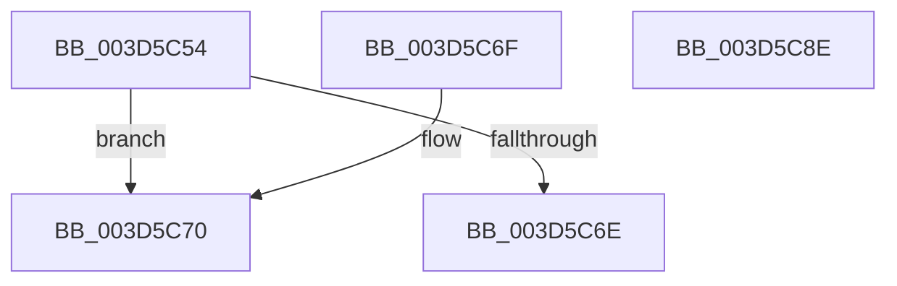

# ExBuildPasidMsrForThread

- RVA: `0x003D5C54`–`0x003D5C8F` (길이 `59` bytes)
- VA: `0x00000001403D5C54`
- 실행 섹션: `.text`
- PDB 이름 있음: `예`; PDB Function 태그: `아니요`
- unwind 정보 RVA: `0x000DB714`
- 디코드: `16`개 명령, `59/59` bytes 표시
- 미해석 바이트: `0` (있으면 어셈블리에 `.byte`로 보존)

> 이 문서는 커널 이미지의 기계어와 PDB 기호를 분석해 생성했습니다. 4번과 5번은 함수 원형과 자료형을 바이너리 사용 방식에서 추정한 C 해석이며 원본 소스 복구 결과는 아닙니다.

## 1. Dependencies

- 직접 호출 지점: **0**; 고유 호출 대상: **0**
- 직접 호출자로 확인된 함수: **2**
- RIP 상대 이미지 참조: **0**

### Outgoing calls
- 직접 디코드된 call 명령이 없습니다.

### Direct callers
- [KiInitializeContextThread](KiInitializeContextThread_function_003D6400.md) at `0x003D680C`
- [ExSvmUpdateThreadPasidMsrApc](../../page/7D/ExSvmUpdateThreadPasidMsrApc_function_007D0A70.md) at `0x007D0A7B`

### Static image references
- 디코드된 RIP-relative 메모리 참조가 없습니다.

## 2. Other-region calls and transfers

- 다른 실행 섹션으로 향하는 call: **0**
- 별도 외부 분기/꼬리 이동을 확인하지 못했습니다.

## 3. Assembly (complete function range)

```asm
003D5C54  48 8B 91 20 02 00 00            mov rdx, qword ptr [rcx + 0x220]
003D5C5B  33 C0                           xor eax, eax
003D5C5D  48 89 44 24 08                  mov qword ptr [rsp + 8], rax
003D5C62  44 8B 82 00 06 00 00            mov r8d, dword ptr [rdx + 0x600]
003D5C69  45 85 C0                        test r8d, r8d
003D5C6C  75 02                           jne 0x1403d5c70
003D5C6E  C3                              ret
003D5C6F  CC                              int3
003D5C70  80 89 A9 05 00 00 80            or byte ptr [rcx + 0x5a9], 0x80
003D5C77  41 8D 40 FF                     lea eax, [r8 - 1]
003D5C7B  25 FF FF 0F 00                  and eax, 0xfffff
003D5C80  0F BA E8 1F                     bts eax, 0x1f
003D5C84  89 44 24 08                     mov dword ptr [rsp + 8], eax
003D5C88  48 8B 44 24 08                  mov rax, qword ptr [rsp + 8]
003D5C8D  C3                              ret
003D5C8E  CC                              int3
```

## 4. C-style interpretation (structured pseudocode)

```c
__int64 __fastcall ExBuildPasidMsrForThread(__int64 a1)
{
    __int64 result;
    unsigned __int64 v_stack_p8;

    result = 0;
    v_stack_p8 = 0;
    if ((unsigned int)((unsigned int)(*(unsigned int *)(*(unsigned __int64 *)(a1 + 544) + 1536))) != 0) goto loc_003D5C70;
    return result;
loc_003D5C70:
    result = (unsigned int)(((unsigned int)(*(unsigned int *)(*(unsigned __int64 *)(a1 + 544) + 1536)) - 1) & (0xFFFFFULL));
    v_stack_p8 = (unsigned int)(result);
    return v_stack_p8;
}
```

## 5. (Beta) C Style

```c
int64_t ExBuildPasidMsrForThread(void *Arg1)
{
    uint8_t *arg1 = (uint8_t *)Arg1;

    int64_t result;
    uint64_t v_stack_p8;

    result = 0;
    v_stack_p8 = 0;
    if ((uint32_t)((uint32_t)(*(uint32_t *)(*(uint64_t *)(arg1 + 0x220) + 0x600))) != 0) goto loc_003D5C70;
    return result;
loc_003D5C70:
    result = (uint32_t)(((uint32_t)(*(uint32_t *)(*(uint64_t *)(arg1 + 0x220) + 0x600)) - 1) & (0xFFFFFULL));
    v_stack_p8 = (uint32_t)(result);
    return v_stack_p8;
}
```

### 관측된 메모리 오프셋

구조체 형식이 확인되지 않은 접근은 인자 기준의 오프셋으로만 기록했습니다.

| 기준 인자 | 오프셋 표현 | 폭 (bit) | 접근 |
|---|---:|---:|---|
| `Arg1` | `+ 0x220` | `64` | `R` |
| `Arg1` | `+ 0x5A9` | `8` | `R/W` |

## 6. Execution-region graph

[열기: 2D/3D 그래프와 함수 탐색 컨트롤 패널](../../../control-panel.html?section=text&rva=0x003D5C54&view=graph)

- 2D 그래프는 위에서 아래로 흐르고, 3D 그래프는 빈 공간을 드래그해 회전합니다. Shift+드래그는 이동, 휠은 확대·축소, 함수 노드 선택은 대상 보고서 이동입니다.

### Static fallback


