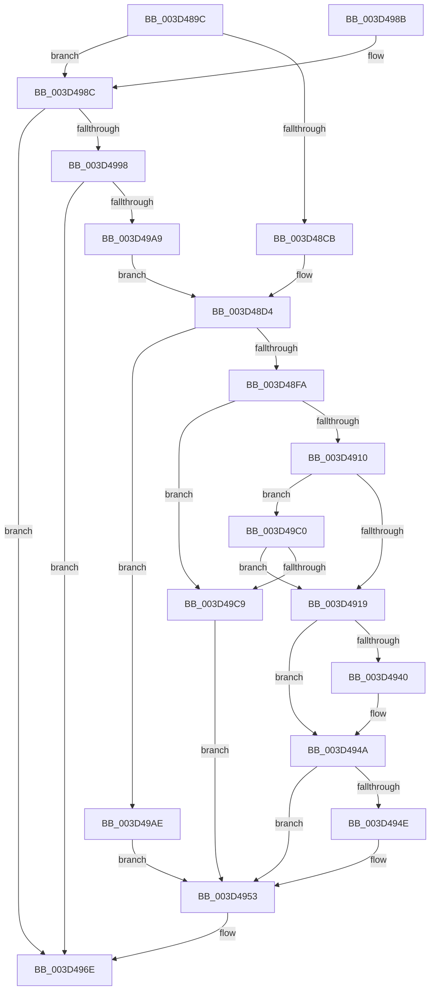

# ExpExpandResourceOwnerTable

- RVA: `0x003D489C`–`0x003D49E0` (길이 `324` bytes)
- VA: `0x00000001403D489C`
- 실행 섹션: `.text`
- PDB 이름 있음: `예`; PDB Function 태그: `아니요`
- unwind 정보 RVA: `0x0009253C`
- 디코드: `89`개 명령, `324/324` bytes 표시
- 미해석 바이트: `0` (있으면 어셈블리에 `.byte`로 보존)

> 이 문서는 커널 이미지의 기계어와 PDB 기호를 분석해 생성했습니다. 4번과 5번은 함수 원형과 자료형을 바이너리 사용 방식에서 추정한 C 해석이며 원본 소스 복구 결과는 아닙니다.

## 1. Dependencies

- 직접 호출 지점: **10**; 고유 호출 대상: **6**
- 직접 호출자로 확인된 함수: **4**
- RIP 상대 이미지 참조: **1**

### Outgoing calls
- `0x003D48D7` → [KeReleaseInStackQueuedSpinLock](../34/KeReleaseInStackQueuedSpinLock_function_00342CE0.md) (function, `0x00342CE0`)
- `0x003D48E9` → [ExAllocatePool2](../../poolcode/B8/ExAllocatePool2_function_00B820F0.md) (function, `0x00B820F0`)
- `0x003D4901` → [KeAcquireInStackQueuedSpinLock](../27/KeAcquireInStackQueuedSpinLock_function_002757A0.md) (function, `0x002757A0`)
- `0x003D4926` → [memcpy](../6C/memcpy_function_006C6840.md) (function, `0x006C6840`)
- `0x003D4936` → [KeReleaseInStackQueuedSpinLock](../34/KeReleaseInStackQueuedSpinLock_function_00342CE0.md) (function, `0x00342CE0`)
- `0x003D4945` → [ExFreePoolWithTag](../../poolcode/B8/ExFreePoolWithTag_function_00B82870.md) (function, `0x00B82870`)
- `0x003D4969` → [KeAcquireInStackQueuedSpinLock](../27/KeAcquireInStackQueuedSpinLock_function_002757A0.md) (function, `0x002757A0`)
- `0x003D49B9` → [KeDelayExecutionThread](../20/KeDelayExecutionThread_function_00209550.md) (function, `0x00209550`)
- `0x003D49CC` → [KeReleaseInStackQueuedSpinLock](../34/KeReleaseInStackQueuedSpinLock_function_00342CE0.md) (function, `0x00342CE0`)
- `0x003D49D6` → [ExFreePoolWithTag](../../poolcode/B8/ExFreePoolWithTag_function_00B82870.md) (function, `0x00B82870`)

### Direct callers
- [ExpAcquireResourceSharedLite](../21/ExpAcquireResourceSharedLite_function_00212040.md) at `0x0021282A`
- [ExpAcquireSharedStarveExclusive](../34/ExpAcquireSharedStarveExclusive_function_003411C0.md) at `0x003416EF`
- [sub_003D4764](Unknown_function_003D4764.md) at `0x003D4825`
- [ExpFindEmptyEntry](ExpFindEmptyEntry_function_003D4840.md) at `0x003D488D`

### Static image references
- `0x003D49AE` → RVA `0x00E0EBA0` (`.data`; read)

## 2. Other-region calls and transfers

- 다른 실행 섹션으로 향하는 call: **3**
  - `0x003D48E9` → [ExAllocatePool2](../../poolcode/B8/ExAllocatePool2_function_00B820F0.md) (`.text` → `POOLCODE`)
  - `0x003D4945` → [ExFreePoolWithTag](../../poolcode/B8/ExFreePoolWithTag_function_00B82870.md) (`.text` → `POOLCODE`)
  - `0x003D49D6` → [ExFreePoolWithTag](../../poolcode/B8/ExFreePoolWithTag_function_00B82870.md) (`.text` → `POOLCODE`)
- 별도 외부 분기/꼬리 이동을 확인하지 못했습니다.

## 3. Assembly (complete function range)

```asm
003D489C  48 89 5C 24 08                  mov qword ptr [rsp + 8], rbx
003D48A1  48 89 6C 24 10                  mov qword ptr [rsp + 0x10], rbp
003D48A6  48 89 74 24 18                  mov qword ptr [rsp + 0x18], rsi
003D48AB  57                              push rdi
003D48AC  41 54                           push r12
003D48AE  41 55                           push r13
003D48B0  41 56                           push r14
003D48B2  41 57                           push r15
003D48B4  48 83 EC 20                     sub rsp, 0x20
003D48B8  48 8B 79 10                     mov rdi, qword ptr [rcx + 0x10]
003D48BC  48 8B EA                        mov rbp, rdx
003D48BF  4C 8B E9                        mov r13, rcx
003D48C2  48 85 FF                        test rdi, rdi
003D48C5  0F 85 C1 00 00 00               jne 0x1403d498c
003D48CB  33 DB                           xor ebx, ebx
003D48CD  8D 77 30                        lea esi, [rdi + 0x30]
003D48D0  44 8D 7F 03                     lea r15d, [rdi + 3]
003D48D4  48 8B CD                        mov rcx, rbp
003D48D7  E8 04 E4 F6 FF                  call 0x140342ce0
003D48DC  8B D6                           mov edx, esi
003D48DE  B9 40 00 00 00                  mov ecx, 0x40
003D48E3  41 B8 52 65 54 61               mov r8d, 0x61546552
003D48E9  E8 02 D8 7A 00                  call 0x140b820f0
003D48EE  48 8B F0                        mov rsi, rax
003D48F1  48 85 C0                        test rax, rax
003D48F4  0F 84 B4 00 00 00               je 0x1403d49ae
003D48FA  48 8B D5                        mov rdx, rbp
003D48FD  49 8D 4D 60                     lea rcx, [r13 + 0x60]
003D4901  E8 9A 0E EA FF                  call 0x1402757a0
003D4906  49 3B 7D 10                     cmp rdi, qword ptr [r13 + 0x10]
003D490A  0F 85 B9 00 00 00               jne 0x1403d49c9
003D4910  48 85 FF                        test rdi, rdi
003D4913  0F 85 A7 00 00 00               jne 0x1403d49c0
003D4919  44 8B C3                        mov r8d, ebx
003D491C  48 8B D7                        mov rdx, rdi
003D491F  49 C1 E0 04                     shl r8, 4
003D4923  48 8B CE                        mov rcx, rsi
003D4926  E8 15 1F 2F 00                  call 0x1406c6840
003D492B  44 89 7E 08                     mov dword ptr [rsi + 8], r15d
003D492F  48 8B CD                        mov rcx, rbp
003D4932  49 89 75 10                     mov qword ptr [r13 + 0x10], rsi
003D4936  E8 A5 E3 F6 FF                  call 0x140342ce0
003D493B  48 85 FF                        test rdi, rdi
003D493E  74 0A                           je 0x1403d494a
003D4940  33 D2                           xor edx, edx
003D4942  48 8B CF                        mov rcx, rdi
003D4945  E8 26 DF 7A 00                  call 0x140b82870
003D494A  85 DB                           test ebx, ebx
003D494C  75 05                           jne 0x1403d4953
003D494E  BB 01 00 00 00                  mov ebx, 1
003D4953  65 48 8B 04 25 88 01 00 00      mov rax, qword ptr gs:[0x188]
003D495C  49 8D 4D 60                     lea rcx, [r13 + 0x60]
003D4960  48 8B D5                        mov rdx, rbp
003D4963  88 98 60 04 00 00               mov byte ptr [rax + 0x460], bl
003D4969  E8 32 0E EA FF                  call 0x1402757a0
003D496E  48 8B 5C 24 50                  mov rbx, qword ptr [rsp + 0x50]
003D4973  48 8B 6C 24 58                  mov rbp, qword ptr [rsp + 0x58]
003D4978  48 8B 74 24 60                  mov rsi, qword ptr [rsp + 0x60]
003D497D  48 83 C4 20                     add rsp, 0x20
003D4981  41 5F                           pop r15
003D4983  41 5E                           pop r14
003D4985  41 5D                           pop r13
003D4987  41 5C                           pop r12
003D4989  5F                              pop rdi
003D498A  C3                              ret
003D498B  CC                              int3
003D498C  8B 5F 08                        mov ebx, dword ptr [rdi + 8]
003D498F  44 8D 7B 04                     lea r15d, [rbx + 4]
003D4993  44 3B FB                        cmp r15d, ebx
003D4996  72 D6                           jb 0x1403d496e
003D4998  41 8B F7                        mov esi, r15d
003D499B  B8 FF FF FF FF                  mov eax, 0xffffffff
003D49A0  48 C1 E6 04                     shl rsi, 4
003D49A4  48 3B F0                        cmp rsi, rax
003D49A7  77 C5                           ja 0x1403d496e
003D49A9  E9 26 FF FF FF                  jmp 0x1403d48d4
003D49AE  4C 8D 05 EB A1 A3 00            lea r8, [rip + 0xa3a1eb]
003D49B5  33 D2                           xor edx, edx
003D49B7  33 C9                           xor ecx, ecx
003D49B9  E8 92 4B E3 FF                  call 0x140209550
003D49BE  EB 93                           jmp 0x1403d4953
003D49C0  3B 5F 08                        cmp ebx, dword ptr [rdi + 8]
003D49C3  0F 84 50 FF FF FF               je 0x1403d4919
003D49C9  48 8B CD                        mov rcx, rbp
003D49CC  E8 0F E3 F6 FF                  call 0x140342ce0
003D49D1  33 D2                           xor edx, edx
003D49D3  48 8B CE                        mov rcx, rsi
003D49D6  E8 95 DE 7A 00                  call 0x140b82870
003D49DB  E9 73 FF FF FF                  jmp 0x1403d4953
```

## 4. C-style interpretation (structured pseudocode)

```c
__int64 __fastcall ExpExpandResourceOwnerTable(__int64 a1, __int64 a2)
{
    __int64 result;
    __int64 v_rbx;
    __int64 v_rsi;
    __int64 v_rsp;
    unsigned __int64 v_stack_p10;
    unsigned __int64 v_stack_p18;
    unsigned __int64 v_stack_p8;

    v_stack_p8 = v_rbx;
    v_stack_p10 = v_rbp;
    v_stack_p18 = v_rsi;
    v_rsp = (v_rsp) - (32);
    if (*(unsigned __int64 *)(a1 + 16) != 0) goto loc_003D498C;
    v_rbx = 0;
loc_003D48D4:
    result = KeReleaseInStackQueuedSpinLock(a2, a2, a3, a4);
    result = ExAllocatePool2(64, (unsigned int)((unsigned int)(*(unsigned __int64 *)(a1 + 16) + 48)), (unsigned int)(0x61546552ULL), a4);
    if (result == 0) goto loc_003D49AE;
    result = KeAcquireInStackQueuedSpinLock(a1 + 96, a2, (unsigned int)(0x61546552ULL), a4);
    if ((*(unsigned __int64 *)(a1 + 16)) != (*(unsigned __int64 *)(a1 + 16))) goto loc_003D49C9;
    if (*(unsigned __int64 *)(a1 + 16) != 0) goto loc_003D49C0;
loc_003D4919:
    a3 = (0) << (4);
    result = memcpy(result, *(unsigned __int64 *)(a1 + 16), a3, a4);
    *(unsigned int *)(result + 8) = (unsigned int)(*(unsigned __int64 *)(a1 + 16) + 3);
    *(unsigned __int64 *)(a1 + 16) = result;
    result = KeReleaseInStackQueuedSpinLock(a2, *(unsigned __int64 *)(a1 + 16), a3, a4);
    if (*(unsigned __int64 *)(a1 + 16) != 0) {
        a2 = 0;
        a1 = *(unsigned __int64 *)(a1 + 16);
        result = ExFreePoolWithTag(a1, a2, a3, a4);
    }
    if (0 == 0) {
        v_rbx = 1;
    }
    *(unsigned __int8 *)(*(unsigned __int64 *)(gs_base + (0 + 392)) + 1120) = (unsigned __int8)(v_rbx);
    result = KeAcquireInStackQueuedSpinLock(a1 + 96, 0, a3, a4);
loc_003D496E:
    v_rsp = (v_rsp) + (32);
    return result;
loc_003D498C:
    if (((unsigned int)((unsigned int)(*(unsigned int *)(*(unsigned __int64 *)(a1 + 16) + 8)) + 4)) < ((unsigned int)((unsigned int)(*(unsigned int *)(*(unsigned __int64 *)(a1 + 16) + 8))))) goto loc_003D496E;
    v_rsi = ((unsigned int)((unsigned int)((unsigned int)(*(unsigned int *)(*(unsigned __int64 *)(a1 + 16) + 8)) + 4))) << (4);
    if (v_rsi > ((unsigned int)(0xFFFFFFFFULL))) goto loc_003D496E;
    goto loc_003D48D4;
loc_003D49AE:
    a2 = 0;
    a1 = 0;
    result = KeDelayExecutionThread(a1, a2, v_rip + 10723819, a4);
    goto loc_003D4953;
loc_003D49C0:
    if (((unsigned int)((unsigned int)(*(unsigned int *)(*(unsigned __int64 *)(a1 + 16) + 8)))) == (*(unsigned int *)(*(unsigned __int64 *)(a1 + 16) + 8))) goto loc_003D4919;
loc_003D49C9:
    result = KeReleaseInStackQueuedSpinLock(v_stack_p10, a2, v_rip + 10723819, a4);
    a2 = 0;
    result = ExFreePoolWithTag(v_rsi, a2, v_rip + 10723819, a4);
    goto loc_003D4953;
}
```

## 5. (Beta) C Style

```c
int64_t ExpExpandResourceOwnerTable(void *Arg1, int64_t Arg2)
{
    uint8_t *arg1 = (uint8_t *)Arg1;

    int64_t result;
    int64_t local_rbx;
    int64_t local_rsi;
    int64_t local_rsp;
    uint64_t v_stack_p10;
    uint64_t v_stack_p18;
    uint64_t v_stack_p8;

    v_stack_p8 = local_rbx;
    v_stack_p10 = local_rbp;
    v_stack_p18 = local_rsi;
    local_rsp = (local_rsp) - (32);
    if (*(uint64_t *)(arg1 + 0x10) != 0) goto loc_003D498C;
    local_rbx = 0;
loc_003D48D4:
    result = KeReleaseInStackQueuedSpinLock(Arg2, Arg2, a3, a4);
    result = ExAllocatePool2(64, (uint32_t)((uint32_t)(*(uint64_t *)(arg1 + 0x10) + 48)), (uint32_t)(0x61546552ULL), a4);
    if (result == 0) goto loc_003D49AE;
    result = KeAcquireInStackQueuedSpinLock(Arg1 + 96, Arg2, (uint32_t)(0x61546552ULL), a4);
    if ((*(uint64_t *)(arg1 + 0x10)) != (*(uint64_t *)(arg1 + 0x10))) goto loc_003D49C9;
    if (*(uint64_t *)(arg1 + 0x10) != 0) goto loc_003D49C0;
loc_003D4919:
    a3 = (0) << (4);
    result = memcpy(result, *(uint64_t *)(arg1 + 0x10), a3, a4);
    *(uint32_t *)(result + 0x8) = (uint32_t)(*(uint64_t *)(arg1 + 0x10) + 3);
    *(uint64_t *)(arg1 + 0x10) = result;
    result = KeReleaseInStackQueuedSpinLock(Arg2, *(uint64_t *)(arg1 + 0x10), a3, a4);
    if (*(uint64_t *)(arg1 + 0x10) != 0) {
        Arg2 = 0;
        Arg1 = *(uint64_t *)(arg1 + 0x10);
        result = ExFreePoolWithTag(Arg1, Arg2, a3, a4);
    }
    if (0 == 0) {
        local_rbx = 1;
    }
    *(uint8_t *)(*(uint64_t *)(gs_base + (0 + 0x188)) + 0x460) = (uint8_t)(local_rbx);
    result = KeAcquireInStackQueuedSpinLock(Arg1 + 96, 0, a3, a4);
loc_003D496E:
    local_rsp = (local_rsp) + (32);
    return result;
loc_003D498C:
    if (((uint32_t)((uint32_t)(*(uint32_t *)(*(uint64_t *)(arg1 + 0x10) + 0x8)) + 4)) < ((uint32_t)((uint32_t)(*(uint32_t *)(*(uint64_t *)(arg1 + 0x10) + 0x8))))) goto loc_003D496E;
    local_rsi = ((uint32_t)((uint32_t)((uint32_t)(*(uint32_t *)(*(uint64_t *)(arg1 + 0x10) + 0x8)) + 4))) << (4);
    if (local_rsi > ((uint32_t)(0xFFFFFFFFULL))) goto loc_003D496E;
    goto loc_003D48D4;
loc_003D49AE:
    Arg2 = 0;
    Arg1 = 0;
    result = KeDelayExecutionThread(Arg1, Arg2, v_rip + 10723819, a4);
    goto loc_003D4953;
loc_003D49C0:
    if (((uint32_t)((uint32_t)(*(uint32_t *)(*(uint64_t *)(arg1 + 0x10) + 0x8)))) == (*(uint32_t *)(*(uint64_t *)(arg1 + 0x10) + 0x8))) goto loc_003D4919;
loc_003D49C9:
    result = KeReleaseInStackQueuedSpinLock(v_stack_p10, Arg2, v_rip + 10723819, a4);
    Arg2 = 0;
    result = ExFreePoolWithTag(local_rsi, Arg2, v_rip + 10723819, a4);
    goto loc_003D4953;
}
```

### 관측된 메모리 오프셋

구조체 형식이 확인되지 않은 접근은 인자 기준의 오프셋으로만 기록했습니다.

| 기준 인자 | 오프셋 표현 | 폭 (bit) | 접근 |
|---|---:|---:|---|
| `Arg1` | `+ 0x10` | `64` | `R` |
| `Arg1` | `+ 0x10` | `64` | `W` |
| `Arg1` | `+ 0x60` | `64` | `R` |

## 6. Execution-region graph

[열기: 2D/3D 그래프와 함수 탐색 컨트롤 패널](../../../control-panel.html?section=text&rva=0x003D489C&view=graph)

- 2D 그래프는 위에서 아래로 흐르고, 3D 그래프는 빈 공간을 드래그해 회전합니다. Shift+드래그는 이동, 휠은 확대·축소, 함수 노드 선택은 대상 보고서 이동입니다.

### Static fallback


