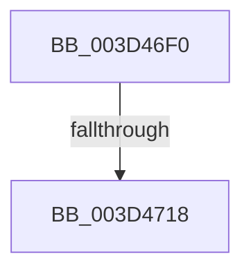

# ExpFindCurrentThread

- RVA: `0x003D46F0`–`0x003D471A` (길이 `42` bytes)
- VA: `0x00000001403D46F0`
- 실행 섹션: `.text`
- PDB 이름 있음: `예`; PDB Function 태그: `아니요`
- unwind 정보 RVA: `0x000924F0`
- 디코드: `13`개 명령, `42/42` bytes 표시
- 미해석 바이트: `0` (있으면 어셈블리에 `.byte`로 보존)

> 이 문서는 커널 이미지의 기계어와 PDB 기호를 분석해 생성했습니다. 4번과 5번은 함수 원형과 자료형을 바이너리 사용 방식에서 추정한 C 해석이며 원본 소스 복구 결과는 아닙니다.

## 1. Dependencies

- 직접 호출 지점: **0**; 고유 호출 대상: **0**
- 직접 호출자로 확인된 함수: **3**
- RIP 상대 이미지 참조: **0**

### Outgoing calls
- 직접 디코드된 call 명령이 없습니다.

### Direct callers
- [ExAcquireSharedWaitForExclusive](ExAcquireSharedWaitForExclusive_function_003D43F0.md) at `0x003D4526`
- [ExpTryConvertSharedToExclusiveLite](../65/ExpTryConvertSharedToExclusiveLite_function_00658F30.md) at `0x00658F9E`
- [sub_006E96C4](../6E/Unknown_function_006E96C4.md) at `0x006E977F`

### Static image references
- 디코드된 RIP-relative 메모리 참조가 없습니다.

## 2. Other-region calls and transfers

- 다른 실행 섹션으로 향하는 call: **0**
- call이 아닌 외부 분기/꼬리 이동: **1**
  - `0x003D4716` → [sub_003D4753](Unknown_function_003D4753.md) (`tail-transfer`)

## 3. Assembly (complete function range)

```asm
003D46F0  48 89 5C 24 10                  mov qword ptr [rsp + 0x10], rbx
003D46F5  48 89 6C 24 18                  mov qword ptr [rsp + 0x18], rbp
003D46FA  57                              push rdi
003D46FB  48 83 EC 20                     sub rsp, 0x20
003D46FF  4C 8B 51 30                     mov r10, qword ptr [rcx + 0x30]
003D4703  48 8D 41 30                     lea rax, [rcx + 0x30]
003D4707  41 8B D9                        mov ebx, r9d
003D470A  49 8B E8                        mov rbp, r8
003D470D  48 8B FA                        mov rdi, rdx
003D4710  4C 8B D9                        mov r11, rcx
003D4713  4C 3B D2                        cmp r10, rdx
003D4716  74 3B                           je 0x1403d4753
003D4718  33 D2                           xor edx, edx
```

## 4. C-style interpretation (structured pseudocode)

```c
__int64 __fastcall ExpFindCurrentThread(__int64 a1, __int64 a2, __int64 a3, int a4)
{
    __int64 v_rsp;
    unsigned __int64 v_stack_p10;
    unsigned __int64 v_stack_p18;

    v_stack_p10 = v_rbx;
    v_stack_p18 = v_rbp;
    v_rsp = (v_rsp) - (32);
    a2 = 0;
    return a1 + 48;
}
```

## 5. (Beta) C Style

```c
void *ExpFindCurrentThread(void *Arg1, int64_t Arg2, int64_t Arg3, int32_t Arg4)
{
    uint8_t *arg1 = (uint8_t *)Arg1;

    int64_t local_rsp;
    uint64_t v_stack_p10;
    uint64_t v_stack_p18;

    v_stack_p10 = local_rbx;
    v_stack_p18 = local_rbp;
    local_rsp = (local_rsp) - (32);
    Arg2 = 0;
    return Arg1 + 48;
}
```

### 관측된 메모리 오프셋

구조체 형식이 확인되지 않은 접근은 인자 기준의 오프셋으로만 기록했습니다.

| 기준 인자 | 오프셋 표현 | 폭 (bit) | 접근 |
|---|---:|---:|---|
| `Arg1` | `+ 0x30` | `64` | `R` |

## 6. Execution-region graph

[열기: 2D/3D 그래프와 함수 탐색 컨트롤 패널](../../../control-panel.html?section=text&rva=0x003D46F0&view=graph)

- 2D 그래프는 위에서 아래로 흐르고, 3D 그래프는 빈 공간을 드래그해 회전합니다. Shift+드래그는 이동, 휠은 확대·축소, 함수 노드 선택은 대상 보고서 이동입니다.

### Static fallback


