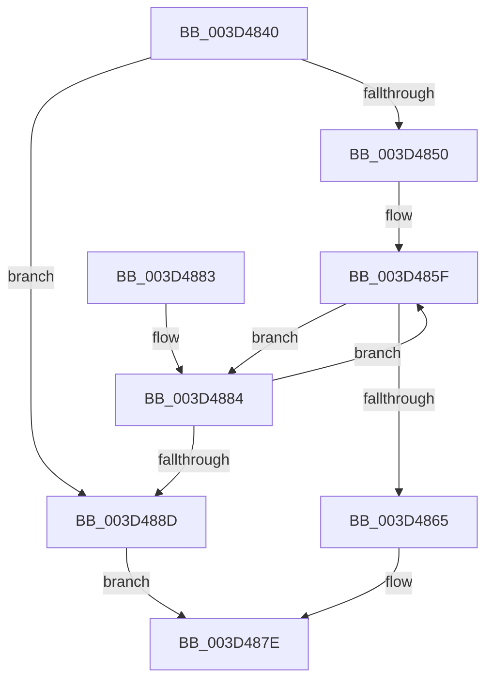

# ExpFindEmptyEntry

- RVA: `0x003D4840`–`0x003D4896` (길이 `86` bytes)
- VA: `0x00000001403D4840`
- 실행 섹션: `.text`
- PDB 이름 있음: `예`; PDB Function 태그: `아니요`
- unwind 정보 RVA: `0x0007A1AC`
- 디코드: `25`개 명령, `86/86` bytes 표시
- 미해석 바이트: `0` (있으면 어셈블리에 `.byte`로 보존)

> 이 문서는 커널 이미지의 기계어와 PDB 기호를 분석해 생성했습니다. 4번과 5번은 함수 원형과 자료형을 바이너리 사용 방식에서 추정한 C 해석이며 원본 소스 복구 결과는 아닙니다.

## 1. Dependencies

- 직접 호출 지점: **1**; 고유 호출 대상: **1**
- 직접 호출자로 확인된 함수: **2**
- RIP 상대 이미지 참조: **0**

### Outgoing calls
- `0x003D488D` → [ExpExpandResourceOwnerTable](ExpExpandResourceOwnerTable_function_003D489C.md) (function, `0x003D489C`)

### Direct callers
- [ExpAcquireSharedStarveExclusive](../34/ExpAcquireSharedStarveExclusive_function_003411C0.md) at `0x003416D2`
- [ExAcquireSharedWaitForExclusive](ExAcquireSharedWaitForExclusive_function_003D43F0.md) at `0x003D463A`

### Static image references
- 디코드된 RIP-relative 메모리 참조가 없습니다.

## 2. Other-region calls and transfers

- 다른 실행 섹션으로 향하는 call: **0**
- 별도 외부 분기/꼬리 이동을 확인하지 못했습니다.

## 3. Assembly (complete function range)

```asm
003D4840  48 83 EC 28                     sub rsp, 0x28
003D4844  4C 8B 49 10                     mov r9, qword ptr [rcx + 0x10]
003D4848  49 8B C1                        mov rax, r9
003D484B  4D 85 C9                        test r9, r9
003D484E  74 3D                           je 0x1403d488d
003D4850  45 8B 41 08                     mov r8d, dword ptr [r9 + 8]
003D4854  49 C1 E0 04                     shl r8, 4
003D4858  4C 03 C0                        add r8, rax
003D485B  48 83 C0 10                     add rax, 0x10
003D485F  48 83 38 00                     cmp qword ptr [rax], 0
003D4863  75 1F                           jne 0x1403d4884
003D4865  65 48 8B 0C 25 88 01 00 00      mov rcx, qword ptr gs:[0x188]
003D486E  48 8B D0                        mov rdx, rax
003D4871  49 2B D1                        sub rdx, r9
003D4874  48 C1 FA 04                     sar rdx, 4
003D4878  88 91 60 04 00 00               mov byte ptr [rcx + 0x460], dl
003D487E  48 83 C4 28                     add rsp, 0x28
003D4882  C3                              ret
003D4883  CC                              int3
003D4884  48 83 C0 10                     add rax, 0x10
003D4888  49 3B C0                        cmp rax, r8
003D488B  75 D2                           jne 0x1403d485f
003D488D  E8 0A 00 00 00                  call 0x1403d489c
003D4892  33 C0                           xor eax, eax
003D4894  EB E8                           jmp 0x1403d487e
```

## 4. C-style interpretation (structured pseudocode)

```c
__int64 __fastcall ExpFindEmptyEntry(__int64 a1)
{
    __int64 result;
    __int64 v_rsp;

    v_rsp = (v_rsp) - (40);
    if (*(unsigned __int64 *)(a1 + 16) == 0) goto loc_003D488D;
    a3 = ((unsigned int)(*(unsigned int *)(*(unsigned __int64 *)(a1 + 16) + 8))) << (4);
    a3 = (a3) + (*(unsigned __int64 *)(a1 + 16));
    result = (*(unsigned __int64 *)(a1 + 16)) + (16);
loc_003D485F:
    if ((*(unsigned __int64 *)(result)) != 0) goto loc_003D4884;
    a2 = (result) - (*(unsigned __int64 *)(a1 + 16));
    a2 = (a2) >> (4);
    *(unsigned __int8 *)(*(unsigned __int64 *)(gs_base + (0 + 392)) + 1120) = (unsigned __int8)(a2);
loc_003D487E:
    v_rsp = (v_rsp) + (40);
    return result;
loc_003D4884:
    result = (result) + (16);
    if (result != a3) goto loc_003D485F;
loc_003D488D:
    result = ExpExpandResourceOwnerTable(*(unsigned __int64 *)(gs_base + (0 + 392)), a2, a3, *(unsigned __int64 *)(a1 + 16));
    result = 0;
    goto loc_003D487E;
}
```

## 5. (Beta) C Style

```c
int64_t ExpFindEmptyEntry(void *Arg1)
{
    uint8_t *arg1 = (uint8_t *)Arg1;

    int64_t result;
    int64_t local_rsp;

    local_rsp = (local_rsp) - (40);
    if (*(uint64_t *)(arg1 + 0x10) == 0) goto loc_003D488D;
    a3 = ((uint32_t)(*(uint32_t *)(*(uint64_t *)(arg1 + 0x10) + 0x8))) << (4);
    a3 = (a3) + (*(uint64_t *)(arg1 + 0x10));
    result = (*(uint64_t *)(arg1 + 0x10)) + (16);
loc_003D485F:
    if ((*(uint64_t *)(result)) != 0) goto loc_003D4884;
    a2 = (result) - (*(uint64_t *)(arg1 + 0x10));
    a2 = (a2) >> (4);
    *(uint8_t *)(*(uint64_t *)(gs_base + (0 + 0x188)) + 0x460) = (uint8_t)(a2);
loc_003D487E:
    local_rsp = (local_rsp) + (40);
    return result;
loc_003D4884:
    result = (result) + (16);
    if (result != a3) goto loc_003D485F;
loc_003D488D:
    result = ExpExpandResourceOwnerTable(*(uint64_t *)(gs_base + (0 + 0x188)), a2, a3, *(uint64_t *)(arg1 + 0x10));
    result = 0;
    goto loc_003D487E;
}
```

### 관측된 메모리 오프셋

구조체 형식이 확인되지 않은 접근은 인자 기준의 오프셋으로만 기록했습니다.

| 기준 인자 | 오프셋 표현 | 폭 (bit) | 접근 |
|---|---:|---:|---|
| `Arg1` | `+ 0x10` | `64` | `R` |

## 6. Execution-region graph

[열기: 2D/3D 그래프와 함수 탐색 컨트롤 패널](../../../control-panel.html?section=text&rva=0x003D4840&view=graph)

- 2D 그래프는 위에서 아래로 흐르고, 3D 그래프는 빈 공간을 드래그해 회전합니다. Shift+드래그는 이동, 휠은 확대·축소, 함수 노드 선택은 대상 보고서 이동입니다.

### Static fallback


