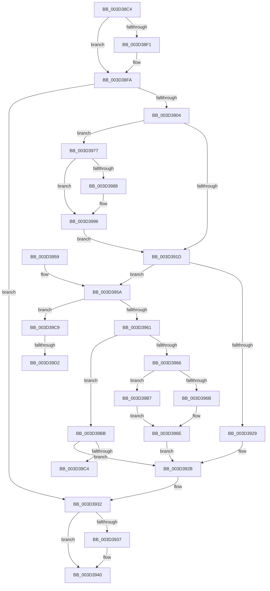

# ExpTimerPause

- RVA: `0x003D38C4`–`0x003D39DD` (길이 `281` bytes)
- VA: `0x00000001403D38C4`
- 실행 섹션: `.text`
- PDB 이름 있음: `예`; PDB Function 태그: `예`
- unwind 정보 RVA: `0x000918C0`
- 디코드: `83`개 명령, `281/281` bytes 표시
- 미해석 바이트: `0` (있으면 어셈블리에 `.byte`로 보존)

> 이 문서는 커널 이미지의 기계어와 PDB 기호를 분석해 생성했습니다. 4번과 5번은 함수 원형과 자료형을 바이너리 사용 방식에서 추정한 C 해석이며 원본 소스 복구 결과는 아닙니다.

## 1. Dependencies

- 직접 호출 지점: **4**; 고유 호출 대상: **4**
- 직접 호출자로 확인된 함수: **3**
- RIP 상대 이미지 참조: **0**

### Outgoing calls
- `0x003D38F5` → [KeAcquireSpinLockAtDpcLevel](../20/KeAcquireSpinLockAtDpcLevel_function_00208430.md) (function, `0x00208430`)
- `0x003D3911` → [KiCancelTimer](KiCancelTimer_function_003D3A80.md) (function, `0x003D3A80`)
- `0x003D393B` → [KxReleaseSpinLock](../20/KxReleaseSpinLock_function_00206670.md) (function, `0x00206670`)
- `0x003D3999` → [KiDecodeTolerableDelayValue](KiDecodeTolerableDelayValue_function_003D3F10.md) (function, `0x003D3F10`)

### Direct callers
- [PsInsertVirtualizedTimer](../46/PsInsertVirtualizedTimer_function_0046C130.md) at `0x0046C21F`
- [ExWakeTimersPause](../4C/ExWakeTimersPause_function_004C6EB4.md) at `0x004C6F5A`
- [PspSetProcessFreezeStateCallback](../4E/PspSetProcessFreezeStateCallback_function_004E98E0.md) at `0x004E99A9`

### Static image references
- 디코드된 RIP-relative 메모리 참조가 없습니다.

## 2. Other-region calls and transfers

- 다른 실행 섹션으로 향하는 call: **0**
- call이 아닌 외부 분기/꼬리 이동: **3**
  - `0x003D39C4` → [sub_006E96AA](../6E/Unknown_function_006E96AA.md) (`tail-transfer`)
  - `0x003D39CC` → [sub_006E96AA + 0xC](../6E/Unknown_function_006E96AA.md) (`tail-transfer`)
  - `0x003D39D8` → [sub_006E96AA](../6E/Unknown_function_006E96AA.md) (`tail-transfer`)

## 3. Assembly (complete function range)

```asm
003D38C4  48 89 5C 24 08                  mov qword ptr [rsp + 8], rbx
003D38C9  48 89 6C 24 10                  mov qword ptr [rsp + 0x10], rbp
003D38CE  48 89 74 24 18                  mov qword ptr [rsp + 0x18], rsi
003D38D3  57                              push rdi
003D38D4  41 56                           push r14
003D38D6  41 57                           push r15
003D38D8  48 83 EC 20                     sub rsp, 0x20
003D38DC  33 FF                           xor edi, edi
003D38DE  33 ED                           xor ebp, ebp
003D38E0  45 8A F1                        mov r14b, r9b
003D38E3  49 8B F0                        mov rsi, r8
003D38E6  4C 8B FA                        mov r15, rdx
003D38E9  48 8B D9                        mov rbx, rcx
003D38EC  45 84 C9                        test r9b, r9b
003D38EF  75 09                           jne 0x1403d38fa
003D38F1  48 83 C1 40                     add rcx, 0x40
003D38F5  E8 36 4B E3 FF                  call 0x140208430
003D38FA  8A 83 30 01 00 00               mov al, byte ptr [rbx + 0x130]
003D3900  A8 02                           test al, 2
003D3902  75 2E                           jne 0x1403d3932
003D3904  0C 02                           or al, 2
003D3906  33 D2                           xor edx, edx
003D3908  48 8B CB                        mov rcx, rbx
003D390B  88 83 30 01 00 00               mov byte ptr [rbx + 0x130], al
003D3911  E8 6A 01 00 00                  call 0x1403d3a80
003D3916  44 8A D8                        mov r11b, al
003D3919  84 C0                           test al, al
003D391B  75 5A                           jne 0x1403d3977
003D391D  F0 81 23 7F FF FF FF            lock and dword ptr [rbx], 0xffffff7f
003D3924  45 84 DB                        test r11b, r11b
003D3927  75 31                           jne 0x1403d395a
003D3929  33 ED                           xor ebp, ebp
003D392B  40 88 AB F8 00 00 00            mov byte ptr [rbx + 0xf8], bpl
003D3932  45 84 F6                        test r14b, r14b
003D3935  75 09                           jne 0x1403d3940
003D3937  48 8D 4B 40                     lea rcx, [rbx + 0x40]
003D393B  E8 30 2D E3 FF                  call 0x140206670
003D3940  48 8B 5C 24 40                  mov rbx, qword ptr [rsp + 0x40]
003D3945  48 8B 6C 24 48                  mov rbp, qword ptr [rsp + 0x48]
003D394A  48 8B 74 24 50                  mov rsi, qword ptr [rsp + 0x50]
003D394F  48 83 C4 20                     add rsp, 0x20
003D3953  41 5F                           pop r15
003D3955  41 5E                           pop r14
003D3957  5F                              pop rdi
003D3958  C3                              ret
003D3959  CC                              int3
003D395A  8B CD                           mov ecx, ebp
003D395C  83 E9 01                        sub ecx, 1
003D395F  74 68                           je 0x1403d39c9
003D3961  83 E9 01                        sub ecx, 1
003D3964  75 55                           jne 0x1403d39bb
003D3966  48 3B FE                        cmp rdi, rsi
003D3969  76 4C                           jbe 0x1403d39b7
003D396B  48 2B F7                        sub rsi, rdi
003D396E  48 89 B3 38 01 00 00            mov qword ptr [rbx + 0x138], rsi
003D3975  EB B4                           jmp 0x1403d392b
003D3977  8A 4B 01                        mov cl, byte ptr [rbx + 1]
003D397A  BD 01 00 00 00                  mov ebp, 1
003D397F  48 8B 7B 18                     mov rdi, qword ptr [rbx + 0x18]
003D3983  40 84 CD                        test bpl, cl
003D3986  75 0E                           jne 0x1403d3996
003D3988  BD 02 00 00 00                  mov ebp, 2
003D398D  F6 C1 02                        test cl, 2
003D3990  8D 45 01                        lea eax, [rbp + 1]
003D3993  0F 45 E8                        cmovne ebp, eax
003D3996  C0 E9 02                        shr cl, 2
003D3999  E8 72 05 00 00                  call 0x1403d3f10
003D399E  44 8B D0                        mov r10d, eax
003D39A1  B8 59 17 B7 D1                  mov eax, 0xd1b71759
003D39A6  41 F7 E2                        mul r10d
003D39A9  C1 EA 0D                        shr edx, 0xd
003D39AC  89 93 40 01 00 00               mov dword ptr [rbx + 0x140], edx
003D39B2  E9 66 FF FF FF                  jmp 0x1403d391d
003D39B7  33 F6                           xor esi, esi
003D39B9  EB B3                           jmp 0x1403d396e
003D39BB  83 F9 01                        cmp ecx, 1
003D39BE  0F 85 67 FF FF FF               jne 0x1403d392b
003D39C4  E9 E1 5C 31 00                  jmp 0x1406e96aa
003D39C9  48 3B FE                        cmp rdi, rsi
003D39CC  0F 86 E4 5C 31 00               jbe 0x1406e96b6
003D39D2  48 2B FE                        sub rdi, rsi
003D39D5  49 03 FF                        add rdi, r15
003D39D8  E9 CD 5C 31 00                  jmp 0x1406e96aa
```

## 4. C-style interpretation (structured pseudocode)

```c
__int64 __fastcall ExpTimerPause(__int64 a1, __int64 a2, __int64 a3, unsigned __int8 a4)
{
    __int64 result;
    __int64 v_rbp;
    __int64 v_rdi;
    __int64 v_rsi;
    __int64 v_rsp;
    unsigned __int64 v_stack_p10;
    unsigned __int64 v_stack_p18;
    unsigned __int64 v_stack_p8;

    v_stack_p8 = v_rbx;
    v_stack_p10 = v_rbp;
    v_stack_p18 = v_rsi;
    v_rsp = (v_rsp) - (32);
    v_rdi = 0;
    v_rbp = 0;
    if (a4 == 0) {
        a1 = (a1) + (64);
        result = KeAcquireSpinLockAtDpcLevel(a1, a2, a3, a4);
    }
    if ((((unsigned __int8)(*(unsigned __int8 *)(a1 + 304))) & (2)) != 0) goto loc_003D3932;
    result = (unsigned __int8)((*(unsigned __int8 *)(a1 + 304)) | (2));
    a2 = 0;
    *(unsigned __int8 *)(a1 + 304) = (unsigned __int8)(result);
    result = KiCancelTimer(a1, a2, a3, a4);
    if ((unsigned __int8)(result) != 0) goto loc_003D3977;
loc_003D391D:
    if ((unsigned __int8)((unsigned __int8)(result)) != 0) goto loc_003D395A;
    v_rbp = 0;
loc_003D392B:
    *(unsigned __int8 *)(a1 + 248) = 0;
loc_003D3932:
    if (a4 == 0) {
        a1 = a1 + 64;
        result = KxReleaseSpinLock(a1, a2, a3, a4);
    }
    v_rsp = (v_rsp) + (32);
    return result;
loc_003D395A:
    a1 = (unsigned int)(((unsigned int)((unsigned int)(v_stack_p10))) - (1));
    if (condition_is_equal) goto loc_003D39C9;
    a1 = (unsigned int)((a1) - (1));
    if (condition_is_not_equal) goto loc_003D39BB;
    if (0 <= v_stack_p18) goto loc_003D39B7;
    v_rsi = (v_stack_p18) - (0);
loc_003D396E:
    *(unsigned __int64 *)(v_stack_p8 + 312) = v_rsi;
    goto loc_003D392B;
loc_003D3977:
    v_rbp = 1;
    if (((1) & ((unsigned __int8)(*(unsigned __int8 *)(v_stack_p8 + 1)))) == 0) {
        v_rbp = 2;
        result = v_rbp + 1;
        if ((((unsigned __int8)(*(unsigned __int8 *)(v_stack_p8 + 1))) & (2)) != 0) { v_rbp = (unsigned int)(result); }
    }
    a1 = (unsigned __int8)((*(unsigned __int8 *)(v_stack_p8 + 1)) >> (2));
    result = KiDecodeTolerableDelayValue(a1, a2, a3, a4);
    a2 = (unsigned int)((a2) >> (13));
    *(unsigned int *)(v_stack_p8 + 320) = (unsigned int)(a2);
    goto loc_003D391D;
loc_003D39B7:
    v_rsi = 0;
    goto loc_003D396E;
loc_003D39BB:
    if (((unsigned int)(a1)) != 1) goto loc_003D392B;
loc_003D39C9:
    v_rdi = (*(unsigned __int64 *)(v_stack_p8 + 24)) - (0);
    v_rdi = (v_rdi) + (a2);
}
```

## 5. (Beta) C Style

```c
int64_t ExpTimerPause(void *Arg1, int64_t Arg2, int64_t Arg3, uint8_t Arg4)
{
    uint8_t *arg1 = (uint8_t *)Arg1;

    int64_t result;
    int64_t local_rbp;
    int64_t local_rdi;
    int64_t local_rsi;
    int64_t local_rsp;
    uint64_t v_stack_p10;
    uint64_t v_stack_p18;
    uint64_t v_stack_p8;

    v_stack_p8 = local_rbx;
    v_stack_p10 = local_rbp;
    v_stack_p18 = local_rsi;
    local_rsp = (local_rsp) - (32);
    local_rdi = 0;
    local_rbp = 0;
    if (Arg4 == 0) {
        Arg1 = (Arg1) + (64);
        result = KeAcquireSpinLockAtDpcLevel(Arg1, Arg2, Arg3, Arg4);
    }
    if ((((uint8_t)(*(uint8_t *)(arg1 + 0x130))) & (2)) != 0) goto loc_003D3932;
    result = (uint8_t)((*(uint8_t *)(arg1 + 0x130)) | (2));
    Arg2 = 0;
    *(uint8_t *)(arg1 + 0x130) = (uint8_t)(result);
    result = KiCancelTimer(Arg1, Arg2, Arg3, Arg4);
    if ((uint8_t)(result) != 0) goto loc_003D3977;
loc_003D391D:
    if ((uint8_t)((uint8_t)(result)) != 0) goto loc_003D395A;
    local_rbp = 0;
loc_003D392B:
    *(uint8_t *)(arg1 + 0xF8) = 0;
loc_003D3932:
    if (Arg4 == 0) {
        Arg1 = Arg1 + 64;
        result = KxReleaseSpinLock(Arg1, Arg2, Arg3, Arg4);
    }
    local_rsp = (local_rsp) + (32);
    return result;
loc_003D395A:
    Arg1 = (uint32_t)(((uint32_t)((uint32_t)(v_stack_p10))) - (1));
    if (condition_is_equal) goto loc_003D39C9;
    Arg1 = (uint32_t)((Arg1) - (1));
    if (condition_is_not_equal) goto loc_003D39BB;
    if (0 <= v_stack_p18) goto loc_003D39B7;
    local_rsi = (v_stack_p18) - (0);
loc_003D396E:
    *(uint64_t *)(v_stack_p8 + 0x138) = local_rsi;
    goto loc_003D392B;
loc_003D3977:
    local_rbp = 1;
    if (((1) & ((uint8_t)(*(uint8_t *)(v_stack_p8 + 0x1)))) == 0) {
        local_rbp = 2;
        result = local_rbp + 1;
        if ((((uint8_t)(*(uint8_t *)(v_stack_p8 + 0x1))) & (2)) != 0) { local_rbp = (uint32_t)(result); }
    }
    Arg1 = (uint8_t)((*(uint8_t *)(v_stack_p8 + 0x1)) >> (2));
    result = KiDecodeTolerableDelayValue(Arg1, Arg2, Arg3, Arg4);
    Arg2 = (uint32_t)((Arg2) >> (13));
    *(uint32_t *)(v_stack_p8 + 0x140) = (uint32_t)(Arg2);
    goto loc_003D391D;
loc_003D39B7:
    local_rsi = 0;
    goto loc_003D396E;
loc_003D39BB:
    if (((uint32_t)(Arg1)) != 1) goto loc_003D392B;
loc_003D39C9:
    local_rdi = (*(uint64_t *)(v_stack_p8 + 0x18)) - (0);
    local_rdi = (local_rdi) + (Arg2);
}
```

### 관측된 메모리 오프셋

구조체 형식이 확인되지 않은 접근은 인자 기준의 오프셋으로만 기록했습니다.

| 기준 인자 | 오프셋 표현 | 폭 (bit) | 접근 |
|---|---:|---:|---|
| `Arg1` | `+ 0x0` | `32` | `R/W` |
| `Arg1` | `+ 0x1` | `8` | `R` |
| `Arg1` | `+ 0x18` | `64` | `R` |
| `Arg1` | `+ 0x40` | `64` | `R` |
| `Arg1` | `+ 0xF8` | `8` | `W` |
| `Arg1` | `+ 0x130` | `8` | `R` |
| `Arg1` | `+ 0x130` | `8` | `W` |
| `Arg1` | `+ 0x138` | `64` | `W` |
| `Arg1` | `+ 0x140` | `32` | `W` |

## 6. Execution-region graph

[열기: 2D/3D 그래프와 함수 탐색 컨트롤 패널](../../../control-panel.html?section=text&rva=0x003D38C4&view=graph)

- 2D 그래프는 위에서 아래로 흐르고, 3D 그래프는 빈 공간을 드래그해 회전합니다. Shift+드래그는 이동, 휠은 확대·축소, 함수 노드 선택은 대상 보고서 이동입니다.

### Static fallback


