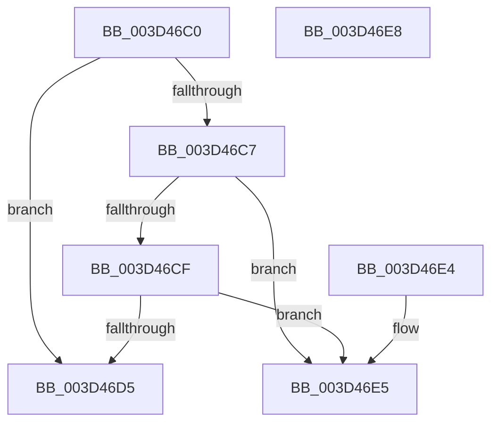

# ExpTryAcquireResourceShared

- RVA: `0x003D46C0`–`0x003D46E9` (길이 `41` bytes)
- VA: `0x00000001403D46C0`
- 실행 섹션: `.text`
- PDB 이름 있음: `예`; PDB Function 태그: `아니요`
- unwind 정보 RVA: `0x000DB714`
- 디코드: `17`개 명령, `41/41` bytes 표시
- 미해석 바이트: `0` (있으면 어셈블리에 `.byte`로 보존)

> 이 문서는 커널 이미지의 기계어와 PDB 기호를 분석해 생성했습니다. 4번과 5번은 함수 원형과 자료형을 바이너리 사용 방식에서 추정한 C 해석이며 원본 소스 복구 결과는 아닙니다.

## 1. Dependencies

- 직접 호출 지점: **0**; 고유 호출 대상: **0**
- 직접 호출자로 확인된 함수: **1**
- RIP 상대 이미지 참조: **0**

### Outgoing calls
- 직접 디코드된 call 명령이 없습니다.

### Direct callers
- [ExAcquireSharedWaitForExclusive](ExAcquireSharedWaitForExclusive_function_003D43F0.md) at `0x003D4492`

### Static image references
- 디코드된 RIP-relative 메모리 참조가 없습니다.

## 2. Other-region calls and transfers

- 다른 실행 섹션으로 향하는 call: **0**
- 별도 외부 분기/꼬리 이동을 확인하지 못했습니다.

## 3. Assembly (complete function range)

```asm
003D46C0  8B 51 40                        mov edx, dword ptr [rcx + 0x40]
003D46C3  85 D2                           test edx, edx
003D46C5  74 0E                           je 0x1403d46d5
003D46C7  0F B6 41 1A                     movzx eax, byte ptr [rcx + 0x1a]
003D46CB  84 C0                           test al, al
003D46CD  78 16                           js 0x1403d46e5
003D46CF  83 79 4C 00                     cmp dword ptr [rcx + 0x4c], 0
003D46D3  75 10                           jne 0x1403d46e5
003D46D5  8D 42 01                        lea eax, [rdx + 1]
003D46D8  66 C7 41 18 01 00               mov word ptr [rcx + 0x18], 1
003D46DE  89 41 40                        mov dword ptr [rcx + 0x40], eax
003D46E1  B0 01                           mov al, 1
003D46E3  C3                              ret
003D46E4  CC                              int3
003D46E5  32 C0                           xor al, al
003D46E7  C3                              ret
003D46E8  CC                              int3
```

## 4. C-style interpretation (structured pseudocode)

```c
__int64 __fastcall ExpTryAcquireResourceShared(__int64 a1)
{
    __int64 result;

    if ((unsigned int)((unsigned int)(*(unsigned int *)(a1 + 64))) == 0) goto loc_003D46D5;
    if (sign_flag) goto loc_003D46E5;
    if ((*(unsigned int *)(a1 + 76)) != 0) goto loc_003D46E5;
loc_003D46D5:
    *(unsigned __int16 *)(a1 + 24) = 1;
    *(unsigned int *)(a1 + 64) = (unsigned int)((unsigned int)(*(unsigned int *)(a1 + 64)) + 1);
    return 1;
loc_003D46E5:
    result = 0;
    return result;
}
```

## 5. (Beta) C Style

```c
int64_t ExpTryAcquireResourceShared(void *Arg1)
{
    uint8_t *arg1 = (uint8_t *)Arg1;

    int64_t result;

    if ((uint32_t)((uint32_t)(*(uint32_t *)(arg1 + 0x40))) == 0) goto loc_003D46D5;
    if (sign_flag) goto loc_003D46E5;
    if ((*(uint32_t *)(arg1 + 0x4C)) != 0) goto loc_003D46E5;
loc_003D46D5:
    *(uint16_t *)(arg1 + 0x18) = 1;
    *(uint32_t *)(arg1 + 0x40) = (uint32_t)((uint32_t)(*(uint32_t *)(arg1 + 0x40)) + 1);
    return 1;
loc_003D46E5:
    result = 0;
    return result;
}
```

### 관측된 메모리 오프셋

구조체 형식이 확인되지 않은 접근은 인자 기준의 오프셋으로만 기록했습니다.

| 기준 인자 | 오프셋 표현 | 폭 (bit) | 접근 |
|---|---:|---:|---|
| `Arg1` | `+ 0x18` | `16` | `W` |
| `Arg1` | `+ 0x1A` | `8` | `R` |
| `Arg1` | `+ 0x40` | `32` | `R` |
| `Arg1` | `+ 0x40` | `32` | `W` |
| `Arg1` | `+ 0x4C` | `32` | `R` |

## 6. Execution-region graph

[열기: 2D/3D 그래프와 함수 탐색 컨트롤 패널](../../../control-panel.html?section=text&rva=0x003D46C0&view=graph)

- 2D 그래프는 위에서 아래로 흐르고, 3D 그래프는 빈 공간을 드래그해 회전합니다. Shift+드래그는 이동, 휠은 확대·축소, 함수 노드 선택은 대상 보고서 이동입니다.

### Static fallback


