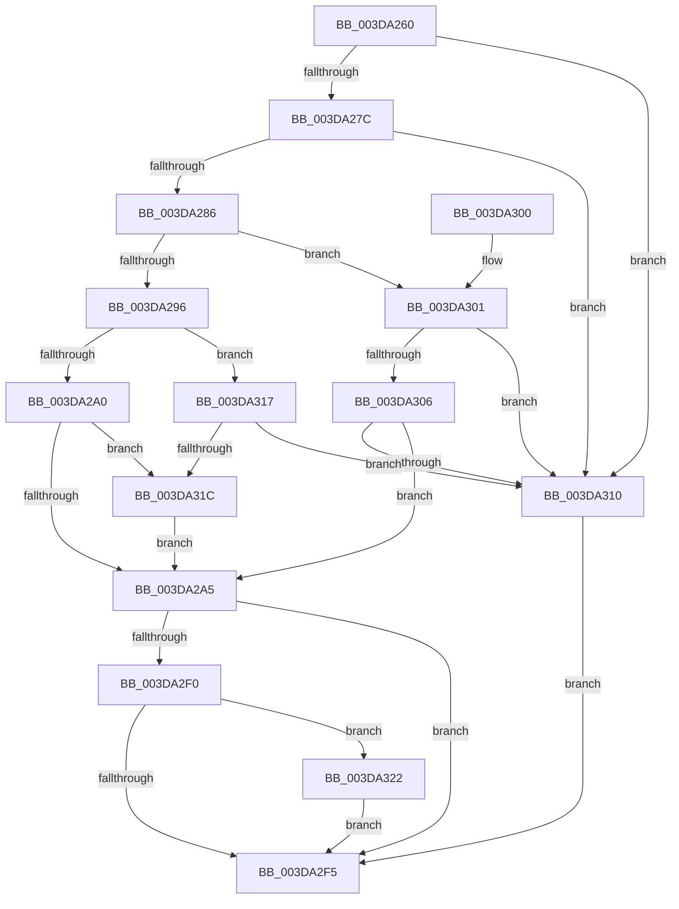

# HalAllocateAdapterChannelEx

- RVA: `0x003DA260`–`0x003DA32E` (길이 `206` bytes)
- VA: `0x00000001403DA260`
- 실행 섹션: `.text`
- PDB 이름 있음: `예`; PDB Function 태그: `아니요`
- unwind 정보 RVA: `0x00093E50`
- 디코드: `58`개 명령, `206/206` bytes 표시
- 미해석 바이트: `0` (있으면 어셈블리에 `.byte`로 보존)

> 이 문서는 커널 이미지의 기계어와 PDB 기호를 분석해 생성했습니다. 4번과 5번은 함수 원형과 자료형을 바이너리 사용 방식에서 추정한 C 해석이며 원본 소스 복구 결과는 아닙니다.

## 1. Dependencies

- 직접 호출 지점: **1**; 고유 호출 대상: **1**
- 직접 호출자로 확인된 함수: **0**
- RIP 상대 이미지 참조: **0**

### Outgoing calls
- `0x003DA2E7` → [HalpAllocateAdapterChannel](HalpAllocateAdapterChannel_function_003DA544.md) (function, `0x003DA544`)

### Direct callers
- 이 함수 시작 RVA로 연결되는 직접 call은 확인되지 않았습니다. 간접 호출은 완전히 역산할 수 없습니다.

### Static image references
- 디코드된 RIP-relative 메모리 참조가 없습니다.

## 2. Other-region calls and transfers

- 다른 실행 섹션으로 향하는 call: **0**
- 별도 외부 분기/꼬리 이동을 확인하지 못했습니다.

## 3. Assembly (complete function range)

```asm
003DA260  48 89 5C 24 08                  mov qword ptr [rsp + 8], rbx
003DA265  57                              push rdi
003DA266  48 83 EC 30                     sub rsp, 0x30
003DA26A  45 8B D9                        mov r11d, r9d
003DA26D  48 8B C2                        mov rax, rdx
003DA270  48 8B F9                        mov rdi, rcx
003DA273  4D 85 C0                        test r8, r8
003DA276  0F 84 94 00 00 00               je 0x1403da310
003DA27C  41 83 38 01                     cmp dword ptr [r8], 1
003DA280  0F 85 8A 00 00 00               jne 0x1403da310
003DA286  44 8B 54 24 60                  mov r10d, dword ptr [rsp + 0x60]
003DA28B  48 8B 4C 24 68                  mov rcx, qword ptr [rsp + 0x68]
003DA290  41 F6 C2 01                     test r10b, 1
003DA294  74 6B                           je 0x1403da301
003DA296  48 8B 5C 24 78                  mov rbx, qword ptr [rsp + 0x78]
003DA29B  48 85 C9                        test rcx, rcx
003DA29E  74 77                           je 0x1403da317
003DA2A0  48 85 DB                        test rbx, rbx
003DA2A3  75 77                           jne 0x1403da31c
003DA2A5  41 83 60 08 00                  and dword ptr [r8 + 8], 0
003DA2AA  49 8D 50 10                     lea rdx, [r8 + 0x10]
003DA2AE  49 83 60 58 00                  and qword ptr [r8 + 0x58], 0
003DA2B3  45 8B C3                        mov r8d, r11d
003DA2B6  48 89 42 30                     mov qword ptr [rdx + 0x30], rax
003DA2BA  48 8B 40 20                     mov rax, qword ptr [rax + 0x20]
003DA2BE  83 4A 14 02                     or dword ptr [rdx + 0x14], 2
003DA2C2  48 89 42 38                     mov qword ptr [rdx + 0x38], rax
003DA2C6  48 8B 44 24 70                  mov rax, qword ptr [rsp + 0x70]
003DA2CB  48 89 4C 24 28                  mov qword ptr [rsp + 0x28], rcx
003DA2D0  48 8B CF                        mov rcx, rdi
003DA2D3  48 89 42 20                     mov qword ptr [rdx + 0x20], rax
003DA2D7  44 8B 8F FC 00 00 00            mov r9d, dword ptr [rdi + 0xfc]
003DA2DE  41 C1 E9 0C                     shr r9d, 0xc
003DA2E2  44 89 54 24 20                  mov dword ptr [rsp + 0x20], r10d
003DA2E7  E8 58 02 00 00                  call 0x1403da544
003DA2EC  85 C0                           test eax, eax
003DA2EE  75 05                           jne 0x1403da2f5
003DA2F0  48 85 DB                        test rbx, rbx
003DA2F3  75 2D                           jne 0x1403da322
003DA2F5  48 8B 5C 24 40                  mov rbx, qword ptr [rsp + 0x40]
003DA2FA  48 83 C4 30                     add rsp, 0x30
003DA2FE  5F                              pop rdi
003DA2FF  C3                              ret
003DA300  CC                              int3
003DA301  48 85 C9                        test rcx, rcx
003DA304  74 0A                           je 0x1403da310
003DA306  48 8B 5C 24 78                  mov rbx, qword ptr [rsp + 0x78]
003DA30B  48 85 DB                        test rbx, rbx
003DA30E  74 95                           je 0x1403da2a5
003DA310  B8 0D 00 00 C0                  mov eax, 0xc000000d
003DA315  EB DE                           jmp 0x1403da2f5
003DA317  48 85 DB                        test rbx, rbx
003DA31A  74 F4                           je 0x1403da310
003DA31C  48 83 23 00                     and qword ptr [rbx], 0
003DA320  EB 83                           jmp 0x1403da2a5
003DA322  48 8B 8F F0 00 00 00            mov rcx, qword ptr [rdi + 0xf0]
003DA329  48 89 0B                        mov qword ptr [rbx], rcx
003DA32C  EB C7                           jmp 0x1403da2f5
```

## 4. C-style interpretation (structured pseudocode)

```c
__int64 __fastcall HalAllocateAdapterChannelEx(__int64 a1, __int64 a2, __int64 a3, int a4, unsigned int a5, __int64 a6, __int64 a7, __int64 a8)
{
    __int64 result;
    __int64 v_rsp;
    unsigned __int64 v_stack_m10;
    unsigned int v_stack_m18;
    unsigned __int64 v_stack_p8;

    v_stack_p8 = v_rbx;
    v_rsp = (v_rsp) - (48);
    if (a3 == 0) goto loc_003DA310;
    if ((*(unsigned int *)(a3)) != 1) goto loc_003DA310;
    if ((((unsigned __int8)((unsigned int)(a5))) & (1)) == 0) goto loc_003DA301;
    if (a6 == 0) goto loc_003DA317;
    if (a8 != 0) goto loc_003DA31C;
loc_003DA2A5:
    *(unsigned __int64 *)(a3 + 16 + 48) = a2;
    *(unsigned __int64 *)(a3 + 16 + 56) = *(unsigned __int64 *)(a2 + 32);
    v_stack_m10 = a6;
    *(unsigned __int64 *)(a3 + 16 + 32) = a7;
    a4 = (unsigned int)(((unsigned int)(*(unsigned int *)(a1 + 252))) >> (12));
    v_stack_m18 = (unsigned int)((unsigned int)(a5));
    result = HalpAllocateAdapterChannel(a1, a3 + 16, (unsigned int)((unsigned int)((unsigned int)(a4))), a4);
    if ((unsigned int)(result) != 0) goto loc_003DA2F5;
    if (a8 != 0) goto loc_003DA322;
loc_003DA2F5:
    v_rsp = (v_rsp) + (48);
    return result;
loc_003DA301:
    if (a1 == 0) goto loc_003DA310;
    if (a8 == 0) goto loc_003DA2A5;
loc_003DA310:
    goto loc_003DA2F5;
loc_003DA317:
    if (a8 == 0) goto loc_003DA310;
loc_003DA31C:
    goto loc_003DA2A5;
loc_003DA322:
    *(unsigned __int64 *)(a8) = *(unsigned __int64 *)(a1 + 240);
    goto loc_003DA2F5;
}
```

## 5. (Beta) C Style

```c
int64_t HalAllocateAdapterChannelEx(void *Arg1, void *Arg2, int64_t Arg3, int32_t Arg4, uint32_t Arg5, int64_t Arg6, int64_t Arg7, int64_t Arg8)
{
    uint8_t *arg1 = (uint8_t *)Arg1;
    uint8_t *arg2 = (uint8_t *)Arg2;

    int64_t result;
    int64_t local_rsp;
    uint64_t v_stack_m10;
    uint32_t v_stack_m18;
    uint64_t v_stack_p8;

    v_stack_p8 = local_rbx;
    local_rsp = (local_rsp) - (48);
    if (Arg3 == 0) goto loc_003DA310;
    if ((*(uint32_t *)(Arg3)) != 1) goto loc_003DA310;
    if ((((uint8_t)((uint32_t)(Arg5))) & (1)) == 0) goto loc_003DA301;
    if (Arg6 == 0) goto loc_003DA317;
    if (Arg8 != 0) goto loc_003DA31C;
loc_003DA2A5:
    *(void **)(Arg3 + 0x10 + 0x30) = Arg2;
    *(uint64_t *)(Arg3 + 0x10 + 0x38) = *(uint64_t *)(arg2 + 0x20);
    v_stack_m10 = Arg6;
    *(uint64_t *)(Arg3 + 0x10 + 0x20) = Arg7;
    Arg4 = (uint32_t)(((uint32_t)(*(uint32_t *)(arg1 + 0xFC))) >> (12));
    v_stack_m18 = (uint32_t)((uint32_t)(Arg5));
    result = HalpAllocateAdapterChannel(Arg1, Arg3 + 16, (uint32_t)((uint32_t)((uint32_t)(Arg4))), Arg4);
    if ((uint32_t)(result) != 0) goto loc_003DA2F5;
    if (Arg8 != 0) goto loc_003DA322;
loc_003DA2F5:
    local_rsp = (local_rsp) + (48);
    return result;
loc_003DA301:
    if (Arg1 == NULL) goto loc_003DA310;
    if (Arg8 == 0) goto loc_003DA2A5;
loc_003DA310:
    goto loc_003DA2F5;
loc_003DA317:
    if (Arg8 == 0) goto loc_003DA310;
loc_003DA31C:
    goto loc_003DA2A5;
loc_003DA322:
    *(uint64_t *)(Arg8) = *(uint64_t *)(arg1 + 0xF0);
    goto loc_003DA2F5;
}
```

### 관측된 메모리 오프셋

구조체 형식이 확인되지 않은 접근은 인자 기준의 오프셋으로만 기록했습니다.

| 기준 인자 | 오프셋 표현 | 폭 (bit) | 접근 |
|---|---:|---:|---|
| `Arg1` | `+ 0xF0` | `64` | `R` |
| `Arg1` | `+ 0xFC` | `32` | `R` |
| `Arg2` | `+ 0x20` | `64` | `R` |

## 6. Execution-region graph

[열기: 2D/3D 그래프와 함수 탐색 컨트롤 패널](../../../control-panel.html?section=text&rva=0x003DA260&view=graph)

- 2D 그래프는 위에서 아래로 흐르고, 3D 그래프는 빈 공간을 드래그해 회전합니다. Shift+드래그는 이동, 휠은 확대·축소, 함수 노드 선택은 대상 보고서 이동입니다.

### Static fallback


