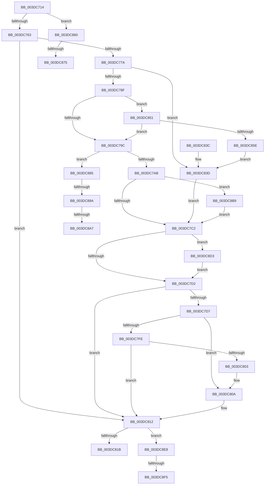

# HalAllocateAdapterChannelV2

- RVA: `0x003DC714`–`0x003DC907` (길이 `499` bytes)
- VA: `0x00000001403DC714`
- 실행 섹션: `.text`
- PDB 이름 있음: `예`; PDB Function 태그: `예`
- unwind 정보 RVA: `0x00094210`
- 디코드: `118`개 명령, `499/499` bytes 표시
- 미해석 바이트: `0` (있으면 어셈블리에 `.byte`로 보존)

> 이 문서는 커널 이미지의 기계어와 PDB 기호를 분석해 생성했습니다. 4번과 5번은 함수 원형과 자료형을 바이너리 사용 방식에서 추정한 C 해석이며 원본 소스 복구 결과는 아닙니다.

## 1. Dependencies

- 직접 호출 지점: **11**; 고유 호출 대상: **8**
- 직접 호출자로 확인된 함수: **2**
- RIP 상대 이미지 참조: **2**

### Outgoing calls
- `0x003DC76D` → [KeInsertDeviceQueue](KeInsertDeviceQueue_function_003DD900.md) (function, `0x003DD900`)
- `0x003DC7AD` → [HalpDmaAllocateMapRegisters](HalpDmaAllocateMapRegisters_function_003DDA0C.md) (function, `0x003DDA0C`)
- `0x003DC7F4` → [guard_dispatch_icall](../6B/guard_dispatch_icall_function_006BAAD0.md) (function, `0x006BAAD0`)
- `0x003DC80D` → [IoFreeAdapterChannelV2](IoFreeAdapterChannelV2_function_003DE3B0.md) (function, `0x003DE3B0`)
- `0x003DC87A` → [KiRaiseIrqlProcessIrqlFlags](../4F/KiRaiseIrqlProcessIrqlFlags_function_004F56FC.md) (function, `0x004F56FC`)
- `0x003DC88C` → [IoFreeAdapterChannelV2](IoFreeAdapterChannelV2_function_003DE3B0.md) (function, `0x003DE3B0`)
- `0x003DC8AE` → [KiLowerIrqlProcessIrqlFlags](../4F/KiLowerIrqlProcessIrqlFlags_function_004F5698.md) (function, `0x004F5698`)
- `0x003DC8BC` → [HalpDmaQueueAdapter](../4E/HalpDmaQueueAdapter_function_004E2B3C.md) (function, `0x004E2B3C`)
- `0x003DC8C9` → [HalpQueueMapBufferWorker](../4A/HalpQueueMapBufferWorker_function_004A7B38.md) (function, `0x004A7B38`)
- `0x003DC8DE` → [guard_dispatch_icall](../6B/guard_dispatch_icall_function_006BAAD0.md) (function, `0x006BAAD0`)
- `0x003DC8FC` → [KiLowerIrqlProcessIrqlFlags](../4F/KiLowerIrqlProcessIrqlFlags_function_004F5698.md) (function, `0x004F5698`)

### Direct callers
- [HalRealAllocateAdapterChannelV2](HalRealAllocateAdapterChannelV2_function_003DC6E0.md) at `0x003DC703`
- [HalAllocateAdapterChannel](../53/HalAllocateAdapterChannel_function_0053F310.md) at `0x0053F358`

### Static image references
- `0x003DC868` → RVA `0x00FC6D20` (`ALMOSTRO`; read)
- `0x003DC8D3` → RVA `0x00FC3E58` (`.data`; read)

## 2. Other-region calls and transfers

- 다른 실행 섹션으로 향하는 call: **0**
- call이 아닌 외부 분기/꼬리 이동: **7**
  - `0x003DC86F` → [sub_006EA098](../6E/Unknown_function_006EA098.md) (`tail-transfer`)
  - `0x003DC880` → [sub_006EA098](../6E/Unknown_function_006EA098.md) (`tail-transfer`)
  - `0x003DC894` → [sub_006EA098 + 0x10](../6E/Unknown_function_006EA098.md) (`tail-transfer`)
  - `0x003DC8A1` → [sub_006EA098 + 0x8](../6E/Unknown_function_006EA098.md) (`tail-transfer`)
  - `0x003DC8B4` → [sub_006EA098 + 0x8](../6E/Unknown_function_006EA098.md) (`tail-transfer`)
  - `0x003DC8EF` → [sub_006EA098 + 0x1A](../6E/Unknown_function_006EA098.md) (`tail-transfer`)
  - `0x003DC902` → [sub_006EA098 + 0x1A](../6E/Unknown_function_006EA098.md) (`tail-transfer`)

## 3. Assembly (complete function range)

```asm
003DC714  48 8B C4                        mov rax, rsp
003DC717  48 89 58 08                     mov qword ptr [rax + 8], rbx
003DC71B  48 89 68 10                     mov qword ptr [rax + 0x10], rbp
003DC71F  48 89 70 18                     mov qword ptr [rax + 0x18], rsi
003DC723  48 89 78 20                     mov qword ptr [rax + 0x20], rdi
003DC727  41 54                           push r12
003DC729  41 56                           push r14
003DC72B  41 57                           push r15
003DC72D  48 83 EC 30                     sub rsp, 0x30
003DC731  83 62 14 FB                     and dword ptr [rdx + 0x14], 0xfffffffb
003DC735  45 32 FF                        xor r15b, r15b
003DC738  45 32 F6                        xor r14b, r14b
003DC73B  4C 89 4A 18                     mov qword ptr [rdx + 0x18], r9
003DC73F  40 32 FF                        xor dil, dil
003DC742  44 89 42 28                     mov dword ptr [rdx + 0x28], r8d
003DC746  4D 8B E1                        mov r12, r9
003DC749  41 8B E8                        mov ebp, r8d
003DC74C  48 8B F2                        mov rsi, rdx
003DC74F  48 8B D9                        mov rbx, rcx
003DC752  44 0F 20 C0                     mov rax, cr8
003DC756  B9 02 00 00 00                  mov ecx, 2
003DC75B  3A C1                           cmp al, cl
003DC75D  0F 82 FD 00 00 00               jb 0x1403dc860
003DC763  48 8D 8B B8 00 00 00            lea rcx, [rbx + 0xb8]
003DC76A  48 8B D6                        mov rdx, rsi
003DC76D  E8 8E 11 00 00                  call 0x1403dd900
003DC772  84 C0                           test al, al
003DC774  0F 85 98 00 00 00               jne 0x1403dc812
003DC77A  89 AB F8 00 00 00               mov dword ptr [rbx + 0xf8], ebp
003DC780  48 89 B3 60 01 00 00            mov qword ptr [rbx + 0x160], rsi
003DC787  85 ED                           test ebp, ebp
003DC789  0F 84 AE 00 00 00               je 0x1403dc83d
003DC78F  44 38 BB B8 01 00 00            cmp byte ptr [rbx + 0x1b8], r15b
003DC796  0F 84 B5 00 00 00               je 0x1403dc851
003DC79C  48 8B CB                        mov rcx, rbx
003DC79F  3B AB E8 00 00 00               cmp ebp, dword ptr [rbx + 0xe8]
003DC7A5  0F 87 DA 00 00 00               ja 0x1403dc885
003DC7AB  8B D5                           mov edx, ebp
003DC7AD  E8 5A 12 00 00                  call 0x1403dda0c
003DC7B2  48 89 83 F0 00 00 00            mov qword ptr [rbx + 0xf0], rax
003DC7B9  48 85 C0                        test rax, rax
003DC7BC  0F 84 F7 00 00 00               je 0x1403dc8b9
003DC7C2  48 8B 8B B0 01 00 00            mov rcx, qword ptr [rbx + 0x1b0]
003DC7C9  48 85 C9                        test rcx, rcx
003DC7CC  0F 85 01 01 00 00               jne 0x1403dc8d3
003DC7D2  45 84 FF                        test r15b, r15b
003DC7D5  75 3B                           jne 0x1403dc812
003DC7D7  4C 8B 83 F0 00 00 00            mov r8, qword ptr [rbx + 0xf0]
003DC7DE  49 8B C4                        mov rax, r12
003DC7E1  48 89 B3 60 01 00 00            mov qword ptr [rbx + 0x160], rsi
003DC7E8  4C 8B 4E 20                     mov r9, qword ptr [rsi + 0x20]
003DC7EC  48 8B 56 38                     mov rdx, qword ptr [rsi + 0x38]
003DC7F0  48 8B 4E 30                     mov rcx, qword ptr [rsi + 0x30]
003DC7F4  E8 D7 E2 2D 00                  call 0x1406baad0
003DC7F9  83 F8 02                        cmp eax, 2
003DC7FC  74 0C                           je 0x1403dc80a
003DC7FE  83 F8 03                        cmp eax, 3
003DC801  75 0F                           jne 0x1403dc812
003DC803  83 A3 F8 00 00 00 00            and dword ptr [rbx + 0xf8], 0
003DC80A  48 8B CB                        mov rcx, rbx
003DC80D  E8 9E 1B 00 00                  call 0x1403de3b0
003DC812  45 84 F6                        test r14b, r14b
003DC815  0F 85 CD 00 00 00               jne 0x1403dc8e8
003DC81B  33 C0                           xor eax, eax
003DC81D  48 8B 5C 24 50                  mov rbx, qword ptr [rsp + 0x50]
003DC822  48 8B 6C 24 58                  mov rbp, qword ptr [rsp + 0x58]
003DC827  48 8B 74 24 60                  mov rsi, qword ptr [rsp + 0x60]
003DC82C  48 8B 7C 24 68                  mov rdi, qword ptr [rsp + 0x68]
003DC831  48 83 C4 30                     add rsp, 0x30
003DC835  41 5F                           pop r15
003DC837  41 5E                           pop r14
003DC839  41 5C                           pop r12
003DC83B  C3                              ret
003DC83C  CC                              int3
003DC83D  48 83 A3 F0 00 00 00 00         and qword ptr [rbx + 0xf0], 0
003DC845  83 A3 F8 00 00 00 00            and dword ptr [rbx + 0xf8], 0
003DC84C  E9 71 FF FF FF                  jmp 0x1403dc7c2
003DC851  44 38 BB BD 01 00 00            cmp byte ptr [rbx + 0x1bd], r15b
003DC858  0F 84 3E FF FF FF               je 0x1403dc79c
003DC85E  EB DD                           jmp 0x1403dc83d
003DC860  44 0F 20 C7                     mov rdi, cr8
003DC864  44 0F 22 C1                     mov cr8, rcx
003DC868  83 3D B1 A4 BE 00 00            cmp dword ptr [rip + 0xbea4b1], 0
003DC86F  0F 84 23 D8 30 00               je 0x1406ea098
003DC875  8A D1                           mov dl, cl
003DC877  40 8A CF                        mov cl, dil
003DC87A  E8 7D 8E 11 00                  call 0x1404f56fc
003DC87F  90                              nop
003DC880  E9 13 D8 30 00                  jmp 0x1406ea098
003DC885  83 A3 F8 00 00 00 00            and dword ptr [rbx + 0xf8], 0
003DC88C  E8 1F 1B 00 00                  call 0x1403de3b0
003DC891  45 84 F6                        test r14b, r14b
003DC894  0F 84 0E D8 30 00               je 0x1406ea0a8
003DC89A  83 3D 7F A4 BE 00 00            cmp dword ptr [rip + 0xbea47f], 0
003DC8A1  0F 84 F9 D7 30 00               je 0x1406ea0a0
003DC8A7  44 0F 20 C1                     mov rcx, cr8
003DC8AB  40 8A D7                        mov dl, dil
003DC8AE  E8 E5 8D 11 00                  call 0x1404f5698
003DC8B3  90                              nop
003DC8B4  E9 E7 D7 30 00                  jmp 0x1406ea0a0
003DC8B9  48 8B CB                        mov rcx, rbx
003DC8BC  E8 7B 62 10 00                  call 0x1404e2b3c
003DC8C1  8B D5                           mov edx, ebp
003DC8C3  48 8B CB                        mov rcx, rbx
003DC8C6  41 B7 01                        mov r15b, 1
003DC8C9  E8 6A B2 0C 00                  call 0x1404a7b38
003DC8CE  E9 EF FE FF FF                  jmp 0x1403dc7c2
003DC8D3  48 8B 05 7E 75 BE 00            mov rax, qword ptr [rip + 0xbe757e]
003DC8DA  48 8B 40 20                     mov rax, qword ptr [rax + 0x20]
003DC8DE  E8 ED E1 2D 00                  call 0x1406baad0
003DC8E3  E9 EA FE FF FF                  jmp 0x1403dc7d2
003DC8E8  83 3D 31 A4 BE 00 00            cmp dword ptr [rip + 0xbea431], 0
003DC8EF  0F 84 BD D7 30 00               je 0x1406ea0b2
003DC8F5  44 0F 20 C1                     mov rcx, cr8
003DC8F9  40 8A D7                        mov dl, dil
003DC8FC  E8 97 8D 11 00                  call 0x1404f5698
003DC901  90                              nop
003DC902  E9 AB D7 30 00                  jmp 0x1406ea0b2
```

## 4. C-style interpretation (structured pseudocode)

```c
__int64 __fastcall HalAllocateAdapterChannelV2(__int64 a1, __int64 a2, int a3, __int64 a4)
{
    __int64 result;
    __int64 v_r14;
    __int64 v_r15;
    __int64 v_rdi;
    __int64 v_rsp;
    unsigned __int64 v_stack_p10;
    unsigned __int64 v_stack_p18;
    unsigned __int64 v_stack_p20;
    unsigned __int64 v_stack_p8;

    *(unsigned __int64 *)(v_rsp + 8) = v_rbx;
    *(unsigned __int64 *)(v_rsp + 16) = v_rbp;
    *(unsigned __int64 *)(v_rsp + 24) = v_rsi;
    *(unsigned __int64 *)(v_rsp + 32) = v_rdi;
    v_rsp = (v_rsp) - (48);
    v_r15 = 0;
    v_r14 = 0;
    *(unsigned __int64 *)(a2 + 24) = a4;
    v_rdi = 0;
    *(unsigned int *)(a2 + 40) = a3;
    if (((unsigned __int8)(v_cr8)) < 2) goto loc_003DC860;
    result = KeInsertDeviceQueue(a1 + 184, a2, a3, a4);
    if ((unsigned __int8)(result) != 0) goto loc_003DC812;
    *(unsigned int *)(a1 + 248) = (unsigned int)((unsigned int)(a3));
    *(unsigned __int64 *)(a1 + 352) = a2;
    if ((unsigned int)((unsigned int)(a3)) == 0) goto loc_003DC83D;
    if ((*(unsigned __int8 *)(a1 + 440)) == 0) goto loc_003DC851;
loc_003DC79C:
    if (((unsigned int)((unsigned int)(a3))) > (*(unsigned int *)(a1 + 232))) goto loc_003DC885;
    result = HalpDmaAllocateMapRegisters(a1, (unsigned int)((unsigned int)((unsigned int)(a3))), a3, a4);
    *(unsigned __int64 *)(a1 + 240) = result;
    if (result == 0) goto loc_003DC8B9;
loc_003DC7C2:
    if (*(unsigned __int64 *)(a1 + 432) != 0) goto loc_003DC8D3;
loc_003DC7D2:
    if (0 != 0) goto loc_003DC812;
    *(unsigned __int64 *)(a1 + 352) = a2;
    result = guard_dispatch_icall(*(unsigned __int64 *)(a2 + 48), *(unsigned __int64 *)(a2 + 56), *(unsigned __int64 *)(a1 + 240), *(unsigned __int64 *)(a2 + 32));
    if (((unsigned int)(result)) == 2) goto loc_003DC80A;
    if (((unsigned int)(result)) != 3) goto loc_003DC812;
loc_003DC80A:
    result = IoFreeAdapterChannelV2(a1, *(unsigned __int64 *)(a2 + 56), *(unsigned __int64 *)(a1 + 240), *(unsigned __int64 *)(a2 + 32));
loc_003DC812:
    if (0 != 0) goto loc_003DC8E8;
    result = 0;
    v_rsp = (v_rsp) + (48);
    return result;
loc_003DC83D:
    goto loc_003DC7C2;
loc_003DC851:
    if ((*(unsigned __int8 *)(v_stack_p8 + 445)) == 0) goto loc_003DC79C;
    goto loc_003DC83D;
loc_003DC860:
    result = KiRaiseIrqlProcessIrqlFlags((unsigned __int8)(v_cr8), (unsigned __int8)(a1), *(unsigned __int64 *)(a1 + 240), *(unsigned __int64 *)(a2 + 32));
loc_003DC885:
    result = IoFreeAdapterChannelV2((unsigned __int8)(v_cr8), (unsigned __int8)(a1), *(unsigned __int64 *)(a1 + 240), *(unsigned __int64 *)(a2 + 32));
    result = KiLowerIrqlProcessIrqlFlags(a1, (unsigned __int8)(v_cr8), *(unsigned __int64 *)(a1 + 240), *(unsigned __int64 *)(a2 + 32));
loc_003DC8B9:
    result = HalpDmaQueueAdapter(v_stack_p8, (unsigned __int8)(v_cr8), *(unsigned __int64 *)(a1 + 240), *(unsigned __int64 *)(a2 + 32));
    result = HalpQueueMapBufferWorker(v_stack_p8, (unsigned int)((unsigned int)(v_stack_p10)), *(unsigned __int64 *)(a1 + 240), *(unsigned __int64 *)(a2 + 32));
    goto loc_003DC7C2;
loc_003DC8D3:
    result = guard_dispatch_icall(v_stack_p8, (unsigned int)((unsigned int)(v_stack_p10)), *(unsigned __int64 *)(a1 + 240), *(unsigned __int64 *)(a2 + 32));
    goto loc_003DC7D2;
loc_003DC8E8:
    result = KiLowerIrqlProcessIrqlFlags(a1, (unsigned __int8)(v_cr8), *(unsigned __int64 *)(a1 + 240), *(unsigned __int64 *)(a2 + 32));
}
```

## 5. (Beta) C Style

```c
int64_t HalAllocateAdapterChannelV2(void *Arg1, void *Arg2, int32_t Arg3, int64_t Arg4)
{
    uint8_t *arg1 = (uint8_t *)Arg1;
    uint8_t *arg2 = (uint8_t *)Arg2;

    int64_t result;
    int64_t local_r14;
    int64_t local_r15;
    int64_t local_rdi;
    int64_t local_rsp;
    uint64_t v_stack_p10;
    uint64_t v_stack_p18;
    uint64_t v_stack_p20;
    uint64_t v_stack_p8;

    *(uint64_t *)(local_rsp + 0x8) = local_rbx;
    *(uint64_t *)(local_rsp + 0x10) = local_rbp;
    *(uint64_t *)(local_rsp + 0x18) = local_rsi;
    *(uint64_t *)(local_rsp + 0x20) = local_rdi;
    local_rsp = (local_rsp) - (48);
    local_r15 = 0;
    local_r14 = 0;
    *(uint64_t *)(arg2 + 0x18) = Arg4;
    local_rdi = 0;
    *(uint32_t *)(arg2 + 0x28) = Arg3;
    if (((uint8_t)(v_cr8)) < 2) goto loc_003DC860;
    result = KeInsertDeviceQueue(Arg1 + 184, Arg2, Arg3, Arg4);
    if ((uint8_t)(result) != 0) goto loc_003DC812;
    *(uint32_t *)(arg1 + 0xF8) = (uint32_t)((uint32_t)(Arg3));
    *(void **)(arg1 + 0x160) = Arg2;
    if ((uint32_t)((uint32_t)(Arg3)) == 0) goto loc_003DC83D;
    if ((*(uint8_t *)(arg1 + 0x1B8)) == 0) goto loc_003DC851;
loc_003DC79C:
    if (((uint32_t)((uint32_t)(Arg3))) > (*(uint32_t *)(arg1 + 0xE8))) goto loc_003DC885;
    result = HalpDmaAllocateMapRegisters(Arg1, (uint32_t)((uint32_t)((uint32_t)(Arg3))), Arg3, Arg4);
    *(uint64_t *)(arg1 + 0xF0) = result;
    if (result == 0) goto loc_003DC8B9;
loc_003DC7C2:
    if (*(uint64_t *)(arg1 + 0x1B0) != 0) goto loc_003DC8D3;
loc_003DC7D2:
    if (0 != 0) goto loc_003DC812;
    *(void **)(arg1 + 0x160) = Arg2;
    result = guard_dispatch_icall(*(uint64_t *)(arg2 + 0x30), *(uint64_t *)(arg2 + 0x38), *(uint64_t *)(arg1 + 0xF0), *(uint64_t *)(arg2 + 0x20));
    if (((uint32_t)(result)) == 2) goto loc_003DC80A;
    if (((uint32_t)(result)) != 3) goto loc_003DC812;
loc_003DC80A:
    result = IoFreeAdapterChannelV2(Arg1, *(uint64_t *)(arg2 + 0x38), *(uint64_t *)(arg1 + 0xF0), *(uint64_t *)(arg2 + 0x20));
loc_003DC812:
    if (0 != 0) goto loc_003DC8E8;
    result = 0;
    local_rsp = (local_rsp) + (48);
    return result;
loc_003DC83D:
    goto loc_003DC7C2;
loc_003DC851:
    if ((*(uint8_t *)(v_stack_p8 + 0x1BD)) == 0) goto loc_003DC79C;
    goto loc_003DC83D;
loc_003DC860:
    result = KiRaiseIrqlProcessIrqlFlags((uint8_t)(v_cr8), (uint8_t)(Arg1), *(uint64_t *)(arg1 + 0xF0), *(uint64_t *)(arg2 + 0x20));
loc_003DC885:
    result = IoFreeAdapterChannelV2((uint8_t)(v_cr8), (uint8_t)(Arg1), *(uint64_t *)(arg1 + 0xF0), *(uint64_t *)(arg2 + 0x20));
    result = KiLowerIrqlProcessIrqlFlags(Arg1, (uint8_t)(v_cr8), *(uint64_t *)(arg1 + 0xF0), *(uint64_t *)(arg2 + 0x20));
loc_003DC8B9:
    result = HalpDmaQueueAdapter(v_stack_p8, (uint8_t)(v_cr8), *(uint64_t *)(arg1 + 0xF0), *(uint64_t *)(arg2 + 0x20));
    result = HalpQueueMapBufferWorker(v_stack_p8, (uint32_t)((uint32_t)(v_stack_p10)), *(uint64_t *)(arg1 + 0xF0), *(uint64_t *)(arg2 + 0x20));
    goto loc_003DC7C2;
loc_003DC8D3:
    result = guard_dispatch_icall(v_stack_p8, (uint32_t)((uint32_t)(v_stack_p10)), *(uint64_t *)(arg1 + 0xF0), *(uint64_t *)(arg2 + 0x20));
    goto loc_003DC7D2;
loc_003DC8E8:
    result = KiLowerIrqlProcessIrqlFlags(Arg1, (uint8_t)(v_cr8), *(uint64_t *)(arg1 + 0xF0), *(uint64_t *)(arg2 + 0x20));
}
```

### 관측된 메모리 오프셋

구조체 형식이 확인되지 않은 접근은 인자 기준의 오프셋으로만 기록했습니다.

| 기준 인자 | 오프셋 표현 | 폭 (bit) | 접근 |
|---|---:|---:|---|
| `Arg1` | `+ 0xB8` | `64` | `R` |
| `Arg1` | `+ 0xE8` | `32` | `R` |
| `Arg1` | `+ 0xF0` | `64` | `R` |
| `Arg1` | `+ 0xF0` | `64` | `R/W` |
| `Arg1` | `+ 0xF0` | `64` | `W` |
| `Arg1` | `+ 0xF8` | `32` | `R/W` |
| `Arg1` | `+ 0xF8` | `32` | `W` |
| `Arg1` | `+ 0x160` | `64` | `W` |
| `Arg1` | `+ 0x1B0` | `64` | `R` |
| `Arg1` | `+ 0x1B8` | `8` | `R` |
| `Arg1` | `+ 0x1BD` | `8` | `R` |
| `Arg2` | `+ 0x14` | `32` | `R/W` |
| `Arg2` | `+ 0x18` | `64` | `W` |
| `Arg2` | `+ 0x20` | `64` | `R` |
| `Arg2` | `+ 0x28` | `32` | `W` |
| `Arg2` | `+ 0x30` | `64` | `R` |
| `Arg2` | `+ 0x38` | `64` | `R` |

## 6. Execution-region graph

[열기: 2D/3D 그래프와 함수 탐색 컨트롤 패널](../../../control-panel.html?section=text&rva=0x003DC714&view=graph)

- 2D 그래프는 위에서 아래로 흐르고, 3D 그래프는 빈 공간을 드래그해 회전합니다. Shift+드래그는 이동, 휠은 확대·축소, 함수 노드 선택은 대상 보고서 이동입니다.

### Static fallback


