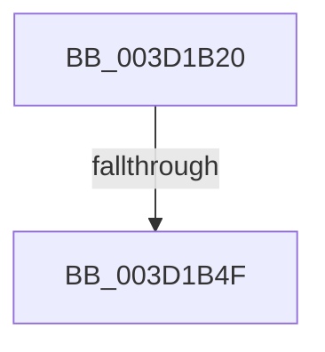

# HalBuildScatterGatherListDmaThin

- RVA: `0x003D1B20`–`0x003D1B58` (길이 `56` bytes)
- VA: `0x00000001403D1B20`
- 실행 섹션: `.text`
- PDB 이름 있음: `예`; PDB Function 태그: `아니요`
- unwind 정보 RVA: `0x000911EC`
- 디코드: `16`개 명령, `56/56` bytes 표시
- 미해석 바이트: `0` (있으면 어셈블리에 `.byte`로 보존)

> 이 문서는 커널 이미지의 기계어와 PDB 기호를 분석해 생성했습니다. 4번과 5번은 함수 원형과 자료형을 바이너리 사용 방식에서 추정한 C 해석이며 원본 소스 복구 결과는 아닙니다.

## 1. Dependencies

- 직접 호출 지점: **0**; 고유 호출 대상: **0**
- 직접 호출자로 확인된 함수: **0**
- RIP 상대 이미지 참조: **0**

### Outgoing calls
- 직접 디코드된 call 명령이 없습니다.

### Direct callers
- 이 함수 시작 RVA로 연결되는 직접 call은 확인되지 않았습니다. 간접 호출은 완전히 역산할 수 없습니다.

### Static image references
- 디코드된 RIP-relative 메모리 참조가 없습니다.

## 2. Other-region calls and transfers

- 다른 실행 섹션으로 향하는 call: **0**
- call이 아닌 외부 분기/꼬리 이동: **2**
  - `0x003D1B49` → [sub_003D1E31](Unknown_function_003D1E31.md) (`tail-transfer`)
  - `0x003D1B52` → [sub_003D1DD8](Unknown_function_003D1DD8.md) (`tail-transfer`)

## 3. Assembly (complete function range)

```asm
003D1B20  48 89 54 24 10                  mov qword ptr [rsp + 0x10], rdx
003D1B25  48 89 4C 24 08                  mov qword ptr [rsp + 8], rcx
003D1B2A  53                              push rbx
003D1B2B  57                              push rdi
003D1B2C  48 83 EC 58                     sub rsp, 0x58
003D1B30  49 8B D8                        mov rbx, r8
003D1B33  49 8B F9                        mov rdi, r9
003D1B36  4C 8B C2                        mov r8, rdx
003D1B39  8B 43 2C                        mov eax, dword ptr [rbx + 0x2c]
003D1B3C  48 2B F8                        sub rdi, rax
003D1B3F  48 2B 7B 20                     sub rdi, qword ptr [rbx + 0x20]
003D1B43  8B 43 28                        mov eax, dword ptr [rbx + 0x28]
003D1B46  48 3B F8                        cmp rdi, rax
003D1B49  0F 83 E2 02 00 00               jae 0x1403d1e31
003D1B4F  48 85 DB                        test rbx, rbx
003D1B52  0F 84 80 02 00 00               je 0x1403d1dd8
```

## 4. C-style interpretation (structured pseudocode)

```c
__int64 __fastcall HalBuildScatterGatherListDmaThin(__int64 a1, __int64 a2, __int64 a3, __int64 a4)
{
    __int64 v_rdi;
    __int64 v_rsp;
    unsigned __int64 v_stack_p10;
    unsigned __int64 v_stack_p8;

    v_stack_p10 = a2;
    v_stack_p8 = a1;
    v_rsp = (v_rsp) - (88);
    v_rdi = (a4) - ((unsigned int)(*(unsigned int *)(a3 + 44)));
    v_rdi = (v_rdi) - (*(unsigned __int64 *)(a3 + 32));
}
```

## 5. (Beta) C Style

```c
int64_t HalBuildScatterGatherListDmaThin(int64_t Arg1, int64_t Arg2, void *Arg3, int64_t Arg4)
{
    uint8_t *arg3 = (uint8_t *)Arg3;

    int64_t local_rdi;
    int64_t local_rsp;
    uint64_t v_stack_p10;
    uint64_t v_stack_p8;

    v_stack_p10 = Arg2;
    v_stack_p8 = Arg1;
    local_rsp = (local_rsp) - (88);
    local_rdi = (Arg4) - ((uint32_t)(*(uint32_t *)(arg3 + 0x2C)));
    local_rdi = (local_rdi) - (*(uint64_t *)(arg3 + 0x20));
}
```

### 관측된 메모리 오프셋

구조체 형식이 확인되지 않은 접근은 인자 기준의 오프셋으로만 기록했습니다.

| 기준 인자 | 오프셋 표현 | 폭 (bit) | 접근 |
|---|---:|---:|---|
| `Arg3` | `+ 0x20` | `64` | `R` |
| `Arg3` | `+ 0x28` | `32` | `R` |
| `Arg3` | `+ 0x2C` | `32` | `R` |

## 6. Execution-region graph

[열기: 2D/3D 그래프와 함수 탐색 컨트롤 패널](../../../control-panel.html?section=text&rva=0x003D1B20&view=graph)

- 2D 그래프는 위에서 아래로 흐르고, 3D 그래프는 빈 공간을 드래그해 회전합니다. Shift+드래그는 이동, 휠은 확대·축소, 함수 노드 선택은 대상 보고서 이동입니다.

### Static fallback


