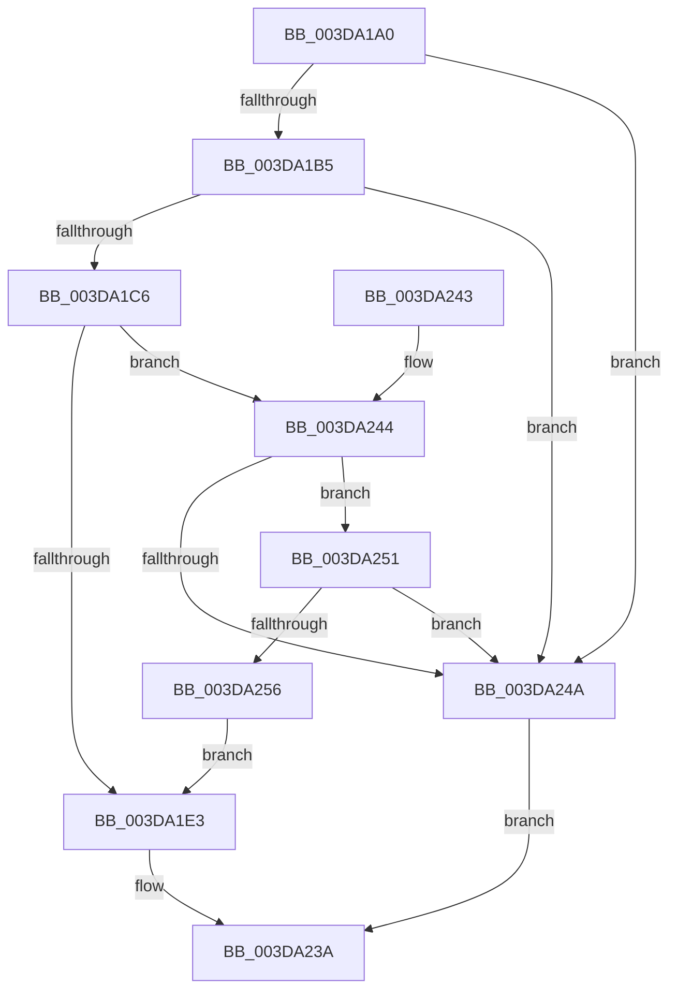

# HalBuildScatterGatherListEx

- RVA: `0x003DA1A0`–`0x003DA258` (길이 `184` bytes)
- VA: `0x00000001403DA1A0`
- 실행 섹션: `.text`
- PDB 이름 있음: `예`; PDB Function 태그: `아니요`
- unwind 정보 RVA: `0x00093E44`
- 디코드: `40`개 명령, `184/184` bytes 표시
- 미해석 바이트: `0` (있으면 어셈블리에 `.byte`로 보존)

> 이 문서는 커널 이미지의 기계어와 PDB 기호를 분석해 생성했습니다. 4번과 5번은 함수 원형과 자료형을 바이너리 사용 방식에서 추정한 C 해석이며 원본 소스 복구 결과는 아닙니다.

## 1. Dependencies

- 직접 호출 지점: **1**; 고유 호출 대상: **1**
- 직접 호출자로 확인된 함수: **0**
- RIP 상대 이미지 참조: **0**

### Outgoing calls
- `0x003DA235` → [HalpBuildScatterGatherList](HalpBuildScatterGatherList_function_003DBAF8.md) (function, `0x003DBAF8`)

### Direct callers
- 이 함수 시작 RVA로 연결되는 직접 call은 확인되지 않았습니다. 간접 호출은 완전히 역산할 수 없습니다.

### Static image references
- 디코드된 RIP-relative 메모리 참조가 없습니다.

## 2. Other-region calls and transfers

- 다른 실행 섹션으로 향하는 call: **0**
- 별도 외부 분기/꼬리 이동을 확인하지 못했습니다.

## 3. Assembly (complete function range)

```asm
003DA1A0  40 53                           push rbx
003DA1A2  48 81 EC 80 00 00 00            sub rsp, 0x80
003DA1A9  49 8B D9                        mov rbx, r9
003DA1AC  4D 85 C0                        test r8, r8
003DA1AF  0F 84 95 00 00 00               je 0x1403da24a
003DA1B5  4C 8B 94 24 E0 00 00 00         mov r10, qword ptr [rsp + 0xe0]
003DA1BD  4D 85 D2                        test r10, r10
003DA1C0  0F 84 84 00 00 00               je 0x1403da24a
003DA1C6  4C 8B 8C 24 C8 00 00 00         mov r9, qword ptr [rsp + 0xc8]
003DA1CE  48 8B 84 24 00 01 00 00         mov rax, qword ptr [rsp + 0x100]
003DA1D6  44 8B 9C 24 C0 00 00 00         mov r11d, dword ptr [rsp + 0xc0]
003DA1DE  4D 85 C9                        test r9, r9
003DA1E1  74 61                           je 0x1403da244
003DA1E3  48 89 44 24 70                  mov qword ptr [rsp + 0x70], rax
003DA1E8  8B 84 24 E8 00 00 00            mov eax, dword ptr [rsp + 0xe8]
003DA1EF  89 44 24 58                     mov dword ptr [rsp + 0x58], eax
003DA1F3  8A 84 24 D8 00 00 00            mov al, byte ptr [rsp + 0xd8]
003DA1FA  4C 89 54 24 50                  mov qword ptr [rsp + 0x50], r10
003DA1FF  88 44 24 48                     mov byte ptr [rsp + 0x48], al
003DA203  48 8B 84 24 D0 00 00 00         mov rax, qword ptr [rsp + 0xd0]
003DA20B  48 89 44 24 40                  mov qword ptr [rsp + 0x40], rax
003DA210  8B 84 24 B8 00 00 00            mov eax, dword ptr [rsp + 0xb8]
003DA217  4C 89 4C 24 38                  mov qword ptr [rsp + 0x38], r9
003DA21C  4C 8B CB                        mov r9, rbx
003DA21F  44 89 5C 24 30                  mov dword ptr [rsp + 0x30], r11d
003DA224  89 44 24 28                     mov dword ptr [rsp + 0x28], eax
003DA228  48 8B 84 24 B0 00 00 00         mov rax, qword ptr [rsp + 0xb0]
003DA230  48 89 44 24 20                  mov qword ptr [rsp + 0x20], rax
003DA235  E8 BE 18 00 00                  call 0x1403dbaf8
003DA23A  48 81 C4 80 00 00 00            add rsp, 0x80
003DA241  5B                              pop rbx
003DA242  C3                              ret
003DA243  CC                              int3
003DA244  41 F6 C3 01                     test r11b, 1
003DA248  75 07                           jne 0x1403da251
003DA24A  B8 0D 00 00 C0                  mov eax, 0xc000000d
003DA24F  EB E9                           jmp 0x1403da23a
003DA251  48 85 C0                        test rax, rax
003DA254  74 F4                           je 0x1403da24a
003DA256  EB 8B                           jmp 0x1403da1e3
```

## 4. C-style interpretation (structured pseudocode)

```c
__int64 __fastcall HalBuildScatterGatherListEx(__int64 a1, __int64 a2, __int64 a3, __int64 a4, __int64 a5, unsigned int a6, unsigned int a7, __int64 a8, __int64 a9, unsigned __int8 a10, __int64 a11, unsigned int a12, __int64 a13, __int64 a14, __int64 a15)
{
    __int64 result;
    __int64 v_rsp;
    unsigned __int64 v_stack_m18;
    unsigned int v_stack_m30;
    unsigned __int64 v_stack_m38;
    unsigned __int8 v_stack_m40;
    unsigned __int64 v_stack_m48;
    unsigned __int64 v_stack_m50;
    unsigned int v_stack_m58;
    unsigned int v_stack_m60;
    unsigned __int64 v_stack_m68;

    v_rsp = (v_rsp) - (128);
    if (a3 == 0) goto loc_003DA24A;
    if (a11 == 0) goto loc_003DA24A;
    if (a8 == 0) goto loc_003DA244;
loc_003DA1E3:
    v_stack_m18 = a15;
    v_stack_m30 = (unsigned int)((unsigned int)(a12));
    v_stack_m38 = a11;
    v_stack_m40 = a10;
    v_stack_m48 = a9;
    v_stack_m50 = a8;
    v_stack_m58 = (unsigned int)((unsigned int)(a7));
    v_stack_m60 = (unsigned int)((unsigned int)(a6));
    v_stack_m68 = a5;
    result = HalpBuildScatterGatherList(a1, a2, a3, a4);
loc_003DA23A:
    v_rsp = (v_rsp) + (128);
    return result;
loc_003DA244:
    if ((((unsigned __int8)((unsigned int)(a7))) & (1)) != 0) goto loc_003DA251;
loc_003DA24A:
    goto loc_003DA23A;
loc_003DA251:
    if ((unsigned int)(0xC000000DULL) == 0) goto loc_003DA24A;
    goto loc_003DA1E3;
}
```

## 5. (Beta) C Style

```c
int64_t HalBuildScatterGatherListEx(int64_t Arg1, int64_t Arg2, int64_t Arg3, int64_t Arg4, int64_t Arg5, uint32_t Arg6, uint32_t Arg7, int64_t Arg8, int64_t Arg9, uint8_t Arg10, int64_t Arg11, uint32_t Arg12, uint64_t Arg13, uint64_t Arg14, int64_t Arg15)
{
    int64_t result;
    int64_t local_rsp;
    uint64_t v_stack_m18;
    uint32_t v_stack_m30;
    uint64_t v_stack_m38;
    uint8_t v_stack_m40;
    uint64_t v_stack_m48;
    uint64_t v_stack_m50;
    uint32_t v_stack_m58;
    uint32_t v_stack_m60;
    uint64_t v_stack_m68;

    local_rsp = (local_rsp) - (128);
    if (Arg3 == 0) goto loc_003DA24A;
    if (Arg11 == 0) goto loc_003DA24A;
    if (Arg8 == 0) goto loc_003DA244;
loc_003DA1E3:
    v_stack_m18 = Arg15;
    v_stack_m30 = (uint32_t)((uint32_t)(Arg12));
    v_stack_m38 = Arg11;
    v_stack_m40 = Arg10;
    v_stack_m48 = Arg9;
    v_stack_m50 = Arg8;
    v_stack_m58 = (uint32_t)((uint32_t)(Arg7));
    v_stack_m60 = (uint32_t)((uint32_t)(Arg6));
    v_stack_m68 = Arg5;
    result = HalpBuildScatterGatherList(Arg1, Arg2, Arg3, Arg4);
loc_003DA23A:
    local_rsp = (local_rsp) + (128);
    return result;
loc_003DA244:
    if ((((uint8_t)((uint32_t)(Arg7))) & (1)) != 0) goto loc_003DA251;
loc_003DA24A:
    goto loc_003DA23A;
loc_003DA251:
    if ((uint32_t)(0xC000000DULL) == 0) goto loc_003DA24A;
    goto loc_003DA1E3;
}
```

## 6. Execution-region graph

[열기: 2D/3D 그래프와 함수 탐색 컨트롤 패널](../../../control-panel.html?section=text&rva=0x003DA1A0&view=graph)

- 2D 그래프는 위에서 아래로 흐르고, 3D 그래프는 빈 공간을 드래그해 회전합니다. Shift+드래그는 이동, 휠은 확대·축소, 함수 노드 선택은 대상 보고서 이동입니다.

### Static fallback


