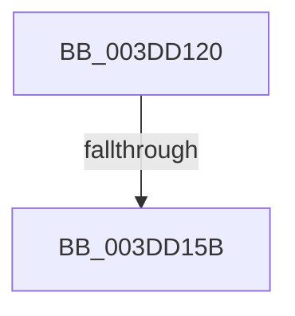

# HalBuildScatterGatherListV2

- RVA: `0x003DD120`–`0x003DD15F` (길이 `63` bytes)
- VA: `0x00000001403DD120`
- 실행 섹션: `.text`
- PDB 이름 있음: `예`; PDB Function 태그: `예`
- unwind 정보 RVA: `0x000942BC`
- 디코드: `20`개 명령, `63/63` bytes 표시
- 미해석 바이트: `0` (있으면 어셈블리에 `.byte`로 보존)

> 이 문서는 커널 이미지의 기계어와 PDB 기호를 분석해 생성했습니다. 4번과 5번은 함수 원형과 자료형을 바이너리 사용 방식에서 추정한 C 해석이며 원본 소스 복구 결과는 아닙니다.

## 1. Dependencies

- 직접 호출 지점: **0**; 고유 호출 대상: **0**
- 직접 호출자로 확인된 함수: **1**
- RIP 상대 이미지 참조: **0**

### Outgoing calls
- 직접 디코드된 call 명령이 없습니다.

### Direct callers
- [HalGetScatterGatherList](HalGetScatterGatherList_function_003DFAC0.md) at `0x003DFB18`

### Static image references
- 디코드된 RIP-relative 메모리 참조가 없습니다.

## 2. Other-region calls and transfers

- 다른 실행 섹션으로 향하는 call: **0**
- call이 아닌 외부 분기/꼬리 이동: **1**
  - `0x003DD155` → [sub_003DD585](Unknown_function_003DD585.md) (`tail-transfer`)

## 3. Assembly (complete function range)

```asm
003DD120  4C 8B DC                        mov r11, rsp
003DD123  4D 89 4B 20                     mov qword ptr [r11 + 0x20], r9
003DD127  49 89 53 10                     mov qword ptr [r11 + 0x10], rdx
003DD12B  55                              push rbp
003DD12C  56                              push rsi
003DD12D  41 55                           push r13
003DD12F  41 56                           push r14
003DD131  41 57                           push r15
003DD133  48 83 EC 60                     sub rsp, 0x60
003DD137  45 33 F6                        xor r14d, r14d
003DD13A  49 8B F1                        mov rsi, r9
003DD13D  45 89 73 C0                     mov dword ptr [r11 - 0x40], r14d
003DD141  4D 8B E8                        mov r13, r8
003DD144  45 89 73 B8                     mov dword ptr [r11 - 0x48], r14d
003DD148  48 8B EA                        mov rbp, rdx
003DD14B  45 89 73 18                     mov dword ptr [r11 + 0x18], r14d
003DD14F  4C 8B F9                        mov r15, rcx
003DD152  4D 85 C0                        test r8, r8
003DD155  0F 84 2A 04 00 00               je 0x1403dd585
003DD15B  49 8D 43 B8                     lea rax, [r11 - 0x48]
```

## 4. C-style interpretation (structured pseudocode)

```c
__int64 __fastcall HalBuildScatterGatherListV2(__int64 a1, __int64 a2, __int64 a3, __int64 a4)
{
    __int64 v_r14;
    __int64 v_rsp;

    *(unsigned __int64 *)(v_rsp + 32) = a4;
    *(unsigned __int64 *)(v_rsp + 16) = a2;
    v_rsp = (v_rsp) - (96);
    v_r14 = 0;
    *(unsigned int *)(v_rsp - 64) = 0;
    *(unsigned int *)(v_rsp - 72) = 0;
    *(unsigned int *)(v_rsp + 24) = 0;
    return v_rsp - 72;
}
```

## 5. (Beta) C Style

```c
int64_t HalBuildScatterGatherListV2(int64_t Arg1, int64_t Arg2, int64_t Arg3, int64_t Arg4)
{
    int64_t local_r14;
    int64_t local_rsp;

    *(uint64_t *)(local_rsp + 0x20) = Arg4;
    *(uint64_t *)(local_rsp + 0x10) = Arg2;
    local_rsp = (local_rsp) - (96);
    local_r14 = 0;
    *(uint32_t *)(local_rsp - 0x40) = 0;
    *(uint32_t *)(local_rsp - 0x48) = 0;
    *(uint32_t *)(local_rsp + 0x18) = 0;
    return local_rsp - 72;
}
```

## 6. Execution-region graph

[열기: 2D/3D 그래프와 함수 탐색 컨트롤 패널](../../../control-panel.html?section=text&rva=0x003DD120&view=graph)

- 2D 그래프는 위에서 아래로 흐르고, 3D 그래프는 빈 공간을 드래그해 회전합니다. Shift+드래그는 이동, 휠은 확대·축소, 함수 노드 선택은 대상 보고서 이동입니다.

### Static fallback


