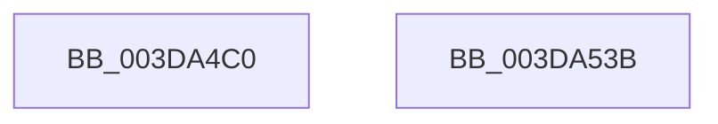

# HalBuildScatterGatherListV3

- RVA: `0x003DA4C0`–`0x003DA53C` (길이 `124` bytes)
- VA: `0x00000001403DA4C0`
- 실행 섹션: `.text`
- PDB 이름 있음: `예`; PDB Function 태그: `아니요`
- unwind 정보 RVA: `0x0007F678`
- 디코드: `26`개 명령, `124/124` bytes 표시
- 미해석 바이트: `0` (있으면 어셈블리에 `.byte`로 보존)

> 이 문서는 커널 이미지의 기계어와 PDB 기호를 분석해 생성했습니다. 4번과 5번은 함수 원형과 자료형을 바이너리 사용 방식에서 추정한 C 해석이며 원본 소스 복구 결과는 아닙니다.

## 1. Dependencies

- 직접 호출 지점: **1**; 고유 호출 대상: **1**
- 직접 호출자로 확인된 함수: **0**
- RIP 상대 이미지 참조: **0**

### Outgoing calls
- `0x003DA52E` → [HalpBuildScatterGatherList](HalpBuildScatterGatherList_function_003DBAF8.md) (function, `0x003DBAF8`)

### Direct callers
- 이 함수 시작 RVA로 연결되는 직접 call은 확인되지 않았습니다. 간접 호출은 완전히 역산할 수 없습니다.

### Static image references
- 디코드된 RIP-relative 메모리 참조가 없습니다.

## 2. Other-region calls and transfers

- 다른 실행 섹션으로 향하는 call: **0**
- 별도 외부 분기/꼬리 이동을 확인하지 못했습니다.

## 3. Assembly (complete function range)

```asm
003DA4C0  4C 8B DC                        mov r11, rsp
003DA4C3  48 81 EC 88 00 00 00            sub rsp, 0x88
003DA4CA  49 83 63 E8 00                  and qword ptr [r11 - 0x18], 0
003DA4CF  41 8B 40 2C                     mov eax, dword ptr [r8 + 0x2c]
003DA4D3  4C 2B C8                        sub r9, rax
003DA4D6  8B 84 24 D8 00 00 00            mov eax, dword ptr [rsp + 0xd8]
003DA4DD  4D 2B 48 20                     sub r9, qword ptr [r8 + 0x20]
003DA4E1  89 44 24 58                     mov dword ptr [rsp + 0x58], eax
003DA4E5  48 8B 84 24 D0 00 00 00         mov rax, qword ptr [rsp + 0xd0]
003DA4ED  49 89 43 C8                     mov qword ptr [r11 - 0x38], rax
003DA4F1  8A 84 24 C8 00 00 00            mov al, byte ptr [rsp + 0xc8]
003DA4F8  88 44 24 48                     mov byte ptr [rsp + 0x48], al
003DA4FC  48 8B 84 24 C0 00 00 00         mov rax, qword ptr [rsp + 0xc0]
003DA504  49 89 43 B8                     mov qword ptr [r11 - 0x48], rax
003DA508  48 8B 84 24 B8 00 00 00         mov rax, qword ptr [rsp + 0xb8]
003DA510  49 89 43 B0                     mov qword ptr [r11 - 0x50], rax
003DA514  83 64 24 30 00                  and dword ptr [rsp + 0x30], 0
003DA519  8B 84 24 B0 00 00 00            mov eax, dword ptr [rsp + 0xb0]
003DA520  89 44 24 28                     mov dword ptr [rsp + 0x28], eax
003DA524  4D 89 4B 98                     mov qword ptr [r11 - 0x68], r9
003DA528  4D 8B C8                        mov r9, r8
003DA52B  45 33 C0                        xor r8d, r8d
003DA52E  E8 C5 15 00 00                  call 0x1403dbaf8
003DA533  48 81 C4 88 00 00 00            add rsp, 0x88
003DA53A  C3                              ret
003DA53B  CC                              int3
```

## 4. C-style interpretation (structured pseudocode)

```c
__int64 __fastcall HalBuildScatterGatherListV3(__int64 a1, __int64 a2, __int64 a3, __int64 a4, unsigned int a5, __int64 a6, __int64 a7, unsigned __int8 a8, __int64 a9, unsigned int a10)
{
    __int64 result;
    __int64 v_rsp;
    unsigned int v_stack_m30;
    unsigned __int8 v_stack_m40;
    unsigned int v_stack_m58;
    unsigned int v_stack_m60;

    v_rsp = (v_rsp) - (136);
    a4 = (a4) - ((unsigned int)(*(unsigned int *)(a3 + 44)));
    a4 = (a4) - (*(unsigned __int64 *)(a3 + 32));
    v_stack_m30 = (unsigned int)((unsigned int)(a10));
    *(unsigned __int64 *)(v_rsp - 56) = a9;
    v_stack_m40 = a8;
    *(unsigned __int64 *)(v_rsp - 72) = a7;
    *(unsigned __int64 *)(v_rsp - 80) = a6;
    v_stack_m60 = (unsigned int)((unsigned int)(a5));
    *(unsigned __int64 *)(v_rsp - 104) = a4;
    a3 = 0;
    result = HalpBuildScatterGatherList(a1, a2, a3, a3);
    v_rsp = (v_rsp) + (136);
    return result;
}
```

## 5. (Beta) C Style

```c
int64_t HalBuildScatterGatherListV3(int64_t Arg1, int64_t Arg2, void *Arg3, int64_t Arg4, uint32_t Arg5, int64_t Arg6, int64_t Arg7, uint8_t Arg8, int64_t Arg9, uint32_t Arg10)
{
    uint8_t *arg3 = (uint8_t *)Arg3;

    int64_t result;
    int64_t local_rsp;
    uint32_t v_stack_m30;
    uint8_t v_stack_m40;
    uint32_t v_stack_m58;
    uint32_t v_stack_m60;

    local_rsp = (local_rsp) - (136);
    Arg4 = (Arg4) - ((uint32_t)(*(uint32_t *)(arg3 + 0x2C)));
    Arg4 = (Arg4) - (*(uint64_t *)(arg3 + 0x20));
    v_stack_m30 = (uint32_t)((uint32_t)(Arg10));
    *(uint64_t *)(local_rsp - 0x38) = Arg9;
    v_stack_m40 = Arg8;
    *(uint64_t *)(local_rsp - 0x48) = Arg7;
    *(uint64_t *)(local_rsp - 0x50) = Arg6;
    v_stack_m60 = (uint32_t)((uint32_t)(Arg5));
    *(uint64_t *)(local_rsp - 0x68) = Arg4;
    Arg3 = 0;
    result = HalpBuildScatterGatherList(Arg1, Arg2, Arg3, Arg3);
    local_rsp = (local_rsp) + (136);
    return result;
}
```

### 관측된 메모리 오프셋

구조체 형식이 확인되지 않은 접근은 인자 기준의 오프셋으로만 기록했습니다.

| 기준 인자 | 오프셋 표현 | 폭 (bit) | 접근 |
|---|---:|---:|---|
| `Arg3` | `+ 0x20` | `64` | `R` |
| `Arg3` | `+ 0x2C` | `32` | `R` |

## 6. Execution-region graph

[열기: 2D/3D 그래프와 함수 탐색 컨트롤 패널](../../../control-panel.html?section=text&rva=0x003DA4C0&view=graph)

- 2D 그래프는 위에서 아래로 흐르고, 3D 그래프는 빈 공간을 드래그해 회전합니다. Shift+드래그는 이동, 휠은 확대·축소, 함수 노드 선택은 대상 보고서 이동입니다.

### Static fallback


