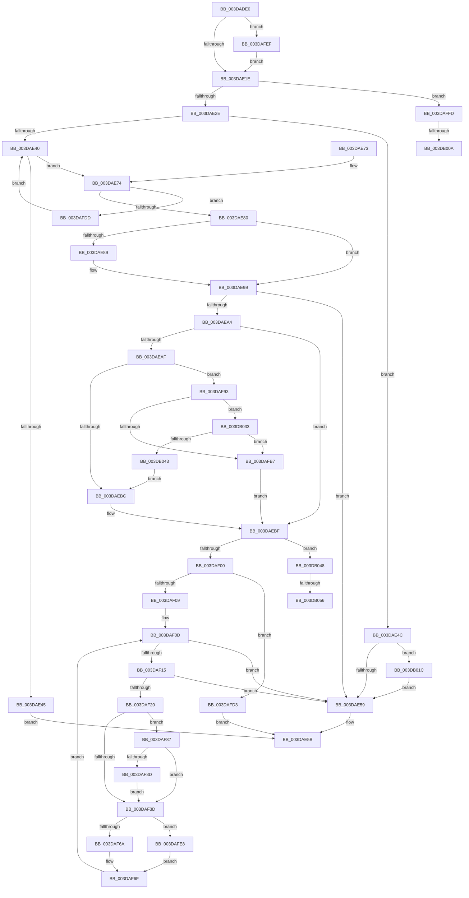

# HalFlushAdapterBuffersEx

- RVA: `0x003DADE0`–`0x003DB066` (길이 `646` bytes)
- VA: `0x00000001403DADE0`
- 실행 섹션: `.text`
- PDB 이름 있음: `예`; PDB Function 태그: `예`
- unwind 정보 RVA: `0x00093FC4`
- 디코드: `169`개 명령, `646/646` bytes 표시
- 미해석 바이트: `0` (있으면 어셈블리에 `.byte`로 보존)

> 이 문서는 커널 이미지의 기계어와 PDB 기호를 분석해 생성했습니다. 4번과 5번은 함수 원형과 자료형을 바이너리 사용 방식에서 추정한 C 해석이며 원본 소스 복구 결과는 아닙니다.

## 1. Dependencies

- 직접 호출 지점: **9**; 고유 호출 대상: **8**
- 직접 호출자로 확인된 함수: **1**
- RIP 상대 이미지 참조: **0**

### Outgoing calls
- `0x003DAE96` → [HalpDmaControllerFlushChannel](HalpDmaControllerFlushChannel_function_003DB25C.md) (function, `0x003DB25C`)
- `0x003DAEE2` → [HalpDmaCheckMdlAccessibility](HalpDmaCheckMdlAccessibility_function_003DB8A0.md) (function, `0x003DB8A0`)
- `0x003DAF6A` → [HalpDmaFlushScatterTransferV3](HalpDmaFlushScatterTransferV3_function_003DB06C.md) (function, `0x003DB06C`)
- `0x003DAFA8` → [HalpDmaGetAdapterCacheAlignment](HalpDmaGetAdapterCacheAlignment_function_003DC150.md) (function, `0x003DC150`)
- `0x003DAFE8` → [HalpDmaFlushContiguousTransferV3](HalpDmaFlushContiguousTransferV3_function_003D9E70.md) (function, `0x003D9E70`)
- `0x003DAFF3` → [HalpDmaFreeLa](../53/HalpDmaFreeLa_function_0053E1B8.md) (function, `0x0053E1B8`)
- `0x003DB011` → [MmUnmapLockedPages](../24/MmUnmapLockedPages_function_00246E60.md) (function, `0x00246E60`)
- `0x003DB029` → [HalpDmaControllerFlushChannel](HalpDmaControllerFlushChannel_function_003DB25C.md) (function, `0x003DB25C`)
- `0x003DB05B` → [HalpDmaFlushDriverMdl](../53/HalpDmaFlushDriverMdl_function_0053E178.md) (function, `0x0053E178`)

### Direct callers
- [HalPutScatterGatherListV3](HalPutScatterGatherListV3_function_003DACA8.md) at `0x003DAD04`

### Static image references
- 디코드된 RIP-relative 메모리 참조가 없습니다.

## 2. Other-region calls and transfers

- 다른 실행 섹션으로 향하는 call: **0**
- call이 아닌 외부 분기/꼬리 이동: **4**
  - `0x003DB004` → [sub_006E9CCC](../6E/Unknown_function_006E9CCC.md) (`tail-transfer`)
  - `0x003DB017` → [sub_006E9CCC](../6E/Unknown_function_006E9CCC.md) (`tail-transfer`)
  - `0x003DB050` → [sub_006E9CCC + 0x19](../6E/Unknown_function_006E9CCC.md) (`tail-transfer`)
  - `0x003DB061` → [sub_006E9CCC + 0x19](../6E/Unknown_function_006E9CCC.md) (`tail-transfer`)

## 3. Assembly (complete function range)

```asm
003DADE0  48 8B C4                        mov rax, rsp
003DADE3  48 89 58 10                     mov qword ptr [rax + 0x10], rbx
003DADE7  55                              push rbp
003DADE8  56                              push rsi
003DADE9  57                              push rdi
003DADEA  41 54                           push r12
003DADEC  41 55                           push r13
003DADEE  41 56                           push r14
003DADF0  41 57                           push r15
003DADF2  48 83 EC 50                     sub rsp, 0x50
003DADF6  45 33 ED                        xor r13d, r13d
003DADF9  4D 8B F9                        mov r15, r9
003DADFC  83 B9 08 02 00 00 03            cmp dword ptr [rcx + 0x208], 3
003DAE03  49 8B E8                        mov rbp, r8
003DAE06  48 8B DA                        mov rbx, rdx
003DAE09  44 88 68 08                     mov byte ptr [rax + 8], r13b
003DAE0D  48 8B F9                        mov rdi, rcx
003DAE10  4C 89 68 B8                     mov qword ptr [rax - 0x48], r13
003DAE14  4C 89 68 18                     mov qword ptr [rax + 0x18], r13
003DAE18  0F 84 D1 01 00 00               je 0x1403dafef
003DAE1E  48 8B B7 28 02 00 00            mov rsi, qword ptr [rdi + 0x228]
003DAE25  48 85 F6                        test rsi, rsi
003DAE28  0F 85 CF 01 00 00               jne 0x1403daffd
003DAE2E  8B B4 24 B0 00 00 00            mov esi, dword ptr [rsp + 0xb0]
003DAE35  4C 89 AF 28 02 00 00            mov qword ptr [rdi + 0x228], r13
003DAE3C  85 F6                           test esi, esi
003DAE3E  74 0C                           je 0x1403dae4c
003DAE40  48 85 DB                        test rbx, rbx
003DAE43  75 2F                           jne 0x1403dae74
003DAE45  B8 0D 00 00 C0                  mov eax, 0xc000000d
003DAE4A  EB 0F                           jmp 0x1403dae5b
003DAE4C  44 38 AF B9 01 00 00            cmp byte ptr [rdi + 0x1b9], r13b
003DAE53  0F 84 C3 01 00 00               je 0x1403db01c
003DAE59  33 C0                           xor eax, eax
003DAE5B  48 8B 9C 24 98 00 00 00         mov rbx, qword ptr [rsp + 0x98]
003DAE63  48 83 C4 50                     add rsp, 0x50
003DAE67  41 5F                           pop r15
003DAE69  41 5E                           pop r14
003DAE6B  41 5D                           pop r13
003DAE6D  41 5C                           pop r12
003DAE6F  5F                              pop rdi
003DAE70  5E                              pop rsi
003DAE71  5D                              pop rbp
003DAE72  C3                              ret
003DAE73  CC                              int3
003DAE74  8B 43 28                        mov eax, dword ptr [rbx + 0x28]
003DAE77  4C 3B F8                        cmp r15, rax
003DAE7A  0F 83 5D 01 00 00               jae 0x1403dafdd
003DAE80  44 38 AF B9 01 00 00            cmp byte ptr [rdi + 0x1b9], r13b
003DAE87  75 12                           jne 0x1403dae9b
003DAE89  8B 97 7C 01 00 00               mov edx, dword ptr [rdi + 0x17c]
003DAE8F  48 8B 8F 70 01 00 00            mov rcx, qword ptr [rdi + 0x170]
003DAE96  E8 C1 03 00 00                  call 0x1403db25c
003DAE9B  44 38 AF B8 01 00 00            cmp byte ptr [rdi + 0x1b8], r13b
003DAEA2  74 B5                           je 0x1403dae59
003DAEA4  4D 8B E7                        mov r12, r15
003DAEA7  4C 8B F3                        mov r14, rbx
003DAEAA  48 85 ED                        test rbp, rbp
003DAEAD  74 10                           je 0x1403daebf
003DAEAF  44 8B 45 10                     mov r8d, dword ptr [rbp + 0x10]
003DAEB3  4C 39 2B                        cmp qword ptr [rbx], r13
003DAEB6  0F 84 D7 00 00 00               je 0x1403daf93
003DAEBC  41 8B F0                        mov esi, r8d
003DAEBF  48 8D 44 24 40                  lea rax, [rsp + 0x40]
003DAEC4  44 8B CE                        mov r9d, esi
003DAEC7  48 89 44 24 28                  mov qword ptr [rsp + 0x28], rax
003DAECC  45 8B C4                        mov r8d, r12d
003DAECF  48 8D 84 24 90 00 00 00         lea rax, [rsp + 0x90]
003DAED7  49 8B D6                        mov rdx, r14
003DAEDA  48 8B CF                        mov rcx, rdi
003DAEDD  48 89 44 24 20                  mov qword ptr [rsp + 0x20], rax
003DAEE2  E8 B9 09 00 00                  call 0x1403db8a0
003DAEE7  44 8A 84 24 90 00 00 00         mov r8b, byte ptr [rsp + 0x90]
003DAEEF  44 8A AC 24 B8 00 00 00         mov r13b, byte ptr [rsp + 0xb8]
003DAEF7  45 84 C0                        test r8b, r8b
003DAEFA  0F 85 48 01 00 00               jne 0x1403db048
003DAF00  48 85 ED                        test rbp, rbp
003DAF03  0F 84 CA 00 00 00               je 0x1403dafd3
003DAF09  48 89 6D 38                     mov qword ptr [rbp + 0x38], rbp
003DAF0D  85 F6                           test esi, esi
003DAF0F  0F 84 44 FF FF FF               je 0x1403dae59
003DAF15  8B D6                           mov edx, esi
003DAF17  4D 85 F6                        test r14, r14
003DAF1A  0F 84 39 FF FF FF               je 0x1403dae59
003DAF20  41 8B 46 28                     mov eax, dword ptr [r14 + 0x28]
003DAF24  8B CE                           mov ecx, esi
003DAF26  45 8B 4E 2C                     mov r9d, dword ptr [r14 + 0x2c]
003DAF2A  41 2B C4                        sub eax, r12d
003DAF2D  3B C6                           cmp eax, esi
003DAF2F  0F 46 C8                        cmovbe ecx, eax
003DAF32  4D 03 4E 20                     add r9, qword ptr [r14 + 0x20]
003DAF36  4D 03 CC                        add r9, r12
003DAF39  2B F1                           sub esi, ecx
003DAF3B  75 4A                           jne 0x1403daf87
003DAF3D  80 BF BA 01 00 00 00            cmp byte ptr [rdi + 0x1ba], 0
003DAF44  48 8D 84 24 A0 00 00 00         lea rax, [rsp + 0xa0]
003DAF4C  48 89 44 24 38                  mov qword ptr [rsp + 0x38], rax
003DAF51  49 8B D6                        mov rdx, r14
003DAF54  44 88 44 24 30                  mov byte ptr [rsp + 0x30], r8b
003DAF59  4C 8B C5                        mov r8, rbp
003DAF5C  44 88 6C 24 28                  mov byte ptr [rsp + 0x28], r13b
003DAF61  89 4C 24 20                     mov dword ptr [rsp + 0x20], ecx
003DAF65  48 8B CF                        mov rcx, rdi
003DAF68  74 7E                           je 0x1403dafe8
003DAF6A  E8 FD 00 00 00                  call 0x1403db06c
003DAF6F  48 8B AC 24 A0 00 00 00         mov rbp, qword ptr [rsp + 0xa0]
003DAF77  45 33 E4                        xor r12d, r12d
003DAF7A  4D 8B 36                        mov r14, qword ptr [r14]
003DAF7D  44 8A 84 24 90 00 00 00         mov r8b, byte ptr [rsp + 0x90]
003DAF85  EB 86                           jmp 0x1403daf0d
003DAF87  49 83 3E 00                     cmp qword ptr [r14], 0
003DAF8B  75 B0                           jne 0x1403daf3d
003DAF8D  8B CA                           mov ecx, edx
003DAF8F  33 F6                           xor esi, esi
003DAF91  EB AA                           jmp 0x1403daf3d
003DAF93  44 8B 5B 2C                     mov r11d, dword ptr [rbx + 0x2c]
003DAF97  48 8B CF                        mov rcx, rdi
003DAF9A  4F 8D 0C 03                     lea r9, [r11 + r8]
003DAF9E  4D 8D 14 33                     lea r10, [r11 + rsi]
003DAFA2  4D 03 CF                        add r9, r15
003DAFA5  4D 03 D7                        add r10, r15
003DAFA8  E8 A3 11 00 00                  call 0x1403dc150
003DAFAD  8D 50 FF                        lea edx, [rax - 1]
003DAFB0  8B CA                           mov ecx, edx
003DAFB2  49 85 C9                        test r9, rcx
003DAFB5  75 7C                           jne 0x1403db033
003DAFB7  8D 70 FF                        lea esi, [rax - 1]
003DAFBA  F7 D2                           not edx
003DAFBC  41 03 F2                        add esi, r10d
003DAFBF  23 F2                           and esi, edx
003DAFC1  41 2B F3                        sub esi, r11d
003DAFC4  41 2B F4                        sub esi, r12d
003DAFC7  41 3B F0                        cmp esi, r8d
003DAFCA  41 0F 47 F0                     cmova esi, r8d
003DAFCE  E9 EC FE FF FF                  jmp 0x1403daebf
003DAFD3  B8 01 00 00 C0                  mov eax, 0xc0000001
003DAFD8  E9 7E FE FF FF                  jmp 0x1403dae5b
003DAFDD  48 8B 1B                        mov rbx, qword ptr [rbx]
003DAFE0  4C 2B F8                        sub r15, rax
003DAFE3  E9 58 FE FF FF                  jmp 0x1403dae40
003DAFE8  E8 83 EE FF FF                  call 0x1403d9e70
003DAFED  EB 80                           jmp 0x1403daf6f
003DAFEF  49 8D 50 18                     lea rdx, [r8 + 0x18]
003DAFF3  E8 C0 31 16 00                  call 0x14053e1b8
003DAFF8  E9 21 FE FF FF                  jmp 0x1403dae1e
003DAFFD  F6 46 0A 01                     test byte ptr [rsi + 0xa], 1
003DB001  4C 8B 36                        mov r14, qword ptr [rsi]
003DB004  0F 84 C2 EC 30 00               je 0x1406e9ccc
003DB00A  48 8B 4E 18                     mov rcx, qword ptr [rsi + 0x18]
003DB00E  48 8B D6                        mov rdx, rsi
003DB011  E8 4A BE E6 FF                  call 0x140246e60
003DB016  90                              nop
003DB017  E9 B0 EC 30 00                  jmp 0x1406e9ccc
003DB01C  8B 97 7C 01 00 00               mov edx, dword ptr [rdi + 0x17c]
003DB022  48 8B 8F 70 01 00 00            mov rcx, qword ptr [rdi + 0x170]
003DB029  E8 2E 02 00 00                  call 0x1403db25c
003DB02E  E9 26 FE FF FF                  jmp 0x1403dae59
003DB033  49 81 E1 00 F0 FF FF            and r9, 0xfffffffffffff000
003DB03A  4D 3B D1                        cmp r10, r9
003DB03D  0F 82 74 FF FF FF               jb 0x1403dafb7
003DB043  E9 74 FE FF FF                  jmp 0x1403daebc
003DB048  4C 8B 7C 24 40                  mov r15, qword ptr [rsp + 0x40]
003DB04D  45 84 ED                        test r13b, r13b
003DB050  0F 85 8F EC 30 00               jne 0x1406e9ce5
003DB056  B2 01                           mov dl, 1
003DB058  49 8B CF                        mov rcx, r15
003DB05B  E8 18 31 16 00                  call 0x14053e178
003DB060  90                              nop
003DB061  E9 7F EC 30 00                  jmp 0x1406e9ce5
```

## 4. C-style interpretation (structured pseudocode)

```c
__int64 __fastcall HalFlushAdapterBuffersEx(__int64 a1, __int64 a2, __int64 a3, __int64 a4, unsigned int a5, unsigned __int8 a6)
{
    __int64 result;
    __int64 v_r10;
    __int64 v_r12;
    __int64 v_r13;
    __int64 v_r15;
    __int64 v_rsi;
    __int64 v_rsp;
    unsigned __int64 v_stack_p10;
    unsigned __int64 v_stack_p20;
    unsigned __int64 v_stack_p28;
    unsigned __int8 v_stack_p30;
    unsigned __int64 v_stack_p38;
    unsigned __int64 v_stack_p40;
    unsigned __int64 v_stack_p90;
    unsigned __int64 v_stack_pA0;

    *(unsigned __int64 *)(v_rsp + 16) = v_rbx;
    v_rsp = (v_rsp) - (80);
    v_r13 = 0;
    *(unsigned __int8 *)(v_rsp + 8) = 0;
    *(unsigned __int64 *)(v_rsp - 72) = 0;
    *(unsigned __int64 *)(v_rsp + 24) = 0;
    if ((*(unsigned int *)(a1 + 520)) == 3) goto loc_003DAFEF;
loc_003DAE1E:
    if (*(unsigned __int64 *)(a1 + 552) != 0) goto loc_003DAFFD;
    *(unsigned __int64 *)(a1 + 552) = 0;
    if ((unsigned int)((unsigned int)(a5)) == 0) goto loc_003DAE4C;
loc_003DAE40:
    if (a2 != 0) goto loc_003DAE74;
    goto loc_003DAE5B;
loc_003DAE4C:
    if ((*(unsigned __int8 *)(a1 + 441)) == 0) goto loc_003DB01C;
loc_003DAE59:
    result = 0;
loc_003DAE5B:
    v_rsp = (v_rsp) + (80);
    return result;
loc_003DAE74:
    if (a4 >= ((unsigned int)(*(unsigned int *)(v_stack_p10 + 40)))) goto loc_003DAFDD;
    result = (unsigned int)(*(unsigned int *)(v_stack_p10 + 40));
    if ((*(unsigned __int8 *)(a1 + 441)) == 0) {
        a2 = *(unsigned int *)(a1 + 380);
        a1 = *(unsigned __int64 *)(a1 + 368);
        result = HalpDmaControllerFlushChannel(a1, a2, a3, a4);
    }
    if ((*(unsigned __int8 *)(a1 + 440)) == 0) goto loc_003DAE59;
    if (a3 == 0) goto loc_003DAEBF;
    if ((*(unsigned __int64 *)(v_stack_p10)) == 0) goto loc_003DAF93;
loc_003DAEBC:
loc_003DAEBF:
    v_stack_p28 = v_stack_p40;
    v_stack_p20 = v_stack_p90;
    result = HalpDmaCheckMdlAccessibility(a1, v_stack_p10, (unsigned int)((unsigned int)(a4)), (unsigned int)((unsigned int)((unsigned int)((unsigned int)((unsigned int)(*(unsigned int *)(a3 + 16)))))));
    if ((unsigned __int8)(v_stack_p90) != 0) goto loc_003DB048;
    if (a3 == 0) goto loc_003DAFD3;
    *(unsigned __int64 *)(a3 + 56) = a3;
loc_003DAF0D:
    if ((unsigned int)((unsigned int)((unsigned int)((unsigned int)(*(unsigned int *)(a3 + 16))))) == 0) goto loc_003DAE59;
    if (v_stack_p10 == 0) goto loc_003DAE59;
    result = (unsigned int)(((unsigned int)(*(unsigned int *)(v_stack_p10 + 40))) - ((unsigned int)(a4)));
    a1 = (unsigned int)((unsigned int)((unsigned int)((unsigned int)((unsigned int)(*(unsigned int *)(a3 + 16))))));
    if (((unsigned int)(result)) <= ((unsigned int)((unsigned int)((unsigned int)((unsigned int)(*(unsigned int *)(a3 + 16))))))) { a1 = (unsigned int)(result); }
    a4 = ((unsigned int)(*(unsigned int *)(v_stack_p10 + 44))) + (*(unsigned __int64 *)(v_stack_p10 + 32));
    a4 = (a4) + (a4);
    v_rsi = (unsigned int)(((unsigned int)((unsigned int)((unsigned int)(*(unsigned int *)(a3 + 16))))) - ((unsigned int)(a1)));
    if (condition_is_not_equal) goto loc_003DAF87;
loc_003DAF3D:
    v_stack_p38 = v_stack_pA0;
    v_stack_p30 = (unsigned __int8)(v_stack_p90);
    v_stack_p28 = a6;
    v_stack_p20 = (unsigned int)(a1);
    if ((*(unsigned __int8 *)(a1 + 442)) == 0) goto loc_003DAFE8;
    result = HalpDmaFlushScatterTransferV3(a1, v_stack_p10, a3, a4);
loc_003DAF6F:
    v_r12 = 0;
    goto loc_003DAF0D;
loc_003DAF87:
    if ((*(unsigned __int64 *)(*(unsigned __int64 *)(v_stack_p10))) != 0) goto loc_003DAF3D;
    v_rsi = 0;
    goto loc_003DAF3D;
loc_003DAF93:
    a4 = ((unsigned int)(*(unsigned int *)(v_stack_p10 + 44)) + v_stack_p90 * 1) + (a4);
    v_r10 = ((unsigned int)(*(unsigned int *)(v_stack_p10 + 44)) + v_rsi * 1) + (a4);
    result = HalpDmaGetAdapterCacheAlignment(a1, v_stack_p10, v_stack_p90, a4);
    if (((a4) & ((unsigned int)((unsigned int)(result - 1)))) != 0) goto loc_003DB033;
loc_003DAFB7:
    a2 = (unsigned int)(~(result - 1));
    v_rsi = (unsigned int)((result - 1) + ((unsigned int)(v_r10)));
    v_rsi = (unsigned int)((v_rsi) & ((unsigned int)(a2)));
    v_rsi = (unsigned int)((v_rsi) - ((unsigned int)((unsigned int)(*(unsigned int *)(v_stack_p10 + 44)))));
    v_rsi = (unsigned int)((v_rsi) - (0));
    if (((unsigned int)(v_rsi)) > ((unsigned int)(v_stack_p90))) { v_rsi = (unsigned int)(v_stack_p90); }
    goto loc_003DAEBF;
loc_003DAFD3:
    goto loc_003DAE5B;
loc_003DAFDD:
    v_r15 = (a4) - ((unsigned int)(0xC0000001ULL));
    goto loc_003DAE40;
loc_003DAFE8:
    result = HalpDmaFlushContiguousTransferV3((unsigned int)((unsigned int)(result - 1)), a2, v_stack_p90, a4);
    goto loc_003DAF6F;
loc_003DAFEF:
    result = HalpDmaFreeLa((unsigned int)((unsigned int)(result - 1)), v_stack_p90 + 24, v_stack_p90, a4);
    goto loc_003DAE1E;
loc_003DAFFD:
    result = MmUnmapLockedPages(*(unsigned __int64 *)(v_rsi + 24), v_rsi, v_stack_p90, a4);
loc_003DB01C:
    result = HalpDmaControllerFlushChannel(*(unsigned __int64 *)(a1 + 368), (unsigned int)(*(unsigned int *)(a1 + 380)), v_stack_p90, a4);
    goto loc_003DAE59;
loc_003DB033:
    a4 = (a4) & (0xFFFFFFFFFFFFF000ULL);
    if (v_r10 < a4) goto loc_003DAFB7;
    goto loc_003DAEBC;
loc_003DB048:
    result = HalpDmaFlushDriverMdl(v_stack_p40, 1, v_stack_p90, a4);
}
```

## 5. (Beta) C Style

```c
int64_t HalFlushAdapterBuffersEx(void *Arg1, int64_t Arg2, void *Arg3, int64_t Arg4, uint32_t Arg5, uint8_t Arg6)
{
    uint8_t *arg1 = (uint8_t *)Arg1;
    uint8_t *arg3 = (uint8_t *)Arg3;

    int64_t result;
    int64_t local_r10;
    int64_t local_r12;
    int64_t local_r13;
    int64_t local_r15;
    int64_t local_rsi;
    int64_t local_rsp;
    uint64_t v_stack_p10;
    uint64_t v_stack_p20;
    uint64_t v_stack_p28;
    uint8_t v_stack_p30;
    uint64_t v_stack_p38;
    uint64_t v_stack_p40;
    uint64_t v_stack_p90;
    uint64_t v_stack_pA0;

    *(uint64_t *)(local_rsp + 0x10) = local_rbx;
    local_rsp = (local_rsp) - (80);
    local_r13 = 0;
    *(uint8_t *)(local_rsp + 0x8) = 0;
    *(uint64_t *)(local_rsp - 0x48) = 0;
    *(uint64_t *)(local_rsp + 0x18) = 0;
    if ((*(uint32_t *)(arg1 + 0x208)) == 3) goto loc_003DAFEF;
loc_003DAE1E:
    if (*(uint64_t *)(arg1 + 0x228) != 0) goto loc_003DAFFD;
    *(uint64_t *)(arg1 + 0x228) = 0;
    if ((uint32_t)((uint32_t)(Arg5)) == 0) goto loc_003DAE4C;
loc_003DAE40:
    if (Arg2 != 0) goto loc_003DAE74;
    goto loc_003DAE5B;
loc_003DAE4C:
    if ((*(uint8_t *)(arg1 + 0x1B9)) == 0) goto loc_003DB01C;
loc_003DAE59:
    result = 0;
loc_003DAE5B:
    local_rsp = (local_rsp) + (80);
    return result;
loc_003DAE74:
    if (Arg4 >= ((uint32_t)(*(uint32_t *)(v_stack_p10 + 0x28)))) goto loc_003DAFDD;
    result = (uint32_t)(*(uint32_t *)(v_stack_p10 + 0x28));
    if ((*(uint8_t *)(arg1 + 0x1B9)) == 0) {
        Arg2 = *(uint32_t *)(arg1 + 0x17C);
        Arg1 = *(uint64_t *)(arg1 + 0x170);
        result = HalpDmaControllerFlushChannel(Arg1, Arg2, Arg3, Arg4);
    }
    if ((*(uint8_t *)(arg1 + 0x1B8)) == 0) goto loc_003DAE59;
    if (Arg3 == NULL) goto loc_003DAEBF;
    if ((*(uint64_t *)(v_stack_p10)) == 0) goto loc_003DAF93;
loc_003DAEBC:
loc_003DAEBF:
    v_stack_p28 = v_stack_p40;
    v_stack_p20 = v_stack_p90;
    result = HalpDmaCheckMdlAccessibility(Arg1, v_stack_p10, (uint32_t)((uint32_t)(Arg4)), (uint32_t)((uint32_t)((uint32_t)((uint32_t)((uint32_t)(*(uint32_t *)(arg3 + 0x10)))))));
    if ((uint8_t)(v_stack_p90) != 0) goto loc_003DB048;
    if (Arg3 == NULL) goto loc_003DAFD3;
    *(void **)(arg3 + 0x38) = Arg3;
loc_003DAF0D:
    if ((uint32_t)((uint32_t)((uint32_t)((uint32_t)(*(uint32_t *)(arg3 + 0x10))))) == 0) goto loc_003DAE59;
    if (v_stack_p10 == 0) goto loc_003DAE59;
    result = (uint32_t)(((uint32_t)(*(uint32_t *)(v_stack_p10 + 0x28))) - ((uint32_t)(Arg4)));
    Arg1 = (uint32_t)((uint32_t)((uint32_t)((uint32_t)((uint32_t)(*(uint32_t *)(arg3 + 0x10))))));
    if (((uint32_t)(result)) <= ((uint32_t)((uint32_t)((uint32_t)((uint32_t)(*(uint32_t *)(arg3 + 0x10))))))) { Arg1 = (uint32_t)(result); }
    Arg4 = ((uint32_t)(*(uint32_t *)(v_stack_p10 + 0x2C))) + (*(uint64_t *)(v_stack_p10 + 0x20));
    Arg4 = (Arg4) + (Arg4);
    local_rsi = (uint32_t)(((uint32_t)((uint32_t)((uint32_t)(*(uint32_t *)(arg3 + 0x10))))) - ((uint32_t)(Arg1)));
    if (condition_is_not_equal) goto loc_003DAF87;
loc_003DAF3D:
    v_stack_p38 = v_stack_pA0;
    v_stack_p30 = (uint8_t)(v_stack_p90);
    v_stack_p28 = Arg6;
    v_stack_p20 = (uint32_t)(Arg1);
    if ((*(uint8_t *)(arg1 + 0x1BA)) == 0) goto loc_003DAFE8;
    result = HalpDmaFlushScatterTransferV3(Arg1, v_stack_p10, Arg3, Arg4);
loc_003DAF6F:
    local_r12 = 0;
    goto loc_003DAF0D;
loc_003DAF87:
    if ((*(uint64_t *)(*(uint64_t *)(v_stack_p10))) != 0) goto loc_003DAF3D;
    local_rsi = 0;
    goto loc_003DAF3D;
loc_003DAF93:
    Arg4 = ((uint32_t)(*(uint32_t *)(v_stack_p10 + 0x2C)) + v_stack_p90 * 1) + (Arg4);
    local_r10 = ((uint32_t)(*(uint32_t *)(v_stack_p10 + 0x2C)) + local_rsi * 1) + (Arg4);
    result = HalpDmaGetAdapterCacheAlignment(Arg1, v_stack_p10, v_stack_p90, Arg4);
    if (((Arg4) & ((uint32_t)((uint32_t)(result - 1)))) != 0) goto loc_003DB033;
loc_003DAFB7:
    Arg2 = (uint32_t)(~(result - 1));
    local_rsi = (uint32_t)((result - 1) + ((uint32_t)(local_r10)));
    local_rsi = (uint32_t)((local_rsi) & ((uint32_t)(Arg2)));
    local_rsi = (uint32_t)((local_rsi) - ((uint32_t)((uint32_t)(*(uint32_t *)(v_stack_p10 + 0x2C)))));
    local_rsi = (uint32_t)((local_rsi) - (0));
    if (((uint32_t)(local_rsi)) > ((uint32_t)(v_stack_p90))) { local_rsi = (uint32_t)(v_stack_p90); }
    goto loc_003DAEBF;
loc_003DAFD3:
    goto loc_003DAE5B;
loc_003DAFDD:
    local_r15 = (Arg4) - ((uint32_t)(0xC0000001ULL));
    goto loc_003DAE40;
loc_003DAFE8:
    result = HalpDmaFlushContiguousTransferV3((uint32_t)((uint32_t)(result - 1)), Arg2, v_stack_p90, Arg4);
    goto loc_003DAF6F;
loc_003DAFEF:
    result = HalpDmaFreeLa((uint32_t)((uint32_t)(result - 1)), v_stack_p90 + 24, v_stack_p90, Arg4);
    goto loc_003DAE1E;
loc_003DAFFD:
    result = MmUnmapLockedPages(*(uint64_t *)(local_rsi + 0x18), local_rsi, v_stack_p90, Arg4);
loc_003DB01C:
    result = HalpDmaControllerFlushChannel(*(uint64_t *)(arg1 + 0x170), (uint32_t)(*(uint32_t *)(arg1 + 0x17C)), v_stack_p90, Arg4);
    goto loc_003DAE59;
loc_003DB033:
    Arg4 = (Arg4) & (0xFFFFFFFFFFFFF000ULL);
    if (local_r10 < Arg4) goto loc_003DAFB7;
    goto loc_003DAEBC;
loc_003DB048:
    result = HalpDmaFlushDriverMdl(v_stack_p40, 1, v_stack_p90, Arg4);
}
```

### 관측된 메모리 오프셋

구조체 형식이 확인되지 않은 접근은 인자 기준의 오프셋으로만 기록했습니다.

| 기준 인자 | 오프셋 표현 | 폭 (bit) | 접근 |
|---|---:|---:|---|
| `Arg1` | `+ 0x170` | `64` | `R` |
| `Arg1` | `+ 0x17C` | `32` | `R` |
| `Arg1` | `+ 0x1B8` | `8` | `R` |
| `Arg1` | `+ 0x1B9` | `8` | `R` |
| `Arg1` | `+ 0x1BA` | `8` | `R` |
| `Arg1` | `+ 0x208` | `32` | `R` |
| `Arg1` | `+ 0x228` | `64` | `R` |
| `Arg1` | `+ 0x228` | `64` | `W` |
| `Arg3` | `+ 0x18` | `64` | `R` |

## 6. Execution-region graph

[열기: 2D/3D 그래프와 함수 탐색 컨트롤 패널](../../../control-panel.html?section=text&rva=0x003DADE0&view=graph)

- 2D 그래프는 위에서 아래로 흐르고, 3D 그래프는 빈 공간을 드래그해 회전합니다. Shift+드래그는 이동, 휠은 확대·축소, 함수 노드 선택은 대상 보고서 이동입니다.

### Static fallback


