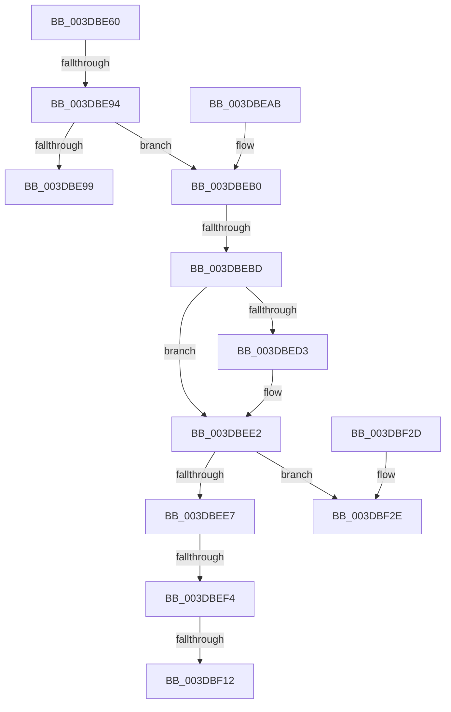

# HalGetDmaTransferInfoInternal

- RVA: `0x003DBE60`–`0x003DBF36` (길이 `214` bytes)
- VA: `0x00000001403DBE60`
- 실행 섹션: `.text`
- PDB 이름 있음: `예`; PDB Function 태그: `예`
- unwind 정보 RVA: `0x0009410C`
- 디코드: `65`개 명령, `214/214` bytes 표시
- 미해석 바이트: `0` (있으면 어셈블리에 `.byte`로 보존)

> 이 문서는 커널 이미지의 기계어와 PDB 기호를 분석해 생성했습니다. 4번과 5번은 함수 원형과 자료형을 바이너리 사용 방식에서 추정한 C 해석이며 원본 소스 복구 결과는 아닙니다.

## 1. Dependencies

- 직접 호출 지점: **0**; 고유 호출 대상: **0**
- 직접 호출자로 확인된 함수: **2**
- RIP 상대 이미지 참조: **0**

### Outgoing calls
- 직접 디코드된 call 명령이 없습니다.

### Direct callers
- [HalpBuildScatterGatherList](HalpBuildScatterGatherList_function_003DBAF8.md) at `0x003DBB78`
- [HalGetDmaTransferInfo](HalGetDmaTransferInfo_function_003DBE20.md) at `0x003DBE30`

### Static image references
- 디코드된 RIP-relative 메모리 참조가 없습니다.

## 2. Other-region calls and transfers

- 다른 실행 섹션으로 향하는 call: **0**
- call이 아닌 외부 분기/꼬리 이동: **4**
  - `0x003DBE8E` → [sub_003DC0C4 + 0x5](Unknown_function_003DC0C4.md) (`tail-transfer`)
  - `0x003DBEB7` → [sub_003DC110 + 0x9](Unknown_function_003DC110.md) (`tail-transfer`)
  - `0x003DBEEE` → [sub_003DC110 + 0x22](Unknown_function_003DC110.md) (`tail-transfer`)
  - `0x003DBF0C` → [sub_003DC0C4](Unknown_function_003DC0C4.md) (`tail-transfer`)

## 3. Assembly (complete function range)

```asm
003DBE60  44 89 4C 24 20                  mov dword ptr [rsp + 0x20], r9d
003DBE65  48 89 54 24 10                  mov qword ptr [rsp + 0x10], rdx
003DBE6A  55                              push rbp
003DBE6B  56                              push rsi
003DBE6C  41 54                           push r12
003DBE6E  41 55                           push r13
003DBE70  41 57                           push r15
003DBE72  48 83 EC 40                     sub rsp, 0x40
003DBE76  4C 8B BC 24 98 00 00 00         mov r15, qword ptr [rsp + 0x98]
003DBE7E  4C 8B D2                        mov r10, rdx
003DBE81  48 8B F1                        mov rsi, rcx
003DBE84  41 8B 17                        mov edx, dword ptr [r15]
003DBE87  89 54 24 24                     mov dword ptr [rsp + 0x24], edx
003DBE8B  83 FA 02                        cmp edx, 2
003DBE8E  0F 87 35 02 00 00               ja 0x1403dc0c9
003DBE94  4D 85 D2                        test r10, r10
003DBE97  75 17                           jne 0x1403dbeb0
003DBE99  B8 0D 00 00 C0                  mov eax, 0xc000000d
003DBE9E  48 83 C4 40                     add rsp, 0x40
003DBEA2  41 5F                           pop r15
003DBEA4  41 5D                           pop r13
003DBEA6  41 5C                           pop r12
003DBEA8  5E                              pop rsi
003DBEA9  5D                              pop rbp
003DBEAA  C3                              ret
003DBEAB  CC                              int3
003DBEAC  0F 1F 40 00                     nop dword ptr [rax]
003DBEB0  41 8B 42 28                     mov eax, dword ptr [r10 + 0x28]
003DBEB4  4C 3B C0                        cmp r8, rax
003DBEB7  0F 83 5C 02 00 00               jae 0x1403dc119
003DBEBD  8B 89 C0 01 00 00               mov ecx, dword ptr [rcx + 0x1c0]
003DBEC3  33 ED                           xor ebp, ebp
003DBEC5  45 33 E4                        xor r12d, r12d
003DBEC8  45 33 ED                        xor r13d, r13d
003DBECB  45 33 DB                        xor r11d, r11d
003DBECE  83 F9 40                        cmp ecx, 0x40
003DBED1  73 0F                           jae 0x1403dbee2
003DBED3  41 BB 01 00 00 00               mov r11d, 1
003DBED9  49 D3 E3                        shl r11, cl
003DBEDC  49 FF CB                        dec r11
003DBEDF  49 F7 D3                        not r11
003DBEE2  45 85 C9                        test r9d, r9d
003DBEE5  75 47                           jne 0x1403dbf2e
003DBEE7  80 BE BA 01 00 00 00            cmp byte ptr [rsi + 0x1ba], 0
003DBEEE  0F 84 3E 02 00 00               je 0x1403dc132
003DBEF4  B9 A8 00 00 00                  mov ecx, 0xa8
003DBEF9  43 8D 04 64                     lea eax, [r12 + r12*2]
003DBEFD  8D 04 C5 D0 00 00 00            lea eax, [rax*8 + 0xd0]
003DBF04  3B C1                           cmp eax, ecx
003DBF06  0F 42 C1                        cmovb eax, ecx
003DBF09  83 EA 01                        sub edx, 1
003DBF0C  0F 85 B2 01 00 00               jne 0x1403dc0c4
003DBF12  41 89 6F 04                     mov dword ptr [r15 + 4], ebp
003DBF16  45 89 67 08                     mov dword ptr [r15 + 8], r12d
003DBF1A  41 89 47 0C                     mov dword ptr [r15 + 0xc], eax
003DBF1E  33 C0                           xor eax, eax
003DBF20  48 83 C4 40                     add rsp, 0x40
003DBF24  41 5F                           pop r15
003DBF26  41 5D                           pop r13
003DBF28  41 5C                           pop r12
003DBF2A  5E                              pop rsi
003DBF2B  5D                              pop rbp
003DBF2C  C3                              ret
003DBF2D  CC                              int3
003DBF2E  44 8B BC 24 88 00 00 00         mov r15d, dword ptr [rsp + 0x88]
```

## 4. C-style interpretation (structured pseudocode)

```c
__int64 __fastcall HalGetDmaTransferInfoInternal(__int64 a1, __int64 a2, __int64 a3, int a4, __int64 a5, __int64 a6)
{
    __int64 result;
    __int64 v_r11;
    __int64 v_r12;
    __int64 v_r13;
    __int64 v_rbp;
    __int64 v_rsp;
    unsigned int v_stack_m44;
    unsigned __int64 v_stack_p10;
    unsigned int v_stack_p20;
    unsigned int v_stack_pF0;

    v_stack_p20 = a4;
    v_stack_p10 = a2;
    v_rsp = (v_rsp) - (64);
    v_stack_m44 = (unsigned int)((unsigned int)(*(unsigned int *)(a6)));
    if (a2 != 0) goto loc_003DBEB0;
    v_rsp = (v_rsp) + (64);
    return (unsigned int)(0xC000000DULL);
loc_003DBEB0:
    v_rbp = 0;
    v_r12 = 0;
    v_r13 = 0;
    v_r11 = 0;
    if (((unsigned int)((unsigned int)(*(unsigned int *)(a1 + 448)))) < 64) {
        v_r11 = 1;
        v_r11 = (v_r11) << ((unsigned __int8)((unsigned int)(*(unsigned int *)(a1 + 448))));
        v_r11 = (v_r11) - 1;
        v_r11 = ~(v_r11);
    }
    if (a4 != 0) goto loc_003DBF2E;
    result = v_r12 + v_r12 * 2 * 8 + 208;
    if (((unsigned int)(v_r12 + v_r12 * 2 * 8 + 208)) < 168) { result = 168; }
    a2 = (unsigned int)(((unsigned int)(*(unsigned int *)(a6))) - (1));
    *(unsigned int *)(a6 + 4) = 0;
    *(unsigned int *)(a6 + 8) = 0;
    *(unsigned int *)(a6 + 12) = (unsigned int)(result);
    result = 0;
    v_rsp = (v_rsp) + (64);
    return result;
loc_003DBF2E:
    return result;
}
```

## 5. (Beta) C Style

```c
int64_t HalGetDmaTransferInfoInternal(void *Arg1, int64_t Arg2, int64_t Arg3, int32_t Arg4, uint64_t Arg5, void *Arg6)
{
    uint8_t *arg1 = (uint8_t *)Arg1;
    uint8_t *arg6 = (uint8_t *)Arg6;

    int64_t result;
    int64_t local_r11;
    int64_t local_r12;
    int64_t local_r13;
    int64_t local_rbp;
    int64_t local_rsp;
    uint32_t v_stack_m44;
    uint64_t v_stack_p10;
    uint32_t v_stack_p20;
    uint32_t v_stack_pF0;

    v_stack_p20 = Arg4;
    v_stack_p10 = Arg2;
    local_rsp = (local_rsp) - (64);
    v_stack_m44 = (uint32_t)((uint32_t)(*(uint32_t *)(arg6)));
    if (Arg2 != 0) goto loc_003DBEB0;
    local_rsp = (local_rsp) + (64);
    return (uint32_t)(0xC000000DULL);
loc_003DBEB0:
    local_rbp = 0;
    local_r12 = 0;
    local_r13 = 0;
    local_r11 = 0;
    if (((uint32_t)((uint32_t)(*(uint32_t *)(arg1 + 0x1C0)))) < 64) {
        local_r11 = 1;
        local_r11 = (local_r11) << ((uint8_t)((uint32_t)(*(uint32_t *)(arg1 + 0x1C0))));
        local_r11 = (local_r11) - 1;
        local_r11 = ~(local_r11);
    }
    if (Arg4 != 0) goto loc_003DBF2E;
    result = local_r12 + local_r12 * 2 * 8 + 208;
    if (((uint32_t)(local_r12 + local_r12 * 2 * 8 + 208)) < 168) { result = 168; }
    Arg2 = (uint32_t)(((uint32_t)(*(uint32_t *)(arg6))) - (1));
    *(uint32_t *)(arg6 + 0x4) = 0;
    *(uint32_t *)(arg6 + 0x8) = 0;
    *(uint32_t *)(arg6 + 0xC) = (uint32_t)(result);
    result = 0;
    local_rsp = (local_rsp) + (64);
    return result;
loc_003DBF2E:
    return result;
}
```

### 관측된 메모리 오프셋

구조체 형식이 확인되지 않은 접근은 인자 기준의 오프셋으로만 기록했습니다.

| 기준 인자 | 오프셋 표현 | 폭 (bit) | 접근 |
|---|---:|---:|---|
| `Arg1` | `+ 0x1BA` | `8` | `R` |
| `Arg1` | `+ 0x1C0` | `32` | `R` |
| `Arg6` | `+ 0x0` | `32` | `R` |
| `Arg6` | `+ 0x4` | `32` | `W` |
| `Arg6` | `+ 0x8` | `32` | `W` |
| `Arg6` | `+ 0xC` | `32` | `W` |

## 6. Execution-region graph

[열기: 2D/3D 그래프와 함수 탐색 컨트롤 패널](../../../control-panel.html?section=text&rva=0x003DBE60&view=graph)

- 2D 그래프는 위에서 아래로 흐르고, 3D 그래프는 빈 공간을 드래그해 회전합니다. Shift+드래그는 이동, 휠은 확대·축소, 함수 노드 선택은 대상 보고서 이동입니다.

### Static fallback


