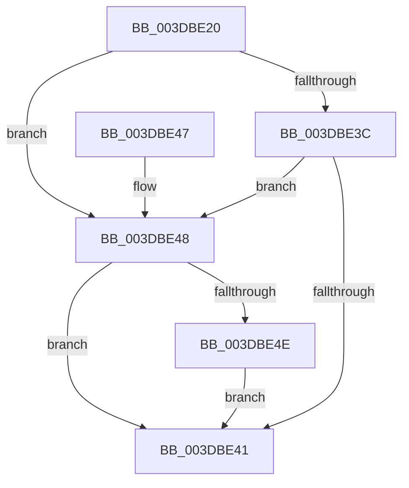

# HalGetDmaTransferInfo

- RVA: `0x003DBE20`–`0x003DBE57` (길이 `55` bytes)
- VA: `0x00000001403DBE20`
- 실행 섹션: `.text`
- PDB 이름 있음: `예`; PDB Function 태그: `아니요`
- unwind 정보 RVA: `0x0006E698`
- 디코드: `18`개 명령, `55/55` bytes 표시
- 미해석 바이트: `0` (있으면 어셈블리에 `.byte`로 보존)

> 이 문서는 커널 이미지의 기계어와 PDB 기호를 분석해 생성했습니다. 4번과 5번은 함수 원형과 자료형을 바이너리 사용 방식에서 추정한 C 해석이며 원본 소스 복구 결과는 아닙니다.

## 1. Dependencies

- 직접 호출 지점: **1**; 고유 호출 대상: **1**
- 직접 호출자로 확인된 함수: **1**
- RIP 상대 이미지 참조: **0**

### Outgoing calls
- `0x003DBE30` → [HalGetDmaTransferInfoInternal](HalGetDmaTransferInfoInternal_function_003DBE60.md) (function, `0x003DBE60`)

### Direct callers
- [HalCalculateScatterGatherListSizeV3](../48/HalCalculateScatterGatherListSizeV3_function_00481110.md) at `0x004811B2`

### Static image references
- 디코드된 RIP-relative 메모리 참조가 없습니다.

## 2. Other-region calls and transfers

- 다른 실행 섹션으로 향하는 call: **0**
- 별도 외부 분기/꼬리 이동을 확인하지 못했습니다.

## 3. Assembly (complete function range)

```asm
003DBE20  40 53                           push rbx
003DBE22  48 83 EC 30                     sub rsp, 0x30
003DBE26  48 8B 5C 24 68                  mov rbx, qword ptr [rsp + 0x68]
003DBE2B  48 89 5C 24 28                  mov qword ptr [rsp + 0x28], rbx
003DBE30  E8 2B 00 00 00                  call 0x1403dbe60
003DBE35  8B 13                           mov edx, dword ptr [rbx]
003DBE37  83 EA 01                        sub edx, 1
003DBE3A  74 0C                           je 0x1403dbe48
003DBE3C  83 FA 01                        cmp edx, 1
003DBE3F  74 07                           je 0x1403dbe48
003DBE41  48 83 C4 30                     add rsp, 0x30
003DBE45  5B                              pop rbx
003DBE46  C3                              ret
003DBE47  CC                              int3
003DBE48  83 7B 04 00                     cmp dword ptr [rbx + 4], 0
003DBE4C  75 F3                           jne 0x1403dbe41
003DBE4E  C7 43 04 01 00 00 00            mov dword ptr [rbx + 4], 1
003DBE55  EB EA                           jmp 0x1403dbe41
```

## 4. C-style interpretation (structured pseudocode)

```c
__int64 __fastcall HalGetDmaTransferInfo(__int64 a1, __int64 a2, __int64 a3, __int64 a4, __int64 a5, __int64 a6)
{
    __int64 result;
    __int64 v_rsp;
    unsigned __int64 v_stack_m10;

    v_rsp = (v_rsp) - (48);
    v_stack_m10 = a6;
    result = HalGetDmaTransferInfoInternal(a1, a2, a3, a4);
    a2 = (unsigned int)(((unsigned int)(*(unsigned int *)(a6))) - (1));
    if (condition_is_equal) goto loc_003DBE48;
    if (((unsigned int)(a2)) == 1) goto loc_003DBE48;
loc_003DBE41:
    v_rsp = (v_rsp) + (48);
    return result;
loc_003DBE48:
    if ((*(unsigned int *)(a6 + 4)) != 0) goto loc_003DBE41;
    *(unsigned int *)(a6 + 4) = 1;
    goto loc_003DBE41;
}
```

## 5. (Beta) C Style

```c
int64_t HalGetDmaTransferInfo(int64_t Arg1, int64_t Arg2, int64_t Arg3, int64_t Arg4, uint64_t Arg5, void *Arg6)
{
    uint8_t *arg6 = (uint8_t *)Arg6;

    int64_t result;
    int64_t local_rsp;
    uint64_t v_stack_m10;

    local_rsp = (local_rsp) - (48);
    v_stack_m10 = Arg6;
    result = HalGetDmaTransferInfoInternal(Arg1, Arg2, Arg3, Arg4);
    Arg2 = (uint32_t)(((uint32_t)(*(uint32_t *)(arg6))) - (1));
    if (condition_is_equal) goto loc_003DBE48;
    if (((uint32_t)(Arg2)) == 1) goto loc_003DBE48;
loc_003DBE41:
    local_rsp = (local_rsp) + (48);
    return result;
loc_003DBE48:
    if ((*(uint32_t *)(arg6 + 0x4)) != 0) goto loc_003DBE41;
    *(uint32_t *)(arg6 + 0x4) = 1;
    goto loc_003DBE41;
}
```

### 관측된 메모리 오프셋

구조체 형식이 확인되지 않은 접근은 인자 기준의 오프셋으로만 기록했습니다.

| 기준 인자 | 오프셋 표현 | 폭 (bit) | 접근 |
|---|---:|---:|---|
| `Arg6` | `+ 0x0` | `32` | `R` |
| `Arg6` | `+ 0x4` | `32` | `R` |
| `Arg6` | `+ 0x4` | `32` | `W` |

## 6. Execution-region graph

[열기: 2D/3D 그래프와 함수 탐색 컨트롤 패널](../../../control-panel.html?section=text&rva=0x003DBE20&view=graph)

- 2D 그래프는 위에서 아래로 흐르고, 3D 그래프는 빈 공간을 드래그해 회전합니다. Shift+드래그는 이동, 휠은 확대·축소, 함수 노드 선택은 대상 보고서 이동입니다.

### Static fallback


