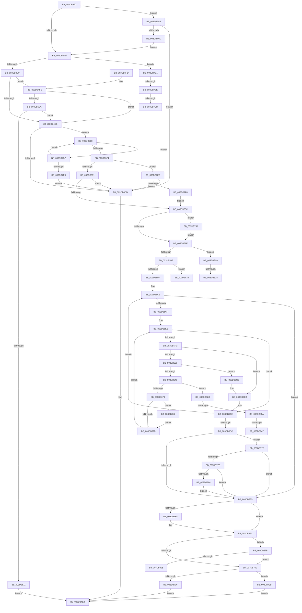

# HalMapTransferEx

- RVA: `0x003DB450`–`0x003DB89A` (길이 `1,098` bytes)
- VA: `0x00000001403DB450`
- 실행 섹션: `.text`
- PDB 이름 있음: `예`; PDB Function 태그: `예`
- unwind 정보 RVA: `0x0009404C`
- 디코드: `269`개 명령, `1,098/1,098` bytes 표시
- 미해석 바이트: `0` (있으면 어셈블리에 `.byte`로 보존)

> 이 문서는 커널 이미지의 기계어와 PDB 기호를 분석해 생성했습니다. 4번과 5번은 함수 원형과 자료형을 바이너리 사용 방식에서 추정한 C 해석이며 원본 소스 복구 결과는 아닙니다.

## 1. Dependencies

- 직접 호출 지점: **6**; 고유 호출 대상: **6**
- 직접 호출자로 확인된 함수: **1**
- RIP 상대 이미지 참조: **1**

### Outgoing calls
- `0x003DB591` → [HalpDmaCheckMdlAccessibility](HalpDmaCheckMdlAccessibility_function_003DB8A0.md) (function, `0x003DB8A0`)
- `0x003DB62D` → [IoMapTransferInternal](IoMapTransferInternal_function_003DC910.md) (function, `0x003DC910`)
- `0x003DB746` → [HalpDmaControllerProgramChannel](HalpDmaControllerProgramChannel_function_003DB990.md) (function, `0x003DB990`)
- `0x003DB75D` → [HalpDmaControllerQueryMaxFragments](HalpDmaControllerQueryMaxFragments_function_003DA0C0.md) (function, `0x003DA0C0`)
- `0x003DB86E` → [guard_dispatch_icall](../6B/guard_dispatch_icall_function_006BAAD0.md) (function, `0x006BAAD0`)
- `0x003DB887` → [HalpDmaFlushDriverMdl](../53/HalpDmaFlushDriverMdl_function_0053E178.md) (function, `0x0053E178`)

### Direct callers
- [HalpAllocateAdapterCallbackV3](HalpAllocateAdapterCallbackV3_function_003DB380.md) at `0x003DB407`

### Static image references
- `0x003DB852` → RVA `0x00FC1778` (`.data`; read)

## 2. Other-region calls and transfers

- 다른 실행 섹션으로 향하는 call: **0**
- call이 아닌 외부 분기/꼬리 이동: **10**
  - `0x003DB7B8` → [sub_006E9D14](../6E/Unknown_function_006E9D14.md) (`tail-transfer`)
  - `0x003DB7C5` → [sub_006E9D14](../6E/Unknown_function_006E9D14.md) (`tail-transfer`)
  - `0x003DB7D2` → [sub_006E9D14 + 0xD](../6E/Unknown_function_006E9D14.md) (`tail-transfer`)
  - `0x003DB814` → [sub_006E9D14 + 0x14](../6E/Unknown_function_006E9D14.md) (`tail-transfer`)
  - `0x003DB81E` → [sub_006E9D14 + 0x14](../6E/Unknown_function_006E9D14.md) (`tail-transfer`)
  - `0x003DB827` → [sub_006E9D14 + 0x30](../6E/Unknown_function_006E9D14.md) (`tail-transfer`)
  - `0x003DB834` → [sub_006E9D14 + 0x153](../6E/Unknown_function_006E9D14.md) (`tail-transfer`)
  - `0x003DB841` → [sub_006E9D14 + 0x153](../6E/Unknown_function_006E9D14.md) (`tail-transfer`)
  - `0x003DB84D` → [sub_006E9D14 + 0x18F](../6E/Unknown_function_006E9D14.md) (`tail-transfer`)
  - `0x003DB895` → [sub_006E9D14 + 0x1E3](../6E/Unknown_function_006E9D14.md) (`tail-transfer`)

## 3. Assembly (complete function range)

```asm
003DB450  48 89 5C 24 10                  mov qword ptr [rsp + 0x10], rbx
003DB455  4C 89 44 24 18                  mov qword ptr [rsp + 0x18], r8
003DB45A  55                              push rbp
003DB45B  56                              push rsi
003DB45C  57                              push rdi
003DB45D  41 54                           push r12
003DB45F  41 55                           push r13
003DB461  41 56                           push r14
003DB463  41 57                           push r15
003DB465  48 8D 6C 24 F9                  lea rbp, [rsp - 7]
003DB46A  48 81 EC B0 00 00 00            sub rsp, 0xb0
003DB471  45 33 ED                        xor r13d, r13d
003DB474  48 8B F9                        mov rdi, rcx
003DB477  33 C9                           xor ecx, ecx
003DB479  44 88 6D 47                     mov byte ptr [rbp + 0x47], r13b
003DB47D  0F 57 C0                        xorps xmm0, xmm0
003DB480  4C 89 6D C7                     mov qword ptr [rbp - 0x39], r13
003DB484  49 8B D9                        mov rbx, r9
003DB487  48 89 4D FF                     mov qword ptr [rbp - 1], rcx
003DB48B  83 BF 08 02 00 00 03            cmp dword ptr [rdi + 0x208], 3
003DB492  49 8B C0                        mov rax, r8
003DB495  48 8B F2                        mov rsi, rdx
003DB498  89 4D DF                        mov dword ptr [rbp - 0x21], ecx
003DB49B  0F 11 45 EF                     movups xmmword ptr [rbp - 0x11], xmm0
003DB49F  4C 89 6D AF                     mov qword ptr [rbp - 0x51], r13
003DB4A3  0F 11 45 CF                     movups xmmword ptr [rbp - 0x31], xmm0
003DB4A7  0F 84 F6 02 00 00               je 0x1403db7a3
003DB4AD  48 8B 87 00 02 00 00            mov rax, qword ptr [rdi + 0x200]
003DB4B4  48 89 45 E7                     mov qword ptr [rbp - 0x19], rax
003DB4B8  48 8B 45 6F                     mov rax, qword ptr [rbp + 0x6f]
003DB4BC  C6 87 0C 02 00 00 01            mov byte ptr [rdi + 0x20c], 1
003DB4C3  44 89 6D A3                     mov dword ptr [rbp - 0x5d], r13d
003DB4C7  44 39 28                        cmp dword ptr [rax], r13d
003DB4CA  0F 84 E1 02 00 00               je 0x1403db7b1
003DB4D0  44 0F 20 C0                     mov rax, cr8
003DB4D4  3C 0F                           cmp al, 0xf
003DB4D6  75 26                           jne 0x1403db4fe
003DB4D8  48 85 D2                        test rdx, rdx
003DB4DB  75 3B                           jne 0x1403db518
003DB4DD  B8 0D 00 00 C0                  mov eax, 0xc000000d
003DB4E2  48 8B 9C 24 F8 00 00 00         mov rbx, qword ptr [rsp + 0xf8]
003DB4EA  48 81 C4 B0 00 00 00            add rsp, 0xb0
003DB4F1  41 5F                           pop r15
003DB4F3  41 5E                           pop r14
003DB4F5  41 5D                           pop r13
003DB4F7  41 5C                           pop r12
003DB4F9  5F                              pop rdi
003DB4FA  5E                              pop rsi
003DB4FB  5D                              pop rbp
003DB4FC  C3                              ret
003DB4FD  CC                              int3
003DB4FE  48 8B 87 68 01 00 00            mov rax, qword ptr [rdi + 0x168]
003DB505  48 85 C0                        test rax, rax
003DB508  74 CE                           je 0x1403db4d8
003DB50A  8B 40 0C                        mov eax, dword ptr [rax + 0xc]
003DB50D  A8 01                           test al, 1
003DB50F  74 C7                           je 0x1403db4d8
003DB511  B8 20 01 00 C0                  mov eax, 0xc0000120
003DB516  EB CA                           jmp 0x1403db4e2
003DB518  8B 46 28                        mov eax, dword ptr [rsi + 0x28]
003DB51B  48 3B D8                        cmp rbx, rax
003DB51E  0F 83 B3 02 00 00               jae 0x1403db7d7
003DB524  4C 8B 7D 7F                     mov r15, qword ptr [rbp + 0x7f]
003DB528  4D 85 FF                        test r15, r15
003DB52B  0F 84 BA 02 00 00               je 0x1403db7eb
003DB531  8B 85 87 00 00 00               mov eax, dword ptr [rbp + 0x87]
003DB537  83 F8 28                        cmp eax, 0x28
003DB53A  72 A1                           jb 0x1403db4dd
003DB53C  8B C8                           mov ecx, eax
003DB53E  45 8B F5                        mov r14d, r13d
003DB541  48 83 E9 10                     sub rcx, 0x10
003DB545  4D 89 6F 08                     mov qword ptr [r15 + 8], r13
003DB549  48 B8 AB AA AA AA AA AA AA AA   movabs rax, 0xaaaaaaaaaaaaaaab
003DB553  48 F7 E1                        mul rcx
003DB556  4C 8B E2                        mov r12, rdx
003DB559  49 C1 EC 04                     shr r12, 4
003DB55D  4C 89 65 B7                     mov qword ptr [rbp - 0x49], r12
003DB561  44 38 AF B9 01 00 00            cmp byte ptr [rdi + 0x1b9], r13b
003DB568  0F 84 E2 01 00 00               je 0x1403db750
003DB56E  4C 8B 65 6F                     mov r12, qword ptr [rbp + 0x6f]
003DB572  48 8D 45 C7                     lea rax, [rbp - 0x39]
003DB576  48 89 44 24 28                  mov qword ptr [rsp + 0x28], rax
003DB57B  44 8B C3                        mov r8d, ebx
003DB57E  48 8D 45 47                     lea rax, [rbp + 0x47]
003DB582  48 8B D6                        mov rdx, rsi
003DB585  48 8B CF                        mov rcx, rdi
003DB588  48 89 44 24 20                  mov qword ptr [rsp + 0x20], rax
003DB58D  45 8B 0C 24                     mov r9d, dword ptr [r12]
003DB591  E8 0A 03 00 00                  call 0x1403db8a0
003DB596  83 BF 08 02 00 00 03            cmp dword ptr [rdi + 0x208], 3
003DB59D  4C 89 6D BF                     mov qword ptr [rbp - 0x41], r13
003DB5A1  0F 84 63 02 00 00               je 0x1403db80a
003DB5A7  48 8B 4D 57                     mov rcx, qword ptr [rbp + 0x57]
003DB5AB  45 8B 24 24                     mov r12d, dword ptr [r12]
003DB5AF  45 33 C9                        xor r9d, r9d
003DB5B2  44 89 4D 97                     mov dword ptr [rbp - 0x69], r9d
003DB5B6  48 85 C9                        test rcx, rcx
003DB5B9  0F 84 64 02 00 00               je 0x1403db823
003DB5BF  C7 45 CF 01 00 00 00            mov dword ptr [rbp - 0x31], 1
003DB5C6  45 85 E4                        test r12d, r12d
003DB5C9  0F 84 16 01 00 00               je 0x1403db6e5
003DB5CF  8B 56 2C                        mov edx, dword ptr [rsi + 0x2c]
003DB5D2  45 8B C4                        mov r8d, r12d
003DB5D5  48 03 56 20                     add rdx, qword ptr [rsi + 0x20]
003DB5D9  8B 46 28                        mov eax, dword ptr [rsi + 0x28]
003DB5DC  48 03 D3                        add rdx, rbx
003DB5DF  2B C3                           sub eax, ebx
003DB5E1  41 3B C4                        cmp eax, r12d
003DB5E4  44 0F 46 C0                     cmovbe r8d, eax
003DB5E8  45 2B E0                        sub r12d, r8d
003DB5EB  44 89 45 9F                     mov dword ptr [rbp - 0x61], r8d
003DB5EF  48 89 55 A7                     mov qword ptr [rbp - 0x59], rdx
003DB5F3  45 85 C0                        test r8d, r8d
003DB5F6  0F 84 D2 00 00 00               je 0x1403db6ce
003DB5FC  44 3B 75 B7                     cmp r14d, dword ptr [rbp - 0x49]
003DB600  0F 83 C5 00 00 00               jae 0x1403db6cb
003DB606  8A 45 47                        mov al, byte ptr [rbp + 0x47]
003DB609  4C 8B CA                        mov r9, rdx
003DB60C  88 44 24 30                     mov byte ptr [rsp + 0x30], al
003DB610  48 8B D6                        mov rdx, rsi
003DB613  8A 45 77                        mov al, byte ptr [rbp + 0x77]
003DB616  88 44 24 28                     mov byte ptr [rsp + 0x28], al
003DB61A  48 8D 45 9B                     lea rax, [rbp - 0x65]
003DB61E  44 89 45 9B                     mov dword ptr [rbp - 0x65], r8d
003DB622  4C 8B C1                        mov r8, rcx
003DB625  48 8B CF                        mov rcx, rdi
003DB628  48 89 44 24 20                  mov qword ptr [rsp + 0x20], rax
003DB62D  E8 DE 12 00 00                  call 0x1403dc910
003DB632  8B 55 9B                        mov edx, dword ptr [rbp - 0x65]
003DB635  48 8B D8                        mov rbx, rax
003DB638  85 D2                           test edx, edx
003DB63A  0F 84 83 00 00 00               je 0x1403db6c3
003DB640  49 C7 C1 00 F0 FF FF            mov r9, 0xfffffffffffff000
003DB647  48 8B CB                        mov rcx, rbx
003DB64A  49 23 C1                        and rax, r9
003DB64D  41 B8 FF 0F 00 00               mov r8d, 0xfff
003DB653  49 23 C8                        and rcx, r8
003DB656  48 89 45 D7                     mov qword ptr [rbp - 0x29], rax
003DB65A  48 8D 82 FF 0F 00 00            lea rax, [rdx + 0xfff]
003DB661  48 03 C8                        add rcx, rax
003DB664  49 23 C9                        and rcx, r9
003DB667  83 BF 08 02 00 00 03            cmp dword ptr [rdi + 0x208], 3
003DB66E  48 89 4D DF                     mov qword ptr [rbp - 0x21], rcx
003DB672  0F 84 B4 01 00 00               je 0x1403db82c
003DB678  41 8B C6                        mov eax, r14d
003DB67B  48 8D 0C 40                     lea rcx, [rax + rax*2]
003DB67F  49 89 74 CF 20                  mov qword ptr [r15 + rcx*8 + 0x20], rsi
003DB684  41 89 54 CF 18                  mov dword ptr [r15 + rcx*8 + 0x18], edx
003DB689  49 89 5C CF 10                  mov qword ptr [r15 + rcx*8 + 0x10], rbx
003DB68E  83 BF 08 02 00 00 01            cmp dword ptr [rdi + 0x208], 1
003DB695  0F 84 B7 01 00 00               je 0x1403db852
003DB69B  8B 4D 9B                        mov ecx, dword ptr [rbp - 0x65]
003DB69E  44 8B 4D 97                     mov r9d, dword ptr [rbp - 0x69]
003DB6A2  48 8B 55 A7                     mov rdx, qword ptr [rbp - 0x59]
003DB6A6  44 03 C9                        add r9d, ecx
003DB6A9  44 8B 45 9F                     mov r8d, dword ptr [rbp - 0x61]
003DB6AD  48 03 D1                        add rdx, rcx
003DB6B0  44 2B C1                        sub r8d, ecx
003DB6B3  44 89 4D 97                     mov dword ptr [rbp - 0x69], r9d
003DB6B7  48 8B 4D 57                     mov rcx, qword ptr [rbp + 0x57]
003DB6BB  41 FF C6                        inc r14d
003DB6BE  E9 28 FF FF FF                  jmp 0x1403db5eb
003DB6C3  44 8B 4D 97                     mov r9d, dword ptr [rbp - 0x69]
003DB6C7  48 8B 4D 57                     mov rcx, qword ptr [rbp + 0x57]
003DB6CB  45 33 E4                        xor r12d, r12d
003DB6CE  48 8B 36                        mov rsi, qword ptr [rsi]
003DB6D1  33 DB                           xor ebx, ebx
003DB6D3  48 85 F6                        test rsi, rsi
003DB6D6  0F 85 EA FE FF FF               jne 0x1403db5c6
003DB6DC  48 85 F6                        test rsi, rsi
003DB6DF  0F 84 8D 00 00 00               je 0x1403db772
003DB6E5  48 8B 45 6F                     mov rax, qword ptr [rbp + 0x6f]
003DB6E9  45 89 37                        mov dword ptr [r15], r14d
003DB6EC  44 89 08                        mov dword ptr [rax], r9d
003DB6EF  48 8B 45 57                     mov rax, qword ptr [rbp + 0x57]
003DB6F3  48 85 C0                        test rax, rax
003DB6F6  74 04                           je 0x1403db6fc
003DB6F8  44 89 48 10                     mov dword ptr [rax + 0x10], r9d
003DB6FC  80 7D 47 00                     cmp byte ptr [rbp + 0x47], 0
003DB700  8A 5D 77                        mov bl, byte ptr [rbp + 0x77]
003DB703  0F 85 72 01 00 00               jne 0x1403db87b
003DB709  80 BF B9 01 00 00 00            cmp byte ptr [rdi + 0x1b9], 0
003DB710  0F 85 85 00 00 00               jne 0x1403db79b
003DB716  8B 45 67                        mov eax, dword ptr [rbp + 0x67]
003DB719  48 8B D7                        mov rdx, rdi
003DB71C  48 03 87 C8 01 00 00            add rax, qword ptr [rdi + 0x1c8]
003DB723  4C 8B 8D 97 00 00 00            mov r9, qword ptr [rbp + 0x97]
003DB72A  4C 8B 85 8F 00 00 00            mov r8, qword ptr [rbp + 0x8f]
003DB731  48 8B 8F 70 01 00 00            mov rcx, qword ptr [rdi + 0x170]
003DB738  88 5C 24 30                     mov byte ptr [rsp + 0x30], bl
003DB73C  48 89 44 24 28                  mov qword ptr [rsp + 0x28], rax
003DB741  4C 89 7C 24 20                  mov qword ptr [rsp + 0x20], r15
003DB746  E8 45 02 00 00                  call 0x1403db990
003DB74B  E9 92 FD FF FF                  jmp 0x1403db4e2
003DB750  48 8B 8F 70 01 00 00            mov rcx, qword ptr [rdi + 0x170]
003DB757  45 8B C4                        mov r8d, r12d
003DB75A  48 8B D7                        mov rdx, rdi
003DB75D  E8 5E E9 FF FF                  call 0x1403da0c0
003DB762  41 3B C4                        cmp eax, r12d
003DB765  44 0F 42 E0                     cmovb r12d, eax
003DB769  4C 89 65 B7                     mov qword ptr [rbp - 0x49], r12
003DB76D  E9 FC FD FF FF                  jmp 0x1403db56e
003DB772  45 85 E4                        test r12d, r12d
003DB775  0F 84 6A FF FF FF               je 0x1403db6e5
003DB77B  45 85 F6                        test r14d, r14d
003DB77E  0F 84 61 FF FF FF               je 0x1403db6e5
003DB784  41 8D 4E FF                     lea ecx, [r14 - 1]
003DB788  48 FF C1                        inc rcx
003DB78B  48 8D 04 49                     lea rax, [rcx + rcx*2]
003DB78F  45 01 24 C7                     add dword ptr [r15 + rax*8], r12d
003DB793  45 03 CC                        add r9d, r12d
003DB796  E9 4A FF FF FF                  jmp 0x1403db6e5
003DB79B  8B 45 A3                        mov eax, dword ptr [rbp - 0x5d]
003DB79E  E9 3F FD FF FF                  jmp 0x1403db4e2
003DB7A3  48 85 C0                        test rax, rax
003DB7A6  0F 84 31 FD FF FF               je 0x1403db4dd
003DB7AC  E9 FC FC FF FF                  jmp 0x1403db4ad
003DB7B1  48 8B 45 7F                     mov rax, qword ptr [rbp + 0x7f]
003DB7B5  48 85 C0                        test rax, rax
003DB7B8  0F 84 56 E5 30 00               je 0x1406e9d14
003DB7BE  83 BD 87 00 00 00 10            cmp dword ptr [rbp + 0x87], 0x10
003DB7C5  0F 82 49 E5 30 00               jb 0x1406e9d14
003DB7CB  44 89 28                        mov dword ptr [rax], r13d
003DB7CE  4C 89 68 08                     mov qword ptr [rax + 8], r13
003DB7D2  E9 4A E5 30 00                  jmp 0x1406e9d21
003DB7D7  48 8B 36                        mov rsi, qword ptr [rsi]
003DB7DA  48 2B D8                        sub rbx, rax
003DB7DD  48 85 F6                        test rsi, rsi
003DB7E0  0F 85 32 FD FF FF               jne 0x1403db518
003DB7E6  E9 F2 FC FF FF                  jmp 0x1403db4dd
003DB7EB  44 38 AF B9 01 00 00            cmp byte ptr [rdi + 0x1b9], r13b
003DB7F2  0F 85 E5 FC FF FF               jne 0x1403db4dd
003DB7F8  8B 87 74 02 00 00               mov eax, dword ptr [rdi + 0x274]
003DB7FE  4C 8D BF 78 02 00 00            lea r15, [rdi + 0x278]
003DB805  E9 32 FD FF FF                  jmp 0x1403db53c
003DB80A  8B 87 FC 00 00 00               mov eax, dword ptr [rdi + 0xfc]
003DB810  41 39 04 24                     cmp dword ptr [r12], eax
003DB814  0F 86 0E E5 30 00               jbe 0x1406e9d28
003DB81A  41 89 04 24                     mov dword ptr [r12], eax
003DB81E  E9 05 E5 30 00                  jmp 0x1406e9d28
003DB823  48 89 4D A7                     mov qword ptr [rbp - 0x59], rcx
003DB827  E9 18 E5 30 00                  jmp 0x1406e9d44
003DB82C  41 8B C5                        mov eax, r13d
003DB82F  0B C3                           or eax, ebx
003DB831  41 85 C0                        test r8d, eax
003DB834  0F 85 2D E6 30 00               jne 0x1406e9e67
003DB83A  48 8B 45 BF                     mov rax, qword ptr [rbp - 0x41]
003DB83E  48 85 C0                        test rax, rax
003DB841  0F 84 20 E6 30 00               je 0x1406e9e67
003DB847  41 FF CE                        dec r14d
003DB84A  01 50 08                        add dword ptr [rax + 8], edx
003DB84D  E9 51 E6 30 00                  jmp 0x1406e9ea3
003DB852  48 8B 05 1F 5F BE 00            mov rax, qword ptr [rip + 0xbe5f1f]
003DB859  4C 8D 45 CF                     lea r8, [rbp - 0x31]
003DB85D  48 8B 4D E7                     mov rcx, qword ptr [rbp - 0x19]
003DB861  BA 03 00 00 00                  mov edx, 3
003DB866  48 8B 40 48                     mov rax, qword ptr [rax + 0x48]
003DB86A  48 8B 49 28                     mov rcx, qword ptr [rcx + 0x28]
003DB86E  E8 5D F2 2D 00                  call 0x1406baad0
003DB873  89 45 A3                        mov dword ptr [rbp - 0x5d], eax
003DB876  E9 20 FE FF FF                  jmp 0x1403db69b
003DB87B  48 8B 75 C7                     mov rsi, qword ptr [rbp - 0x39]
003DB87F  84 DB                           test bl, bl
003DB881  48 8B CE                        mov rcx, rsi
003DB884  0F 94 C2                        sete dl
003DB887  E8 EC 28 16 00                  call 0x14053e178
003DB88C  48 85 F6                        test rsi, rsi
003DB88F  0F 84 74 FE FF FF               je 0x1403db709
003DB895  E9 5D E6 30 00                  jmp 0x1406e9ef7
```

## 4. C-style interpretation (structured pseudocode)

```c
__int64 __fastcall HalMapTransferEx(__int64 a1, __int64 a2, __int64 a3, __int64 a4, unsigned int a5, __int64 a6, unsigned __int8 a7, __int64 a8, unsigned int a9, __int64 a10, __int64 a11)
{
    __int64 result;
    __int64 v_r12;
    __int64 v_r13;
    __int64 v_r14;
    __int64 v_rbx;
    __int64 v_rsp;
    unsigned __int64 v_stack_m3F;
    unsigned __int64 v_stack_m40;
    unsigned __int64 v_stack_m50;
    unsigned __int64 v_stack_m58;
    unsigned int v_stack_m60;
    unsigned __int64 v_stack_m68;
    unsigned __int64 v_stack_m70;
    unsigned __int64 v_stack_m78;
    unsigned __int64 v_stack_m80;
    unsigned __int64 v_stack_m88;
    unsigned __int64 v_stack_m90;
    unsigned __int64 v_stack_m98;
    unsigned int v_stack_m9C;
    unsigned int v_stack_mA0;
    unsigned __int64 v_stack_mA4;
    unsigned int v_stack_mA8;
    unsigned __int64 v_stack_p10;
    unsigned __int64 v_stack_p18;
    unsigned __int64 v_stack_p20;
    unsigned __int64 v_stack_p28;
    unsigned __int8 v_stack_p30;
    unsigned __int8 v_stack_p8;

    v_stack_p10 = v_rbx;
    v_stack_p18 = a3;
    v_rsp = (v_rsp) - (176);
    v_r13 = 0;
    a1 = 0;
    v_stack_p8 = 0;
    v_stack_m78 = 0;
    v_stack_m40 = 0;
    v_stack_m60 = 0;
    v_stack_m50 = v_xmm0;
    v_stack_m90 = 0;
    v_stack_m70 = v_xmm0;
    if ((*(unsigned int *)(a1 + 520)) == 3) goto loc_003DB7A3;
loc_003DB4AD:
    v_stack_m58 = *(unsigned __int64 *)(a1 + 512);
    *(unsigned __int8 *)(a1 + 524) = 1;
    v_stack_m9C = 0;
    if ((*(unsigned int *)(a6)) == 0) goto loc_003DB7B1;
    if (((unsigned __int8)(v_cr8)) != 15) goto loc_003DB4FE;
loc_003DB4D8:
    if (a2 != 0) goto loc_003DB518;
loc_003DB4DD:
loc_003DB4E2:
    v_rsp = (v_rsp) + (176);
    return (unsigned int)(0xC000000DULL);
loc_003DB4FE:
    if (*(unsigned __int64 *)(a1 + 360) == 0) goto loc_003DB4D8;
    if ((((unsigned __int8)((unsigned int)(*(unsigned int *)(*(unsigned __int64 *)(a1 + 360) + 12)))) & (1)) == 0) goto loc_003DB4D8;
    goto loc_003DB4E2;
loc_003DB518:
    if (v_stack_p10 >= ((unsigned int)(*(unsigned int *)(a2 + 40)))) goto loc_003DB7D7;
    if (a8 == 0) goto loc_003DB7EB;
    if (((unsigned int)((unsigned int)(a9))) < 40) goto loc_003DB4DD;
loc_003DB53C:
    a1 = ((unsigned int)((unsigned int)((unsigned int)(a9)))) - (16);
    *(unsigned __int64 *)(a8 + 8) = 0;
    v_r12 = (a2) >> (4);
    v_stack_m88 = v_r12;
    if ((*(unsigned __int8 *)(a1 + 441)) == 0) goto loc_003DB750;
loc_003DB56E:
    v_stack_p28 = v_stack_m78;
    v_stack_p20 = v_stack_p8;
    result = HalpDmaCheckMdlAccessibility(a1, a2, (unsigned int)((unsigned int)(v_stack_p10)), (unsigned int)(*(unsigned int *)(a6)));
    v_stack_m80 = 0;
    if ((*(unsigned int *)(a1 + 520)) == 3) goto loc_003DB80A;
    a4 = 0;
    v_stack_mA8 = 0;
    if (v_stack_p18 == 0) goto loc_003DB823;
    v_stack_m70 = 1;
loc_003DB5C6:
    if ((unsigned int)((unsigned int)(*(unsigned int *)(a6))) == 0) goto loc_003DB6E5;
    a2 = ((unsigned int)(*(unsigned int *)(a2 + 44))) + (*(unsigned __int64 *)(a2 + 32));
    a2 = (a2) + (v_stack_p10);
    result = (unsigned int)(((unsigned int)(*(unsigned int *)(a2 + 40))) - ((unsigned int)(v_stack_p10)));
    a3 = (unsigned int)((unsigned int)((unsigned int)(*(unsigned int *)(a6))));
    if (((unsigned int)(result)) <= ((unsigned int)((unsigned int)(*(unsigned int *)(a6))))) { a3 = (unsigned int)(result); }
    v_r12 = (unsigned int)(((unsigned int)(*(unsigned int *)(a6))) - ((unsigned int)(a3)));
loc_003DB5EB:
    v_stack_mA0 = (unsigned int)(a3);
    v_stack_m98 = a2;
    if ((unsigned int)(a3) == 0) goto loc_003DB6CE;
    if (0 >= v_stack_m88) goto loc_003DB6CB;
    v_stack_p30 = (unsigned __int8)(v_stack_p8);
    v_stack_p28 = a7;
    v_stack_mA4 = (unsigned int)(a3);
    v_stack_p20 = v_stack_mA4;
    result = IoMapTransferInternal(a1, a2, v_stack_p18, a2);
    if ((unsigned int)((unsigned int)(v_stack_mA4)) == 0) goto loc_003DB6C3;
    result = (result) & (0xFFFFFFFFFFFFF000ULL);
    a1 = (result) & ((unsigned int)(0xFFFULL));
    v_stack_m68 = result;
    a1 = (a1) + ((unsigned int)(v_stack_mA4) + 4095);
    a1 = (a1) & (0xFFFFFFFFFFFFF000ULL);
    v_stack_m60 = a1;
    if ((*(unsigned int *)(a1 + 520)) == 3) goto loc_003DB82C;
    *(unsigned __int64 *)(a8 + 0 + 0 * 2 * 8 + 32) = a2;
    *(unsigned int *)(a8 + 0 + 0 * 2 * 8 + 24) = (unsigned int)((unsigned int)(v_stack_mA4));
    *(unsigned __int64 *)(a8 + 0 + 0 * 2 * 8 + 16) = result;
    if ((*(unsigned int *)(a1 + 520)) == 1) goto loc_003DB852;
loc_003DB69B:
    a4 = (unsigned int)(((unsigned int)(v_stack_mA8)) + ((unsigned int)((unsigned int)(v_stack_mA4))));
    a2 = (v_stack_m98) + ((unsigned int)(v_stack_mA4));
    a3 = (unsigned int)(((unsigned int)(v_stack_mA0)) - ((unsigned int)((unsigned int)(v_stack_mA4))));
    v_stack_mA8 = (unsigned int)(a4);
    v_r14 = (unsigned int)((0) + 1);
    goto loc_003DB5EB;
loc_003DB6C3:
loc_003DB6CB:
    v_r12 = 0;
loc_003DB6CE:
    v_rbx = 0;
    if (*(unsigned __int64 *)(a2) != 0) goto loc_003DB5C6;
    if (*(unsigned __int64 *)(a2) == 0) goto loc_003DB772;
loc_003DB6E5:
    *(unsigned int *)(a8) = (unsigned int)(v_r14);
    *(unsigned int *)(a6) = (unsigned int)((unsigned int)(v_stack_mA8));
    if (v_stack_p18 != 0) {
        *(unsigned int *)(v_stack_p18 + 16) = (unsigned int)((unsigned int)(v_stack_mA8));
    }
    if (v_stack_p8 != 0) goto loc_003DB87B;
loc_003DB709:
    if ((*(unsigned __int8 *)(a1 + 441)) != 0) goto loc_003DB79B;
    result = ((unsigned int)(a5)) + (*(unsigned __int64 *)(a1 + 456));
    v_stack_p30 = a7;
    v_stack_p28 = result;
    v_stack_p20 = a8;
    result = HalpDmaControllerProgramChannel(*(unsigned __int64 *)(a1 + 368), a1, a10, a11);
    goto loc_003DB4E2;
loc_003DB750:
    result = HalpDmaControllerQueryMaxFragments(*(unsigned __int64 *)(a1 + 368), a1, 0, a11);
    if (((unsigned int)(result)) < 0) { v_r12 = (unsigned int)(result); }
    v_stack_m88 = v_r12;
    goto loc_003DB56E;
loc_003DB772:
    if ((unsigned int)(v_r12) == 0) goto loc_003DB6E5;
    if ((unsigned int)(v_r14) == 0) goto loc_003DB6E5;
    a1 = (v_r14 - 1) + 1;
    a4 = (unsigned int)((a11) + ((unsigned int)(v_r12)));
    goto loc_003DB6E5;
loc_003DB79B:
    goto loc_003DB4E2;
loc_003DB7A3:
    if ((unsigned int)(v_stack_m9C) == 0) goto loc_003DB4DD;
    goto loc_003DB4AD;
loc_003DB7B1:
    *(unsigned int *)(a8) = 0;
    *(unsigned __int64 *)(a8 + 8) = 0;
loc_003DB7D7:
    v_rbx = (a7) - (a8);
    if (*(unsigned __int64 *)(*(unsigned __int64 *)(a2)) != 0) goto loc_003DB518;
    goto loc_003DB4DD;
loc_003DB7EB:
    if ((*(unsigned __int8 *)(a1 + 441)) != 0) goto loc_003DB4DD;
    goto loc_003DB53C;
loc_003DB80A:
    *(unsigned int *)(v_r12) = (unsigned int)((unsigned int)(*(unsigned int *)(a1 + 252)));
loc_003DB823:
    v_stack_m98 = a1;
loc_003DB82C:
    result = (unsigned int)((0) | ((unsigned int)(v_rbx)));
    v_r14 = (unsigned int)((v_r14) - 1);
loc_003DB852:
    result = guard_dispatch_icall(*(unsigned __int64 *)(v_stack_m58 + 40), 3, v_stack_m70, a4);
    v_stack_m9C = (unsigned int)(result);
    goto loc_003DB69B;
loc_003DB87B:
    a2 = ((unsigned __int8)(v_rbx) == 0) ? 1 : 0;
    result = HalpDmaFlushDriverMdl(v_stack_m78, a2, v_stack_m70, a4);
    if (v_stack_m78 == 0) goto loc_003DB709;
}
```

## 5. (Beta) C Style

```c
int64_t HalMapTransferEx(void *Arg1, int64_t Arg2, int64_t Arg3, int64_t Arg4, uint32_t Arg5, void *Arg6, uint8_t Arg7, int64_t Arg8, uint32_t Arg9, int64_t Arg10, int64_t Arg11)
{
    uint8_t *arg1 = (uint8_t *)Arg1;
    uint8_t *arg6 = (uint8_t *)Arg6;

    int64_t result;
    int64_t local_r12;
    int64_t local_r13;
    int64_t local_r14;
    int64_t local_rbx;
    int64_t local_rsp;
    uint64_t v_stack_m3F;
    uint64_t v_stack_m40;
    uint64_t v_stack_m50;
    uint64_t v_stack_m58;
    uint32_t v_stack_m60;
    uint64_t v_stack_m68;
    uint64_t v_stack_m70;
    uint64_t v_stack_m78;
    uint64_t v_stack_m80;
    uint64_t v_stack_m88;
    uint64_t v_stack_m90;
    uint64_t v_stack_m98;
    uint32_t v_stack_m9C;
    uint32_t v_stack_mA0;
    uint64_t v_stack_mA4;
    uint32_t v_stack_mA8;
    uint64_t v_stack_p10;
    uint64_t v_stack_p18;
    uint64_t v_stack_p20;
    uint64_t v_stack_p28;
    uint8_t v_stack_p30;
    uint8_t v_stack_p8;

    v_stack_p10 = local_rbx;
    v_stack_p18 = Arg3;
    local_rsp = (local_rsp) - (176);
    local_r13 = 0;
    Arg1 = 0;
    v_stack_p8 = 0;
    v_stack_m78 = 0;
    v_stack_m40 = 0;
    v_stack_m60 = 0;
    v_stack_m50 = v_xmm0;
    v_stack_m90 = 0;
    v_stack_m70 = v_xmm0;
    if ((*(uint32_t *)(arg1 + 0x208)) == 3) goto loc_003DB7A3;
loc_003DB4AD:
    v_stack_m58 = *(uint64_t *)(arg1 + 0x200);
    *(uint8_t *)(arg1 + 0x20C) = 1;
    v_stack_m9C = 0;
    if ((*(uint32_t *)(arg6)) == 0) goto loc_003DB7B1;
    if (((uint8_t)(v_cr8)) != 15) goto loc_003DB4FE;
loc_003DB4D8:
    if (Arg2 != 0) goto loc_003DB518;
loc_003DB4DD:
loc_003DB4E2:
    local_rsp = (local_rsp) + (176);
    return (uint32_t)(0xC000000DULL);
loc_003DB4FE:
    if (*(uint64_t *)(arg1 + 0x168) == 0) goto loc_003DB4D8;
    if ((((uint8_t)((uint32_t)(*(uint32_t *)(*(uint64_t *)(arg1 + 0x168) + 0xC)))) & (1)) == 0) goto loc_003DB4D8;
    goto loc_003DB4E2;
loc_003DB518:
    if (v_stack_p10 >= ((uint32_t)(*(uint32_t *)(Arg2 + 0x28)))) goto loc_003DB7D7;
    if (Arg8 == 0) goto loc_003DB7EB;
    if (((uint32_t)((uint32_t)(Arg9))) < 40) goto loc_003DB4DD;
loc_003DB53C:
    Arg1 = ((uint32_t)((uint32_t)((uint32_t)(Arg9)))) - (16);
    *(uint64_t *)(Arg8 + 0x8) = 0;
    local_r12 = (Arg2) >> (4);
    v_stack_m88 = local_r12;
    if ((*(uint8_t *)(arg1 + 0x1B9)) == 0) goto loc_003DB750;
loc_003DB56E:
    v_stack_p28 = v_stack_m78;
    v_stack_p20 = v_stack_p8;
    result = HalpDmaCheckMdlAccessibility(Arg1, Arg2, (uint32_t)((uint32_t)(v_stack_p10)), (uint32_t)(*(uint32_t *)(arg6)));
    v_stack_m80 = 0;
    if ((*(uint32_t *)(arg1 + 0x208)) == 3) goto loc_003DB80A;
    Arg4 = 0;
    v_stack_mA8 = 0;
    if (v_stack_p18 == 0) goto loc_003DB823;
    v_stack_m70 = 1;
loc_003DB5C6:
    if ((uint32_t)((uint32_t)(*(uint32_t *)(arg6))) == 0) goto loc_003DB6E5;
    Arg2 = ((uint32_t)(*(uint32_t *)(Arg2 + 0x2C))) + (*(uint64_t *)(Arg2 + 0x20));
    Arg2 = (Arg2) + (v_stack_p10);
    result = (uint32_t)(((uint32_t)(*(uint32_t *)(Arg2 + 0x28))) - ((uint32_t)(v_stack_p10)));
    Arg3 = (uint32_t)((uint32_t)((uint32_t)(*(uint32_t *)(arg6))));
    if (((uint32_t)(result)) <= ((uint32_t)((uint32_t)(*(uint32_t *)(arg6))))) { Arg3 = (uint32_t)(result); }
    local_r12 = (uint32_t)(((uint32_t)(*(uint32_t *)(arg6))) - ((uint32_t)(Arg3)));
loc_003DB5EB:
    v_stack_mA0 = (uint32_t)(Arg3);
    v_stack_m98 = Arg2;
    if ((uint32_t)(Arg3) == 0) goto loc_003DB6CE;
    if (0 >= v_stack_m88) goto loc_003DB6CB;
    v_stack_p30 = (uint8_t)(v_stack_p8);
    v_stack_p28 = Arg7;
    v_stack_mA4 = (uint32_t)(Arg3);
    v_stack_p20 = v_stack_mA4;
    result = IoMapTransferInternal(Arg1, Arg2, v_stack_p18, Arg2);
    if ((uint32_t)((uint32_t)(v_stack_mA4)) == 0) goto loc_003DB6C3;
    result = (result) & (0xFFFFFFFFFFFFF000ULL);
    Arg1 = (result) & ((uint32_t)(0xFFFULL));
    v_stack_m68 = result;
    Arg1 = (Arg1) + ((uint32_t)(v_stack_mA4) + 4095);
    Arg1 = (Arg1) & (0xFFFFFFFFFFFFF000ULL);
    v_stack_m60 = Arg1;
    if ((*(uint32_t *)(arg1 + 0x208)) == 3) goto loc_003DB82C;
    *(uint64_t *)(Arg8 + 0x0 + 0x0 * 2 * 8 + 0x20) = Arg2;
    *(uint32_t *)(Arg8 + 0x0 + 0x0 * 2 * 8 + 0x18) = (uint32_t)((uint32_t)(v_stack_mA4));
    *(uint64_t *)(Arg8 + 0x0 + 0x0 * 2 * 8 + 0x10) = result;
    if ((*(uint32_t *)(arg1 + 0x208)) == 1) goto loc_003DB852;
loc_003DB69B:
    Arg4 = (uint32_t)(((uint32_t)(v_stack_mA8)) + ((uint32_t)((uint32_t)(v_stack_mA4))));
    Arg2 = (v_stack_m98) + ((uint32_t)(v_stack_mA4));
    Arg3 = (uint32_t)(((uint32_t)(v_stack_mA0)) - ((uint32_t)((uint32_t)(v_stack_mA4))));
    v_stack_mA8 = (uint32_t)(Arg4);
    local_r14 = (uint32_t)((0) + 1);
    goto loc_003DB5EB;
loc_003DB6C3:
loc_003DB6CB:
    local_r12 = 0;
loc_003DB6CE:
    local_rbx = 0;
    if (*(uint64_t *)(Arg2) != 0) goto loc_003DB5C6;
    if (*(uint64_t *)(Arg2) == 0) goto loc_003DB772;
loc_003DB6E5:
    *(uint32_t *)(Arg8) = (uint32_t)(local_r14);
    *(uint32_t *)(arg6) = (uint32_t)((uint32_t)(v_stack_mA8));
    if (v_stack_p18 != 0) {
        *(uint32_t *)(v_stack_p18 + 0x10) = (uint32_t)((uint32_t)(v_stack_mA8));
    }
    if (v_stack_p8 != 0) goto loc_003DB87B;
loc_003DB709:
    if ((*(uint8_t *)(arg1 + 0x1B9)) != 0) goto loc_003DB79B;
    result = ((uint32_t)(Arg5)) + (*(uint64_t *)(arg1 + 0x1C8));
    v_stack_p30 = Arg7;
    v_stack_p28 = result;
    v_stack_p20 = Arg8;
    result = HalpDmaControllerProgramChannel(*(uint64_t *)(arg1 + 0x170), Arg1, Arg10, Arg11);
    goto loc_003DB4E2;
loc_003DB750:
    result = HalpDmaControllerQueryMaxFragments(*(uint64_t *)(arg1 + 0x170), Arg1, 0, Arg11);
    if (((uint32_t)(result)) < 0) { local_r12 = (uint32_t)(result); }
    v_stack_m88 = local_r12;
    goto loc_003DB56E;
loc_003DB772:
    if ((uint32_t)(local_r12) == 0) goto loc_003DB6E5;
    if ((uint32_t)(local_r14) == 0) goto loc_003DB6E5;
    Arg1 = (local_r14 - 1) + 1;
    Arg4 = (uint32_t)((Arg11) + ((uint32_t)(local_r12)));
    goto loc_003DB6E5;
loc_003DB79B:
    goto loc_003DB4E2;
loc_003DB7A3:
    if ((uint32_t)(v_stack_m9C) == 0) goto loc_003DB4DD;
    goto loc_003DB4AD;
loc_003DB7B1:
    *(uint32_t *)(Arg8) = 0;
    *(uint64_t *)(Arg8 + 0x8) = 0;
loc_003DB7D7:
    local_rbx = (Arg7) - (Arg8);
    if (*(uint64_t *)(*(uint64_t *)(Arg2)) != 0) goto loc_003DB518;
    goto loc_003DB4DD;
loc_003DB7EB:
    if ((*(uint8_t *)(arg1 + 0x1B9)) != 0) goto loc_003DB4DD;
    goto loc_003DB53C;
loc_003DB80A:
    *(uint32_t *)(local_r12) = (uint32_t)((uint32_t)(*(uint32_t *)(arg1 + 0xFC)));
loc_003DB823:
    v_stack_m98 = Arg1;
loc_003DB82C:
    result = (uint32_t)((0) | ((uint32_t)(local_rbx)));
    local_r14 = (uint32_t)((local_r14) - 1);
loc_003DB852:
    result = guard_dispatch_icall(*(uint64_t *)(v_stack_m58 + 0x28), 3, v_stack_m70, Arg4);
    v_stack_m9C = (uint32_t)(result);
    goto loc_003DB69B;
loc_003DB87B:
    Arg2 = ((uint8_t)(local_rbx) == 0) ? 1 : 0;
    result = HalpDmaFlushDriverMdl(v_stack_m78, Arg2, v_stack_m70, Arg4);
    if (v_stack_m78 == 0) goto loc_003DB709;
}
```

### 관측된 메모리 오프셋

구조체 형식이 확인되지 않은 접근은 인자 기준의 오프셋으로만 기록했습니다.

| 기준 인자 | 오프셋 표현 | 폭 (bit) | 접근 |
|---|---:|---:|---|
| `Arg1` | `+ 0xFC` | `32` | `R` |
| `Arg1` | `+ 0x168` | `64` | `R` |
| `Arg1` | `+ 0x170` | `64` | `R` |
| `Arg1` | `+ 0x1B9` | `8` | `R` |
| `Arg1` | `+ 0x1C8` | `64` | `R` |
| `Arg1` | `+ 0x200` | `64` | `R` |
| `Arg1` | `+ 0x208` | `32` | `R` |
| `Arg1` | `+ 0x20C` | `8` | `W` |
| `Arg1` | `+ 0x274` | `32` | `R` |
| `Arg1` | `+ 0x278` | `64` | `R` |
| `Arg6` | `+ 0x0` | `32` | `R` |
| `Arg6` | `+ 0x0` | `32` | `W` |

## 6. Execution-region graph

[열기: 2D/3D 그래프와 함수 탐색 컨트롤 패널](../../../control-panel.html?section=text&rva=0x003DB450&view=graph)

- 2D 그래프는 위에서 아래로 흐르고, 3D 그래프는 빈 공간을 드래그해 회전합니다. Shift+드래그는 이동, 휠은 확대·축소, 함수 노드 선택은 대상 보고서 이동입니다.

### Static fallback


