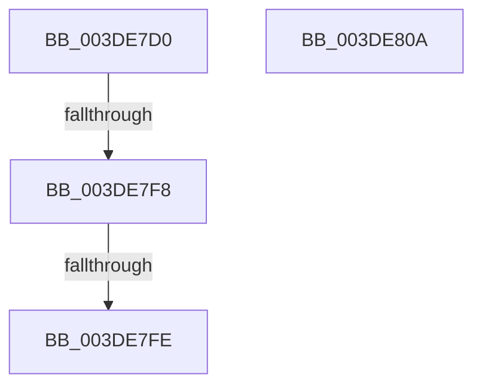

# HalPutScatterGatherListV2

- RVA: `0x003DE7D0`–`0x003DE80B` (길이 `59` bytes)
- VA: `0x00000001403DE7D0`
- 실행 섹션: `.text`
- PDB 이름 있음: `예`; PDB Function 태그: `아니요`
- unwind 정보 RVA: `0x000945B0`
- 디코드: `19`개 명령, `59/59` bytes 표시
- 미해석 바이트: `0` (있으면 어셈블리에 `.byte`로 보존)

> 이 문서는 커널 이미지의 기계어와 PDB 기호를 분석해 생성했습니다. 4번과 5번은 함수 원형과 자료형을 바이너리 사용 방식에서 추정한 C 해석이며 원본 소스 복구 결과는 아닙니다.

## 1. Dependencies

- 직접 호출 지점: **0**; 고유 호출 대상: **0**
- 직접 호출자로 확인된 함수: **1**
- RIP 상대 이미지 참조: **0**

### Outgoing calls
- 직접 디코드된 call 명령이 없습니다.

### Direct callers
- [HalPutScatterGatherList](HalPutScatterGatherList_function_003DAC80.md) at `0x003DAC9A`

### Static image references
- 디코드된 RIP-relative 메모리 참조가 없습니다.

## 2. Other-region calls and transfers

- 다른 실행 섹션으로 향하는 call: **0**
- call이 아닌 외부 분기/꼬리 이동: **2**
  - `0x003DE7F2` → [sub_003DEA73](Unknown_function_003DEA73.md) (`tail-transfer`)
  - `0x003DE7FC` → [sub_003DE80B](Unknown_function_003DE80B.md) (`tail-transfer`)

## 3. Assembly (complete function range)

```asm
003DE7D0  40 53                           push rbx
003DE7D2  57                              push rdi
003DE7D3  41 56                           push r14
003DE7D5  48 81 EC 80 00 00 00            sub rsp, 0x80
003DE7DC  48 8B 5A 08                     mov rbx, qword ptr [rdx + 8]
003DE7E0  45 0F B6 F0                     movzx r14d, r8b
003DE7E4  48 89 5C 24 48                  mov qword ptr [rsp + 0x48], rbx
003DE7E9  48 8B C2                        mov rax, rdx
003DE7EC  48 8B F9                        mov rdi, rcx
003DE7EF  48 85 DB                        test rbx, rbx
003DE7F2  0F 84 7B 02 00 00               je 0x1403dea73
003DE7F8  48 83 FB 01                     cmp rbx, 1
003DE7FC  75 0D                           jne 0x1403de80b
003DE7FE  48 81 C4 80 00 00 00            add rsp, 0x80
003DE805  41 5E                           pop r14
003DE807  5F                              pop rdi
003DE808  5B                              pop rbx
003DE809  C3                              ret
003DE80A  CC                              int3
```

## 4. C-style interpretation (structured pseudocode)

```c
__int64 __fastcall HalPutScatterGatherListV2(__int64 a1, __int64 a2, unsigned __int8 a3)
{
    __int64 v_rsp;
    unsigned __int64 v_stack_m50;

    v_rsp = (v_rsp) - (128);
    v_stack_m50 = *(unsigned __int64 *)(a2 + 8);
    v_rsp = (v_rsp) + (128);
    return a2;
}
```

## 5. (Beta) C Style

```c
void *HalPutScatterGatherListV2(int64_t Arg1, void *Arg2, uint8_t Arg3)
{
    uint8_t *arg2 = (uint8_t *)Arg2;

    int64_t local_rsp;
    uint64_t v_stack_m50;

    local_rsp = (local_rsp) - (128);
    v_stack_m50 = *(uint64_t *)(arg2 + 0x8);
    local_rsp = (local_rsp) + (128);
    return Arg2;
}
```

### 관측된 메모리 오프셋

구조체 형식이 확인되지 않은 접근은 인자 기준의 오프셋으로만 기록했습니다.

| 기준 인자 | 오프셋 표현 | 폭 (bit) | 접근 |
|---|---:|---:|---|
| `Arg2` | `+ 0x8` | `64` | `R` |

## 6. Execution-region graph

[열기: 2D/3D 그래프와 함수 탐색 컨트롤 패널](../../../control-panel.html?section=text&rva=0x003DE7D0&view=graph)

- 2D 그래프는 위에서 아래로 흐르고, 3D 그래프는 빈 공간을 드래그해 회전합니다. Shift+드래그는 이동, 휠은 확대·축소, 함수 노드 선택은 대상 보고서 이동입니다.

### Static fallback


