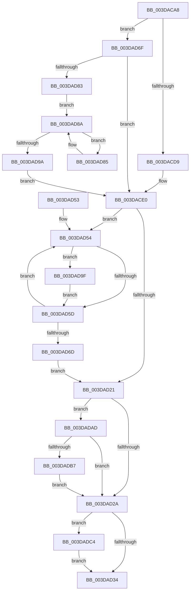

# HalPutScatterGatherListV3

- RVA: `0x003DACA8`–`0x003DADD7` (길이 `303` bytes)
- VA: `0x00000001403DACA8`
- 실행 섹션: `.text`
- PDB 이름 있음: `예`; PDB Function 태그: `아니요`
- unwind 정보 RVA: `0x00093FA4`
- 디코드: `86`개 명령, `303/303` bytes 표시
- 미해석 바이트: `0` (있으면 어셈블리에 `.byte`로 보존)

> 이 문서는 커널 이미지의 기계어와 PDB 기호를 분석해 생성했습니다. 4번과 5번은 함수 원형과 자료형을 바이너리 사용 방식에서 추정한 C 해석이며 원본 소스 복구 결과는 아닙니다.

## 1. Dependencies

- 직접 호출 지점: **7**; 고유 호출 대상: **7**
- 직접 호출자로 확인된 함수: **1**
- RIP 상대 이미지 참조: **0**

### Outgoing calls
- `0x003DAD04` → [HalFlushAdapterBuffersEx](HalFlushAdapterBuffersEx_function_003DADE0.md) (function, `0x003DADE0`)
- `0x003DAD13` → [IoFreeMapRegistersV3](IoFreeMapRegistersV3_function_003DAAD0.md) (function, `0x003DAAD0`)
- `0x003DAD60` → [IoFreeMdl](../29/IoFreeMdl_function_0029EA80.md) (function, `0x0029EA80`)
- `0x003DAD91` → [HalpDmaStartWcb](HalpDmaStartWcb_function_003DA6EC.md) (function, `0x003DA6EC`)
- `0x003DADA6` → [MmUnmapLockedPages](../24/MmUnmapLockedPages_function_00246E60.md) (function, `0x00246E60`)
- `0x003DADBA` → [HalpContinueProcessingWaitQueue](HalpContinueProcessingWaitQueue_function_003DAB9C.md) (function, `0x003DAB9C`)
- `0x003DADCD` → [ExFreePoolWithTag](../../poolcode/B8/ExFreePoolWithTag_function_00B82870.md) (function, `0x00B82870`)

### Direct callers
- [HalPutScatterGatherList](HalPutScatterGatherList_function_003DAC80.md) at `0x003DAC8F`

### Static image references
- 디코드된 RIP-relative 메모리 참조가 없습니다.

## 2. Other-region calls and transfers

- 다른 실행 섹션으로 향하는 call: **1**
  - `0x003DADCD` → [ExFreePoolWithTag](../../poolcode/B8/ExFreePoolWithTag_function_00B82870.md) (`.text` → `POOLCODE`)
- 별도 외부 분기/꼬리 이동을 확인하지 못했습니다.

## 3. Assembly (complete function range)

```asm
003DACA8  48 8B C4                        mov rax, rsp
003DACAB  48 89 58 08                     mov qword ptr [rax + 8], rbx
003DACAF  48 89 68 10                     mov qword ptr [rax + 0x10], rbp
003DACB3  48 89 70 18                     mov qword ptr [rax + 0x18], rsi
003DACB7  48 89 78 20                     mov qword ptr [rax + 0x20], rdi
003DACBB  41 54                           push r12
003DACBD  41 56                           push r14
003DACBF  41 57                           push r15
003DACC1  48 83 EC 30                     sub rsp, 0x30
003DACC5  48 8B 5A 08                     mov rbx, qword ptr [rdx + 8]
003DACC9  45 8A E0                        mov r12b, r8b
003DACCC  48 8B E9                        mov rbp, rcx
003DACCF  8B 03                           mov eax, dword ptr [rbx]
003DACD1  A8 02                           test al, 2
003DACD3  0F 85 96 00 00 00               jne 0x1403dad6f
003DACD9  45 32 FF                        xor r15b, r15b
003DACDC  48 8D 73 18                     lea rsi, [rbx + 0x18]
003DACE0  48 8B 53 08                     mov rdx, qword ptr [rbx + 8]
003DACE4  48 8B CD                        mov rcx, rbp
003DACE7  4C 8B 4B 20                     mov r9, qword ptr [rbx + 0x20]
003DACEB  4C 8B 06                        mov r8, qword ptr [rsi]
003DACEE  44 88 64 24 28                  mov byte ptr [rsp + 0x28], r12b
003DACF3  8B 42 2C                        mov eax, dword ptr [rdx + 0x2c]
003DACF6  4C 2B C8                        sub r9, rax
003DACF9  8B 43 28                        mov eax, dword ptr [rbx + 0x28]
003DACFC  4C 2B 4A 20                     sub r9, qword ptr [rdx + 0x20]
003DAD00  89 44 24 20                     mov dword ptr [rsp + 0x20], eax
003DAD04  E8 D7 00 00 00                  call 0x1403dade0
003DAD09  44 8B 43 2C                     mov r8d, dword ptr [rbx + 0x2c]
003DAD0D  48 8B CD                        mov rcx, rbp
003DAD10  48 8B 16                        mov rdx, qword ptr [rsi]
003DAD13  E8 B8 FD FF FF                  call 0x1403daad0
003DAD18  48 8B 7B 10                     mov rdi, qword ptr [rbx + 0x10]
003DAD1C  48 85 FF                        test rdi, rdi
003DAD1F  75 33                           jne 0x1403dad54
003DAD21  45 84 FF                        test r15b, r15b
003DAD24  0F 85 83 00 00 00               jne 0x1403dadad
003DAD2A  8B 03                           mov eax, dword ptr [rbx]
003DAD2C  A8 01                           test al, 1
003DAD2E  0F 84 90 00 00 00               je 0x1403dadc4
003DAD34  48 8B 5C 24 50                  mov rbx, qword ptr [rsp + 0x50]
003DAD39  48 8B 6C 24 58                  mov rbp, qword ptr [rsp + 0x58]
003DAD3E  48 8B 74 24 60                  mov rsi, qword ptr [rsp + 0x60]
003DAD43  48 8B 7C 24 68                  mov rdi, qword ptr [rsp + 0x68]
003DAD48  48 83 C4 30                     add rsp, 0x30
003DAD4C  41 5F                           pop r15
003DAD4E  41 5E                           pop r14
003DAD50  41 5C                           pop r12
003DAD52  C3                              ret
003DAD53  CC                              int3
003DAD54  F6 47 0A 01                     test byte ptr [rdi + 0xa], 1
003DAD58  4C 8B 37                        mov r14, qword ptr [rdi]
003DAD5B  75 42                           jne 0x1403dad9f
003DAD5D  48 8B CF                        mov rcx, rdi
003DAD60  E8 1B 3D EC FF                  call 0x14029ea80
003DAD65  49 8B FE                        mov rdi, r14
003DAD68  4D 85 F6                        test r14, r14
003DAD6B  75 E7                           jne 0x1403dad54
003DAD6D  EB B2                           jmp 0x1403dad21
003DAD6F  48 8D 7B 18                     lea rdi, [rbx + 0x18]
003DAD73  41 B7 01                        mov r15b, 1
003DAD76  48 83 3F 00                     cmp qword ptr [rdi], 0
003DAD7A  48 8B F7                        mov rsi, rdi
003DAD7D  0F 84 5D FF FF FF               je 0x1403dace0
003DAD83  EB 05                           jmp 0x1403dad8a
003DAD85  F3 90                           pause
003DAD87  48 8B CD                        mov rcx, rbp
003DAD8A  45 8A C7                        mov r8b, r15b
003DAD8D  48 8D 53 30                     lea rdx, [rbx + 0x30]
003DAD91  E8 56 F9 FF FF                  call 0x1403da6ec
003DAD96  84 C0                           test al, al
003DAD98  74 EB                           je 0x1403dad85
003DAD9A  E9 41 FF FF FF                  jmp 0x1403dace0
003DAD9F  48 8B 4F 18                     mov rcx, qword ptr [rdi + 0x18]
003DADA3  48 8B D7                        mov rdx, rdi
003DADA6  E8 B5 C0 E6 FF                  call 0x140246e60
003DADAB  EB B0                           jmp 0x1403dad5d
003DADAD  48 83 3E 00                     cmp qword ptr [rsi], 0
003DADB1  0F 84 73 FF FF FF               je 0x1403dad2a
003DADB7  48 8B CD                        mov rcx, rbp
003DADBA  E8 DD FD FF FF                  call 0x1403dab9c
003DADBF  E9 66 FF FF FF                  jmp 0x1403dad2a
003DADC4  48 8B 8B A0 00 00 00            mov rcx, qword ptr [rbx + 0xa0]
003DADCB  33 D2                           xor edx, edx
003DADCD  E8 9E 7A 7A 00                  call 0x140b82870
003DADD2  E9 5D FF FF FF                  jmp 0x1403dad34
```

## 4. C-style interpretation (structured pseudocode)

```c
__int64 __fastcall HalPutScatterGatherListV3(__int64 a1, __int64 a2, unsigned __int8 a3)
{
    __int64 result;
    __int64 v_r15;
    __int64 v_rsp;
    unsigned __int8 v_stack_m20;
    unsigned int v_stack_m28;
    unsigned __int64 v_stack_p10;
    unsigned __int64 v_stack_p18;
    unsigned __int64 v_stack_p20;
    unsigned __int64 v_stack_p8;

    *(unsigned __int64 *)(v_rsp + 8) = v_rbx;
    *(unsigned __int64 *)(v_rsp + 16) = v_rbp;
    *(unsigned __int64 *)(v_rsp + 24) = v_rsi;
    *(unsigned __int64 *)(v_rsp + 32) = v_rdi;
    v_rsp = (v_rsp) - (48);
    if ((((unsigned __int8)((unsigned int)(*(unsigned int *)(*(unsigned __int64 *)(a2 + 8))))) & (2)) != 0) goto loc_003DAD6F;
    v_r15 = 0;
loc_003DACE0:
    v_stack_m20 = a3;
    a4 = (*(unsigned __int64 *)(*(unsigned __int64 *)(a2 + 8) + 32)) - ((unsigned int)(*(unsigned int *)(*(unsigned __int64 *)(*(unsigned __int64 *)(a2 + 8) + 8) + 44)));
    a4 = (a4) - (*(unsigned __int64 *)(*(unsigned __int64 *)(*(unsigned __int64 *)(a2 + 8) + 8) + 32));
    v_stack_m28 = (unsigned int)((unsigned int)(*(unsigned int *)(*(unsigned __int64 *)(a2 + 8) + 40)));
    result = HalFlushAdapterBuffersEx(a1, *(unsigned __int64 *)(*(unsigned __int64 *)(a2 + 8) + 8), *(unsigned __int64 *)(*(unsigned __int64 *)(a2 + 8) + 24), a4);
    result = IoFreeMapRegistersV3(a1, *(unsigned __int64 *)(*(unsigned __int64 *)(a2 + 8) + 24), (unsigned int)(*(unsigned int *)(*(unsigned __int64 *)(a2 + 8) + 44)), a4);
    if (*(unsigned __int64 *)(*(unsigned __int64 *)(a2 + 8) + 16) != 0) goto loc_003DAD54;
loc_003DAD21:
    if (0 != 0) goto loc_003DADAD;
loc_003DAD2A:
    if ((((unsigned __int8)((unsigned int)(*(unsigned int *)(*(unsigned __int64 *)(a2 + 8))))) & (1)) == 0) goto loc_003DADC4;
loc_003DAD34:
    v_rsp = (v_rsp) + (48);
    return (unsigned int)(*(unsigned int *)(*(unsigned __int64 *)(a2 + 8)));
loc_003DAD54:
    if (((*(unsigned __int8 *)(v_stack_p20 + 10)) & (1)) != 0) goto loc_003DAD9F;
loc_003DAD5D:
    result = IoFreeMdl(v_stack_p20, *(unsigned __int64 *)(*(unsigned __int64 *)(a2 + 8) + 24), (unsigned int)(*(unsigned int *)(*(unsigned __int64 *)(a2 + 8) + 44)), a4);
    if (*(unsigned __int64 *)(v_stack_p20) != 0) goto loc_003DAD54;
    goto loc_003DAD21;
loc_003DAD6F:
    if ((*(unsigned __int64 *)(v_stack_p8 + 24)) == 0) goto loc_003DACE0;
    goto loc_003DAD8A;
loc_003DAD85:
loc_003DAD8A:
    result = HalpDmaStartWcb(v_stack_p10, v_stack_p8 + 48, 1, a4);
    if ((unsigned __int8)(result) == 0) goto loc_003DAD85;
    goto loc_003DACE0;
loc_003DAD9F:
    result = MmUnmapLockedPages(*(unsigned __int64 *)(v_stack_p8 + 24 + 24), v_stack_p8 + 24, 1, a4);
    goto loc_003DAD5D;
loc_003DADAD:
    if ((*(unsigned __int64 *)(v_stack_p8 + 24)) == 0) goto loc_003DAD2A;
    result = HalpContinueProcessingWaitQueue(v_stack_p10, v_stack_p8 + 24, 1, a4);
    goto loc_003DAD2A;
loc_003DADC4:
    a2 = 0;
    result = ExFreePoolWithTag(*(unsigned __int64 *)(v_stack_p8 + 160), a2, 1, a4);
    goto loc_003DAD34;
}
```

## 5. (Beta) C Style

```c
int64_t HalPutScatterGatherListV3(int64_t Arg1, void *Arg2, uint8_t Arg3)
{
    uint8_t *arg2 = (uint8_t *)Arg2;

    int64_t result;
    int64_t local_r15;
    int64_t local_rsp;
    uint8_t v_stack_m20;
    uint32_t v_stack_m28;
    uint64_t v_stack_p10;
    uint64_t v_stack_p18;
    uint64_t v_stack_p20;
    uint64_t v_stack_p8;

    *(uint64_t *)(local_rsp + 0x8) = local_rbx;
    *(uint64_t *)(local_rsp + 0x10) = local_rbp;
    *(uint64_t *)(local_rsp + 0x18) = local_rsi;
    *(uint64_t *)(local_rsp + 0x20) = local_rdi;
    local_rsp = (local_rsp) - (48);
    if ((((uint8_t)((uint32_t)(*(uint32_t *)(*(uint64_t *)(arg2 + 0x8))))) & (2)) != 0) goto loc_003DAD6F;
    local_r15 = 0;
loc_003DACE0:
    v_stack_m20 = Arg3;
    a4 = (*(uint64_t *)(*(uint64_t *)(arg2 + 0x8) + 0x20)) - ((uint32_t)(*(uint32_t *)(*(uint64_t *)(*(uint64_t *)(arg2 + 0x8) + 0x8) + 0x2C)));
    a4 = (a4) - (*(uint64_t *)(*(uint64_t *)(*(uint64_t *)(arg2 + 0x8) + 0x8) + 0x20));
    v_stack_m28 = (uint32_t)((uint32_t)(*(uint32_t *)(*(uint64_t *)(arg2 + 0x8) + 0x28)));
    result = HalFlushAdapterBuffersEx(Arg1, *(uint64_t *)(*(uint64_t *)(arg2 + 0x8) + 0x8), *(uint64_t *)(*(uint64_t *)(arg2 + 0x8) + 0x18), a4);
    result = IoFreeMapRegistersV3(Arg1, *(uint64_t *)(*(uint64_t *)(arg2 + 0x8) + 0x18), (uint32_t)(*(uint32_t *)(*(uint64_t *)(arg2 + 0x8) + 0x2C)), a4);
    if (*(uint64_t *)(*(uint64_t *)(arg2 + 0x8) + 0x10) != 0) goto loc_003DAD54;
loc_003DAD21:
    if (0 != 0) goto loc_003DADAD;
loc_003DAD2A:
    if ((((uint8_t)((uint32_t)(*(uint32_t *)(*(uint64_t *)(arg2 + 0x8))))) & (1)) == 0) goto loc_003DADC4;
loc_003DAD34:
    local_rsp = (local_rsp) + (48);
    return (uint32_t)(*(uint32_t *)(*(uint64_t *)(arg2 + 0x8)));
loc_003DAD54:
    if (((*(uint8_t *)(v_stack_p20 + 0xA)) & (1)) != 0) goto loc_003DAD9F;
loc_003DAD5D:
    result = IoFreeMdl(v_stack_p20, *(uint64_t *)(*(uint64_t *)(arg2 + 0x8) + 0x18), (uint32_t)(*(uint32_t *)(*(uint64_t *)(arg2 + 0x8) + 0x2C)), a4);
    if (*(uint64_t *)(v_stack_p20) != 0) goto loc_003DAD54;
    goto loc_003DAD21;
loc_003DAD6F:
    if ((*(uint64_t *)(v_stack_p8 + 0x18)) == 0) goto loc_003DACE0;
    goto loc_003DAD8A;
loc_003DAD85:
loc_003DAD8A:
    result = HalpDmaStartWcb(v_stack_p10, v_stack_p8 + 48, 1, a4);
    if ((uint8_t)(result) == 0) goto loc_003DAD85;
    goto loc_003DACE0;
loc_003DAD9F:
    result = MmUnmapLockedPages(*(uint64_t *)(v_stack_p8 + 0x18 + 0x18), v_stack_p8 + 24, 1, a4);
    goto loc_003DAD5D;
loc_003DADAD:
    if ((*(uint64_t *)(v_stack_p8 + 0x18)) == 0) goto loc_003DAD2A;
    result = HalpContinueProcessingWaitQueue(v_stack_p10, v_stack_p8 + 24, 1, a4);
    goto loc_003DAD2A;
loc_003DADC4:
    Arg2 = 0;
    result = ExFreePoolWithTag(*(uint64_t *)(v_stack_p8 + 0xA0), Arg2, 1, a4);
    goto loc_003DAD34;
}
```

### 관측된 메모리 오프셋

구조체 형식이 확인되지 않은 접근은 인자 기준의 오프셋으로만 기록했습니다.

| 기준 인자 | 오프셋 표현 | 폭 (bit) | 접근 |
|---|---:|---:|---|
| `Arg2` | `+ 0x8` | `64` | `R` |

## 6. Execution-region graph

[열기: 2D/3D 그래프와 함수 탐색 컨트롤 패널](../../../control-panel.html?section=text&rva=0x003DACA8&view=graph)

- 2D 그래프는 위에서 아래로 흐르고, 3D 그래프는 빈 공간을 드래그해 회전합니다. Shift+드래그는 이동, 휠은 확대·축소, 함수 노드 선택은 대상 보고서 이동입니다.

### Static fallback


