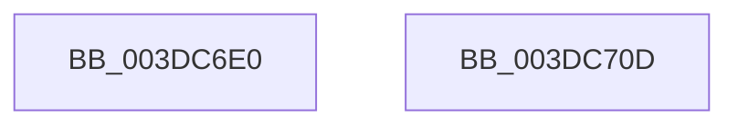

# HalRealAllocateAdapterChannelV2

- RVA: `0x003DC6E0`–`0x003DC70E` (길이 `46` bytes)
- VA: `0x00000001403DC6E0`
- 실행 섹션: `.text`
- PDB 이름 있음: `예`; PDB Function 태그: `아니요`
- unwind 정보 RVA: `0x0005C788`
- 디코드: `11`개 명령, `46/46` bytes 표시
- 미해석 바이트: `0` (있으면 어셈블리에 `.byte`로 보존)

> 이 문서는 커널 이미지의 기계어와 PDB 기호를 분석해 생성했습니다. 4번과 5번은 함수 원형과 자료형을 바이너리 사용 방식에서 추정한 C 해석이며 원본 소스 복구 결과는 아닙니다.

## 1. Dependencies

- 직접 호출 지점: **1**; 고유 호출 대상: **1**
- 직접 호출자로 확인된 함수: **0**
- RIP 상대 이미지 참조: **0**

### Outgoing calls
- `0x003DC703` → [HalAllocateAdapterChannelV2](HalAllocateAdapterChannelV2_function_003DC714.md) (function, `0x003DC714`)

### Direct callers
- 이 함수 시작 RVA로 연결되는 직접 call은 확인되지 않았습니다. 간접 호출은 완전히 역산할 수 없습니다.

### Static image references
- 디코드된 RIP-relative 메모리 참조가 없습니다.

## 2. Other-region calls and transfers

- 다른 실행 섹션으로 향하는 call: **0**
- 별도 외부 분기/꼬리 이동을 확인하지 못했습니다.

## 3. Assembly (complete function range)

```asm
003DC6E0  48 83 EC 28                     sub rsp, 0x28
003DC6E4  48 89 92 80 00 00 00            mov qword ptr [rdx + 0x80], rdx
003DC6EB  48 8B 42 20                     mov rax, qword ptr [rdx + 0x20]
003DC6EF  48 89 82 88 00 00 00            mov qword ptr [rdx + 0x88], rax
003DC6F6  48 8B 44 24 50                  mov rax, qword ptr [rsp + 0x50]
003DC6FB  48 89 42 70                     mov qword ptr [rdx + 0x70], rax
003DC6FF  48 83 C2 50                     add rdx, 0x50
003DC703  E8 0C 00 00 00                  call 0x1403dc714
003DC708  48 83 C4 28                     add rsp, 0x28
003DC70C  C3                              ret
003DC70D  CC                              int3
```

## 4. C-style interpretation (structured pseudocode)

```c
__int64 __fastcall HalRealAllocateAdapterChannelV2(__int64 a1, __int64 a2, __int64 a3, __int64 a4, __int64 a5)
{
    __int64 result;
    __int64 v_rsp;

    v_rsp = (v_rsp) - (40);
    *(unsigned __int64 *)(a2 + 128) = a2;
    *(unsigned __int64 *)(a2 + 136) = *(unsigned __int64 *)(a2 + 32);
    *(unsigned __int64 *)(a2 + 112) = a5;
    a2 = (a2) + (80);
    result = HalAllocateAdapterChannelV2(a1, a2, a3, a4);
    v_rsp = (v_rsp) + (40);
    return result;
}
```

## 5. (Beta) C Style

```c
int64_t HalRealAllocateAdapterChannelV2(int64_t Arg1, void *Arg2, int64_t Arg3, int64_t Arg4, int64_t Arg5)
{
    uint8_t *arg2 = (uint8_t *)Arg2;

    int64_t result;
    int64_t local_rsp;

    local_rsp = (local_rsp) - (40);
    *(void **)(arg2 + 0x80) = Arg2;
    *(uint64_t *)(arg2 + 0x88) = *(uint64_t *)(arg2 + 0x20);
    *(uint64_t *)(arg2 + 0x70) = Arg5;
    Arg2 = (Arg2) + (80);
    result = HalAllocateAdapterChannelV2(Arg1, Arg2, Arg3, Arg4);
    local_rsp = (local_rsp) + (40);
    return result;
}
```

### 관측된 메모리 오프셋

구조체 형식이 확인되지 않은 접근은 인자 기준의 오프셋으로만 기록했습니다.

| 기준 인자 | 오프셋 표현 | 폭 (bit) | 접근 |
|---|---:|---:|---|
| `Arg2` | `+ 0x20` | `64` | `R` |
| `Arg2` | `+ 0x70` | `64` | `W` |
| `Arg2` | `+ 0x80` | `64` | `W` |
| `Arg2` | `+ 0x88` | `64` | `W` |

## 6. Execution-region graph

[열기: 2D/3D 그래프와 함수 탐색 컨트롤 패널](../../../control-panel.html?section=text&rva=0x003DC6E0&view=graph)

- 2D 그래프는 위에서 아래로 흐르고, 3D 그래프는 빈 공간을 드래그해 회전합니다. Shift+드래그는 이동, 휠은 확대·축소, 함수 노드 선택은 대상 보고서 이동입니다.

### Static fallback


