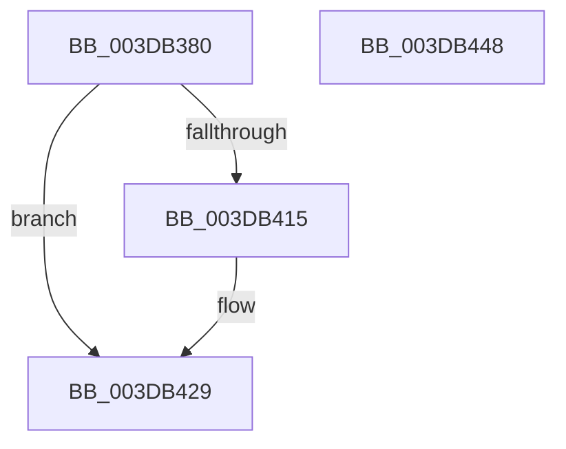

# HalpAllocateAdapterCallbackV3

- RVA: `0x003DB380`–`0x003DB449` (길이 `201` bytes)
- VA: `0x00000001403DB380`
- 실행 섹션: `.text`
- PDB 이름 있음: `예`; PDB Function 태그: `아니요`
- unwind 정보 RVA: `0x00094030`
- 디코드: `54`개 명령, `201/201` bytes 표시
- 미해석 바이트: `0` (있으면 어셈블리에 `.byte`로 보존)

> 이 문서는 커널 이미지의 기계어와 PDB 기호를 분석해 생성했습니다. 4번과 5번은 함수 원형과 자료형을 바이너리 사용 방식에서 추정한 C 해석이며 원본 소스 복구 결과는 아닙니다.

## 1. Dependencies

- 직접 호출 지점: **2**; 고유 호출 대상: **2**
- 직접 호출자로 확인된 함수: **2**
- RIP 상대 이미지 참조: **0**

### Outgoing calls
- `0x003DB407` → [HalMapTransferEx](HalMapTransferEx_function_003DB450.md) (function, `0x003DB450`)
- `0x003DB424` → [guard_dispatch_icall](../6B/guard_dispatch_icall_function_006BAAD0.md) (function, `0x006BAAD0`)

### Direct callers
- [HalpBuildScatterGatherList](HalpBuildScatterGatherList_function_003DBAF8.md) at `0x003DBD26`
- [sub_006EA022](../6E/Unknown_function_006EA022.md) at `0x006EA069`

### Static image references
- 디코드된 RIP-relative 메모리 참조가 없습니다.

## 2. Other-region calls and transfers

- 다른 실행 섹션으로 향하는 call: **0**
- 별도 외부 분기/꼬리 이동을 확인하지 못했습니다.

## 3. Assembly (complete function range)

```asm
003DB380  4C 8B DC                        mov r11, rsp
003DB383  49 89 5B 08                     mov qword ptr [r11 + 8], rbx
003DB387  49 89 6B 10                     mov qword ptr [r11 + 0x10], rbp
003DB38B  49 89 73 20                     mov qword ptr [r11 + 0x20], rsi
003DB38F  57                              push rdi
003DB390  41 56                           push r14
003DB392  41 57                           push r15
003DB394  48 83 EC 60                     sub rsp, 0x60
003DB398  49 83 63 D8 00                  and qword ptr [r11 - 0x28], 0
003DB39D  49 8B D9                        mov rbx, r9
003DB3A0  41 8B 41 28                     mov eax, dword ptr [r9 + 0x28]
003DB3A4  48 8B EA                        mov rbp, rdx
003DB3A7  49 83 63 D0 00                  and qword ptr [r11 - 0x30], 0
003DB3AC  4C 8B F1                        mov r14, rcx
003DB3AF  49 8B 51 08                     mov rdx, qword ptr [r9 + 8]
003DB3B3  49 8B B9 A0 00 00 00            mov rdi, qword ptr [r9 + 0xa0]
003DB3BA  49 8B 71 78                     mov rsi, qword ptr [r9 + 0x78]
003DB3BE  4D 8B B9 80 00 00 00            mov r15, qword ptr [r9 + 0x80]
003DB3C5  48 8B 8B 90 00 00 00            mov rcx, qword ptr [rbx + 0x90]
003DB3CC  4D 89 41 18                     mov qword ptr [r9 + 0x18], r8
003DB3D0  4D 8B 49 20                     mov r9, qword ptr [r9 + 0x20]
003DB3D4  41 89 43 18                     mov dword ptr [r11 + 0x18], eax
003DB3D8  8B 42 2C                        mov eax, dword ptr [rdx + 0x2c]
003DB3DB  4C 2B C8                        sub r9, rax
003DB3DE  8B 83 9C 00 00 00               mov eax, dword ptr [rbx + 0x9c]
003DB3E4  4C 2B 4A 20                     sub r9, qword ptr [rdx + 0x20]
003DB3E8  89 44 24 40                     mov dword ptr [rsp + 0x40], eax
003DB3EC  8A 83 98 00 00 00               mov al, byte ptr [rbx + 0x98]
003DB3F2  49 89 7B C0                     mov qword ptr [r11 - 0x40], rdi
003DB3F6  88 44 24 30                     mov byte ptr [rsp + 0x30], al
003DB3FA  49 8D 43 18                     lea rax, [r11 + 0x18]
003DB3FE  49 89 43 B0                     mov qword ptr [r11 - 0x50], rax
003DB402  83 64 24 20 00                  and dword ptr [rsp + 0x20], 0
003DB407  E8 44 00 00 00                  call 0x1403db450
003DB40C  48 89 5F 08                     mov qword ptr [rdi + 8], rbx
003DB410  48 85 F6                        test rsi, rsi
003DB413  74 14                           je 0x1403db429
003DB415  4D 8B CF                        mov r9, r15
003DB418  4C 8B C7                        mov r8, rdi
003DB41B  48 8B D5                        mov rdx, rbp
003DB41E  49 8B CE                        mov rcx, r14
003DB421  48 8B C6                        mov rax, rsi
003DB424  E8 A7 F6 2D 00                  call 0x1406baad0
003DB429  4C 8D 5C 24 60                  lea r11, [rsp + 0x60]
003DB42E  B8 03 00 00 00                  mov eax, 3
003DB433  49 8B 5B 20                     mov rbx, qword ptr [r11 + 0x20]
003DB437  49 8B 6B 28                     mov rbp, qword ptr [r11 + 0x28]
003DB43B  49 8B 73 38                     mov rsi, qword ptr [r11 + 0x38]
003DB43F  49 8B E3                        mov rsp, r11
003DB442  41 5F                           pop r15
003DB444  41 5E                           pop r14
003DB446  5F                              pop rdi
003DB447  C3                              ret
003DB448  CC                              int3
```

## 4. C-style interpretation (structured pseudocode)

```c
__int64 __fastcall HalpAllocateAdapterCallbackV3(__int64 a1, __int64 a2, __int64 a3, __int64 a4)
{
    __int64 result;
    __int64 v_rsp;
    unsigned __int64 v_stack_m18;
    unsigned int v_stack_m38;
    unsigned __int8 v_stack_m48;
    unsigned int v_stack_m58;

    *(unsigned __int64 *)(v_rsp + 8) = v_rbx;
    *(unsigned __int64 *)(v_rsp + 16) = v_rbp;
    *(unsigned __int64 *)(v_rsp + 32) = v_rsi;
    v_rsp = (v_rsp) - (96);
    *(unsigned __int64 *)(a4 + 24) = a3;
    *(unsigned int *)(v_rsp + 24) = (unsigned int)((unsigned int)(*(unsigned int *)(a4 + 40)));
    a4 = (*(unsigned __int64 *)(a4 + 32)) - ((unsigned int)(*(unsigned int *)(*(unsigned __int64 *)(a4 + 8) + 44)));
    a4 = (a4) - (*(unsigned __int64 *)(*(unsigned __int64 *)(a4 + 8) + 32));
    v_stack_m38 = (unsigned int)((unsigned int)(*(unsigned int *)(a4 + 156)));
    *(unsigned __int64 *)(v_rsp - 64) = *(unsigned __int64 *)(a4 + 160);
    v_stack_m48 = (unsigned __int8)(*(unsigned __int8 *)(a4 + 152));
    *(unsigned __int64 *)(v_rsp - 80) = v_rsp + 24;
    result = HalMapTransferEx(*(unsigned __int64 *)(a4 + 144), *(unsigned __int64 *)(a4 + 8), a3, a4);
    *(unsigned __int64 *)(*(unsigned __int64 *)(a4 + 160) + 8) = a4;
    if (*(unsigned __int64 *)(a4 + 120) != 0) {
        a4 = *(unsigned __int64 *)(a4 + 128);
        a3 = *(unsigned __int64 *)(a4 + 160);
        a2 = a2;
        a1 = a1;
        result = *(unsigned __int64 *)(a4 + 120);
        result = guard_dispatch_icall(a1, a2, a3, a4);
    }
    return 3;
}
```

## 5. (Beta) C Style

```c
int64_t HalpAllocateAdapterCallbackV3(int64_t Arg1, int64_t Arg2, int64_t Arg3, void *Arg4)
{
    uint8_t *arg4 = (uint8_t *)Arg4;

    int64_t result;
    int64_t local_rsp;
    uint64_t v_stack_m18;
    uint32_t v_stack_m38;
    uint8_t v_stack_m48;
    uint32_t v_stack_m58;

    *(uint64_t *)(local_rsp + 0x8) = local_rbx;
    *(uint64_t *)(local_rsp + 0x10) = local_rbp;
    *(uint64_t *)(local_rsp + 0x20) = local_rsi;
    local_rsp = (local_rsp) - (96);
    *(uint64_t *)(arg4 + 0x18) = Arg3;
    *(uint32_t *)(local_rsp + 0x18) = (uint32_t)((uint32_t)(*(uint32_t *)(arg4 + 0x28)));
    Arg4 = (*(uint64_t *)(arg4 + 0x20)) - ((uint32_t)(*(uint32_t *)(*(uint64_t *)(arg4 + 0x8) + 0x2C)));
    Arg4 = (Arg4) - (*(uint64_t *)(*(uint64_t *)(arg4 + 0x8) + 0x20));
    v_stack_m38 = (uint32_t)((uint32_t)(*(uint32_t *)(arg4 + 0x9C)));
    *(uint64_t *)(local_rsp - 0x40) = *(uint64_t *)(arg4 + 0xA0);
    v_stack_m48 = (uint8_t)(*(uint8_t *)(arg4 + 0x98));
    *(uint64_t *)(local_rsp - 0x50) = local_rsp + 24;
    result = HalMapTransferEx(*(uint64_t *)(arg4 + 0x90), *(uint64_t *)(arg4 + 0x8), Arg3, Arg4);
    *(void **)(*(uint64_t *)(arg4 + 0xA0) + 0x8) = Arg4;
    if (*(uint64_t *)(arg4 + 0x78) != 0) {
        Arg4 = *(uint64_t *)(arg4 + 0x80);
        Arg3 = *(uint64_t *)(arg4 + 0xA0);
        Arg2 = Arg2;
        Arg1 = Arg1;
        result = *(uint64_t *)(arg4 + 0x78);
        result = guard_dispatch_icall(Arg1, Arg2, Arg3, Arg4);
    }
    return 3;
}
```

### 관측된 메모리 오프셋

구조체 형식이 확인되지 않은 접근은 인자 기준의 오프셋으로만 기록했습니다.

| 기준 인자 | 오프셋 표현 | 폭 (bit) | 접근 |
|---|---:|---:|---|
| `Arg4` | `+ 0x8` | `64` | `R` |
| `Arg4` | `+ 0x18` | `64` | `W` |
| `Arg4` | `+ 0x20` | `64` | `R` |
| `Arg4` | `+ 0x28` | `32` | `R` |
| `Arg4` | `+ 0x78` | `64` | `R` |
| `Arg4` | `+ 0x80` | `64` | `R` |
| `Arg4` | `+ 0x90` | `64` | `R` |
| `Arg4` | `+ 0x98` | `8` | `R` |
| `Arg4` | `+ 0x9C` | `32` | `R` |
| `Arg4` | `+ 0xA0` | `64` | `R` |

## 6. Execution-region graph

[열기: 2D/3D 그래프와 함수 탐색 컨트롤 패널](../../../control-panel.html?section=text&rva=0x003DB380&view=graph)

- 2D 그래프는 위에서 아래로 흐르고, 3D 그래프는 빈 공간을 드래그해 회전합니다. Shift+드래그는 이동, 휠은 확대·축소, 함수 노드 선택은 대상 보고서 이동입니다.

### Static fallback


