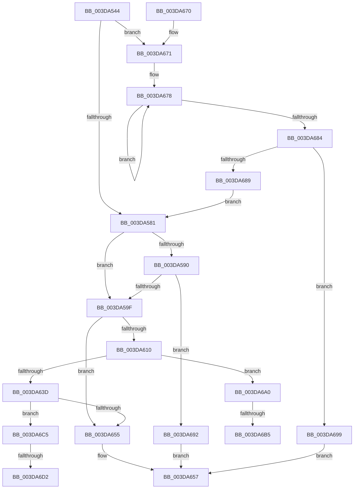

# HalpAllocateAdapterChannel

- RVA: `0x003DA544`–`0x003DA6E3` (길이 `415` bytes)
- VA: `0x00000001403DA544`
- 실행 섹션: `.text`
- PDB 이름 있음: `예`; PDB Function 태그: `예`
- unwind 정보 RVA: `0x00072DBC`
- 디코드: `113`개 명령, `415/415` bytes 표시
- 미해석 바이트: `0` (있으면 어셈블리에 `.byte`로 보존)

> 이 문서는 커널 이미지의 기계어와 PDB 기호를 분석해 생성했습니다. 4번과 5번은 함수 원형과 자료형을 바이너리 사용 방식에서 추정한 C 해석이며 원본 소스 복구 결과는 아닙니다.

## 1. Dependencies

- 직접 호출 지점: **4**; 고유 호출 대상: **4**
- 직접 호출자로 확인된 함수: **4**
- RIP 상대 이미지 참조: **1**

### Outgoing calls
- `0x003DA607` → [HalpDmaStartWcb](HalpDmaStartWcb_function_003DA6EC.md) (function, `0x003DA6EC`)
- `0x003DA645` → [HalpAllocateDmaResourcesInternal](HalpAllocateDmaResourcesInternal_function_003DA7C4.md) (function, `0x003DA7C4`)
- `0x003DA6BA` → [KiRaiseIrqlProcessIrqlFlags](../4F/KiRaiseIrqlProcessIrqlFlags_function_004F56FC.md) (function, `0x004F56FC`)
- `0x003DA6D8` → [KiLowerIrqlProcessIrqlFlags](../4F/KiLowerIrqlProcessIrqlFlags_function_004F5698.md) (function, `0x004F5698`)

### Direct callers
- [HalAllocateAdapterChannelEx](HalAllocateAdapterChannelEx_function_003DA260.md) at `0x003DA2E7`
- [HalpBuildScatterGatherList](HalpBuildScatterGatherList_function_003DBAF8.md) at `0x003DBCB4`
- [HalpBuildScatterGatherList](HalpBuildScatterGatherList_function_003DBAF8.md) at `0x003DBD0A`
- [HalAllocateAdapterChannel](../53/HalAllocateAdapterChannel_function_0053F310.md) at `0x0053F351`
- [HalRealAllocateAdapterChannelV3](../55/HalRealAllocateAdapterChannelV3_function_00553090.md) at `0x005530CF`

### Static image references
- `0x003DA6A8` → RVA `0x00FC6D20` (`ALMOSTRO`; read)

## 2. Other-region calls and transfers

- 다른 실행 섹션으로 향하는 call: **0**
- call이 아닌 외부 분기/꼬리 이동: **4**
  - `0x003DA6AF` → [sub_006E9B28](../6E/Unknown_function_006E9B28.md) (`tail-transfer`)
  - `0x003DA6C0` → [sub_006E9B28](../6E/Unknown_function_006E9B28.md) (`tail-transfer`)
  - `0x003DA6CC` → [sub_006E9B28 + 0x8](../6E/Unknown_function_006E9B28.md) (`tail-transfer`)
  - `0x003DA6DE` → [sub_006E9B28 + 0x8](../6E/Unknown_function_006E9B28.md) (`tail-transfer`)

## 3. Assembly (complete function range)

```asm
003DA544  48 89 5C 24 08                  mov qword ptr [rsp + 8], rbx
003DA549  48 89 6C 24 10                  mov qword ptr [rsp + 0x10], rbp
003DA54E  48 89 74 24 18                  mov qword ptr [rsp + 0x18], rsi
003DA553  57                              push rdi
003DA554  41 56                           push r14
003DA556  41 57                           push r15
003DA558  48 83 EC 20                     sub rsp, 0x20
003DA55C  4C 8D 52 14                     lea r10, [rdx + 0x14]
003DA560  41 BF 02 00 00 00               mov r15d, 2
003DA566  41 8B 02                        mov eax, dword ptr [r10]
003DA569  48 8B F9                        mov rdi, rcx
003DA56C  45 8B D9                        mov r11d, r9d
003DA56F  41 8B E8                        mov ebp, r8d
003DA572  48 8B DA                        mov rbx, rdx
003DA575  49 8B CA                        mov rcx, r10
003DA578  41 84 C7                        test r15b, al
003DA57B  0F 85 F0 00 00 00               jne 0x1403da671
003DA581  45 33 F6                        xor r14d, r14d
003DA584  4D 8B CA                        mov r9, r10
003DA587  44 38 B7 B8 01 00 00            cmp byte ptr [rdi + 0x1b8], r14b
003DA58E  74 0F                           je 0x1403da59f
003DA590  4C 8B C9                        mov r9, rcx
003DA593  3B AF E8 00 00 00               cmp ebp, dword ptr [rdi + 0xe8]
003DA599  0F 87 F3 00 00 00               ja 0x1403da692
003DA59F  45 8B 02                        mov r8d, dword ptr [r10]
003DA5A2  48 8B CF                        mov rcx, rdi
003DA5A5  8B 54 24 60                     mov edx, dword ptr [rsp + 0x60]
003DA5A9  41 8B C0                        mov eax, r8d
003DA5AC  41 83 C8 04                     or r8d, 4
003DA5B0  83 E0 FB                        and eax, 0xfffffffb
003DA5B3  41 85 D7                        test r15d, edx
003DA5B6  44 0F 44 C0                     cmove r8d, eax
003DA5BA  48 8B 44 24 68                  mov rax, qword ptr [rsp + 0x68]
003DA5BF  45 89 02                        mov dword ptr [r10], r8d
003DA5C2  83 E2 01                        and edx, 1
003DA5C5  41 81 E0 FF 0F 00 00            and r8d, 0xfff
003DA5CC  48 89 43 18                     mov qword ptr [rbx + 0x18], rax
003DA5D0  41 C1 E3 0C                     shl r11d, 0xc
003DA5D4  8B C2                           mov eax, edx
003DA5D6  45 0B C3                        or r8d, r11d
003DA5D9  89 6B 28                        mov dword ptr [rbx + 0x28], ebp
003DA5DC  F7 D8                           neg eax
003DA5DE  C7 43 10 01 00 00 00            mov dword ptr [rbx + 0x10], 1
003DA5E5  41 8B C0                        mov eax, r8d
003DA5E8  1B F6                           sbb esi, esi
003DA5EA  41 83 C8 01                     or r8d, 1
003DA5EE  83 E0 FE                        and eax, 0xfffffffe
003DA5F1  81 E6 9A 00 00 C0               and esi, 0xc000009a
003DA5F7  85 D2                           test edx, edx
003DA5F9  48 8B D3                        mov rdx, rbx
003DA5FC  44 0F 44 C0                     cmove r8d, eax
003DA600  45 89 01                        mov dword ptr [r9], r8d
003DA603  41 80 E0 01                     and r8b, 1
003DA607  E8 E0 00 00 00                  call 0x1403da6ec
003DA60C  84 C0                           test al, al
003DA60E  74 45                           je 0x1403da655
003DA610  89 AF F8 00 00 00               mov dword ptr [rdi + 0xf8], ebp
003DA616  41 8A EE                        mov bpl, r14b
003DA619  48 89 9F 60 01 00 00            mov qword ptr [rdi + 0x160], rbx
003DA620  41 8A DE                        mov bl, r14b
003DA623  C7 87 84 01 00 00 01 00 00 00   mov dword ptr [rdi + 0x184], 1
003DA62D  44 89 B7 70 02 00 00            mov dword ptr [rdi + 0x270], r14d
003DA634  44 0F 20 C0                     mov rax, cr8
003DA638  41 3A C7                        cmp al, r15b
003DA63B  72 63                           jb 0x1403da6a0
003DA63D  45 33 C0                        xor r8d, r8d
003DA640  B2 01                           mov dl, 1
003DA642  48 8B CF                        mov rcx, rdi
003DA645  E8 7A 01 00 00                  call 0x1403da7c4
003DA64A  84 C0                           test al, al
003DA64C  41 0F 45 F6                     cmovne esi, r14d
003DA650  40 84 ED                        test bpl, bpl
003DA653  75 70                           jne 0x1403da6c5
003DA655  8B C6                           mov eax, esi
003DA657  48 8B 5C 24 40                  mov rbx, qword ptr [rsp + 0x40]
003DA65C  48 8B 6C 24 48                  mov rbp, qword ptr [rsp + 0x48]
003DA661  48 8B 74 24 50                  mov rsi, qword ptr [rsp + 0x50]
003DA666  48 83 C4 20                     add rsp, 0x20
003DA66A  41 5F                           pop r15
003DA66C  41 5E                           pop r14
003DA66E  5F                              pop rdi
003DA66F  C3                              ret
003DA670  CC                              int3
003DA671  0F 0D 4A F8                     prefetchw byte ptr [rdx - 8]
003DA675  8B 42 F8                        mov eax, dword ptr [rdx - 8]
003DA678  8B C8                           mov ecx, eax
003DA67A  83 C9 04                        or ecx, 4
003DA67D  F0 0F B1 4A F8                  lock cmpxchg dword ptr [rdx - 8], ecx
003DA682  75 F4                           jne 0x1403da678
003DA684  41 84 C7                        test r15b, al
003DA687  75 10                           jne 0x1403da699
003DA689  48 8D 4A 14                     lea rcx, [rdx + 0x14]
003DA68D  E9 EF FE FF FF                  jmp 0x1403da581
003DA692  B8 9A 00 00 C0                  mov eax, 0xc000009a
003DA697  EB BE                           jmp 0x1403da657
003DA699  B8 20 01 00 C0                  mov eax, 0xc0000120
003DA69E  EB B7                           jmp 0x1403da657
003DA6A0  44 0F 20 C3                     mov rbx, cr8
003DA6A4  45 0F 22 C7                     mov cr8, r15
003DA6A8  44 39 35 71 C6 BE 00            cmp dword ptr [rip + 0xbec671], r14d
003DA6AF  0F 84 73 F4 30 00               je 0x1406e9b28
003DA6B5  41 8A D7                        mov dl, r15b
003DA6B8  8A CB                           mov cl, bl
003DA6BA  E8 3D B0 11 00                  call 0x1404f56fc
003DA6BF  90                              nop
003DA6C0  E9 63 F4 30 00                  jmp 0x1406e9b28
003DA6C5  44 39 35 54 C6 BE 00            cmp dword ptr [rip + 0xbec654], r14d
003DA6CC  0F 84 5E F4 30 00               je 0x1406e9b30
003DA6D2  44 0F 20 C1                     mov rcx, cr8
003DA6D6  8A D3                           mov dl, bl
003DA6D8  E8 BB AF 11 00                  call 0x1404f5698
003DA6DD  90                              nop
003DA6DE  E9 4D F4 30 00                  jmp 0x1406e9b30
```

## 4. C-style interpretation (structured pseudocode)

```c
__int64 __fastcall HalpAllocateAdapterChannel(__int64 a1, __int64 a2, int a3, int a4, unsigned int a5, __int64 a6)
{
    __int64 result;
    __int64 v_r11;
    __int64 v_r14;
    __int64 v_rsi;
    __int64 v_rsp;
    unsigned __int64 v_stack_p10;
    unsigned __int64 v_stack_p18;
    unsigned __int64 v_stack_p8;

    v_stack_p8 = v_rbx;
    v_stack_p10 = v_rbp;
    v_stack_p18 = v_rsi;
    v_rsp = (v_rsp) - (32);
    if (((2) & ((unsigned __int8)((unsigned int)(*(unsigned int *)(a2 + 20))))) != 0) goto loc_003DA671;
loc_003DA581:
    v_r14 = 0;
    if ((*(unsigned __int8 *)(a1 + 440)) == 0) goto loc_003DA59F;
    if (((unsigned int)((unsigned int)(a3))) > (*(unsigned int *)(a1 + 232))) goto loc_003DA692;
loc_003DA59F:
    a3 = (unsigned int)(((unsigned int)(*(unsigned int *)(a2 + 20))) | (4));
    result = (unsigned int)(((unsigned int)((unsigned int)((unsigned int)(*(unsigned int *)(a2 + 20))))) & (0xFFFFFFFBULL));
    if (((2) & ((unsigned int)((unsigned int)(a5)))) == 0) { a3 = (unsigned int)(result); }
    *(unsigned int *)(a2 + 20) = a3;
    a2 = (unsigned int)(((unsigned int)(a5)) & (1));
    a3 = (unsigned int)((a3) & (0xFFFULL));
    *(unsigned __int64 *)(a2 + 24) = a6;
    v_r11 = (unsigned int)(((unsigned int)(a4)) << (12));
    a3 = (unsigned int)((a3) | ((unsigned int)(v_r11)));
    *(unsigned int *)(a2 + 40) = (unsigned int)((unsigned int)(a3));
    result = (unsigned int)(-((unsigned int)((unsigned int)(a2))));
    *(unsigned int *)(a2 + 16) = 1;
    a3 = (unsigned int)((a3) | (1));
    result = (unsigned int)(((unsigned int)(a3)) & (0xFFFFFFFEULL));
    v_rsi = (unsigned int)((v_rsi) & (0xC000009AULL));
    if ((unsigned int)(a2) == 0) { a3 = (unsigned int)(result); }
    *(unsigned int *)(a2 + 20) = a3;
    a3 = (unsigned __int8)((a3) & (1));
    result = HalpDmaStartWcb(a1, a2, a3, a2 + 20);
    if ((unsigned __int8)(result) == 0) goto loc_003DA655;
    *(unsigned int *)(a1 + 248) = (unsigned int)((unsigned int)(a3));
    *(unsigned __int64 *)(a1 + 352) = a2;
    *(unsigned int *)(a1 + 388) = 1;
    *(unsigned int *)(a1 + 624) = 0;
    if (((unsigned __int8)(v_cr8)) < 2) goto loc_003DA6A0;
    a3 = 0;
    result = HalpAllocateDmaResourcesInternal(a1, 1, a3, a2 + 20);
    if ((unsigned __int8)(result) != 0) { v_rsi = 0; }
    if (0 != 0) goto loc_003DA6C5;
loc_003DA655:
loc_003DA657:
    v_rsp = (v_rsp) + (32);
    return (unsigned int)((unsigned int)(v_rsi));
loc_003DA671:
loc_003DA678:
    a1 = (unsigned int)(((unsigned int)((unsigned int)((unsigned int)(*(unsigned int *)(1 - 8))))) | (4));
    if (condition_is_not_equal) goto loc_003DA678;
    if (((2) & ((unsigned __int8)((unsigned int)(*(unsigned int *)(1 - 8))))) != 0) goto loc_003DA699;
    goto loc_003DA581;
loc_003DA692:
    goto loc_003DA657;
loc_003DA699:
    goto loc_003DA657;
loc_003DA6A0:
    result = KiRaiseIrqlProcessIrqlFlags((unsigned __int8)(v_cr8), 2, a3, a2 + 20);
loc_003DA6C5:
    result = KiLowerIrqlProcessIrqlFlags(2, (unsigned __int8)(v_cr8), a3, a2 + 20);
}
```

## 5. (Beta) C Style

```c
int64_t HalpAllocateAdapterChannel(void *Arg1, void *Arg2, int32_t Arg3, int32_t Arg4, uint32_t Arg5, int64_t Arg6)
{
    uint8_t *arg1 = (uint8_t *)Arg1;
    uint8_t *arg2 = (uint8_t *)Arg2;

    int64_t result;
    int64_t local_r11;
    int64_t local_r14;
    int64_t local_rsi;
    int64_t local_rsp;
    uint64_t v_stack_p10;
    uint64_t v_stack_p18;
    uint64_t v_stack_p8;

    v_stack_p8 = local_rbx;
    v_stack_p10 = local_rbp;
    v_stack_p18 = local_rsi;
    local_rsp = (local_rsp) - (32);
    if (((2) & ((uint8_t)((uint32_t)(*(uint32_t *)(arg2 + 0x14))))) != 0) goto loc_003DA671;
loc_003DA581:
    local_r14 = 0;
    if ((*(uint8_t *)(arg1 + 0x1B8)) == 0) goto loc_003DA59F;
    if (((uint32_t)((uint32_t)(Arg3))) > (*(uint32_t *)(arg1 + 0xE8))) goto loc_003DA692;
loc_003DA59F:
    Arg3 = (uint32_t)(((uint32_t)(*(uint32_t *)(arg2 + 0x14))) | (4));
    result = (uint32_t)(((uint32_t)((uint32_t)((uint32_t)(*(uint32_t *)(arg2 + 0x14))))) & (0xFFFFFFFBULL));
    if (((2) & ((uint32_t)((uint32_t)(Arg5)))) == 0) { Arg3 = (uint32_t)(result); }
    *(uint32_t *)(arg2 + 0x14) = Arg3;
    Arg2 = (uint32_t)(((uint32_t)(Arg5)) & (1));
    Arg3 = (uint32_t)((Arg3) & (0xFFFULL));
    *(uint64_t *)(arg2 + 0x18) = Arg6;
    local_r11 = (uint32_t)(((uint32_t)(Arg4)) << (12));
    Arg3 = (uint32_t)((Arg3) | ((uint32_t)(local_r11)));
    *(uint32_t *)(arg2 + 0x28) = (uint32_t)((uint32_t)(Arg3));
    result = (uint32_t)(-((uint32_t)((uint32_t)(Arg2))));
    *(uint32_t *)(arg2 + 0x10) = 1;
    Arg3 = (uint32_t)((Arg3) | (1));
    result = (uint32_t)(((uint32_t)(Arg3)) & (0xFFFFFFFEULL));
    local_rsi = (uint32_t)((local_rsi) & (0xC000009AULL));
    if ((uint32_t)(Arg2) == 0) { Arg3 = (uint32_t)(result); }
    *(uint32_t *)(arg2 + 0x14) = Arg3;
    Arg3 = (uint8_t)((Arg3) & (1));
    result = HalpDmaStartWcb(Arg1, Arg2, Arg3, Arg2 + 20);
    if ((uint8_t)(result) == 0) goto loc_003DA655;
    *(uint32_t *)(arg1 + 0xF8) = (uint32_t)((uint32_t)(Arg3));
    *(void **)(arg1 + 0x160) = Arg2;
    *(uint32_t *)(arg1 + 0x184) = 1;
    *(uint32_t *)(arg1 + 0x270) = 0;
    if (((uint8_t)(v_cr8)) < 2) goto loc_003DA6A0;
    Arg3 = 0;
    result = HalpAllocateDmaResourcesInternal(Arg1, 1, Arg3, Arg2 + 20);
    if ((uint8_t)(result) != 0) { local_rsi = 0; }
    if (0 != 0) goto loc_003DA6C5;
loc_003DA655:
loc_003DA657:
    local_rsp = (local_rsp) + (32);
    return (uint32_t)((uint32_t)(local_rsi));
loc_003DA671:
loc_003DA678:
    Arg1 = (uint32_t)(((uint32_t)((uint32_t)((uint32_t)(*(uint32_t *)(1 - 0x8))))) | (4));
    if (condition_is_not_equal) goto loc_003DA678;
    if (((2) & ((uint8_t)((uint32_t)(*(uint32_t *)(1 - 0x8))))) != 0) goto loc_003DA699;
    goto loc_003DA581;
loc_003DA692:
    goto loc_003DA657;
loc_003DA699:
    goto loc_003DA657;
loc_003DA6A0:
    result = KiRaiseIrqlProcessIrqlFlags((uint8_t)(v_cr8), 2, Arg3, Arg2 + 20);
loc_003DA6C5:
    result = KiLowerIrqlProcessIrqlFlags(2, (uint8_t)(v_cr8), Arg3, Arg2 + 20);
}
```

### 관측된 메모리 오프셋

구조체 형식이 확인되지 않은 접근은 인자 기준의 오프셋으로만 기록했습니다.

| 기준 인자 | 오프셋 표현 | 폭 (bit) | 접근 |
|---|---:|---:|---|
| `Arg1` | `+ 0xE8` | `32` | `R` |
| `Arg1` | `+ 0xF8` | `32` | `W` |
| `Arg1` | `+ 0x160` | `64` | `W` |
| `Arg1` | `+ 0x184` | `32` | `W` |
| `Arg1` | `+ 0x1B8` | `8` | `R` |
| `Arg1` | `+ 0x270` | `32` | `W` |
| `Arg2` | `- 0x8` | `8` | `R` |
| `Arg2` | `- 0x8` | `32` | `R` |
| `Arg2` | `+ 0x0` | `32` | `R` |
| `Arg2` | `+ 0x0` | `32` | `W` |
| `Arg2` | `+ 0x10` | `32` | `W` |
| `Arg2` | `+ 0x14` | `64` | `R` |
| `Arg2` | `+ 0x18` | `64` | `W` |
| `Arg2` | `+ 0x28` | `32` | `W` |

## 6. Execution-region graph

[열기: 2D/3D 그래프와 함수 탐색 컨트롤 패널](../../../control-panel.html?section=text&rva=0x003DA544&view=graph)

- 2D 그래프는 위에서 아래로 흐르고, 3D 그래프는 빈 공간을 드래그해 회전합니다. Shift+드래그는 이동, 휠은 확대·축소, 함수 노드 선택은 대상 보고서 이동입니다.

### Static fallback


